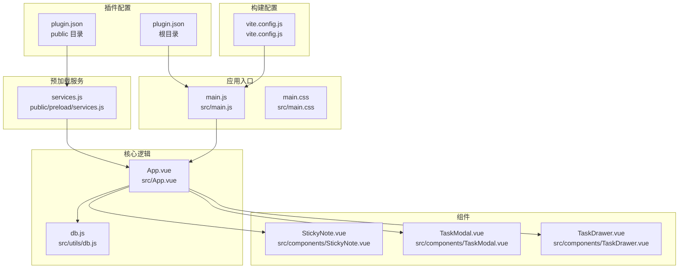
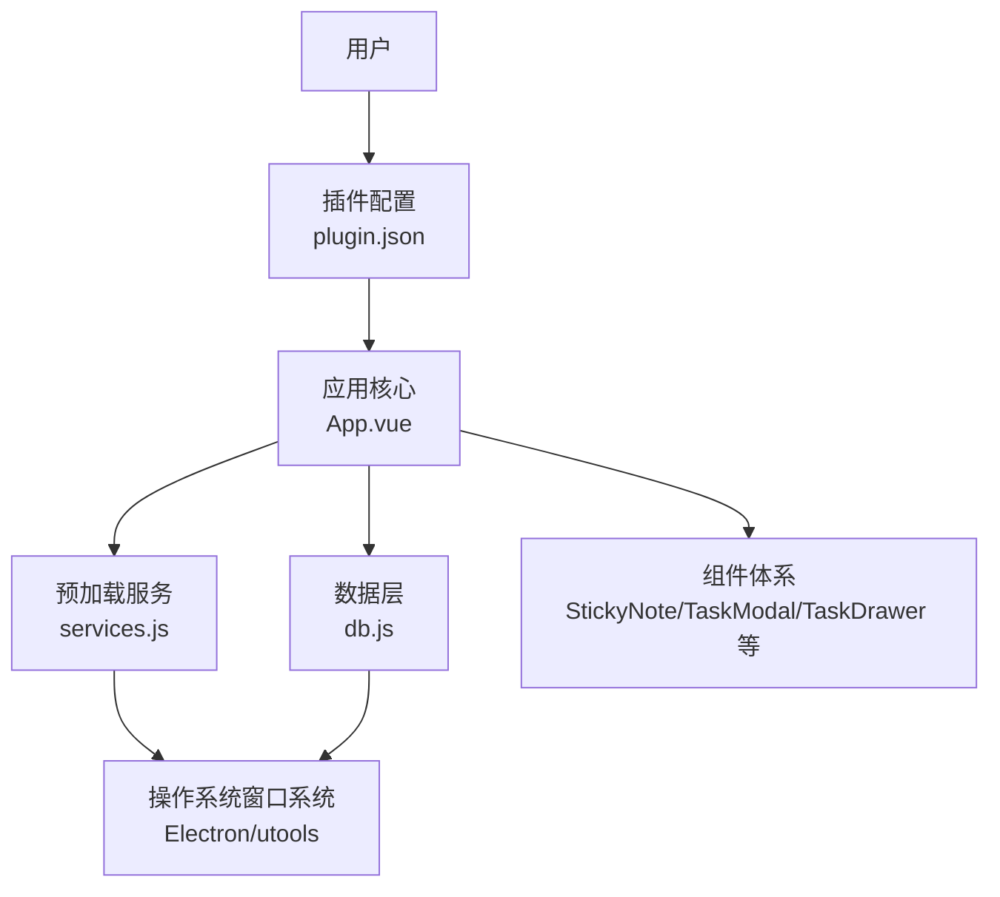
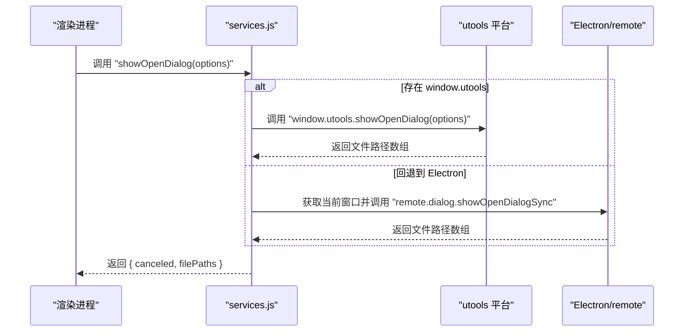
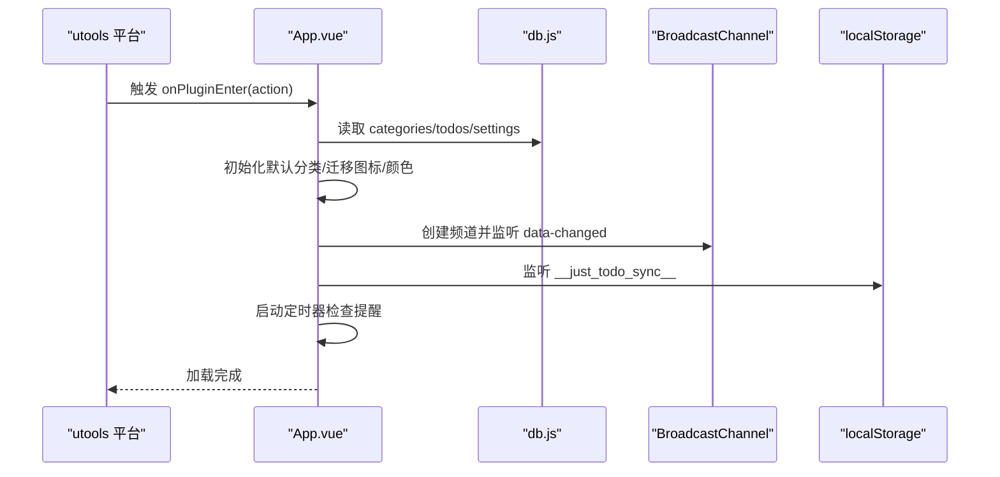
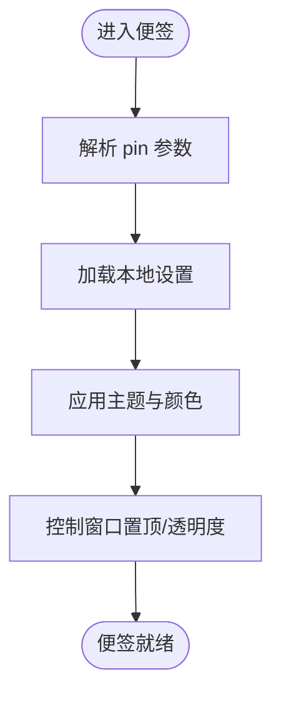
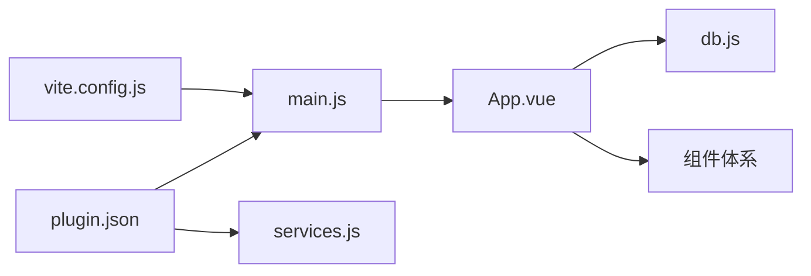

# utools 平台集成

<cite>
**本文引用的文件**
- [plugin.json](file://plugin.json)
- [plugin.json（public）](file://public/plugin.json)
- [services.js](file://public/preload/services.js)
- [package.json](file://package.json)
- [main.js](file://src/main.js)
- [App.vue](file://src/App.vue)
- [sticky.html](file://public/sticky.html)
- [db.js](file://src/utils/db.js)
- [vite.config.js](file://vite.config.js)
- [StickyNote.vue](file://src/components/StickyNote.vue)
- [TaskModal.vue](file://src/components/TaskModal.vue)
- [TaskDrawer.vue](file://src/components/TaskDrawer.vue)
- [main.css](file://src/main.css)
</cite>

## 目录
1. [简介](#简介)
2. [项目结构](#项目结构)
3. [核心组件](#核心组件)
4. [架构总览](#架构总览)
5. [详细组件分析](#详细组件分析)
6. [依赖关系分析](#依赖关系分析)
7. [性能考量](#性能考量)
8. [故障排查指南](#故障排查指南)
9. [结论](#结论)
10. [附录](#附录)

## 简介
本文件面向在 utools 平台集成 Just-Todo 插件的开发者与使用者，系统化说明插件配置文件结构、菜单与命令定义、快捷键与权限声明、预加载服务实现机制与 API 调用方式、桌面应用集成与生命周期管理、事件处理流程、平台 API 使用示例、最佳实践以及兼容性注意事项。内容基于仓库中实际源码进行提炼与可视化呈现，帮助读者快速理解并扩展该插件。

## 项目结构
该项目采用前端单页应用（SPA）与 utools 插件配置相结合的方式组织代码：
- 插件配置：位于根目录与 public 目录下的两个 plugin.json 文件，分别用于开发环境与打包后发布。
- 预加载服务：位于 public/preload/services.js，提供窗口控制、对话框、文件读写、网络请求、邮件发送等能力。
- 应用入口与样式：src/main.js 作为 Vue 应用入口；src/main.css 定义主题变量与样式。
- 核心业务逻辑：src/App.vue 负责状态管理、数据持久化、通知调度、广播同步等。
- 数据层：src/utils/db.js 封装了 utools.db 的读写接口，并在浏览器开发环境下提供本地存储回退。
- 组件体系：包含侧边栏、任务列表、日历视图、抽屉式编辑器、模态框、便签等。
- 构建配置：vite.config.js 定义构建产物分包策略与构建常量注入。

**图表来源**
- [plugin.json](file://plugin.json)
- [plugin.json（public）](file://public/plugin.json)
- [services.js](file://public/preload/services.js)
- [main.js](file://src/main.js)
- [App.vue](file://src/App.vue)
- [db.js](file://src/utils/db.js)
- [StickyNote.vue](file://src/components/StickyNote.vue)
- [TaskModal.vue](file://src/components/TaskModal.vue)
- [TaskDrawer.vue](file://src/components/TaskDrawer.vue)
- [vite.config.js](file://vite.config.js)

**章节来源**
- [plugin.json](file://plugin.json)
- [plugin.json（public）](file://public/plugin.json)
- [services.js](file://public/preload/services.js)
- [main.js](file://src/main.js)
- [App.vue](file://src/App.vue)
- [db.js](file://src/utils/db.js)
- [vite.config.js](file://vite.config.js)

## 核心组件
- 插件配置文件（plugin.json）
  - main：主页面入口为 index.html。
  - preload：预加载脚本路径为 public/preload/services.js。
  - logo：插件图标路径为 public/logo.png。
  - development.main：开发模式下指向本地 Vite 开发服务器地址。
  - features：定义功能模块 todo，包含代码标识、说明文字与多语言命令列表（英文与中文）。
- 预加载服务（services.js）
  - 窗口控制：设置透明度、置顶、创建便签窗口等。
  - 对话框：保存/打开文件对话框。
  - 文件操作：读写文本、图片、Base64 文件至下载目录。
  - 网络请求：封装 HTTP/HTTPS 请求，支持超时。
  - 邮件发送：使用 nodemailer 发送邮件。
  - 兼容性：对 setImmediate 进行 polyfill，适配不同运行环境。
- 应用核心（App.vue）
  - 生命周期：监听插件进入事件，加载数据并启动通知定时器。
  - 同步机制：使用 BroadcastChannel 与 localStorage 实现跨标签页同步。
  - 数据持久化：委托 db.js 访问 utools.db 或本地存储。
  - 通知与提醒：定时检查任务提醒，支持桌面与邮件等通道。
  - 主题与外观：根据系统主题或用户选择切换明暗主题。
- 数据层（db.js）
  - IS_UTOOLS 判断当前是否在 utools 环境。
  - getDoc/putDoc：封装 utools.db 的读取与写入。
  - 备份与恢复：生成备份载荷与应用备份。
- 组件体系
  - StickyNote.vue：便携式便签窗口，支持置顶、透明度、颜色与主题设置。
  - TaskModal.vue / TaskDrawer.vue：任务新增/编辑弹窗与抽屉式编辑器，支持重复规则、附件、子任务等。
- 构建配置（vite.config.js）
  - 基础路径：相对路径 base: ./。
  - 手动分包：按依赖库拆分 vendor chunk，优化加载性能。
  - 构建常量：注入 __JUSTTODO_BUILD_TAG__。

**章节来源**
- [plugin.json](file://plugin.json)
- [plugin.json（public）](file://public/plugin.json)
- [services.js](file://public/preload/services.js)
- [App.vue](file://src/App.vue)
- [db.js](file://src/utils/db.js)
- [StickyNote.vue](file://src/components/StickyNote.vue)
- [TaskModal.vue](file://src/components/TaskModal.vue)
- [TaskDrawer.vue](file://src/components/TaskDrawer.vue)
- [vite.config.js](file://vite.config.js)

## 架构总览
整体架构围绕“插件配置 → 预加载服务 → 应用核心 → 组件体系”的层次展开，数据通过 db.js 与 utools.db/本地存储交互，通知与同步通过 App.vue 的定时器与广播通道实现。

**图表来源**
- [plugin.json](file://plugin.json)
- [services.js](file://public/preload/services.js)
- [App.vue](file://src/App.vue)
- [db.js](file://src/utils/db.js)

## 详细组件分析

### 插件配置文件（plugin.json）解析
- 字段说明
  - main：指定插件主页面为 index.html。
  - preload：指定预加载脚本路径，用于在渲染进程中注入 Node/Electron 能力。
  - logo：插件图标路径。
  - development.main：开发模式下指向本地开发服务器地址，便于热更新调试。
  - features：定义功能模块数组，每个模块包含：
    - code：功能代码标识。
    - explain：功能说明。
    - cmds：命令关键词数组，支持多语言匹配（如“Todo”、“todo”、“待办”、“待办事项”）。
- 权限与快捷键
  - 本配置未显式声明权限字段与快捷键映射；若需键盘快捷键或额外权限，请在 utools 平台侧补充相应配置项。

**章节来源**
- [plugin.json](file://plugin.json)
- [plugin.json（public）](file://public/plugin.json)

### 预加载服务（services.js）实现机制
- 窗口控制
  - setOpacity：设置当前窗口透明度。
  - setAlwaysOnTop：尝试多种置顶策略，兼容不同平台与版本差异。
  - recreateStickyWindow：创建便签窗口，支持透明无框、置顶、尺寸与位置控制，并注入预加载脚本。
- 对话框
  - showSaveDialog/showOpenDialog：优先调用 window.utools 接口，回退到 Electron remote。
- 文件操作
  - readFile/writeTextFileToPath/writeBase64FileToPath/writeTextFile/writeFileToDownloads/writeImageFile/writeBase64FileToDownloads：统一编码与下载目录处理。
- 网络请求
  - requestText：封装 HTTP/HTTPS 请求，支持方法、头、体与超时。
- 邮件发送
  - sendEmail：使用 nodemailer 创建传输器并发送邮件，包含异常捕获与返回结构。
- 兼容性与安全
  - setImmediate polyfill：修复环境差异导致的缺失问题。
  - 窗口创建与对话框调用均包含 try/catch 与降级逻辑，避免在不支持的环境中崩溃。

**图表来源**
- [services.js](file://public/preload/services.js)

**章节来源**
- [services.js](file://public/preload/services.js)

### 应用核心（App.vue）生命周期与事件处理
- 插件进入事件
  - 监听 window.utools.onPluginEnter，在插件激活时加载数据。
- 数据加载与持久化
  - loadData：从 db.js 读取分类、任务与设置，确保默认分类存在并迁移图标/颜色。
  - saveCategories/saveTodos：保存变更并通过广播或本地存储触发同步。
- 同步机制
  - BroadcastChannel：创建“just-todo-sync”频道，接收消息后延迟刷新。
  - localStorage：监听 __just_todo_sync__ 键变化，实现跨标签页同步。
- 通知与提醒
  - 定时器每分钟检查一次任务提醒，支持桌面与邮件等通道。
  - notifiedTasks 缓存避免重复提醒。
- 主题与外观
  - 支持系统主题跟随与手动切换，持久化到 localStorage。
- 便签窗口
  - 通过 window.utools 或 Electron 创建便签窗口，支持置顶与透明度控制。

**图表来源**
- [App.vue](file://src/App.vue)
- [db.js](file://src/utils/db.js)

**章节来源**
- [App.vue](file://src/App.vue)
- [db.js](file://src/utils/db.js)

### 便携式便签（StickyNote.vue）
- 功能要点
  - 通过查询参数或哈希参数解析 pin 状态，决定是否置顶。
  - 主题跟随系统或用户选择，支持自定义背景色与透明度。
  - 便签设置持久化到 localStorage，包含主题模式、颜色跟随、背景色、透明度与置顶状态。
- 与预加载服务协作
  - 通过 window.utools 或 Electron 控制窗口置顶与显示。

**图表来源**
- [StickyNote.vue](file://src/components/StickyNote.vue)

**章节来源**
- [StickyNote.vue](file://src/components/StickyNote.vue)

### 任务编辑器（TaskModal.vue / TaskDrawer.vue）
- 功能要点
  - 表单字段：内容、描述、分类、优先级、到期时间、提醒开关、提醒时间、通知通道、重复规则（周/月）、子任务、附件等。
  - 浮动日期/时间选择器：根据触发元素定位，自动调整上下空间与最大高度。
  - 附件处理：支持文本/图片等类型识别与预览，支持下载与编码切换。
- 与数据层交互
  - 保存时调用 db.js 写入，触发同步广播。

**章节来源**
- [TaskModal.vue](file://src/components/TaskModal.vue)
- [TaskDrawer.vue](file://src/components/TaskDrawer.vue)
- [db.js](file://src/utils/db.js)

### 数据层（db.js）
- 环境判断
  - IS_UTOOLS：在 utools 环境中使用 window.utools.db，否则使用 localStorage。
- 读写封装
  - getDoc/putDoc：统一读取与写入接口，错误时抛出异常或返回错误信息。
- 备份与恢复
  - createBackupPayload：生成包含分类、任务、设置与主题的备份载荷。
  - applyBackupPayload：校验并应用备份，确保默认分类存在。

**章节来源**
- [db.js](file://src/utils/db.js)

### 构建与样式
- 构建配置
  - vite.config.js：启用 Vue 插件、相对路径基础、手动分包策略、构建常量注入。
- 样式体系
  - main.css：定义主题变量与明暗主题样式，支持系统主题跟随与手动切换。

**章节来源**
- [vite.config.js](file://vite.config.js)
- [main.css](file://src/main.css)

## 依赖关系分析
- 插件配置与入口
  - plugin.json 指定 main 与 preload，preload 在渲染进程中注入服务。
- 应用与数据层
  - App.vue 通过 db.js 访问 utools.db 或本地存储，实现数据持久化。
- 组件与服务
  - 组件通过 App.vue 的状态与方法间接使用 services.js 提供的能力（如便签窗口、对话框等）。
- 构建与分包
  - vite.config.js 将第三方库按名称拆分为独立 chunk，减少首屏体积。

**图表来源**
- [plugin.json](file://plugin.json)
- [main.js](file://src/main.js)
- [services.js](file://public/preload/services.js)
- [App.vue](file://src/App.vue)
- [db.js](file://src/utils/db.js)
- [vite.config.js](file://vite.config.js)

**章节来源**
- [plugin.json](file://plugin.json)
- [main.js](file://src/main.js)
- [services.js](file://public/preload/services.js)
- [App.vue](file://src/App.vue)
- [db.js](file://src/utils/db.js)
- [vite.config.js](file://vite.config.js)

## 性能考量
- 构建分包
  - 通过 manualChunks 将 html2canvas、jspdf、canvas-confetti、vuedraggable、dayjs、vue 等拆分为独立 chunk，降低缓存失效影响。
- 渲染与动画
  - 仅在完成任务时触发 canvas-confetti，避免频繁重绘。
- 数据同步
  - 使用延迟刷新（scheduleSyncReload）与定时器节流（每分钟检查），减少不必要的数据库读取。
- 窗口与对话框
  - 预加载服务对 Electron 与 utools 接口进行降级处理，避免阻塞主线程。

**章节来源**
- [vite.config.js](file://vite.config.js)
- [App.vue](file://src/App.vue)
- [services.js](file://public/preload/services.js)

## 故障排查指南
- 插件无法唤起或空白
  - 检查 plugin.json 中 main 与 development.main 是否正确指向 index.html 与开发服务器地址。
  - 确认 public/preload/services.js 路径与文件存在。
- 预加载服务调用失败
  - services.js 已对 window.utools 与 Electron remote 进行降级处理；若仍失败，检查控制台报错与网络连通性。
- 便签窗口不显示或无法置顶
  - recreateStickyWindow 会尝试多种置顶策略；确认窗口创建 URL 与 webPreferences 配置正确。
- 数据无法持久化
  - 若不在 utools 环境，db.js 会回退到 localStorage；检查浏览器隐私模式或存储限制。
- 通知不生效
  - 确认定时器已启动且未被清理；检查 enabledNotifyChannels 与通知通道配置。

**章节来源**
- [plugin.json](file://plugin.json)
- [services.js](file://public/preload/services.js)
- [db.js](file://src/utils/db.js)
- [App.vue](file://src/App.vue)

## 结论
本项目以清晰的分层架构实现了 utools 平台下的待办事项插件：插件配置简洁明确，预加载服务提供丰富的桌面集成能力，应用核心负责状态与数据管理，组件体系覆盖常用场景。通过构建分包与主题系统，兼顾性能与可维护性。建议在后续迭代中补充权限与快捷键配置、增强错误提示与日志记录，并完善自动化测试以提升稳定性。

## 附录
- 平台 API 使用示例（路径指引）
  - 插件进入事件监听：[App.vue:470-478](file://src/App.vue#L470-L478)
  - 显示主窗口：[App.vue:182-213](file://src/App.vue#L182-L213)
  - 便签窗口创建：[services.js:133-218](file://public/preload/services.js#L133-L218)
  - 打开文件对话框：[services.js:245-266](file://public/preload/services.js#L245-L266)
  - 写入文本文件到下载目录：[services.js:275-286](file://public/preload/services.js#L275-L286)
  - 发送邮件：[services.js:342-356](file://public/preload/services.js#L342-L356)
- 最佳实践
  - 在渲染进程中仅通过预加载服务访问系统能力，避免直接引入 Electron 模块。
  - 对外部 API 调用添加超时与重试策略，提升健壮性。
  - 使用 BroadcastChannel 与 localStorage 双通道同步，确保跨标签页一致性。
  - 将主题与用户偏好持久化到 localStorage，提升用户体验。
- 兼容性注意事项
  - 预加载服务对 window.utools 与 Electron remote 均有降级处理，建议在不同版本平台上验证窗口控制与对话框行为。
  - 便签窗口通过 sticky.html 重定向至主应用路由，确保目标 URL 正确拼接与参数传递。