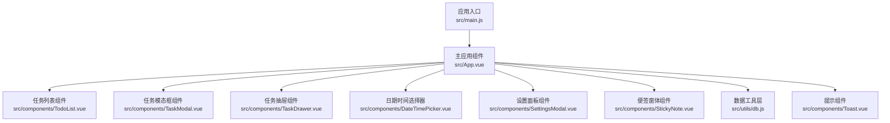
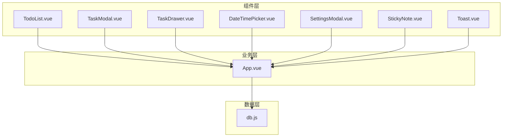
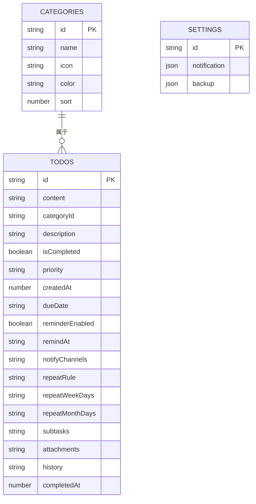
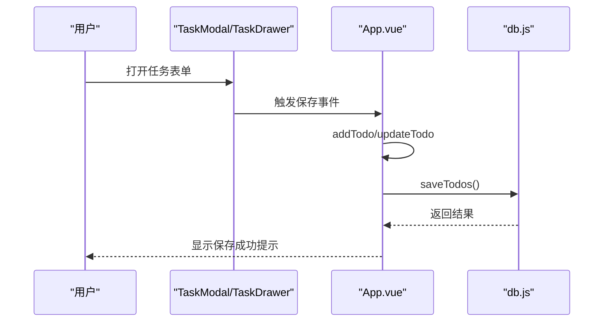
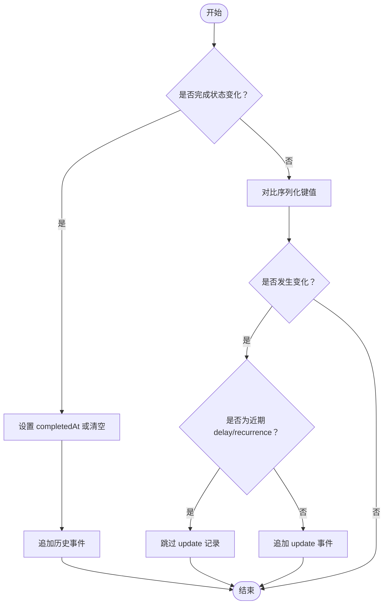
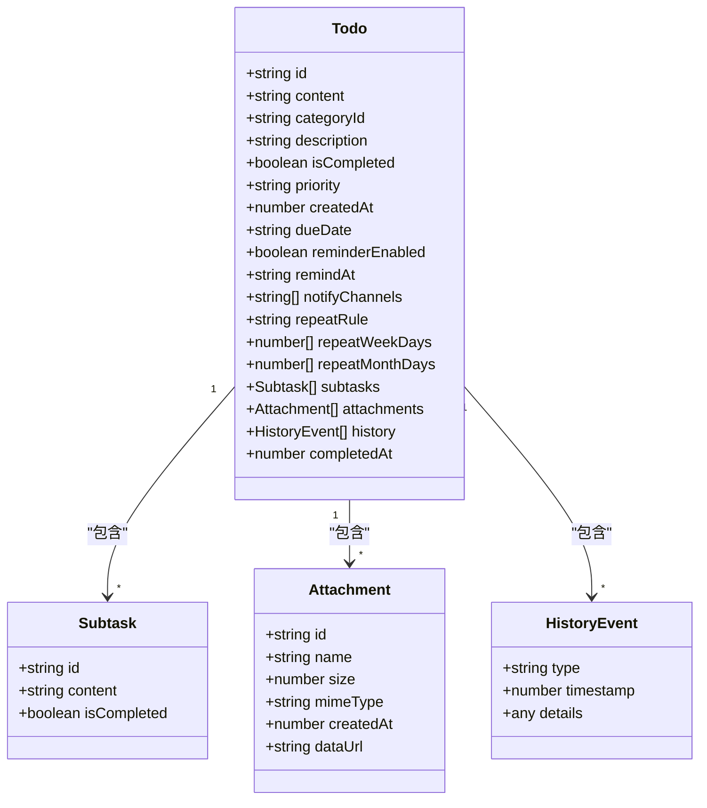
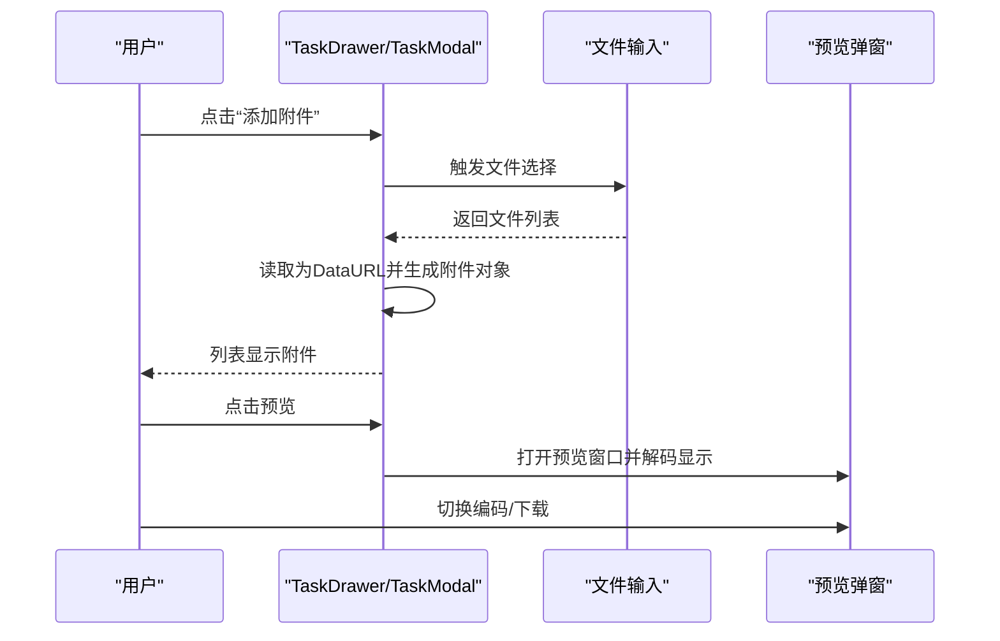
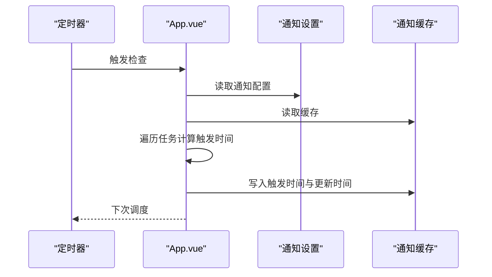
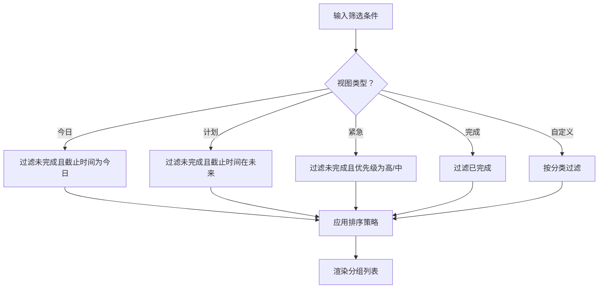
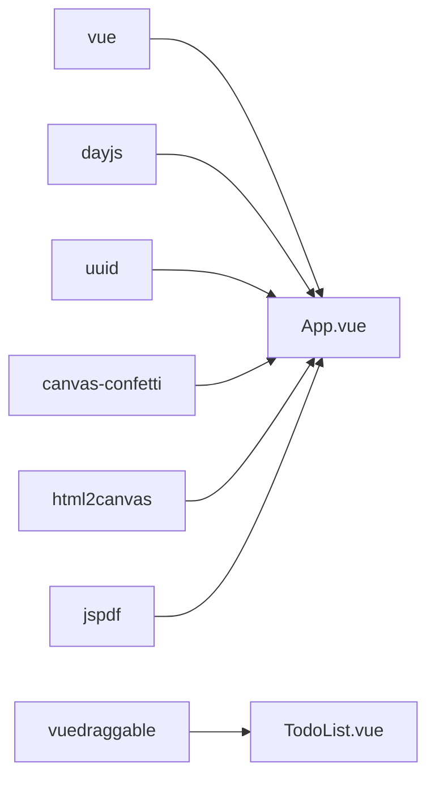

# 任务管理系统

<cite>
**本文档引用的文件**
- [src/main.js](file://src/main.js)
- [src/App.vue](file://src/App.vue)
- [src/utils/db.js](file://src/utils/db.js)
- [src/components/TodoList.vue](file://src/components/TodoList.vue)
- [src/components/TaskModal.vue](file://src/components/TaskModal.vue)
- [src/components/TaskDrawer.vue](file://src/components/TaskDrawer.vue)
- [src/components/DateTimePicker.vue](file://src/components/DateTimePicker.vue)
- [src/components/SettingsModal.vue](file://src/components/SettingsModal.vue)
- [src/components/Toast.vue](file://src/components/Toast.vue)
- [src/components/StickyNote.vue](file://src/components/StickyNote.vue)
- [package.json](file://package.json)
</cite>

## 目录
1. [项目概述](#项目概述)
2. [项目结构](#项目结构)
3. [核心组件](#核心组件)
4. [架构总览](#架构总览)
5. [详细组件分析](#详细组件分析)
6. [依赖关系分析](#依赖关系分析)
7. [性能考虑](#性能考虑)
8. [故障排除指南](#故障排除指南)
9. [结论](#结论)

## 项目概述
本项目是一个基于 Vue 3 的跨平台任务管理系统，支持清单分类、任务创建与编辑、状态管理、优先级设置、截止日期与提醒、重复规则、子任务与附件、通知与备份等功能。系统通过统一的数据层抽象，兼容浏览器开发环境与 utools 插件运行时，提供本地持久化与跨设备同步能力。

## 项目结构
项目采用前端单页应用（SPA）架构，主要由以下层次构成：
- 应用入口与全局状态：App.vue 负责状态管理、数据加载与持久化、视图切换与通知调度。
- 组件层：包含任务列表、任务模态框、抽屉详情、日期时间选择器、设置面板、便签窗体等。
- 工具层：db.js 提供统一的数据访问接口，兼容浏览器 localStorage 与 utools db。
- 入口脚本：main.js 初始化 Vue 应用与样式资源。

**图表来源**
- [src/main.js:1-6](file://src/main.js#L1-L6)
- [src/App.vue:1-120](file://src/App.vue#L1-L120)
- [src/utils/db.js:102-157](file://src/utils/db.js#L102-L157)

**章节来源**
- [src/main.js:1-6](file://src/main.js#L1-L6)
- [src/App.vue:1-120](file://src/App.vue#L1-L120)
- [src/utils/db.js:102-157](file://src/utils/db.js#L102-L157)

## 核心组件
- 数据层（db.js）
  - 提供 categories、todos、settings 文档的读写与初始化。
  - 支持浏览器开发环境下的本地存储模拟与 utools 运行时的真实数据库。
  - 提供备份与恢复能力，支持主题模式持久化。
- 主应用（App.vue）
  - 管理全局状态：分类、任务、当前视图、排序、通知设置等。
  - 实现任务增删改查、历史记录、重复规则、通知调度与全局提示。
  - 提供侧边栏、日历视图、便签模式切换。
- 任务列表（TodoList.vue）
  - 支持多种分组视图：全部、今日、计划、紧急、自定义分类。
  - 支持优先级、截止日期、子任务进度、附件预览与下载。
  - 提供拖拽排序、展开折叠、滚动与粘性布局。
- 任务编辑（TaskModal.vue / TaskDrawer.vue）
  - 提供任务表单：内容、描述、清单、优先级、截止日期、提醒、重复规则、子任务、附件。
  - 支持文件选择、预览、编码切换、下载。
- 日期时间选择（DateTimePicker.vue）
  - 提供日历与时间选择，支持最小日期限制与“今天”快捷操作。
- 设置面板（SettingsModal.vue）
  - 支持通知渠道配置（桌面、邮件、Bark、Webhook）与备份恢复（本地、HTTP、WebDAV）。
- 便签窗体（StickyNote.vue）
  - 提供悬浮便签模式，支持置顶、透明度、主题与颜色设置。

**章节来源**
- [src/utils/db.js:102-157](file://src/utils/db.js#L102-L157)
- [src/App.vue:23-120](file://src/App.vue#L23-L120)
- [src/components/TodoList.vue:1-120](file://src/components/TodoList.vue#L1-L120)
- [src/components/TaskModal.vue:1-120](file://src/components/TaskModal.vue#L1-L120)
- [src/components/TaskDrawer.vue:1-120](file://src/components/TaskDrawer.vue#L1-L120)
- [src/components/DateTimePicker.vue:1-120](file://src/components/DateTimePicker.vue#L1-L120)
- [src/components/SettingsModal.vue:1-120](file://src/components/SettingsModal.vue#L1-L120)
- [src/components/StickyNote.vue:1-120](file://src/components/StickyNote.vue#L1-L120)

## 架构总览
系统采用“组件驱动 + 数据抽象”的架构：
- 组件层：负责用户交互与视图渲染。
- 业务层：在 App.vue 中集中处理任务生命周期、排序、过滤、重复与通知。
- 数据层：db.js 抽象底层存储差异，向上提供一致的 API。
- 同步与备份：通过广播通道与本地存储实现跨窗口同步，并提供备份/恢复流程。

**图表来源**
- [src/App.vue:1-120](file://src/App.vue#L1-L120)
- [src/utils/db.js:102-157](file://src/utils/db.js#L102-L157)

## 详细组件分析

### 数据模型与持久化
- 文档结构
  - categories：清单集合，包含 id、name、icon、color、sort 等字段。
  - todos：任务集合，包含 id、content、categoryId、description、isCompleted、priority、createdAt、dueDate、reminderEnabled、remindAt、notifyChannels、repeatRule、repeatWeekDays、repeatMonthDays、subtasks、attachments、history、completedAt 等。
  - settings：应用设置，包含通知与备份配置。
- 存储适配
  - 浏览器开发：localStorage 模拟文档存储。
  - utools：调用 window.utools.db 的 get/put 接口。
- 备份与恢复
  - 备份：收集 categories、todos、settings 与主题模式生成备份载荷。
  - 恢复：校验备份格式后写入对应文档，确保默认清单存在。

**图表来源**
- [src/utils/db.js:102-157](file://src/utils/db.js#L102-L157)
- [src/App.vue:617-638](file://src/App.vue#L617-L638)

**章节来源**
- [src/utils/db.js:102-157](file://src/utils/db.js#L102-L157)
- [src/App.vue:617-638](file://src/App.vue#L617-L638)

### 任务创建与编辑流程
- 创建任务
  - TaskModal/TaskDrawer 打开，初始化表单。
  - 用户填写内容、描述、清单、优先级、截止日期、提醒、重复规则、子任务、附件。
  - App.vue 的 addTodo 生成新任务对象并插入列表头部，保存到数据库。
- 编辑任务
  - TaskDrawer 监听表单变更，保存时触发 handleDrawerSave -> updateTodo。
  - updateTodo 对比旧值与新值，生成历史记录，处理完成/撤销完成、重复规则归一化、通知触发键变化等。
- 删除任务
  - 当前代码未直接暴露删除按钮或方法；可通过更新任务状态为完成或在上层逻辑中移除实现。

**图表来源**
- [src/components/TaskModal.vue:743-761](file://src/components/TaskModal.vue#L743-L761)
- [src/components/TaskDrawer.vue:743-761](file://src/components/TaskDrawer.vue#L743-L761)
- [src/App.vue:617-638](file://src/App.vue#L617-L638)
- [src/utils/db.js:129-133](file://src/utils/db.js#L129-L133)

**章节来源**
- [src/components/TaskModal.vue:743-761](file://src/components/TaskModal.vue#L743-L761)
- [src/components/TaskDrawer.vue:743-761](file://src/components/TaskDrawer.vue#L743-L761)
- [src/App.vue:617-638](file://src/App.vue#L617-L638)
- [src/utils/db.js:129-133](file://src/utils/db.js#L129-L133)

### 任务状态管理与历史
- 状态字段
  - isCompleted：完成状态。
  - completedAt：完成时间戳。
  - history：历史记录数组，包含 create、complete、uncomplete、delay、update、recurrence 等事件。
- 历史记录生成
  - 完成/撤销完成：自动追加事件并设置 completedAt。
  - 更新：去重与节流，避免频繁 update 事件刷屏。
  - 重复规则：完成时触发 handleRecurrence 生成下一次任务并记录 recurrence。

**图表来源**
- [src/App.vue:653-790](file://src/App.vue#L653-L790)

**章节来源**
- [src/App.vue:653-790](file://src/App.vue#L653-L790)

### 优先级、截止日期与提醒
- 优先级
  - normal/low/medium/high，用于排序与视觉标识。
- 截止日期与提醒
  - dueDate：任务截止时间（支持日期与日期+时间）。
  - remindAt：提醒时间，可与 dueDate 同步或独立设置。
  - reminderEnabled：是否启用提醒。
  - notifyChannels：通知渠道集合（桌面、邮件、Bark、Webhook）。
- 重复规则
  - daily/weekly/monthly/yearly，支持周几与月几的精确化。
  - 完成后根据规则计算下一次任务的 dueDate/remindAt 并插入列表。

**图表来源**
- [src/App.vue:617-638](file://src/App.vue#L617-L638)
- [src/components/TaskModal.vue:183-197](file://src/components/TaskModal.vue#L183-L197)
- [src/components/TaskDrawer.vue:43-57](file://src/components/TaskDrawer.vue#L43-L57)

**章节来源**
- [src/App.vue:617-638](file://src/App.vue#L617-L638)
- [src/components/TaskModal.vue:183-197](file://src/components/TaskModal.vue#L183-L197)
- [src/components/TaskDrawer.vue:43-57](file://src/components/TaskDrawer.vue#L43-L57)

### 子任务与附件
- 子任务
  - 支持添加、删除、切换完成状态。
  - TodoList 展示子任务进度（已完成/总数）。
- 附件
  - 支持图片、文本、PDF 等类型识别与图标展示。
  - 支持预览、下载、编码切换（UTF-8/GBK/GB18030/ISO-8859-1）。
  - 文件读取为 DataURL 存储，便于离线预览与下载。

**图表来源**
- [src/components/TaskDrawer.vue:104-130](file://src/components/TaskDrawer.vue#L104-L130)
- [src/components/TaskDrawer.vue:175-207](file://src/components/TaskDrawer.vue#L175-L207)
- [src/components/TaskModal.vue:232-321](file://src/components/TaskModal.vue#L232-L321)

**章节来源**
- [src/components/TaskDrawer.vue:104-130](file://src/components/TaskDrawer.vue#L104-L130)
- [src/components/TaskDrawer.vue:175-207](file://src/components/TaskDrawer.vue#L175-L207)
- [src/components/TaskModal.vue:232-321](file://src/components/TaskModal.vue#L232-L321)

### 通知与提醒
- 通知调度
  - 定时器每分钟检查一次，比较当前时间与任务的提醒时间。
  - 使用缓存避免重复推送与过期任务刷屏。
- 通知渠道
  - 桌面：系统原生通知。
  - 邮件：SMTP 配置，支持 SSL/TLS。
  - Bark：移动端推送。
  - Webhook：HTTP 回调，支持自定义头与 JSON 载荷。
- 推迟提醒
  - 支持 5/10 分钟或自定义时长推迟，更新历史记录。

**图表来源**
- [src/App.vue:940-1015](file://src/App.vue#L940-L1015)
- [src/components/SettingsModal.vue:30-195](file://src/components/SettingsModal.vue#L30-L195)

**章节来源**
- [src/App.vue:940-1015](file://src/App.vue#L940-L1015)
- [src/components/SettingsModal.vue:30-195](file://src/components/SettingsModal.vue#L30-L195)

### 排序、过滤与搜索
- 排序
  - 支持按创建时间、截止时间、优先级排序，支持升序/降序切换。
  - 不同视图（今日、计划、完成）有默认排序策略。
- 过滤
  - 全部、今日、计划、紧急、完成、自定义分类。
- 搜索
  - TodoList.vue 提供分组与滚动控制，结合 App.vue 的过滤逻辑实现高效浏览。

**图表来源**
- [src/App.vue:350-415](file://src/App.vue#L350-L415)
- [src/components/TodoList.vue:300-495](file://src/components/TodoList.vue#L300-L495)

**章节来源**
- [src/App.vue:350-415](file://src/App.vue#L350-L415)
- [src/components/TodoList.vue:300-495](file://src/components/TodoList.vue#L300-L495)

### 便签模式与主题
- 便签模式
  - StickyNote.vue 提供悬浮窗体，支持置顶、透明度、颜色与主题设置。
  - 通过窗口句柄与服务接口实现置顶与透明度调整。
- 主题
  - 支持浅色、深色与系统跟随，主题类名注入根元素影响子组件样式。

**章节来源**
- [src/components/StickyNote.vue:25-140](file://src/components/StickyNote.vue#L25-L140)
- [src/App.vue:268-291](file://src/App.vue#L268-L291)

## 依赖关系分析
- 运行时依赖
  - vue：响应式框架。
  - dayjs：日期时间处理。
  - uuid：任务 ID 生成。
  - vuedraggable：拖拽排序。
  - canvas-confetti：完成动画。
  - html2canvas/jspdf：截图与 PDF 导出（延迟加载）。
- 开发依赖
  - vite、@vitejs/plugin-vue、less、utools-api-types。

**图表来源**
- [package.json:7-22](file://package.json#L7-L22)
- [src/App.vue:104-115](file://src/App.vue#L104-L115)

**章节来源**
- [package.json:7-22](file://package.json#L7-L22)
- [src/App.vue:104-115](file://src/App.vue#L104-L115)

## 性能考虑
- 渲染优化
  - TodoList.vue 使用分组与滚动控制，减少长列表重绘。
  - 动画过渡使用 CSS 控制，避免 JavaScript 阻塞。
- 数据访问
  - db.js 统一抽象，避免多处分散的存储逻辑。
  - utools 环境下使用 put 返回值进行错误处理，浏览器环境模拟 _rev。
- 通知调度
  - 使用缓存与 TTL 降低重复计算与网络请求。
  - 定时器周期性检查，避免高频轮询。
- 附件处理
  - DataURL 存储便于预览，但注意大文件内存占用；建议在生产环境限制文件大小或采用分块上传策略。

[本节为通用指导，无需特定文件引用]

## 故障排除指南
- 数据加载失败
  - App.vue 在加载数据时捕获异常并通过 utools 通知或控制台输出错误信息。
- utools 数据库错误
  - db.put 在 utools 环境下检查 result.error 并抛出异常，需检查权限与版本。
- 通知未触发
  - 检查通知设置、提醒时间与缓存状态；确认定时器正常运行。
- 便签置顶失败
  - 检查窗口句柄与服务接口可用性，必要时回退到重新创建窗口。

**章节来源**
- [src/App.vue:526-534](file://src/App.vue#L526-L534)
- [src/utils/db.js:30-43](file://src/utils/db.js#L30-L43)
- [src/App.vue:940-1015](file://src/App.vue#L940-L1015)
- [src/components/StickyNote.vue:228-266](file://src/components/StickyNote.vue#L228-L266)

## 结论
本任务管理系统通过清晰的组件划分与统一的数据抽象，实现了从任务创建、编辑、状态管理到通知与备份的完整闭环。其模块化设计便于扩展与维护，同时兼顾了用户体验与性能表现。建议后续增强删除操作、搜索与筛选的高级能力，并在生产环境完善大文件处理与安全策略。