# 分类管理系统

<cite>
**本文档引用的文件**
- [src/main.js](file://src/main.js)
- [src/App.vue](file://src/App.vue)
- [src/utils/db.js](file://src/utils/db.js)
- [src/utils/color.js](file://src/utils/color.js)
- [src/components/Sidebar.vue](file://src/components/Sidebar.vue)
- [src/components/TodoList.vue](file://src/components/TodoList.vue)
- [src/components/TaskModal.vue](file://src/components/TaskModal.vue)
- [src/components/SettingsModal.vue](file://src/components/SettingsModal.vue)
- [package.json](file://package.json)
</cite>

## 目录
1. [简介](#简介)
2. [项目结构](#项目结构)
3. [核心组件](#核心组件)
4. [架构总览](#架构总览)
5. [详细组件分析](#详细组件分析)
6. [依赖关系分析](#依赖关系分析)
7. [性能考虑](#性能考虑)
8. [故障排除指南](#故障排除指南)
9. [结论](#结论)
10. [附录](#附录)

## 简介
本项目是一个基于 Vue 3 的分类管理系统，支持清单分类的创建、编辑、删除和排序功能。系统通过统一的数据层抽象实现了跨平台（utools 插件环境与浏览器环境）的分类数据持久化，提供图标选择、颜色定制以及灵活的排序机制。分类与任务之间存在明确的关联关系，系统在数据层面保证了分类状态的一致性和完整性。

## 项目结构
项目采用 Vue 3 单页应用架构，主要由以下模块组成：
- 应用入口与全局状态：App.vue 负责应用初始化、全局状态管理、分类与任务的增删改查、上下文菜单处理等
- 数据持久化：db.js 抽象了分类、任务、设置的存储与备份/恢复流程
- 视图组件：Sidebar.vue（侧边栏分类列表）、TodoList.vue（任务列表与分组显示）、TaskModal.vue（任务编辑弹窗）、SettingsModal.vue（设置与备份）
- 工具函数：color.js 提供颜色校验与转换工具
- 入口脚本：main.js 初始化应用、样式与图标库

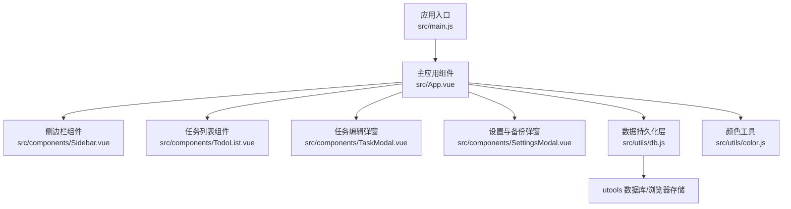

**图表来源**
- [src/main.js:1-6](file://src/main.js#L1-L6)
- [src/App.vue:1-120](file://src/App.vue#L1-L120)
- [src/utils/db.js:102-156](file://src/utils/db.js#L102-L156)

**章节来源**
- [src/main.js:1-6](file://src/main.js#L1-L6)
- [src/App.vue:1-120](file://src/App.vue#L1-L120)
- [src/utils/db.js:102-156](file://src/utils/db.js#L102-L156)

## 核心组件
本节概述分类管理系统的四大核心组件及其职责：
- App.vue：应用状态中心，负责分类与任务的 CRUD、过滤与排序、上下文菜单、数据同步广播、备份与恢复
- Sidebar.vue：侧边栏分类列表，支持拖拽排序、右键菜单、主题切换、添加分类
- TodoList.vue：任务列表与分组展示，根据当前分类进行分组与排序
- db.js：统一的数据访问层，封装了分类、任务、设置的读写与备份/恢复逻辑

**章节来源**
- [src/App.vue:23-120](file://src/App.vue#L23-L120)
- [src/components/Sidebar.vue:1-120](file://src/components/Sidebar.vue#L1-L120)
- [src/components/TodoList.vue:1-120](file://src/components/TodoList.vue#L1-L120)
- [src/utils/db.js:102-156](file://src/utils/db.js#L102-L156)

## 架构总览
系统采用“视图组件 + 应用状态 + 数据层”的三层架构：
- 视图层：Sidebar、TodoList、TaskModal、SettingsModal
- 应用状态层：App.vue 维护分类、任务、当前分类、排序状态、上下文菜单等
- 数据层：db.js 封装了 get/saveCategories/get/saveTodos/get/saveSettings 以及备份/恢复方法

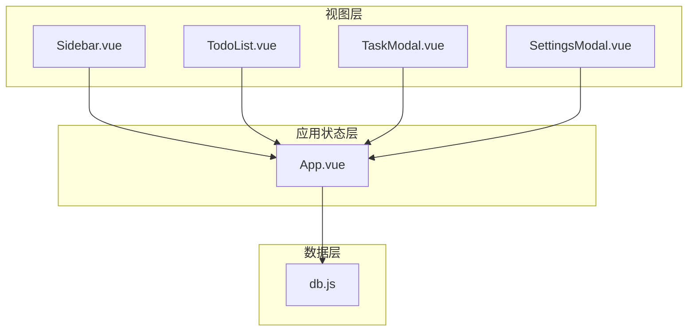

**图表来源**
- [src/components/Sidebar.vue:1-120](file://src/components/Sidebar.vue#L1-L120)
- [src/components/TodoList.vue:1-120](file://src/components/TodoList.vue#L1-L120)
- [src/components/TaskModal.vue:1-120](file://src/components/TaskModal.vue#L1-L120)
- [src/components/SettingsModal.vue:1-120](file://src/components/SettingsModal.vue#L1-L120)
- [src/App.vue:120-220](file://src/App.vue#L120-L220)
- [src/utils/db.js:102-156](file://src/utils/db.js#L102-L156)

## 详细组件分析

### 分类数据模型与关系
- 分类实体包含字段：id、name、icon、color、sort、isDefault 等
- 任务实体包含字段：categoryId（关联分类）、priority、dueDate、attachments 等
- 关系：任务通过 categoryId 关联到分类；删除分类时会级联删除该分类下的所有任务

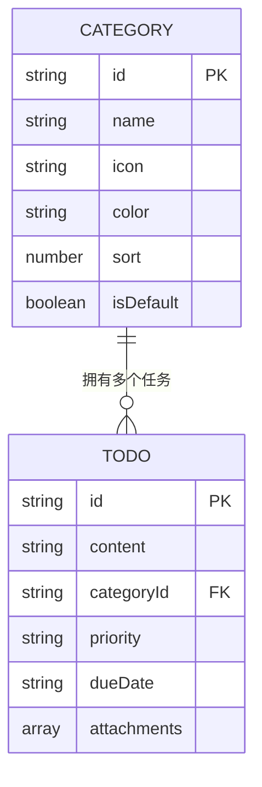

**图表来源**
- [src/utils/db.js:103-118](file://src/utils/db.js#L103-L118)
- [src/App.vue:617-638](file://src/App.vue#L617-L638)

**章节来源**
- [src/utils/db.js:103-118](file://src/utils/db.js#L103-L118)
- [src/App.vue:617-638](file://src/App.vue#L617-L638)

### 分类创建、编辑、删除与排序流程

#### 创建分类
- 触发路径：Sidebar.vue 点击“添加分类”按钮
- 执行步骤：
  1) 弹出输入模态框（名称、图标、颜色）
  2) 在 App.vue 中生成唯一 id，追加到分类数组末尾
  3) 调用 db.saveCategories 持久化
  4) 广播数据变更事件

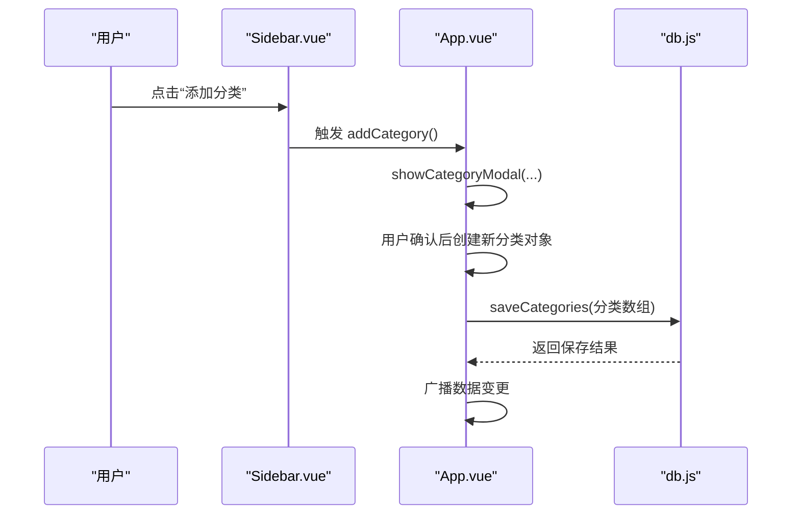

**图表来源**
- [src/components/Sidebar.vue:43-45](file://src/components/Sidebar.vue#L43-L45)
- [src/App.vue:553-566](file://src/App.vue#L553-L566)
- [src/utils/db.js:114-118](file://src/utils/db.js#L114-L118)

**章节来源**
- [src/components/Sidebar.vue:43-45](file://src/components/Sidebar.vue#L43-L45)
- [src/App.vue:553-566](file://src/App.vue#L553-L566)
- [src/utils/db.js:114-118](file://src/utils/db.js#L114-L118)

#### 编辑分类（重命名、修改图标与颜色）
- 触发路径：Sidebar.vue 右键分类项打开上下文菜单，选择“编辑”
- 执行步骤：
  1) 弹出输入模态框，回显当前分类信息
  2) 用户确认后更新分类对象的 name、icon、color
  3) 调用 db.saveCategories 持久化

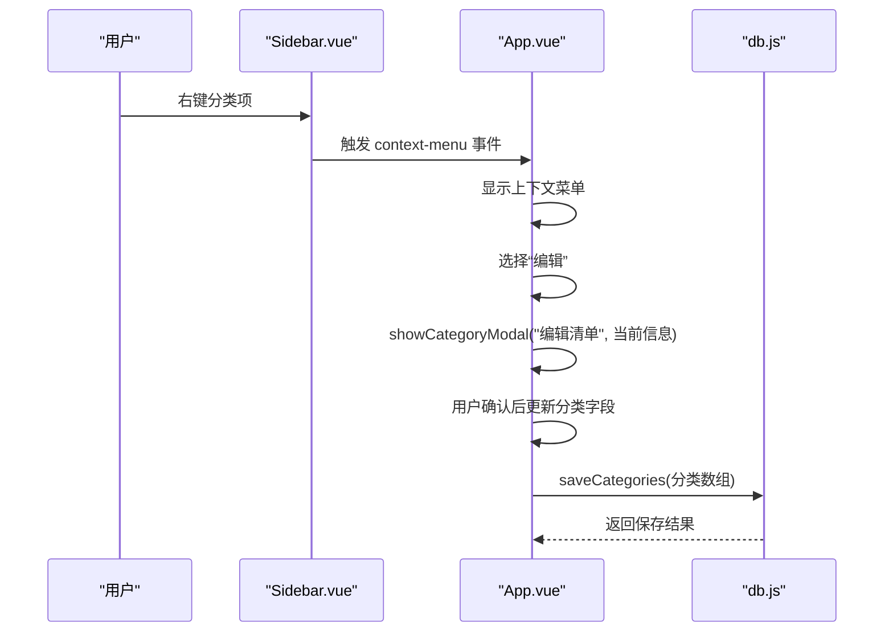

**图表来源**
- [src/components/Sidebar.vue:38-41](file://src/components/Sidebar.vue#L38-L41)
- [src/App.vue:1552-1563](file://src/App.vue#L1552-L1563)
- [src/utils/db.js:114-118](file://src/utils/db.js#L114-L118)

**章节来源**
- [src/components/Sidebar.vue:38-41](file://src/components/Sidebar.vue#L38-L41)
- [src/App.vue:1552-1563](file://src/App.vue#L1552-L1563)
- [src/utils/db.js:114-118](file://src/utils/db.js#L114-L118)

#### 删除分类（含级联删除任务）
- 触发路径：Sidebar.vue 右键分类项，选择“删除”
- 执行步骤：
  1) 默认分类不可删除，提示用户
  2) 确认后从分类数组移除
  3) 级联删除该分类下的所有任务
  4) 更新当前选中的分类为“全部”
  5) 持久化分类与任务数据

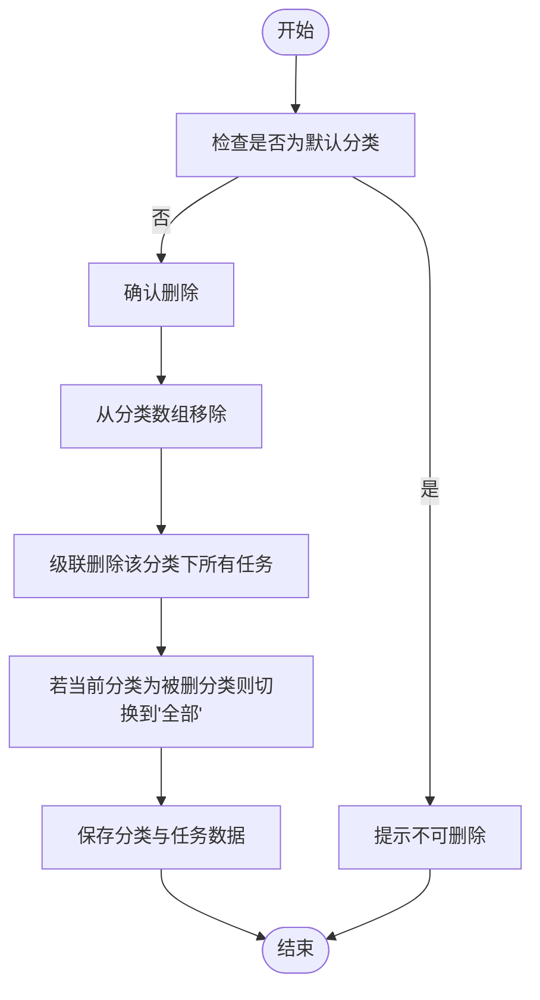

**图表来源**
- [src/App.vue:1525-1544](file://src/App.vue#L1525-L1544)

**章节来源**
- [src/App.vue:1525-1544](file://src/App.vue#L1525-L1544)

#### 分类排序（拖拽排序）
- 触发路径：Sidebar.vue 使用 vuedraggable 对分类列表进行拖拽
- 执行步骤：
  1) 用户拖拽分类项
  2) v-model 双向绑定更新分类数组顺序
  3) App.vue 监听分类数组变化，调用 saveCategories 持久化
  4) TodoList.vue 根据当前分类顺序渲染分组

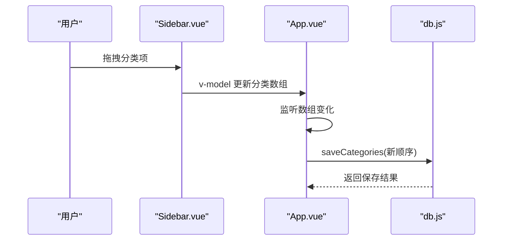

**图表来源**
- [src/components/Sidebar.vue:171-195](file://src/components/Sidebar.vue#L171-L195)
- [src/App.vue:568-570](file://src/App.vue#L568-L570)
- [src/utils/db.js:114-118](file://src/utils/db.js#L114-L118)

**章节来源**
- [src/components/Sidebar.vue:171-195](file://src/components/Sidebar.vue#L171-L195)
- [src/App.vue:568-570](file://src/App.vue#L568-L570)
- [src/utils/db.js:114-118](file://src/utils/db.js#L114-L118)

### 图标选择与颜色定制
- 图标选择：通过图标选择器弹窗，支持搜索与预设图标集合
- 颜色定制：支持十六进制颜色输入与校验，颜色工具提供颜色转换与混合能力

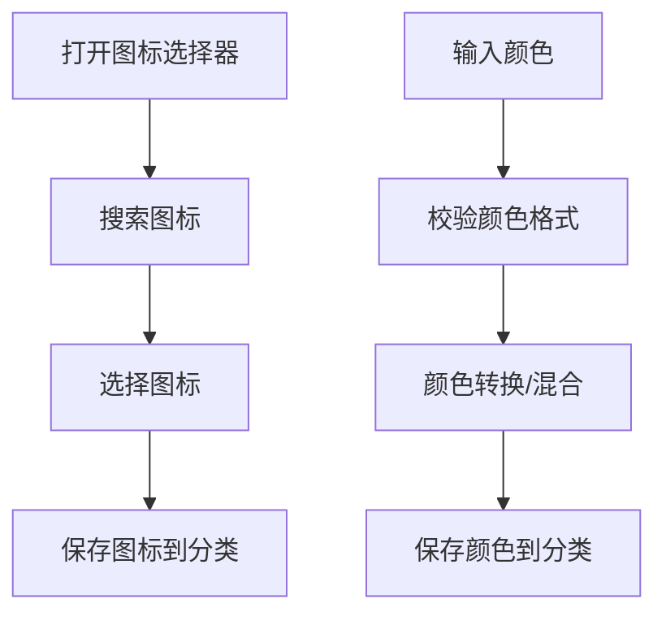

**图表来源**
- [src/App.vue:1435-1448](file://src/App.vue#L1435-L1448)
- [src/App.vue:1491-1505](file://src/App.vue#L1491-L1505)
- [src/utils/color.js:1-27](file://src/utils/color.js#L1-L27)

**章节来源**
- [src/App.vue:1435-1448](file://src/App.vue#L1435-L1448)
- [src/App.vue:1491-1505](file://src/App.vue#L1491-L1505)
- [src/utils/color.js:1-27](file://src/utils/color.js#L1-L27)

### 分类状态持久化与备份/恢复
- 持久化：db.js 封装 get/saveCategories/get/saveTodos/get/saveSettings
- 备份：createBackupPayload 收集 categories、todos、settings 与主题模式
- 恢复：applyBackupPayload 校验格式并写入对应集合，同时恢复主题模式

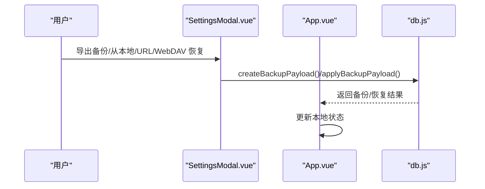

**图表来源**
- [src/components/SettingsModal.vue:469-520](file://src/components/SettingsModal.vue#L469-L520)
- [src/components/SettingsModal.vue:585-644](file://src/components/SettingsModal.vue#L585-L644)
- [src/utils/db.js:47-100](file://src/utils/db.js#L47-L100)

**章节来源**
- [src/components/SettingsModal.vue:469-520](file://src/components/SettingsModal.vue#L469-L520)
- [src/components/SettingsModal.vue:585-644](file://src/components/SettingsModal.vue#L585-L644)
- [src/utils/db.js:47-100](file://src/utils/db.js#L47-L100)

### 分类与任务关联的业务逻辑与一致性保证
- 关联关系：任务实体包含 categoryId 字段，用于标识所属分类
- 过滤逻辑：App.vue 根据 currentCategoryId 对任务进行过滤
- 一致性保证：
  - 删除分类时级联删除该分类下的所有任务
  - 更新分类时保持任务的 categoryId 不变，仅更新分类元数据
  - 拖拽排序不影响任务数据，仅改变分类顺序

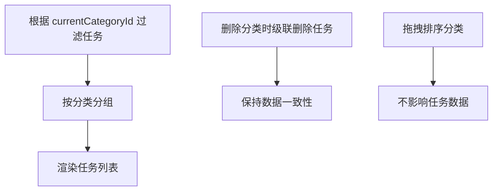

**图表来源**
- [src/App.vue:351-415](file://src/App.vue#L351-L415)
- [src/App.vue:1532-1544](file://src/App.vue#L1532-L1544)

**章节来源**
- [src/App.vue:351-415](file://src/App.vue#L351-L415)
- [src/App.vue:1532-1544](file://src/App.vue#L1532-L1544)

## 依赖关系分析
- 依赖框架与库：Vue 3、vuedraggable（拖拽）、remixicon（图标）、uuid（ID 生成）、dayjs（日期处理）、canvas-confetti（动画效果）
- 数据层依赖：utools 数据库 API 或浏览器 localStorage

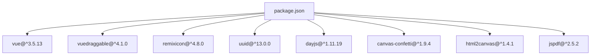

**图表来源**
- [package.json:7-22](file://package.json#L7-L22)

**章节来源**
- [package.json:7-22](file://package.json#L7-L22)

## 性能考虑
- 渲染优化：TodoList.vue 使用分组渲染与可折叠分组，减少 DOM 数量
- 拖拽性能：Sidebar.vue 使用 vuedraggable，避免复杂计算在拖拽过程中执行
- 数据持久化：db.js 在浏览器环境模拟 _rev 版本号，减少不必要的冲突检测
- 主题切换：App.vue 使用 CSS 类切换，避免频繁重排

[本节为通用性能建议，无需特定文件引用]

## 故障排除指南
- 数据加载失败：App.vue 在 loadData 中捕获异常并通过 utools 提示或控制台输出
- 默认分类不可删除：上下文菜单中对默认分类进行保护，防止误删
- 备份/恢复失败：SettingsModal.vue 对备份格式进行严格校验，失败时提示错误信息

**章节来源**
- [src/App.vue:526-534](file://src/App.vue#L526-L534)
- [src/App.vue:1527-1531](file://src/App.vue#L1527-L1531)
- [src/components/SettingsModal.vue:591-606](file://src/components/SettingsModal.vue#L591-L606)

## 结论
本分类管理系统通过清晰的组件划分与统一的数据层抽象，实现了分类的全生命周期管理。系统具备良好的扩展性：新增分类字段、自定义图标与颜色、支持多平台数据持久化。分类与任务之间的关联关系在数据层面得到保障，删除、重命名、排序等操作均能维持数据一致性。整体架构简洁、易于维护与扩展。

## 附录

### API 接口文档（概念性说明）
以下为分类相关操作的概念性接口定义，实际实现位于 App.vue 与 db.js 中：

- 创建分类
  - 方法：POST /categories
  - 请求体：{ name, icon, color, sort }
  - 响应：分类对象（包含 id）

- 更新分类属性
  - 方法：PATCH /categories/{id}
  - 请求体：{ name, icon, color }
  - 响应：更新后的分类对象

- 删除分类
  - 方法：DELETE /categories/{id}
  - 响应：布尔值（删除成功/失败）

- 重新排序
  - 方法：PUT /categories/order
  - 请求体：[{ id, sort }]
  - 响应：布尔值（排序成功/失败）

- 获取分类列表
  - 方法：GET /categories
  - 响应：分类数组

- 获取任务列表（按分类过滤）
  - 方法：GET /todos?categoryId={id}
  - 响应：任务数组

[本节为概念性接口说明，不直接映射具体源码文件]