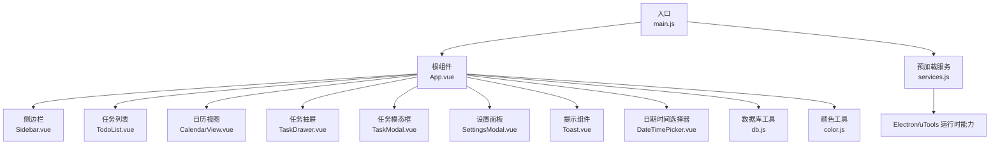
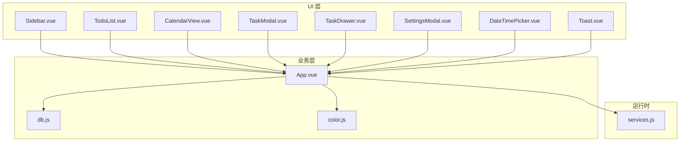
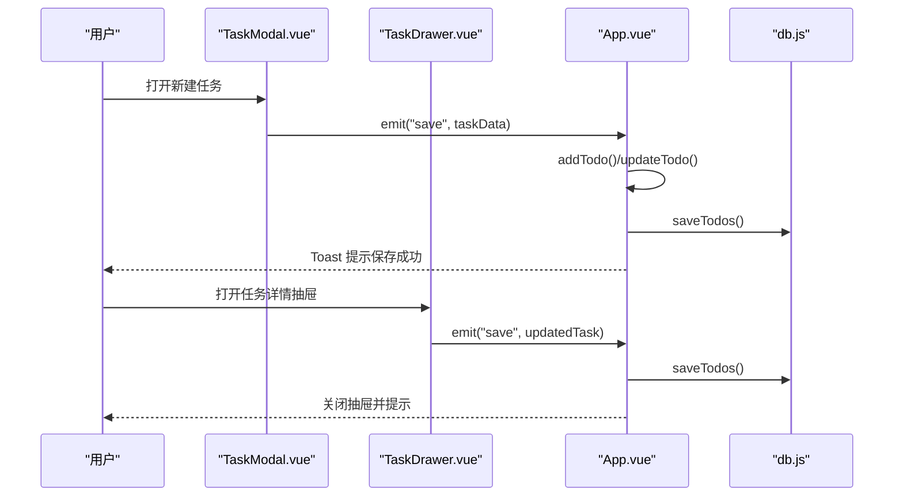
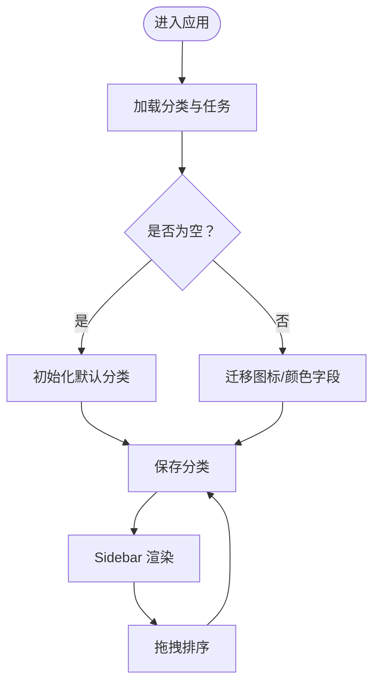
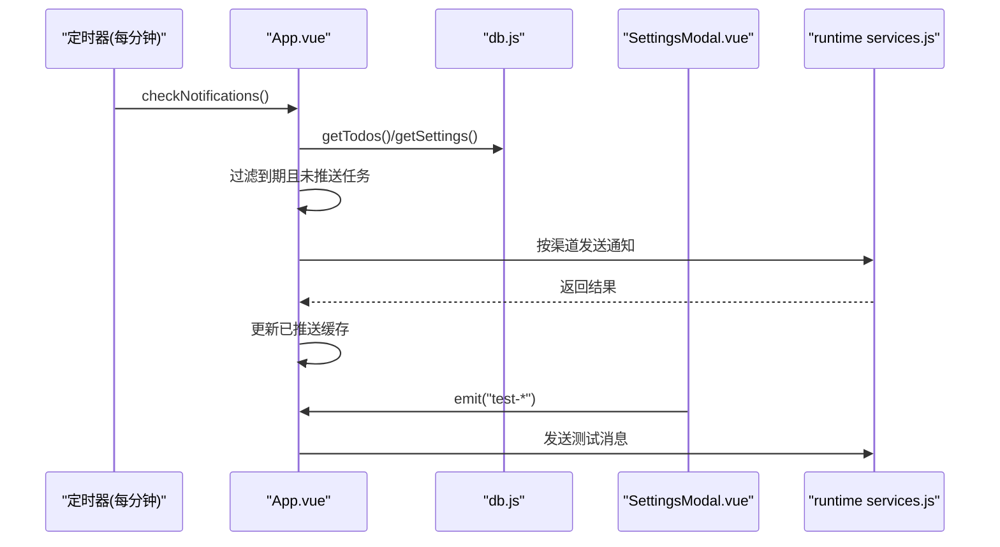
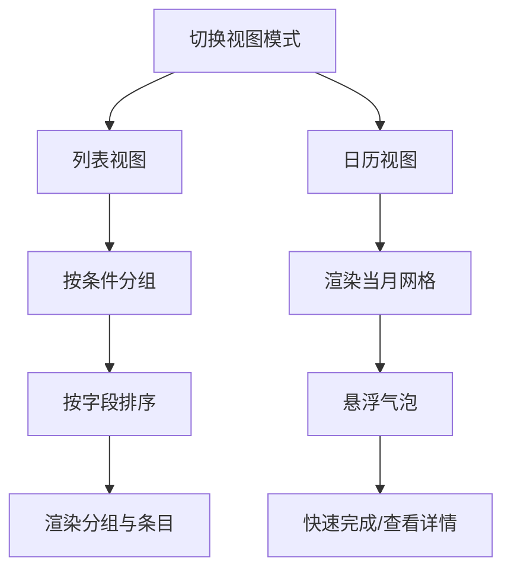
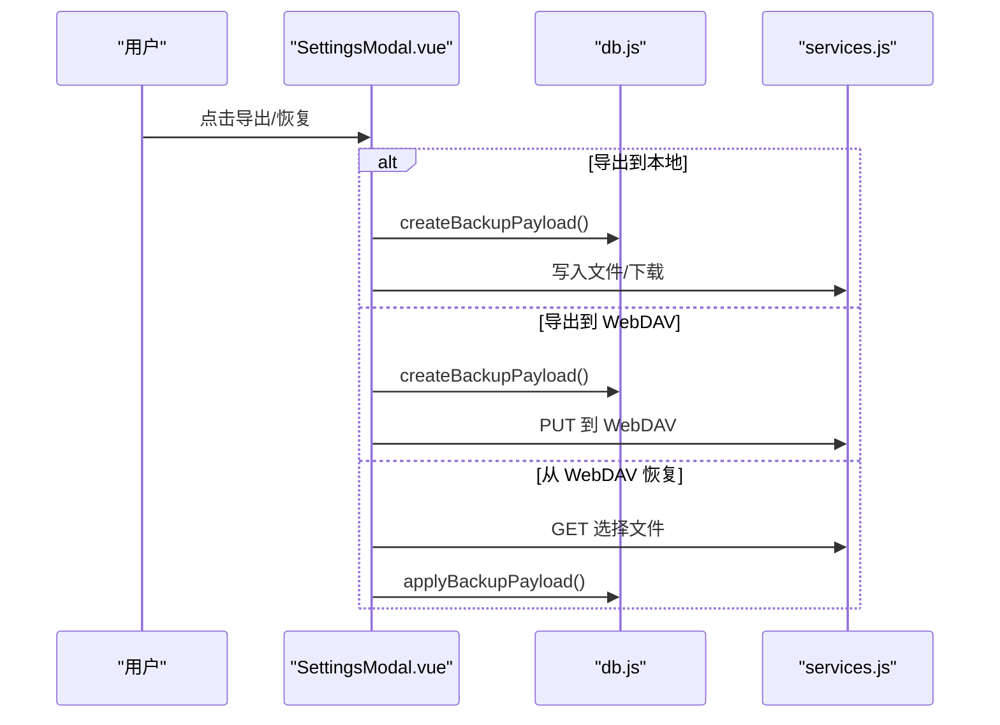
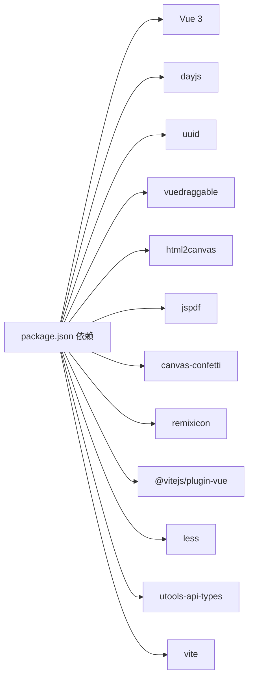

# 功能模块

<cite>
**本文引用的文件**
- [package.json](file://package.json)
- [plugin.json](file://plugin.json)
- [main.js](file://src/main.js)
- [App.vue](file://src/App.vue)
- [db.js](file://src/utils/db.js)
- [Sidebar.vue](file://src/components/Sidebar.vue)
- [TodoList.vue](file://src/components/TodoList.vue)
- [CalendarView.vue](file://src/components/CalendarView.vue)
- [TaskModal.vue](file://src/components/TaskModal.vue)
- [TaskDrawer.vue](file://src/components/TaskDrawer.vue)
- [SettingsModal.vue](file://src/components/SettingsModal.vue)
- [Toast.vue](file://src/components/Toast.vue)
- [DateTimePicker.vue](file://src/components/DateTimePicker.vue)
- [color.js](file://src/utils/color.js)
- [services.js](file://public/preload/services.js)
</cite>

## 目录
1. [简介](#简介)
2. [项目结构](#项目结构)
3. [核心组件](#核心组件)
4. [架构总览](#架构总览)
5. [详细组件分析](#详细组件分析)
6. [依赖分析](#依赖分析)
7. [性能考量](#性能考量)
8. [故障排除指南](#故障排除指南)
9. [结论](#结论)
10. [附录](#附录)

## 简介
Just-Todo 是一款基于 Vue 3 的跨平台待办事项管理插件，支持任务管理、分类管理、提醒通知与视图切换等功能。其核心特性包括：
- 任务生命周期管理（新增、编辑、完成、历史记录）
- 多维度分类与智能筛选（今日、计划、紧急、已完成、全部）
- 日历视图与列表视图双模式
- 提醒通知（桌面、邮件、Bark、Webhook）与重复规则
- 数据本地化与多通道备份/恢复（本地文件、HTTP、WebDAV）

## 项目结构
项目采用前端单页应用结构，核心入口为 Vue 应用，组件化组织功能模块，工具函数封装数据持久化与颜色处理，preload 注入运行时服务。

图表来源
- [main.js:1-6](file://src/main.js#L1-L6)
- [App.vue:1-120](file://src/App.vue#L1-L120)
- [Sidebar.vue:1-120](file://src/components/Sidebar.vue#L1-L120)
- [TodoList.vue:1-120](file://src/components/TodoList.vue#L1-L120)
- [CalendarView.vue:1-120](file://src/components/CalendarView.vue#L1-L120)
- [TaskDrawer.vue:1-120](file://src/components/TaskDrawer.vue#L1-L120)
- [TaskModal.vue:1-120](file://src/components/TaskModal.vue#L1-L120)
- [SettingsModal.vue:1-120](file://src/components/SettingsModal.vue#L1-L120)
- [Toast.vue:1-63](file://src/components/Toast.vue#L1-L63)
- [DateTimePicker.vue:1-120](file://src/components/DateTimePicker.vue#L1-L120)
- [db.js:1-157](file://src/utils/db.js#L1-L157)
- [color.js:1-27](file://src/utils/color.js#L1-L27)
- [services.js:1-120](file://public/preload/services.js#L1-L120)

章节来源
- [main.js:1-6](file://src/main.js#L1-L6)
- [plugin.json:1-21](file://plugin.json#L1-L21)

## 核心组件
- 应用根组件 App.vue：集中状态管理、主题控制、通知调度、数据同步广播、提醒弹窗与全局交互。
- 数据层 db.js：统一抽象本地存储（utools db 或 localStorage），提供分类、任务、设置的读写与备份导入导出。
- 视图层组件：Sidebar（导航与分类）、TodoList（列表/分组/拖拽）、CalendarView（日历）、TaskModal/TaskDrawer（任务编辑）、SettingsModal（通知与备份）、Toast（提示）、DateTimePicker（日期时间选择）。
- 工具层：color.js（颜色校验与混合）、services.js（Electron/uTools 运行时能力注入）。

章节来源
- [App.vue:1-200](file://src/App.vue#L1-L200)
- [db.js:102-157](file://src/utils/db.js#L102-L157)

## 架构总览
系统采用“组件驱动 + 工具抽象 + 运行时注入”的架构：
- 组件间通过 props/emit 通信，根组件集中处理业务逻辑与状态。
- 数据访问统一经 db.js，兼容开发环境与生产环境（utools db）。
- 运行时能力由 preload services.js 注入，提供窗口、对话框、网络请求、邮件发送等。

图表来源
- [App.vue:1-200](file://src/App.vue#L1-L200)
- [db.js:102-157](file://src/utils/db.js#L102-L157)
- [color.js:1-27](file://src/utils/color.js#L1-L27)
- [services.js:59-357](file://public/preload/services.js#L59-L357)

## 详细组件分析

### 任务管理模块
- 新增/编辑任务：TaskModal 与 TaskDrawer 提供一致的任务表单，支持优先级、截止时间、提醒、重复规则、子任务与附件。
- 完成状态与历史：TodoList 与 TaskDrawer 记录完成/重置事件；App.vue 在完成时触发全局彩带动画。
- 排序与分组：TodoList 支持按优先级、截止时间、创建时间排序；按日期/分类/优先级进行分组展示。
- 附件与预览：支持图片/文本/通用文件类型，提供预览与下载。

图表来源
- [TaskModal.vue:743-761](file://src/components/TaskModal.vue#L743-L761)
- [TaskDrawer.vue:743-761](file://src/components/TaskDrawer.vue#L743-L761)
- [App.vue:617-790](file://src/App.vue#L617-L790)
- [db.js:129-133](file://src/utils/db.js#L129-L133)

章节来源
- [TaskModal.vue:1-200](file://src/components/TaskModal.vue#L1-L200)
- [TaskDrawer.vue:1-200](file://src/components/TaskDrawer.vue#L1-L200)
- [TodoList.vue:1-200](file://src/components/TodoList.vue#L1-L200)
- [App.vue:617-790](file://src/App.vue#L617-L790)

### 分类管理模块
- 默认分类初始化与图标/颜色迁移：首次加载若缺失图标或颜色，自动补全默认值。
- 分类增删改：Sidebar 支持拖拽排序与右键菜单；新增分类后立即持久化。
- 智能计数：Sidebar 根据当前视图统计各类别/智能视图中的任务数量。

图表来源
- [App.vue:489-535](file://src/App.vue#L489-L535)
- [db.js:114-118](file://src/utils/db.js#L114-L118)
- [Sidebar.vue:171-195](file://src/components/Sidebar.vue#L171-L195)

章节来源
- [App.vue:489-535](file://src/App.vue#L489-L535)
- [Sidebar.vue:1-120](file://src/components/Sidebar.vue#L1-L120)
- [db.js:102-118](file://src/utils/db.js#L102-L118)

### 提醒通知模块
- 通知渠道：桌面、邮件、Bark、Webhook；根据设置动态启用。
- 触发机制：每分钟扫描一次到期任务，避免重复推送；支持“推迟”与“打开详情”。
- 测试与配置：SettingsModal 提供各渠道测试按钮与参数配置；支持 Webhook 请求头与自定义体。

图表来源
- [App.vue:482-486](file://src/App.vue#L482-L486)
- [App.vue:58-81](file://src/App.vue#L58-L81)
- [SettingsModal.vue:392-395](file://src/components/SettingsModal.vue#L392-L395)
- [services.js:301-357](file://public/preload/services.js#L301-L357)

章节来源
- [App.vue:482-486](file://src/App.vue#L482-L486)
- [App.vue:58-81](file://src/App.vue#L58-L81)
- [SettingsModal.vue:1-200](file://src/components/SettingsModal.vue#L1-L200)
- [services.js:301-357](file://public/preload/services.js#L301-L357)

### 视图切换模块
- 视图模式：列表/日历双视图，通过 App.vue 的 viewMode 控制。
- 日历视图：按月网格显示，悬浮气泡快速完成与查看；支持滚轮微调滚动。
- 列表视图：支持分组（今日/计划/优先级/分类）、折叠、拖拽排序（特定场景）。

图表来源
- [App.vue:29-31](file://src/App.vue#L29-L31)
- [CalendarView.vue:1-120](file://src/components/CalendarView.vue#L1-L120)
- [TodoList.vue:300-495](file://src/components/TodoList.vue#L300-L495)

章节来源
- [App.vue:29-31](file://src/App.vue#L29-L31)
- [CalendarView.vue:1-120](file://src/components/CalendarView.vue#L1-L120)
- [TodoList.vue:300-495](file://src/components/TodoList.vue#L300-L495)

### 数据与备份模块
- 备份导出：支持本地文件导出、HTTP 下载、WebDAV 上传；文件名含时间戳。
- 备份恢复：支持本地文件恢复、HTTP URL 恢复、WebDAV 文件选择恢复。
- 数据结构：categories、todos、settings；settings 包含通知与备份配置。

图表来源
- [SettingsModal.vue:469-520](file://src/components/SettingsModal.vue#L469-L520)
- [SettingsModal.vue:578-631](file://src/components/SettingsModal.vue#L578-L631)
- [db.js:47-100](file://src/utils/db.js#L47-L100)
- [services.js:301-357](file://public/preload/services.js#L301-L357)

章节来源
- [SettingsModal.vue:1-200](file://src/components/SettingsModal.vue#L1-L200)
- [db.js:47-100](file://src/utils/db.js#L47-L100)

## 依赖分析
- 运行时依赖：Vue 3、dayjs、uuid、vuedraggable、html2canvas、jspdf、canvas-confetti、remixicon。
- 开发依赖：@vitejs/plugin-vue、less、utools-api-types、vite。
- 插件元信息：features.code 为 todo，命令集包含多种语言关键词，入口指向 index.html，preload 指向 services.js。

图表来源
- [package.json:7-22](file://package.json#L7-L22)

章节来源
- [package.json:1-24](file://package.json#L1-L24)
- [plugin.json:1-21](file://plugin.json#L1-L21)

## 性能考量
- 渲染优化：TodoList 使用分组与过渡动画，减少不必要的重排；日历视图采用虚拟滚动与微滚动速度控制。
- 数据访问：db.js 统一封装读写，避免重复 IO；App.vue 使用 computed 缓存过滤与排序结果。
- 通知调度：定时器每分钟扫描，避免高频轮询；已推送任务缓存于 localStorage，降低重复触发概率。
- 懒加载：html2canvas 与 jspdf 按需引入，减少首屏体积。

## 故障排除指南
- 数据加载失败：App.vue 在加载数据时捕获异常并通过系统通知提示；检查 db.js 初始化与权限。
- 通知发送失败：检查 SettingsModal 中对应渠道配置；使用测试按钮验证；确认 runtime services.js 可用。
- WebDAV 目录不存在：导出前自动创建所需目录；确保凭据正确与网络可达。
- 重复规则异常：确认 dueDate 与 repeatRule 的时间解析逻辑；注意周/月重复的候选日期计算。
- 附件预览失败：检查 MIME 类型与编码；文本文件支持多种编码，失败时提示解码失败。

章节来源
- [App.vue:526-532](file://src/App.vue#L526-L532)
- [SettingsModal.vue:578-631](file://src/components/SettingsModal.vue#L578-L631)
- [TaskModal.vue:304-322](file://src/components/TaskModal.vue#L304-L322)
- [TaskDrawer.vue:175-207](file://src/components/TaskDrawer.vue#L175-L207)

## 结论
Just-Todo 通过清晰的组件划分与工具抽象，实现了任务管理、分类管理、提醒通知与视图切换的完整闭环。其可扩展性体现在：
- 通知渠道可插拔（桌面/邮件/Bark/Webhook）
- 备份策略多样化（本地/HTTP/WebDAV）
- 视图与分组策略可扩展
- 数据层统一抽象，便于迁移与扩展

建议在后续版本中进一步增强：
- 任务模板与批量操作
- 多设备同步与冲突解决
- 更丰富的报表与导出格式

## 附录
- 配置项参考
  - 通知设置：desktop.enabled、email.*、bark.*、webhook.*
  - 备份设置：webdav.baseUrl/directory/username/password、http.url
- 常用路径参考
  - 任务 CRUD：App.vue 的 addTodo/updateTodo/saveTodos
  - 分类 CRUD：App.vue 的 saveCategories
  - 备份导入导出：db.js 的 createBackupPayload/applyBackupPayload
  - 运行时能力：services.js 的 requestText/sendEmail 等

章节来源
- [App.vue:617-790](file://src/App.vue#L617-L790)
- [db.js:47-100](file://src/utils/db.js#L47-L100)
- [services.js:301-357](file://public/preload/services.js#L301-L357)