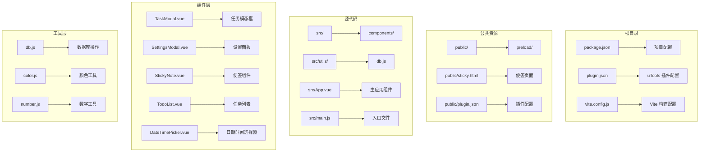
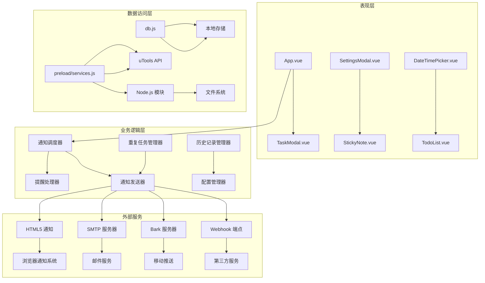
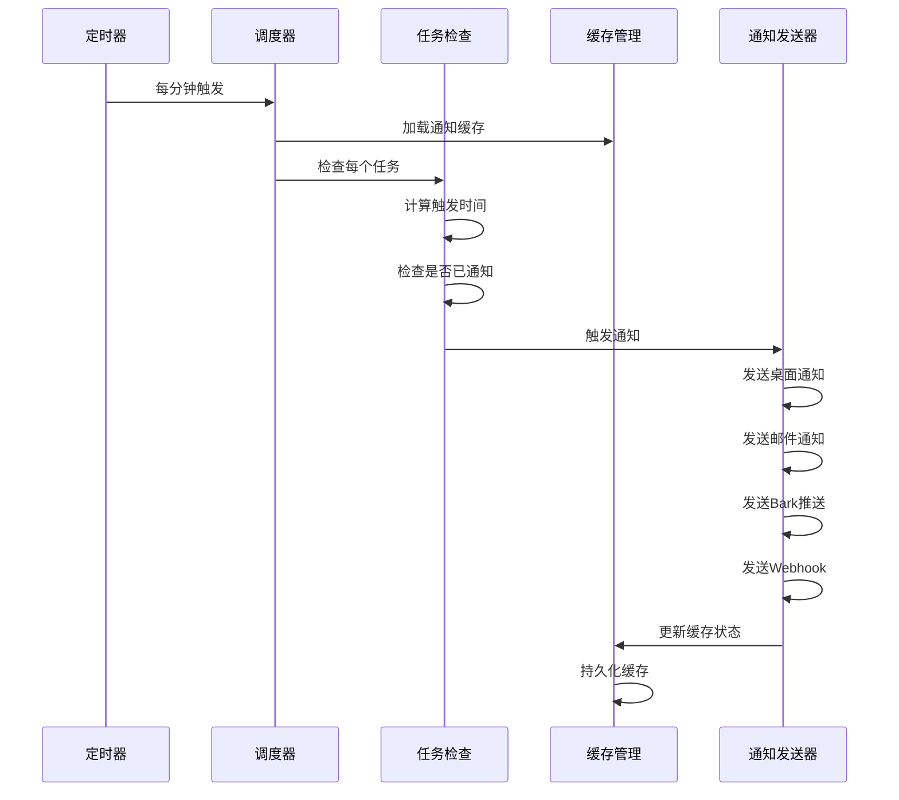
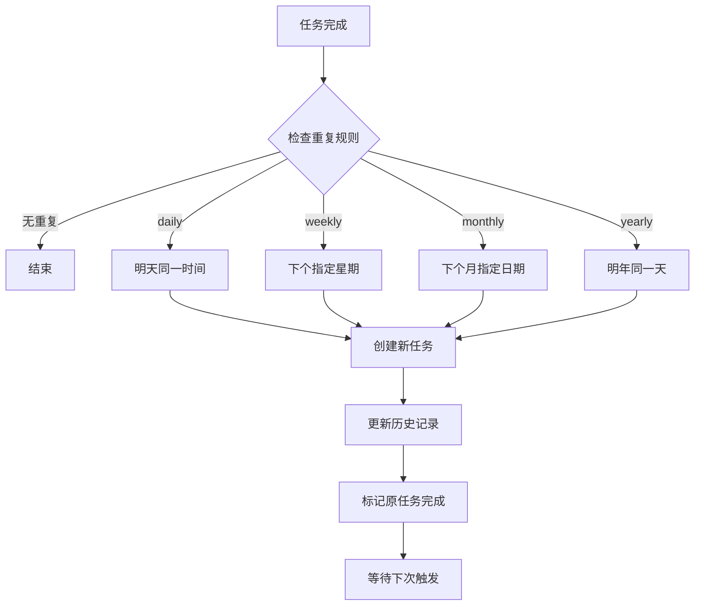

# 提醒通知系统

<cite>
**本文档引用的文件**
- [package.json](file://package.json)
- [plugin.json](file://plugin.json)
- [src/main.js](file://src/main.js)
- [src/App.vue](file://src/App.vue)
- [src/utils/db.js](file://src/utils/db.js)
- [src/components/SettingsModal.vue](file://src/components/SettingsModal.vue)
- [src/components/TaskModal.vue](file://src/components/TaskModal.vue)
- [src/components/StickyNote.vue](file://src/components/StickyNote.vue)
- [public/preload/services.js](file://public/preload/services.js)
- [public/sticky.html](file://public/sticky.html)
</cite>

## 目录
1. [简介](#简介)
2. [项目结构](#项目结构)
3. [核心组件](#核心组件)
4. [架构概览](#架构概览)
5. [详细组件分析](#详细组件分析)
6. [依赖关系分析](#依赖关系分析)
7. [性能考虑](#性能考虑)
8. [故障排除指南](#故障排除指南)
9. [结论](#结论)

## 简介

提醒通知系统是一个基于 Vue 3 构建的跨平台任务管理应用，集成了多种通知渠道和智能提醒机制。该系统支持桌面通知、邮件通知、Bark 推送和 Webhook 通知等多种通知方式，具备智能提醒调度、重复任务处理和通知历史记录管理等高级功能。

系统采用模块化设计，通过 uTools 插件框架运行在桌面环境中，同时支持浏览器开发模式。通知系统的核心特性包括：

- **多通道通知支持**：HTML5 原生通知、uTools 原生通知、邮件通知、Bark 推送、Webhook 通知
- **智能提醒调度**：基于定时器的任务检查和通知触发机制
- **重复任务处理**：支持每日、每周、每月、每年等重复规则的智能递归
- **通知历史管理**：本地缓存和历史记录跟踪
- **跨平台兼容**：支持 Windows、macOS、Linux 等多个操作系统

## 项目结构

该项目采用典型的 Vue 3 单页应用架构，主要目录结构如下：



**图表来源**
- [package.json:1-24](file://package.json#L1-L24)
- [plugin.json:1-21](file://plugin.json#L1-L21)
- [src/main.js:1-6](file://src/main.js#L1-L6)

**章节来源**
- [package.json:1-24](file://package.json#L1-L24)
- [plugin.json:1-21](file://plugin.json#L1-L21)
- [src/main.js:1-6](file://src/main.js#L1-L6)

## 核心组件

### 应用主组件 (App.vue)

应用主组件是整个提醒通知系统的核心，负责协调各个子系统的工作。主要功能包括：

- **状态管理**：管理应用状态、任务数据、设置配置等
- **通知调度**：定时检查任务状态并触发相应通知
- **提醒逻辑**：处理任务提醒的计算和触发机制
- **重复任务**：管理任务的重复规则和递归处理
- **UI 交互**：提供用户界面和交互功能

### 数据持久化 (db.js)

数据库模块提供了统一的数据访问接口，支持本地存储和 uTools 环境下的数据库操作：

- **跨环境适配**：在 uTools 环境和浏览器环境下自动切换存储方式
- **数据迁移**：支持数据格式的自动迁移和兼容性处理
- **备份恢复**：提供完整的数据备份和恢复功能

### 通知设置 (SettingsModal.vue)

设置面板组件允许用户配置各种通知选项：

- **桌面通知**：HTML5 原生通知和 uTools 原生通知
- **邮件通知**：SMTP 配置和邮件发送
- **Bark 推送**：Bark 服务集成和推送配置
- **Webhook 通知**：HTTP/Webhook 集成和自定义配置

**章节来源**
- [src/App.vue:1-800](file://src/App.vue#L1-L800)
- [src/utils/db.js:1-157](file://src/utils/db.js#L1-L157)
- [src/components/SettingsModal.vue:1-800](file://src/components/SettingsModal.vue#L1-L800)

## 架构概览

提醒通知系统采用分层架构设计，各层职责明确，耦合度低：



**图表来源**
- [src/App.vue:455-486](file://src/App.vue#L455-L486)
- [src/utils/db.js:102-156](file://src/utils/db.js#L102-L156)
- [public/preload/services.js:59-358](file://public/preload/services.js#L59-L358)

系统采用事件驱动的设计模式，通过定时器定期检查任务状态，当满足提醒条件时触发相应的通知流程。通知发送采用异步非阻塞的方式，确保用户体验的流畅性。

## 详细组件分析

### 通知调度系统

通知调度系统是整个提醒通知系统的核心，负责定时检查任务状态并触发通知：



**图表来源**
- [src/App.vue:941-1015](file://src/App.vue#L941-L1015)
- [src/App.vue:1017-1149](file://src/App.vue#L1017-L1149)

#### 触发条件判断

系统采用智能的时间比较算法来判断任务是否需要提醒：

1. **基础时间确定**：优先使用 `remindAt` 时间，否则使用 `dueDate`
2. **时间有效性验证**：确保解析后的日期时间有效
3. **缓存一致性检查**：避免重复通知相同任务
4. **时间窗口控制**：只在特定时间范围内触发通知

#### 通知缓存机制

为了防止重复通知和提高性能，系统实现了智能缓存机制：

- **本地缓存存储**：使用 `localStorage` 存储通知状态
- **TTL 管理**：7 天有效期的缓存清理机制
- **任务存在性验证**：定期清理不存在任务的缓存条目
- **状态同步**：缓存与任务状态保持一致

**章节来源**
- [src/App.vue:941-1015](file://src/App.vue#L941-L1015)
- [src/App.vue:58-81](file://src/App.vue#L58-L81)

### 多通道通知集成

系统支持四种不同的通知渠道，每种渠道都有其特定的实现方式：

#### 桌面通知 (HTML5 Notification API)

桌面通知是最直接的通知方式，具有以下特点：

- **权限管理**：自动请求和管理通知权限
- **交互能力**：支持点击交互和用户操作响应
- **跨平台兼容**：在不同操作系统上提供一致体验
- **降级处理**：在权限受限时自动回退到 uTools 通知

#### 邮件通知 (SMTP)

邮件通知通过 SMTP 协议实现，支持完整的邮件传输：

- **SMTP 配置**：支持多种 SMTP 服务器配置
- **认证机制**：支持用户名密码和 OAuth 认证
- **SSL/TLS 支持**：安全的邮件传输加密
- **错误处理**：完善的错误捕获和用户反馈

#### Bark 推送

Bark 是一款优秀的移动推送服务，系统提供了完整的集成：

- **服务器配置**：支持自定义 Bark 服务器地址
- **推送级别**：支持 active、timeSensitive、passive 等级别
- **个性化设置**：支持铃声、角标等个性化配置
- **URL 参数**：通过 URL 参数传递推送配置

#### Webhook 通知

Webhook 通知提供了最大的灵活性，可以集成到任何第三方服务：

- **HTTP 方法**：支持 GET 和 POST 方法
- **内容类型**：支持 JSON 和表单数据格式
- **自定义头部**：支持添加自定义请求头
- **动态负载**：支持自定义请求体内容

**章节来源**
- [src/App.vue:1017-1149](file://src/App.vue#L1017-L1149)
- [src/components/SettingsModal.vue:100-195](file://src/components/SettingsModal.vue#L100-L195)

### 重复任务处理机制

系统支持复杂的重复任务规则，能够智能地生成新的任务实例：



**图表来源**
- [src/App.vue:792-938](file://src/App.vue#L792-L938)

#### 重复规则计算

系统实现了精确的重复规则计算算法：

1. **每日重复**：简单地在当前日期基础上加一天
2. **每周重复**：根据用户选择的星期几计算下一个触发日期
3. **每月重复**：考虑月份天数差异，智能处理 2 月等特殊情况
4. **每年重复**：处理闰年等特殊情况

#### 历史记录管理

每次重复任务都会生成详细的历史记录：

- **事件类型**：recurrence 表示重复事件
- **时间戳**：记录事件发生的具体时间
- **关联任务**：记录新创建任务的 ID
- **状态追踪**：帮助用户了解任务的生命周期

**章节来源**
- [src/App.vue:792-938](file://src/App.vue#L792-L938)

### 任务提醒配置

任务提醒配置提供了灵活的提醒设置选项：

#### 提醒渠道选择

用户可以选择一个或多个通知渠道：

- **桌面通知**：最常用的本地提醒方式
- **邮件通知**：适合重要任务的重要提醒
- **Bark 推送**：移动端实时提醒
- **Webhook 通知**：集成到自定义系统

#### 提醒时间设置

系统支持多种提醒时间设置方式：

- **截止时间提醒**：在任务截止时间触发
- **自定义时间提醒**：用户可以设置具体的提醒时间
- **相对时间提醒**：设置提前若干分钟或小时提醒

#### 重复规则配置

支持多种重复规则：

- **不重复**：一次性提醒
- **每日**：每天同一时间提醒
- **每周**：每周固定星期几提醒
- **每月**：每月固定日期提醒
- **每年**：每年固定日期提醒

**章节来源**
- [src/components/TaskModal.vue:418-480](file://src/components/TaskModal.vue#L418-L480)
- [src/components/TaskModal.vue:593-787](file://src/components/TaskModal.vue#L593-L787)

## 依赖关系分析

系统采用模块化的依赖管理，各模块之间的关系清晰明确：

```mermaid
graph TB
subgraph "核心依赖"
A[Vue 3] --> B[响应式系统]
C[dayjs] --> D[日期处理]
E[uuid] --> F[唯一标识符]
end
subgraph "通知相关"
G[html2canvas] --> H[截图生成]
I[jspdf] --> J[PDF 创建]
K[nodemailer] --> L[邮件发送]
end
subgraph "UI 组件"
M[remixicon] --> N[图标字体]
O[vuedraggable] --> P[拖拽排序]
end
subgraph "构建工具"
Q[Vite] --> R[开发服务器]
S[Less] --> T[样式预处理]
U[@vitejs/plugin-vue] --> V[Vue 支持]
end
subgraph "开发依赖"
W[utools-api-types] --> X[类型定义]
Y[@vitejs/plugin-vue] --> Z[Vite 插件]
end
```

**图表来源**
- [package.json:7-22](file://package.json#L7-L22)

### 外部服务集成

系统通过 preload 脚本与 uTools 平台深度集成：

- **Node.js 模块**：文件系统、网络请求等底层功能
- **Electron API**：窗口管理、系统集成等高级功能
- **uTools API**：平台特定功能和系统集成

### 错误处理和降级机制

系统实现了多层次的错误处理和降级机制：

1. **通知权限错误**：自动降级到 uTools 原生通知
2. **网络连接错误**：邮件发送失败时提供用户反馈
3. **配置错误**：Bark 和 Webhook 配置错误时的处理
4. **存储错误**：数据库操作失败时的回退机制

**章节来源**
- [public/preload/services.js:59-358](file://public/preload/services.js#L59-L358)
- [src/App.vue:1034-1065](file://src/App.vue#L1034-L1065)

## 性能考虑

提醒通知系统在设计时充分考虑了性能优化，采用了多种策略来确保系统的高效运行：

### 内存管理优化

1. **定时器管理**：在组件卸载时正确清理定时器，防止内存泄漏
2. **缓存策略**：智能的本地缓存管理，避免无限增长
3. **对象复用**：合理使用对象池和缓存机制
4. **垃圾回收**：及时释放不再使用的对象引用

### 计算复杂度优化

1. **时间比较优化**：使用高效的 dayjs 库进行时间计算
2. **集合操作优化**：使用 Set 和 Map 提高查找效率
3. **批量操作**：减少不必要的 DOM 操作和状态更新
4. **延迟加载**：按需加载大型依赖模块

### 网络性能优化

1. **请求超时控制**：为外部请求设置合理的超时时间
2. **并发限制**：控制同时进行的通知发送数量
3. **重试机制**：智能的失败重试策略
4. **连接复用**：复用网络连接减少开销

### 用户体验优化

1. **异步处理**：所有耗时操作都采用异步方式
2. **进度反馈**：长时间操作提供进度指示
3. **错误恢复**：失败的操作提供恢复机制
4. **性能监控**：内置性能指标收集和分析

## 故障排除指南

### 常见问题诊断

#### 通知不生效

**症状**：设置了提醒但没有收到通知

**可能原因**：
1. 浏览器通知权限未授权
2. uTools 权限设置问题
3. 任务时间设置错误
4. 缓存状态异常

**解决方案**：
1. 检查浏览器通知权限设置
2. 在 uTools 设置中启用通知权限
3. 验证任务的提醒时间和通知渠道
4. 清除本地缓存重新启动应用

#### 邮件发送失败

**症状**：邮件通知发送失败

**可能原因**：
1. SMTP 配置错误
2. 网络连接问题
3. 账户认证失败
4. 防火墙阻止

**解决方案**：
1. 验证 SMTP 服务器地址和端口
2. 检查网络连接状态
3. 确认用户名和密码正确性
4. 检查防火墙设置

#### Bark 推送失败

**症状**：Bark 推送通知无法到达移动设备

**可能原因**：
1. 服务器地址配置错误
2. 网络连接问题
3. 设备离线状态
4. 服务器维护

**解决方案**：
1. 验证 Bark 服务器 URL 正确性
2. 检查移动设备网络连接
3. 确认设备处于在线状态
4. 查看 Bark 服务器状态

#### Webhook 请求失败

**症状**：Webhook 通知发送失败

**可能原因**：
1. Webhook URL 配置错误
2. 请求头设置问题
3. 自定义负载格式错误
4. 服务器端错误

**解决方案**：
1. 验证 Webhook URL 的正确性
2. 检查请求头配置格式
3. 验证自定义负载 JSON 格式
4. 查看服务器端错误日志

### 调试工具和方法

#### 开发者工具

1. **浏览器开发者工具**：检查控制台错误和网络请求
2. **Vue DevTools**：调试 Vue 组件状态和生命周期
3. **uTools 调试模式**：查看插件运行状态

#### 日志记录

系统提供了详细的日志记录机制：

- **通知发送日志**：记录每次通知的发送状态
- **错误日志**：捕获和记录所有异常情况
- **性能日志**：监控系统性能指标
- **用户行为日志**：记录用户操作和偏好

#### 性能监控

1. **内存使用监控**：定期检查内存占用情况
2. **CPU 使用率监控**：监控处理器使用情况
3. **网络请求监控**：跟踪外部服务调用
4. **存储使用监控**：检查本地存储空间使用

**章节来源**
- [src/App.vue:1034-1065](file://src/App.vue#L1034-L1065)
- [public/preload/services.js:342-356](file://public/preload/services.js#L342-L356)

## 结论

提醒通知系统是一个功能完善、架构清晰的跨平台任务管理应用。系统通过精心设计的多通道通知机制、智能的提醒调度算法和灵活的重复任务处理，为用户提供了全面的任务提醒解决方案。

### 主要优势

1. **多平台支持**：基于 uTools 框架，支持 Windows、macOS、Linux 等多个平台
2. **多通道通知**：支持桌面、邮件、移动推送、Webhook 等多种通知方式
3. **智能调度**：高效的定时器调度和智能的重复任务处理
4. **用户友好**：直观的界面设计和灵活的配置选项
5. **性能优化**：经过优化的内存管理和计算效率

### 技术特色

1. **模块化设计**：清晰的组件分离和职责划分
2. **异步处理**：非阻塞的通知发送和错误处理
3. **缓存机制**：智能的本地缓存和状态管理
4. **降级策略**：完善的错误处理和功能降级
5. **跨平台兼容**：统一的 API 接口和环境适配

### 未来发展方向

1. **云端同步**：增加云同步功能支持多设备数据同步
2. **AI 助手**：集成 AI 助手提供智能任务建议
3. **扩展插件**：支持更多第三方服务集成
4. **性能优化**：进一步提升系统性能和响应速度
5. **用户体验**：持续改进用户界面和交互体验

该系统为任务管理和提醒通知提供了一个坚实的技术基础，通过持续的优化和功能扩展，将成为一个更加完善和强大的生产力工具。