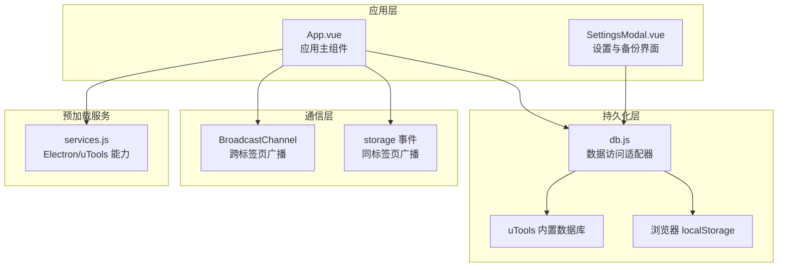
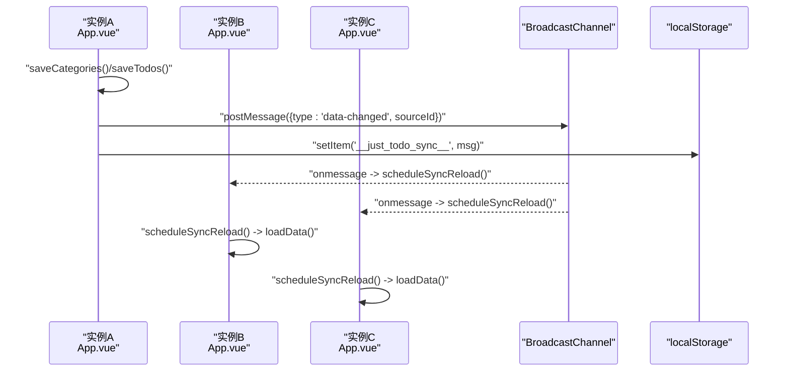
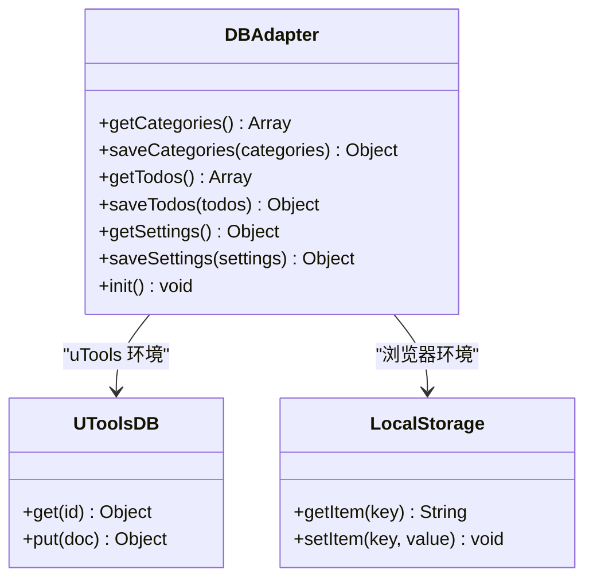
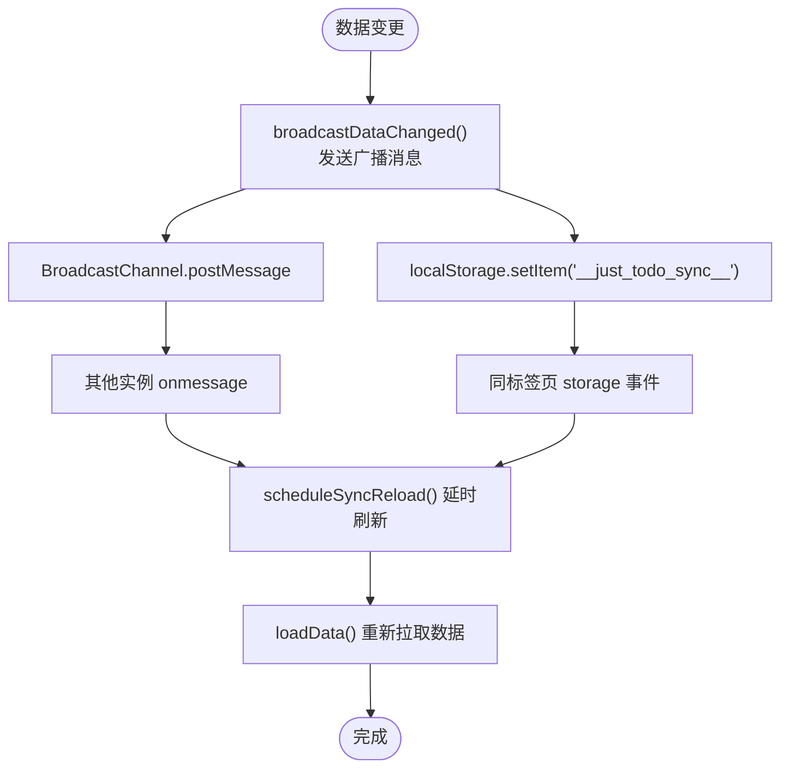
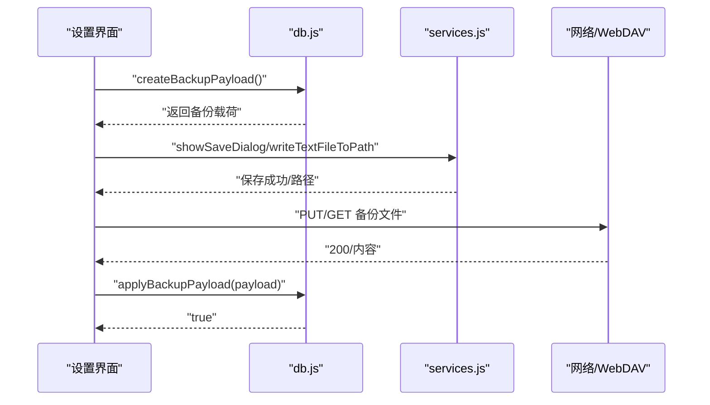
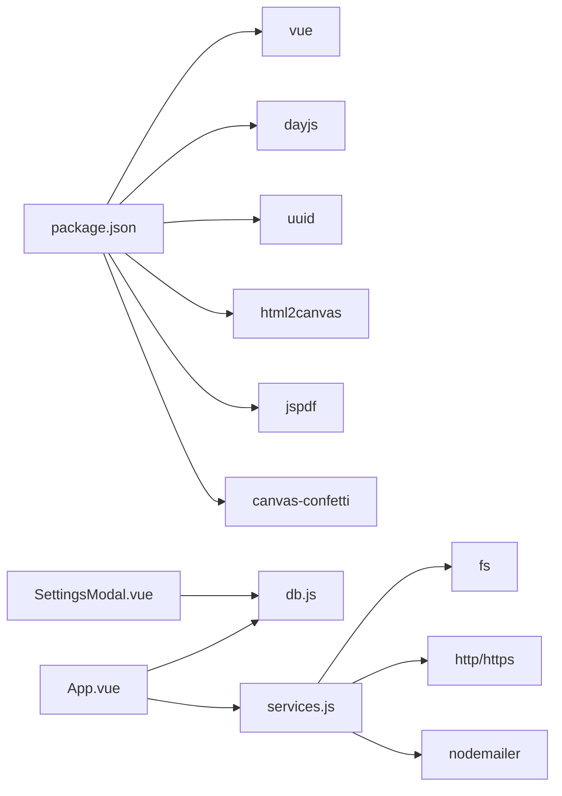

# 数据同步系统

<cite>
**本文引用的文件**
- [db.js](file://src/utils/db.js)
- [App.vue](file://src/App.vue)
- [services.js](file://public/preload/services.js)
- [SettingsModal.vue](file://src/components/SettingsModal.vue)
- [plugin.json](file://plugin.json)
- [package.json](file://package.json)
</cite>

## 目录
1. [简介](#简介)
2. [项目结构](#项目结构)
3. [核心组件](#核心组件)
4. [架构总览](#架构总览)
5. [详细组件分析](#详细组件分析)
6. [依赖关系分析](#依赖关系分析)
7. [性能考量](#性能考量)
8. [故障排查指南](#故障排查指南)
9. [结论](#结论)
10. [附录](#附录)

## 简介
本文件为“Just Todo”数据同步系统的详细技术文档，聚焦于跨标签页/窗口的数据同步机制与数据持久化策略。系统同时支持 uTools 插件环境与浏览器开发环境，采用 BroadcastChannel 作为主要跨上下文通信手段，并辅以 localStorage 的 storage 事件与本地存储广播，确保在多窗口或多标签页场景下的数据一致性。持久化层统一通过一个适配器封装，既可对接 uTools 内置数据库，也可回退到浏览器 localStorage，实现一致的 API 行为。

## 项目结构
- 应用入口与主组件：App.vue
- 数据持久化与备份/恢复：src/utils/db.js
- 预加载服务（Electron/uTools 能力桥接）：public/preload/services.js
- 设置与备份界面：src/components/SettingsModal.vue
- 插件配置：plugin.json
- 依赖声明：package.json

图表来源
- [App.vue:455-486](file://src/App.vue#L455-L486)
- [db.js:102-156](file://src/utils/db.js#L102-L156)
- [services.js:59-357](file://public/preload/services.js#L59-L357)

章节来源
- [plugin.json:1-21](file://plugin.json#L1-L21)
- [package.json:1-24](file://package.json#L1-L24)

## 核心组件
- 数据访问适配器（db.js）
  - 统一 get/save 接口，自动识别运行环境（uTools 或浏览器），并在浏览器环境下模拟版本号更新逻辑。
  - 提供备份/恢复能力：createBackupPayload 与 applyBackupPayload。
- 应用主组件（App.vue）
  - 初始化同步通道与 storage 监听，负责在数据变更后广播消息并延迟刷新。
  - 封装数据加载、保存与迁移逻辑。
- 预加载服务（services.js）
  - 向渲染进程注入 Node/Electron 能力（如文件对话框、HTTP 请求、邮件发送等），为备份/恢复提供平台能力。
- 设置与备份界面（SettingsModal.vue）
  - 提供本地备份导出、WebDAV 备份/恢复、HTTP 下载恢复等能力，并调用 db.js 的备份/恢复函数。

章节来源
- [db.js:102-156](file://src/utils/db.js#L102-L156)
- [App.vue:455-486](file://src/App.vue#L455-L486)
- [services.js:59-357](file://public/preload/services.js#L59-L357)
- [SettingsModal.vue:469-644](file://src/components/SettingsModal.vue#L469-L644)

## 架构总览
系统采用“适配器 + 广播 + 存储”的三层架构：
- 适配器层：db.js 统一对外暴露 get/save 与备份/恢复接口，内部根据运行环境切换实现。
- 广播层：App.vue 使用 BroadcastChannel 与 storage 事件进行跨上下文通知；每个实例生成唯一实例 ID，避免自播自听。
- 存储层：uTools 数据库存储或浏览器 localStorage；浏览器环境模拟 _rev 版本号以支持简单冲突检测。

图表来源
- [App.vue:122-141](file://src/App.vue#L122-L141)
- [App.vue:460-467](file://src/App.vue#L460-L467)
- [App.vue:489-535](file://src/App.vue#L489-L535)

## 详细组件分析

### 数据访问适配器（db.js）
- 环境探测与回退
  - 通过 window.utools 判断是否运行在 uTools 环境；否则回退到 localStorage，并提供 mock 数据用于开发。
- 文档模型与版本号
  - 采用 _id 作为文档标识，_rev 作为版本号（浏览器环境模拟递增）。
- 核心接口
  - getCategories()/saveCategories()
  - getTodos()/saveTodos()
  - getSettings()/saveSettings()
  - init() 自动初始化默认文档
- 备份/恢复
  - createBackupPayload：聚合 categories、todos、settings 与主题信息，输出带版本号的备份载荷。
  - applyBackupPayload：校验载荷结构与应用数据，必要时补全默认清单。

图表来源
- [db.js:102-156](file://src/utils/db.js#L102-L156)
- [db.js:21-43](file://src/utils/db.js#L21-L43)

章节来源
- [db.js:1-157](file://src/utils/db.js#L1-L157)

### 应用主组件（App.vue）中的同步机制
- 实例标识与通道
  - 每个实例生成唯一 syncInstanceId，避免自播自听。
  - 创建 BroadcastChannel('just-todo-sync')，监听 data-changed 消息并调度刷新。
- storage 事件回退
  - 监听 __just_todo_sync__ 键变化，解析消息并触发刷新。
- 刷新策略
  - broadcastDataChanged：发送广播消息。
  - scheduleSyncReload：去抖/节流，延时 60ms 后执行 loadData。
  - loadData：从 db.js 读取数据，必要时进行默认数据与迁移处理。
- 生命周期清理
  - onUnmounted 中移除 storage 监听、关闭 BroadcastChannel、清理定时器。

图表来源
- [App.vue:122-141](file://src/App.vue#L122-L141)
- [App.vue:115-122](file://src/App.vue#L115-L122)
- [App.vue:489-535](file://src/App.vue#L489-L535)

章节来源
- [App.vue:99-141](file://src/App.vue#L99-L141)
- [App.vue:455-486](file://src/App.vue#L455-L486)
- [App.vue:537-545](file://src/App.vue#L537-L545)

### 备份与恢复（SettingsModal.vue + db.js）
- 本地备份导出
  - 生成备份载荷并触发下载或保存对话框（优先使用 uTools services）。
- WebDAV 备份/恢复
  - 支持创建目录、上传/下载备份文件，列出目录并选择恢复。
- HTTP 恢复
  - 通过内置 HTTP 请求或浏览器 fetch 获取备份 JSON 并应用。
- 恢复流程
  - 解析 JSON -> 校验结构 -> 应用数据 -> 触发界面回调。

图表来源
- [SettingsModal.vue:469-644](file://src/components/SettingsModal.vue#L469-L644)
- [db.js:47-100](file://src/utils/db.js#L47-L100)
- [services.js:223-286](file://public/preload/services.js#L223-L286)

章节来源
- [SettingsModal.vue:469-644](file://src/components/SettingsModal.vue#L469-L644)
- [db.js:47-100](file://src/utils/db.js#L47-L100)

### 数据一致性、冲突解决与版本管理
- 版本与冲突
  - 浏览器环境通过 _rev 递增模拟版本号；uTools 环境由其数据库管理版本。
  - 同步广播不直接传输数据，仅触发 reload，避免跨实例并发写入冲突。
- 默认数据与迁移
  - 首次加载若缺失默认清单，自动补齐；后续迁移逻辑在 loadData 中处理字段补齐。
- 通知缓存
  - 使用 localStorage 缓存已提示任务，避免重复提醒。

章节来源
- [db.js:38-42](file://src/utils/db.js#L38-L42)
- [App.vue:498-525](file://src/App.vue#L498-L525)
- [App.vue:60-81](file://src/App.vue#L60-L81)

### API 接口文档（基于现有实现）
- 数据变更通知
  - 触发时机：saveCategories()/saveTodos()/saveSettings()（非静默保存）。
  - 广播内容：包含 type、sourceId、reason、at。
  - 接收方：其他实例监听 BroadcastChannel 与 storage 事件，延时刷新。
- 同步状态查询
  - 当前实现未提供显式的“同步状态查询”接口；可通过监听 data-changed 消息与本地刷新行为间接感知。
- 手动同步
  - loadData() 可视为手动触发的同步入口；scheduleSyncReload() 提供去抖控制。

章节来源
- [App.vue:537-545](file://src/App.vue#L537-L545)
- [App.vue:122-141](file://src/App.vue#L122-L141)
- [App.vue:489-535](file://src/App.vue#L489-L535)

## 依赖关系分析
- 运行时依赖
  - Vue 3、dayjs、uuid、html2canvas、jspdf、canvas-confetti 等。
- 平台能力
  - uTools 插件通过 preload 注入 Node/Electron 能力，用于文件对话框、HTTP 请求、邮件发送等。
- 插件配置
  - main、preload、development.main 等字段定义了应用入口与开发模式。

图表来源
- [package.json:7-22](file://package.json#L7-L22)
- [services.js:51-56](file://public/preload/services.js#L51-L56)

章节来源
- [package.json:1-24](file://package.json#L1-L24)
- [plugin.json:1-21](file://plugin.json#L1-L21)

## 性能考量
- 延迟刷新与去抖
  - scheduleSyncReload 在收到广播后延时 60ms 刷新，减少频繁重载带来的抖动。
- 广播与回退
  - BroadcastChannel 为主，storage 事件为回退，确保在不同浏览器/环境下的兼容性。
- 异常容错
  - 广播与 storage 处理均包裹 try/catch，避免单点异常影响整体。
- I/O 优化
  - 备份导出优先使用 uTools services 的写文件能力，减少内存拷贝与 URL 对象创建。

章节来源
- [App.vue:115-141](file://src/App.vue#L115-L141)
- [App.vue:309-322](file://src/App.vue#L309-L322)
- [SettingsModal.vue:476-494](file://src/components/SettingsModal.vue#L476-L494)

## 故障排查指南
- 广播无效
  - 检查 BroadcastChannel 是否可用与实例 ID 是否正确过滤自播。
  - 确认 storage 事件监听是否注册。
- 数据未刷新
  - 确认 loadData() 是否被 scheduleSyncReload() 调用。
  - 检查 db.js 的 get/save 是否抛出异常。
- 备份/恢复失败
  - 校验备份载荷结构（app、version、data、extra）。
  - WebDAV/HTTP 场景检查网络与权限。
- uTools 环境差异
  - 确认 window.utools 与 window.services 是否可用，部分 API 在旧版本可能不存在。

章节来源
- [App.vue:455-486](file://src/App.vue#L455-L486)
- [db.js:71-100](file://src/utils/db.js#L71-L100)
- [services.js:59-357](file://public/preload/services.js#L59-L357)

## 结论
该系统通过“适配器 + 广播 + 存储”的组合，在 uTools 与浏览器环境中实现了稳定的跨标签页/窗口数据同步。db.js 提供统一的持久化接口与备份/恢复能力；App.vue 以 BroadcastChannel 与 storage 事件为核心，结合延时刷新策略，兼顾实时性与性能。未来可在以下方面进一步增强：引入更细粒度的增量同步、版本合并策略与冲突仲裁、以及显式的同步状态查询接口。

## 附录
- 运行与开发
  - 开发模式：npm run dev
  - 构建：npm run build
- 插件入口
  - main、preload、development.main 在 plugin.json 中定义

章节来源
- [plugin.json:1-21](file://plugin.json#L1-L21)
- [package.json:3-6](file://package.json#L3-L6)