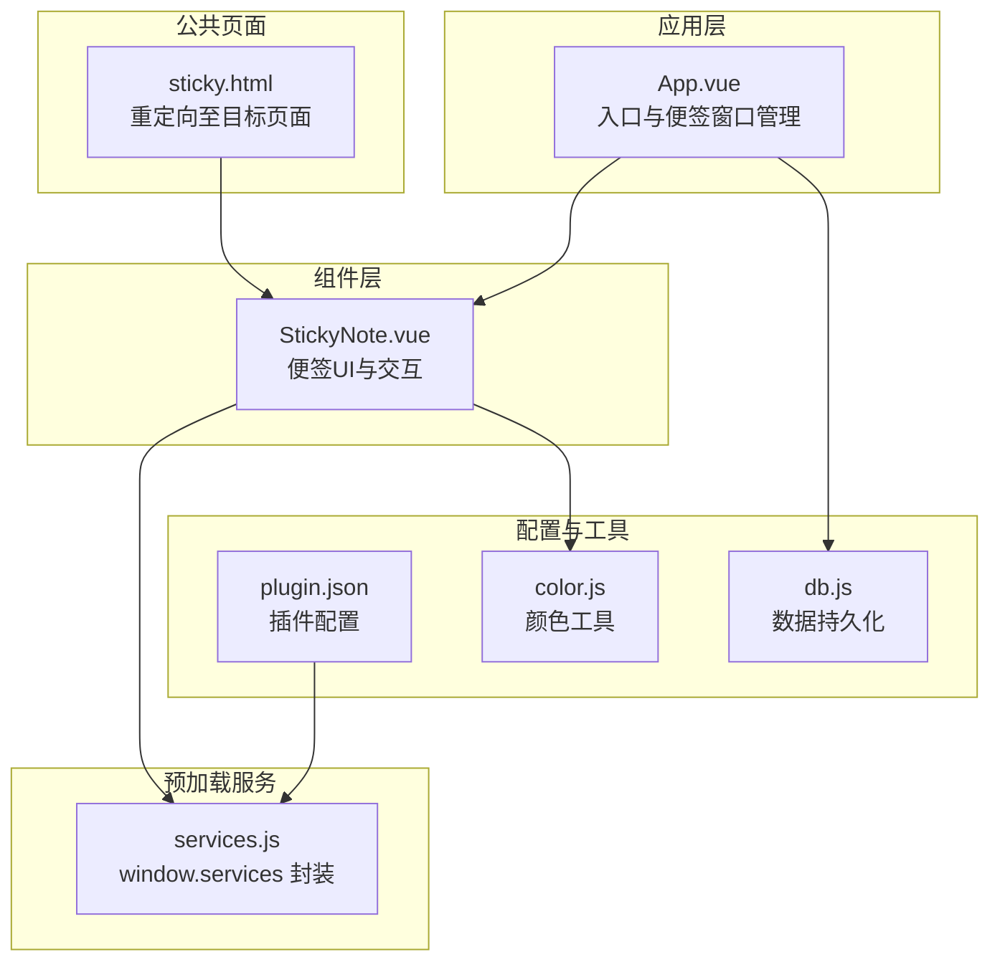
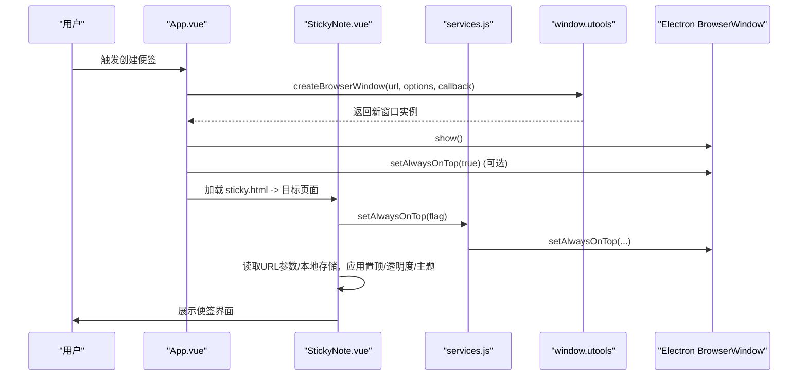
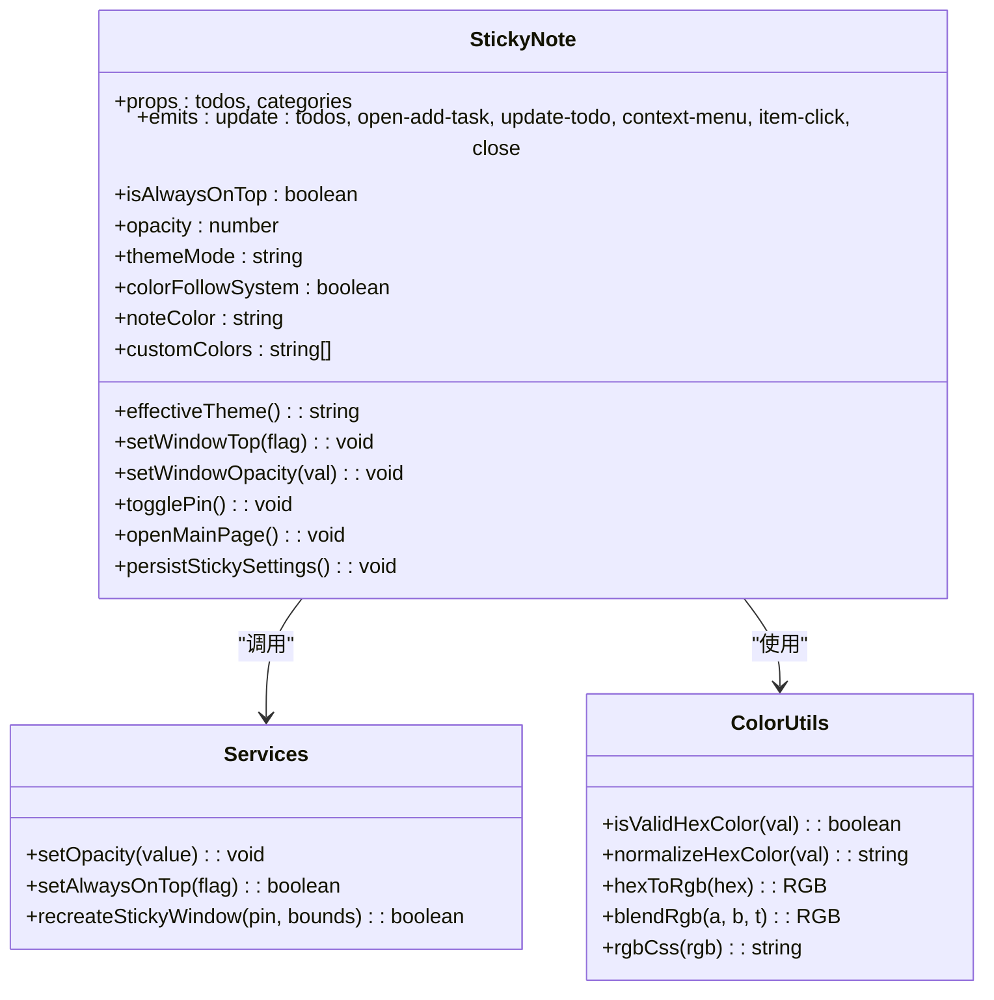
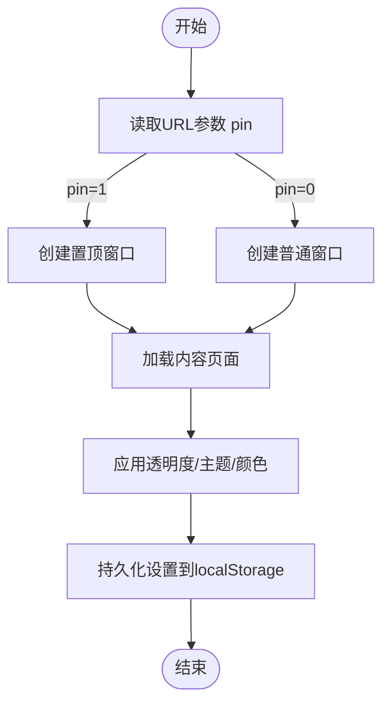
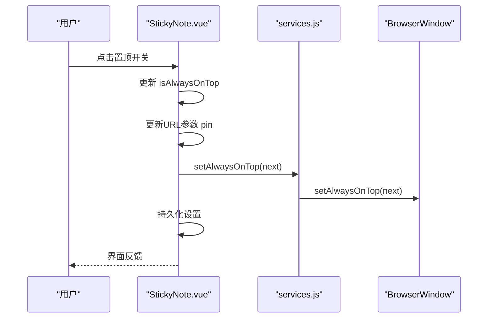
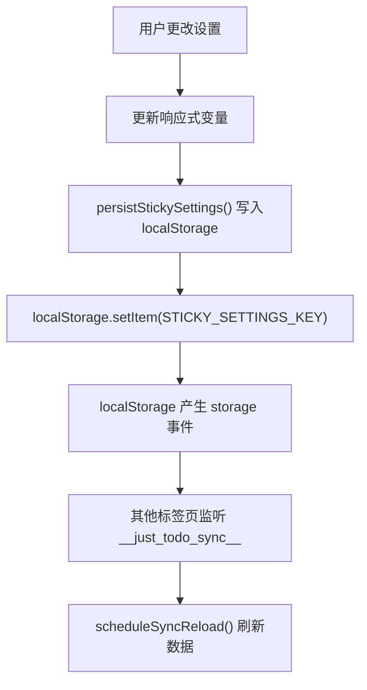
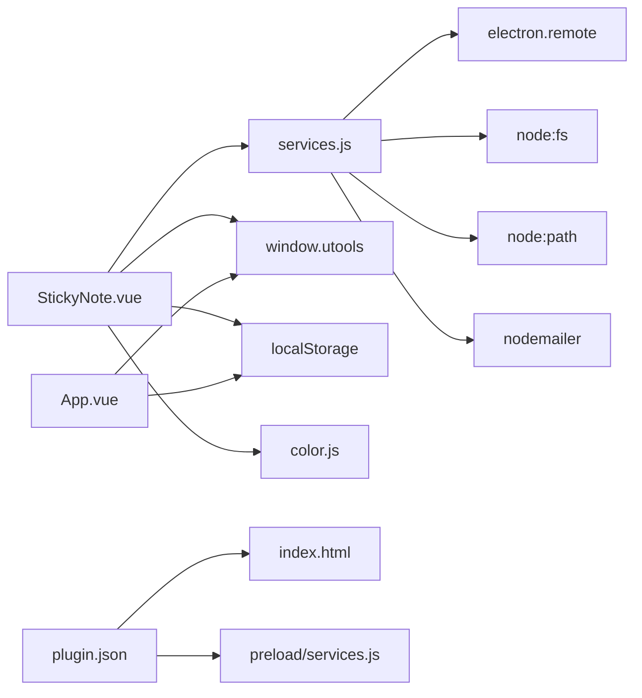

# 便签模式

<cite>
**本文档引用的文件**
- [StickyNote.vue](file://src/components/StickyNote.vue)
- [sticky.html](file://public/sticky.html)
- [services.js](file://public/preload/services.js)
- [App.vue](file://src/App.vue)
- [db.js](file://src/utils/db.js)
- [color.js](file://src/utils/color.js)
- [plugin.json](file://public/plugin.json)
- [main.js](file://src/main.js)
- [StickyNote.test.js](file://src/components/StickyNote.test.js)
</cite>

## 目录
1. [简介](#简介)
2. [项目结构](#项目结构)
3. [核心组件](#核心组件)
4. [架构总览](#架构总览)
5. [详细组件分析](#详细组件分析)
6. [依赖关系分析](#依赖关系分析)
7. [性能考虑](#性能考虑)
8. [故障排除指南](#故障排除指南)
9. [结论](#结论)
10. [附录](#附录)

## 简介
本文件系统性阐述“便签模式”的技术实现，重点围绕 StickyNote 组件展开，涵盖以下方面：
- 悬浮窗口管理与置顶显示机制
- 窗口状态保持（透明度、置顶状态、主题与颜色）
- 生命周期管理（创建、销毁、状态同步）
- 用户交互处理（拖拽、大小调整、透明度控制、颜色定制）
- 技术实现细节（window.utools API 使用、窗口属性设置、跨标签页数据同步）
- 配置选项与扩展方法（便签数量限制、位置记忆、主题适配）

## 项目结构
该项目基于 Vue 3 + uTools 插件框架构建，便签模式通过独立的悬浮窗口实现，核心文件分布如下：
- 组件层：StickyNote.vue 提供便签界面与交互逻辑
- 应用层：App.vue 提供入口与便签窗口创建/切换逻辑
- 预加载服务：services.js 注入 window.services，封装窗口操作
- 配置与插件：plugin.json 定义插件入口与预加载脚本
- 数据持久化：db.js 封装本地存储与数据库访问
- 工具函数：color.js 提供颜色转换与混合工具

**图表来源**
- [App.vue:1622-1666](file://src/App.vue#L1622-L1666)
- [StickyNote.vue:196-266](file://src/components/StickyNote.vue#L196-L266)
- [services.js:59-132](file://public/preload/services.js#L59-L132)
- [sticky.html:1-21](file://public/sticky.html#L1-L21)
- [plugin.json:1-21](file://public/plugin.json#L1-L21)
- [db.js:102-157](file://src/utils/db.js#L102-L157)
- [color.js:1-27](file://src/utils/color.js#L1-L27)

**章节来源**
- [App.vue:1-200](file://src/App.vue#L1-L200)
- [StickyNote.vue:1-1283](file://src/components/StickyNote.vue#L1-L1283)
- [services.js:1-358](file://public/preload/services.js#L1-L358)
- [sticky.html:1-21](file://public/sticky.html#L1-L21)
- [plugin.json:1-21](file://public/plugin.json#L1-L21)
- [db.js:1-157](file://src/utils/db.js#L1-L157)
- [color.js:1-27](file://src/utils/color.js#L1-L27)

## 核心组件
- StickyNote.vue：便签 UI、交互与状态管理，负责透明度、置顶、主题与颜色等设置的持久化与实时生效。
- services.js：在渲染进程中注入 window.services，统一调用 setOpacity、setAlwaysOnTop、recreateStickyWindow 等能力。
- App.vue：提供 createStickyWindow 与 togglePin，用于创建/切换便签窗口及置顶状态切换。
- sticky.html：轻量页面，根据查询参数重定向到目标页面（如 index.html#/sticky）。
- db.js：提供 categories、todos、settings 的读写与初始化，支持备份/恢复。
- color.js：提供颜色校验、标准化、RGB 转换与混合等工具。

**章节来源**
- [StickyNote.vue:1-1283](file://src/components/StickyNote.vue#L1-L1283)
- [services.js:59-132](file://public/preload/services.js#L59-L132)
- [App.vue:1622-1716](file://src/App.vue#L1622-L1716)
- [sticky.html:1-21](file://public/sticky.html#L1-L21)
- [db.js:102-157](file://src/utils/db.js#L102-L157)
- [color.js:1-27](file://src/utils/color.js#L1-L27)

## 架构总览
便签模式采用“独立悬浮窗口 + 预加载服务”的架构：
- 渲染进程通过 window.services 调用原生窗口 API（透明度、置顶、重建窗口）
- StickyNote.vue 在挂载时读取 URL 参数决定初始置顶状态，并同步到窗口
- 状态通过 localStorage 持久化，确保重启后恢复
- App.vue 提供统一的便签窗口创建入口，便于从主界面触发

**图表来源**
- [App.vue:1622-1666](file://src/App.vue#L1622-L1666)
- [StickyNote.vue:228-266](file://src/components/StickyNote.vue#L228-L266)
- [services.js:59-132](file://public/preload/services.js#L59-L132)

## 详细组件分析

### StickyNote 组件分析
StickyNote 是便签模式的核心，负责：
- 初始化与状态恢复：从 URL 查询参数或本地存储读取置顶、透明度、主题与颜色等设置
- 置顶显示：优先通过 window.services.setAlwaysOnTop，回退到 window.utools.getCurrentBrowserWindow
- 透明度控制：通过 window.services.setOpacity 或原生窗口 setOpacity
- 主题与颜色：支持浅色/深色/系统主题；支持预设与自定义颜色；支持跟随系统主题
- 窗口重建：当切换置顶状态时，通过 window.utools.createBrowserWindow 重建窗口，保证置顶状态正确
- 任务列表集成：嵌入 TodoList 子组件，传递 todos/categories 并处理事件

**图表来源**
- [StickyNote.vue:1-1283](file://src/components/StickyNote.vue#L1-L1283)
- [services.js:59-132](file://public/preload/services.js#L59-L132)
- [color.js:1-27](file://src/utils/color.js#L1-L27)

**章节来源**
- [StickyNote.vue:1-1283](file://src/components/StickyNote.vue#L1-L1283)
- [color.js:1-27](file://src/utils/color.js#L1-L27)

### 窗口生命周期管理
- 创建：App.vue 的 createStickyWindow 根据 bounds 与 pin 参数创建透明无框窗口，加载 sticky.html 并在回调中显示
- 销毁：通过 window.close 或 destroy/close 方法销毁当前窗口；在重建时先创建新窗口再销毁旧窗口
- 状态同步：通过 URL 查询参数（pin）与本地存储（STICKY_SETTINGS_KEY）同步置顶状态与外观设置

**图表来源**
- [App.vue:1622-1666](file://src/App.vue#L1622-L1666)
- [StickyNote.vue:368-545](file://src/components/StickyNote.vue#L368-L545)
- [sticky.html:1-21](file://public/sticky.html#L1-L21)

**章节来源**
- [App.vue:1622-1666](file://src/App.vue#L1622-L1666)
- [StickyNote.vue:368-545](file://src/components/StickyNote.vue#L368-L545)
- [sticky.html:1-21](file://public/sticky.html#L1-L21)

### 用户交互处理
- 拖拽移动：通过 CSS 属性 -webkit-app-region 实现标题栏拖拽区域，实现窗口拖拽
- 大小调整：窗口 resizable=true，允许用户调整尺寸
- 透明度控制：滑块输入更新 opacity，实时影响便签透明度
- 颜色定制：支持预设颜色与自定义颜色，支持编辑与删除，颜色变更自动持久化
- 置顶切换：菜单开关切换 isAlwaysOnTop，同时更新 URL 参数与窗口置顶状态

**图表来源**
- [StickyNote.vue:368-475](file://src/components/StickyNote.vue#L368-L475)
- [services.js:69-132](file://public/preload/services.js#L69-L132)

**章节来源**
- [StickyNote.vue:606-608](file://src/components/StickyNote.vue#L606-L608)
- [StickyNote.vue:630-770](file://src/components/StickyNote.vue#L630-L770)

### 数据持久化与跨标签页同步
- 便签设置持久化：STICKY_SETTINGS_KEY 记录 themeMode、colorFollowSystem、noteColor、opacity、isAlwaysOnTop
- 自定义颜色持久化：justtodo_custom_colors 记录用户自定义颜色列表
- 跨标签页同步：通过 localStorage 的 storage 事件监听 __just_todo_sync__，实现数据变更广播与刷新

**图表来源**
- [StickyNote.vue:102-113](file://src/components/StickyNote.vue#L102-L113)
- [App.vue:123-141](file://src/App.vue#L123-L141)

**章节来源**
- [StickyNote.vue:70-113](file://src/components/StickyNote.vue#L70-L113)
- [App.vue:116-141](file://src/App.vue#L116-L141)
- [db.js:47-100](file://src/utils/db.js#L47-L100)

## 依赖关系分析
- StickyNote.vue 依赖：
  - window.services（预加载注入）：setOpacity、setAlwaysOnTop、recreateStickyWindow
  - window.utools：getCurrentBrowserWindow、createBrowserWindow、showMainWindow
  - localStorage：持久化设置与颜色
  - 颜色工具：color.js
- App.vue 依赖：
  - window.utools：createBrowserWindow、outPlugin、showNotification
  - localStorage：跨标签页同步
- services.js 依赖：
  - electron.remote：获取当前窗口实例
  - node:fs、node:path：文件读写
  - nodemailer：邮件发送
- plugin.json：
  - main/index.html：主入口
  - preload/services.js：预加载脚本

**图表来源**
- [StickyNote.vue:196-266](file://src/components/StickyNote.vue#L196-L266)
- [services.js:51-358](file://public/preload/services.js#L51-L358)
- [App.vue:1622-1716](file://src/App.vue#L1622-L1716)
- [plugin.json:1-21](file://public/plugin.json#L1-L21)

**章节来源**
- [StickyNote.vue:196-266](file://src/components/StickyNote.vue#L196-L266)
- [services.js:51-358](file://public/preload/services.js#L51-L358)
- [App.vue:1622-1716](file://src/App.vue#L1622-L1716)
- [plugin.json:1-21](file://public/plugin.json#L1-L21)

## 性能考虑
- 窗口重建策略：切换置顶状态时通过 window.utools.createBrowserWindow 重建窗口，避免直接修改窗口层级导致的不稳定
- 动画与事件：菜单弹出使用 CSS 动画，避免复杂 JS 动画造成卡顿
- 颜色计算：主题与颜色混合计算在响应式计算属性中进行，减少重复计算
- 透明度与置顶：通过 window.services.setOpacity/setAlwaysOnTop 执行原生优化路径
- 跨标签页同步：通过 localStorage storage 事件进行轻量级广播，避免频繁轮询

[本节为通用性能建议，不直接分析具体文件]

## 故障排除指南
- 置顶无效
  - 检查 window.services.setAlwaysOnTop 是否返回 true
  - 若失败，尝试多次 setAlwaysOnTop(true, 'screen-saver') / ('floating') / ('normal')
  - 参考：[StickyNote.vue:228-266](file://src/components/StickyNote.vue#L228-L266)、[services.js:69-132](file://public/preload/services.js#L69-L132)
- 透明度不生效
  - 确认 window.services.setOpacity 是否存在且可用
  - 回退到原生窗口 setOpacity
  - 参考：[StickyNote.vue:215-226](file://src/components/StickyNote.vue#L215-L226)
- 窗口无法拖拽
  - 确保标题栏使用 -webkit-app-region: drag
  - 控制按钮区域使用 -webkit-app-region: no-drag
  - 参考：[StickyNote.vue:806-823](file://src/components/StickyNote.vue#L806-L823)
- 自定义颜色丢失
  - 检查 localStorage 中 justtodo_custom_colors 是否存在
  - 确认颜色值符合十六进制规范
  - 参考：[StickyNote.vue:311-366](file://src/components/StickyNote.vue#L311-L366)、[color.js:1-27](file://src/utils/color.js#L1-L27)
- 跨标签页不同步
  - 确认 __just_todo_sync__ 事件是否触发
  - 检查 scheduleSyncReload 是否被调用
  - 参考：[App.vue:123-141](file://src/App.vue#L123-L141)

**章节来源**
- [StickyNote.vue:215-266](file://src/components/StickyNote.vue#L215-L266)
- [services.js:69-132](file://public/preload/services.js#L69-L132)
- [color.js:1-27](file://src/utils/color.js#L1-L27)
- [App.vue:123-141](file://src/App.vue#L123-L141)

## 结论
便签模式通过 StickyNote 组件与 services.js 的协同，实现了稳定的悬浮窗口管理与丰富的用户交互体验。其设计遵循“渲染进程统一调用原生能力”的原则，结合本地存储与跨标签页同步，确保了状态的一致性与可恢复性。未来可在以下方面进一步完善：
- 增加便签数量上限与多便签管理
- 支持位置记忆与窗口边界约束
- 提供更细粒度的主题与颜色扩展接口
- 优化窗口重建流程，减少闪烁与抖动

[本节为总结性内容，不直接分析具体文件]

## 附录

### 配置选项与扩展方法
- 便签数量限制：当前实现未强制限制数量，可通过 App.vue 的 stickyWindowInstance 单例控制
- 位置记忆：通过 bounds 参数传入窗口初始位置与尺寸，重建时复用
- 主题适配：支持 light/dark/system 三种模式，可跟随系统主题
- 颜色定制：支持预设与自定义颜色，颜色变更自动持久化
- 透明度控制：范围 0.05-1，实时生效
- 置顶状态：通过菜单开关与 URL 参数 pin 控制

**章节来源**
- [App.vue:1622-1666](file://src/App.vue#L1622-L1666)
- [StickyNote.vue:70-113](file://src/components/StickyNote.vue#L70-L113)
- [StickyNote.vue:630-770](file://src/components/StickyNote.vue#L630-L770)

### API 与事件参考
- window.services.setOpacity(value)
- window.services.setAlwaysOnTop(flag)
- window.services.recreateStickyWindow(pin, bounds)
- window.utools.createBrowserWindow(url, options, callback)
- window.utools.getCurrentBrowserWindow()
- window.utools.showMainWindow()

**章节来源**
- [services.js:59-132](file://public/preload/services.js#L59-L132)
- [App.vue:1622-1666](file://src/App.vue#L1622-L1666)
- [StickyNote.vue:196-266](file://src/components/StickyNote.vue#L196-L266)