# 列表视图

<cite>
**本文档引用的文件**
- [TodoList.vue](file://src/components/TodoList.vue)
- [App.vue](file://src/App.vue)
- [db.js](file://src/utils/db.js)
- [main.css](file://src/main.css)
- [TaskModal.vue](file://src/components/TaskModal.vue)
- [TaskDrawer.vue](file://src/components/TaskDrawer.vue)
- [main.js](file://src/main.js)
</cite>

## 目录
1. [简介](#简介)
2. [项目结构](#项目结构)
3. [核心组件](#核心组件)
4. [架构概览](#架构概览)
5. [详细组件分析](#详细组件分析)
6. [依赖关系分析](#依赖关系分析)
7. [性能考虑](#性能考虑)
8. [故障排除指南](#故障排除指南)
9. [结论](#结论)

## 简介

TodoList 组件是 Just-Todo 应用程序的核心列表视图组件，负责渲染和管理待办事项列表。该组件实现了完整的任务列表功能，包括任务渲染、排序和过滤、拖拽排序、响应式布局等特性。它采用 Vue 3 Composition API 构建，结合 Day.js 进行日期处理，使用 vuedraggable 实现拖拽功能，并通过全局状态管理实现组件间通信。

## 项目结构

Just-Todo 项目采用模块化架构设计，主要组件分布如下：

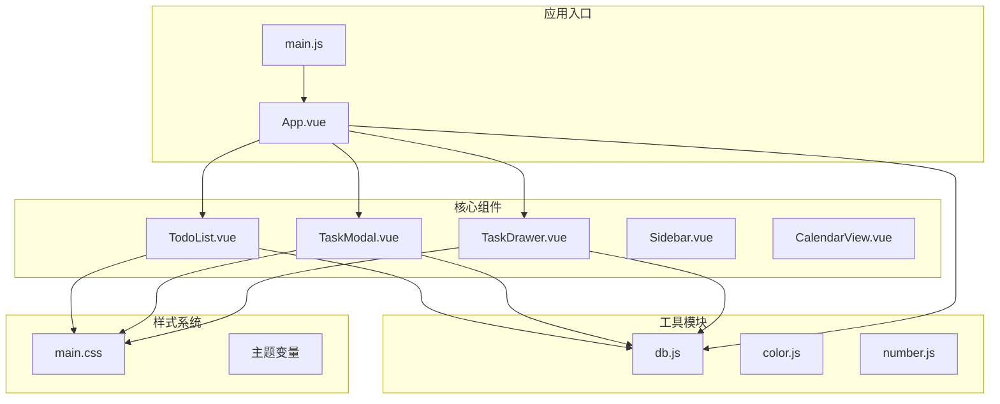

**图表来源**
- [main.js:1-6](file://src/main.js#L1-L6)
- [App.vue:1-50](file://src/App.vue#L1-L50)
- [TodoList.vue:1-50](file://src/components/TodoList.vue#L1-L50)

**章节来源**
- [main.js:1-6](file://src/main.js#L1-L6)
- [App.vue:1-100](file://src/App.vue#L1-L100)

## 核心组件

TodoList 组件是整个应用程序的核心，承担着以下主要职责：

### 主要功能特性

1. **任务列表渲染**：支持多种视图模式（全部待办、今日待办、计划、紧急、已完成）
2. **分组显示**：根据不同的分类标准对任务进行智能分组
3. **排序功能**：支持多种排序规则（创建时间、截止日期、优先级）
4. **过滤机制**：基于类别和状态的任务过滤
5. **拖拽排序**：使用 vuedraggable 实现任务项的拖拽重新排序
6. **响应式布局**：适配不同屏幕尺寸和设备类型
7. **附件管理**：支持图片、文本、PDF 等多种文件类型的预览和下载
8. **子任务系统**：支持嵌套的子任务管理和进度跟踪

### 数据绑定方式

组件采用双向数据绑定的方式与父组件通信：

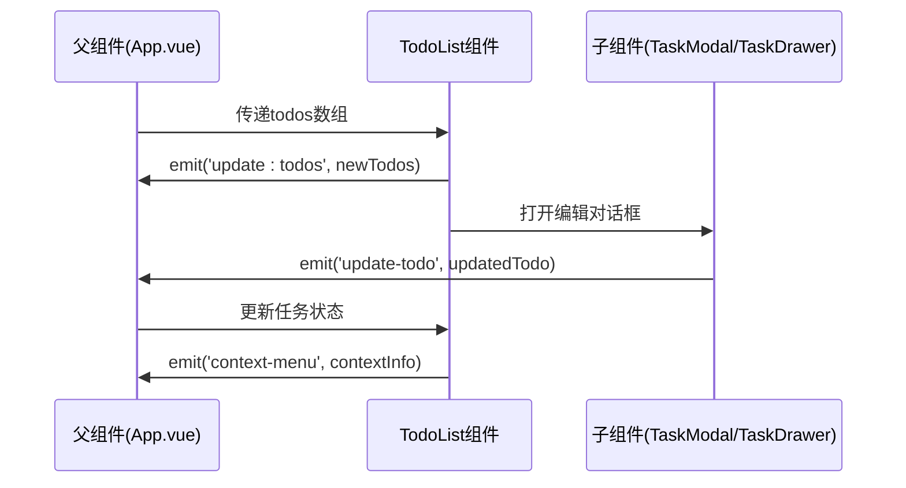

**图表来源**
- [TodoList.vue:30-37](file://src/components/TodoList.vue#L30-L37)
- [App.vue:640-790](file://src/App.vue#L640-L790)

**章节来源**
- [TodoList.vue:9-28](file://src/components/TodoList.vue#L9-L28)
- [TodoList.vue:30-37](file://src/components/TodoList.vue#L30-L37)

## 架构概览

TodoList 组件采用分层架构设计，实现了清晰的关注点分离：

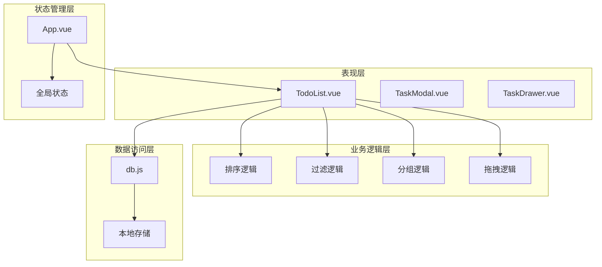

**图表来源**
- [TodoList.vue:176-179](file://src/components/TodoList.vue#L176-L179)
- [App.vue:351-415](file://src/App.vue#L351-L415)
- [db.js:102-157](file://src/utils/db.js#L102-L157)

### 组件通信协议

TodoList 组件定义了明确的事件通信协议：

| 事件名称 | 参数类型 | 描述 |
|---------|----------|------|
| update:todos | Array | 当任务列表发生变更时触发 |
| open-add-task | Object | 请求打开添加任务对话框 |
| update-todo | Object | 更新单个任务信息 |
| context-menu | Object | 右键菜单事件 |
| item-click | Object | 列表项点击事件 |

**章节来源**
- [TodoList.vue:30-37](file://src/components/TodoList.vue#L30-L37)
- [App.vue:617-790](file://src/App.vue#L617-L790)

## 详细组件分析

### 任务列表渲染机制

TodoList 组件实现了智能的任务列表渲染机制，支持多种视图模式：

#### 视图模式分类

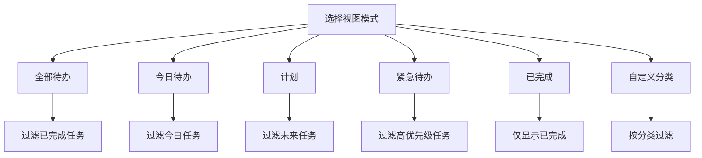

**图表来源**
- [App.vue:351-415](file://src/App.vue#L351-L415)
- [TodoList.vue:300-495](file://src/components/TodoList.vue#L300-L495)

#### 分组算法实现

组件根据不同的视图模式采用相应的分组策略：

**粘性模式（Sticky Mode）**：
- 今日待办：按日期分组，突出显示当天任务
- 紧急待办：按优先级分组，高优先级和中优先级任务
- 分类列表：显示所有分类，即使为空

**优先级模式（Urgent）**：
- 按优先级分组：高、中、低、无优先级
- 默认展开最高优先级组

**日期模式（Plan）**：
- 按日期分组：今天、明天、未来日期、已过期
- 支持自定义日期范围

**章节来源**
- [TodoList.vue:300-495](file://src/components/TodoList.vue#L300-L495)

### 排序和过滤功能

#### 排序逻辑

TodoList 组件支持多种排序规则：

| 排序字段 | 排序方向 | 默认行为 |
|---------|----------|----------|
| default | asc | 按原始顺序 |
| createdAt | desc | 最新创建的任务在前 |
| dueDate | asc | 截止日期早的任务在前 |
| priority | desc | 高优先级任务在前 |

#### 过滤逻辑

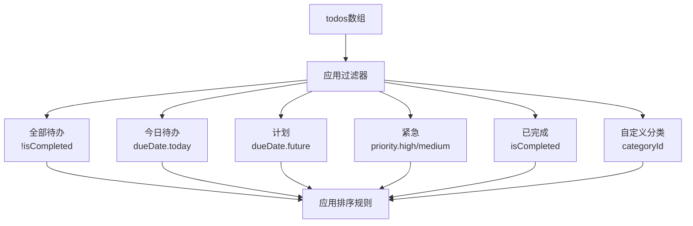

**图表来源**
- [App.vue:351-415](file://src/App.vue#L351-L415)
- [App.vue:325-348](file://src/App.vue#L325-L348)

**章节来源**
- [App.vue:351-415](file://src/App.vue#L351-L415)
- [App.vue:325-348](file://src/App.vue#L325-L348)

### 拖拽排序实现

TodoList 组件集成了 vuedraggable 库实现拖拽排序功能：

#### 拖拽配置

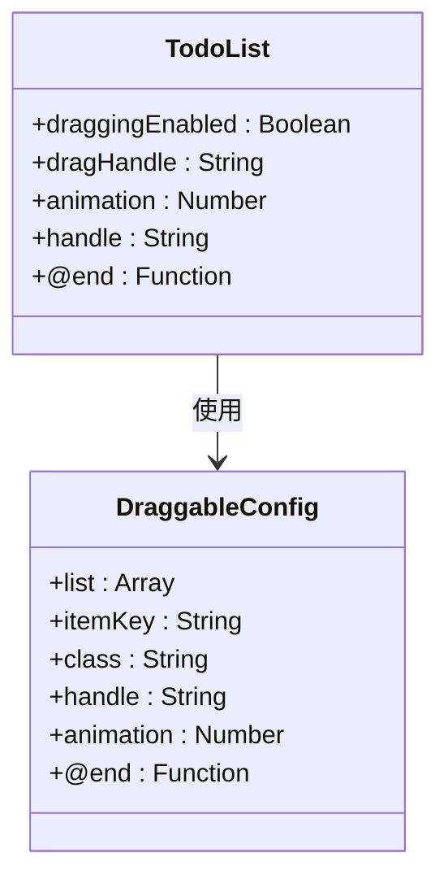

**图表来源**
- [TodoList.vue:765-782](file://src/components/TodoList.vue#L765-L782)

#### 拖拽状态管理

拖拽功能仅在特定条件下启用：

- **激活任务组**：仅当处于自定义分类且非排序状态时
- **视图模式限制**：粘性模式下禁用拖拽
- **类别过滤**：排除全部、今日、计划、紧急、已完成视图

**章节来源**
- [TodoList.vue:765-782](file://src/components/TodoList.vue#L765-L782)

### 响应式布局

TodoList 组件采用灵活的响应式设计：

#### 布局特性

| 特性 | 移动端 | 平板端 | 桌面端 |
|------|--------|--------|--------|
| 列表间距 | 16px | 24px | 30px |
| 分组头部间距 | 8px | 12px | 12px |
| 卡片圆角 | 8px | 10px | 10px |
| 内边距 | 8px | 10px | 10px |
| 悬浮效果 | 简化 | 标准 | 标准 |

#### 滚动行为

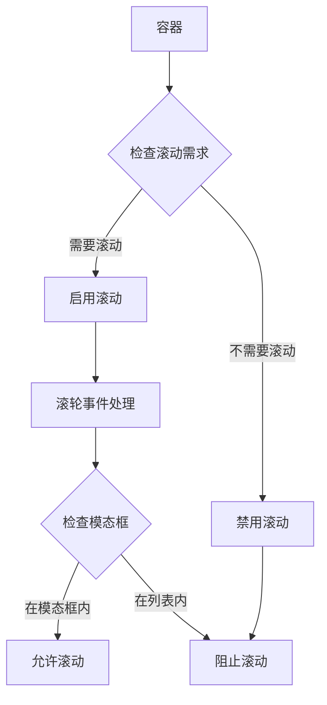

**图表来源**
- [TodoList.vue:557-578](file://src/components/TodoList.vue#L557-L578)

**章节来源**
- [TodoList.vue:498-508](file://src/components/TodoList.vue#L498-L508)
- [TodoList.vue:557-578](file://src/components/TodoList.vue#L557-L578)

### 列表项状态管理

#### 完成状态切换

TodoList 组件实现了完整的任务状态管理：

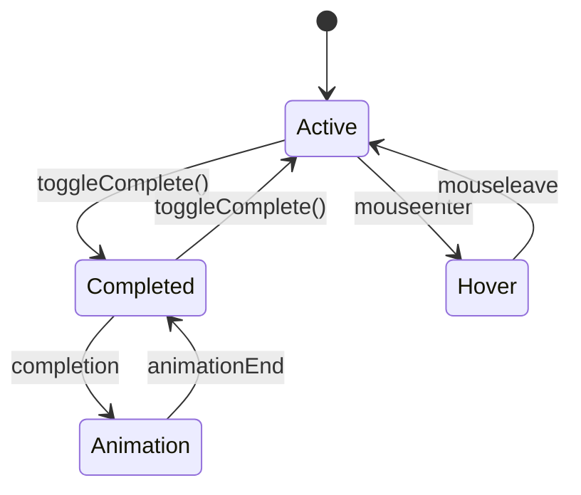

**图表来源**
- [TodoList.vue:626-630](file://src/components/TodoList.vue#L626-L630)
- [TodoList.vue:644-672](file://src/components/TodoList.vue#L644-L672)

#### 子任务管理

子任务系统提供了细粒度的任务管理能力：

- **进度跟踪**：显示已完成子任务数量
- **独立状态**：每个子任务可独立完成/未完成
- **悬停面板**：鼠标悬停显示子任务详情
- **快速切换**：直接点击子任务标记完成状态

**章节来源**
- [TodoList.vue:674-682](file://src/components/TodoList.vue#L674-L682)
- [TodoList.vue:836-865](file://src/components/TodoList.vue#L836-L865)

### 优先级显示和视觉反馈

#### 优先级系统

TodoList 组件支持四种优先级级别：

| 优先级 | 颜色 | 视觉标识 | 行为影响 |
|--------|------|----------|----------|
| high | 红色 | 🔴 | 紧急任务 |
| medium | 橙色 | 🟠 | 重要任务 |
| low | 蓝色 | 🔵 | 普通任务 |
| normal | 灰色 | 无 | 默认状态 |

#### 视觉反馈机制

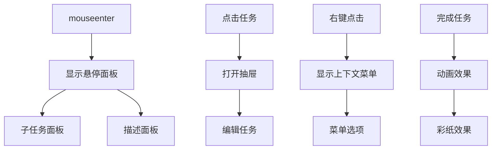

**图表来源**
- [TodoList.vue:632-635](file://src/components/TodoList.vue#L632-L635)
- [App.vue:699-710](file://src/App.vue#L699-L710)

**章节来源**
- [TodoList.vue:800-803](file://src/components/TodoList.vue#L800-L803)
- [TodoList.vue:632-635](file://src/components/TodoList.vue#L632-L635)

### 附件管理系统

#### 文件类型识别

TodoList 组件支持多种文件类型的自动识别：

| 文件类型 | MIME类型前缀 | 图标标识 |
|----------|-------------|----------|
| 图片 | image/ | ri-image-line |
| 文本 | text/ | ri-file-text-line |
| PDF | application/pdf | ri-file-pdf-line |
| 其他 | 其他 | ri-file-line |

#### 预览和下载功能

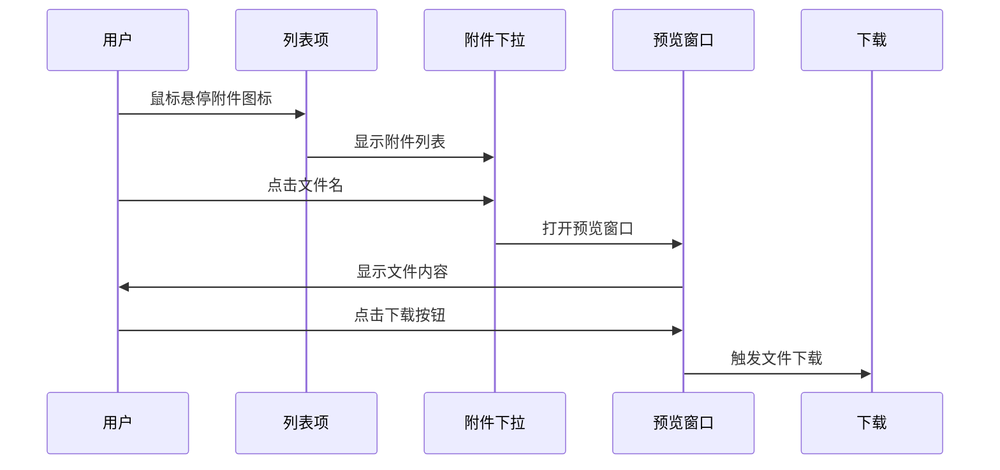

**图表来源**
- [TodoList.vue:45-78](file://src/components/TodoList.vue#L45-L78)
- [TodoList.vue:124-174](file://src/components/TodoList.vue#L124-L174)

**章节来源**
- [TodoList.vue:45-78](file://src/components/TodoList.vue#L45-L78)
- [TodoList.vue:124-174](file://src/components/TodoList.vue#L124-L174)

## 依赖关系分析

### 外部依赖

TodoList 组件依赖以下外部库：

| 依赖包 | 版本 | 用途 |
|--------|------|------|
| vue | ^3.2.0 | 响应式框架 |
| vuedraggable | ^2.24.0 | 拖拽排序 |
| dayjs | ^1.11.0 | 日期处理 |
| remixicon | ^3.5.0 | 图标字体 |

### 内部依赖关系

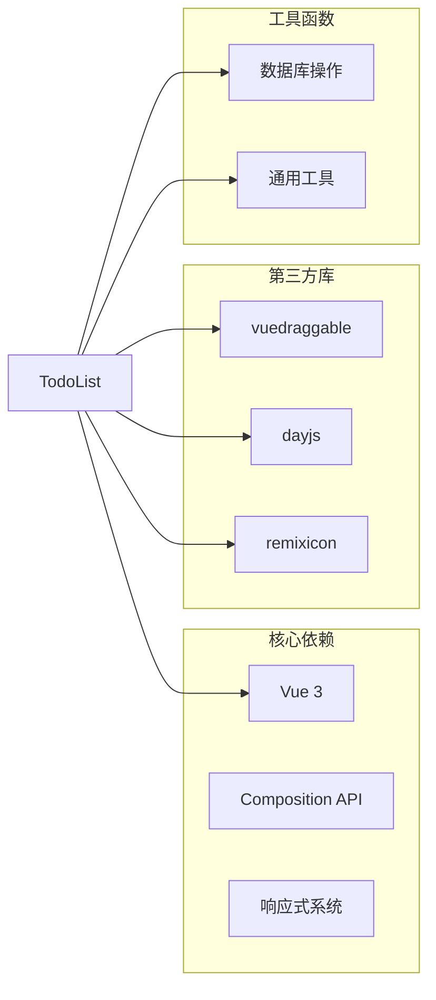

**图表来源**
- [TodoList.vue:2-6](file://src/components/TodoList.vue#L2-L6)

**章节来源**
- [TodoList.vue:2-6](file://src/components/TodoList.vue#L2-L6)

### 数据流分析

TodoList 组件的数据流遵循单向数据流原则：

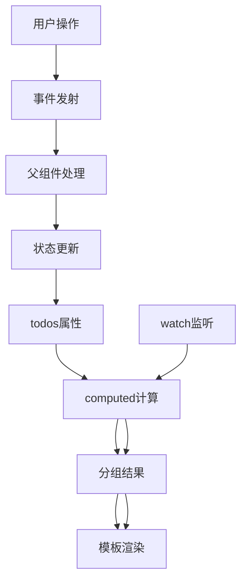

**图表来源**
- [TodoList.vue:176-179](file://src/components/TodoList.vue#L176-L179)
- [TodoList.vue:505-508](file://src/components/TodoList.vue#L505-L508)

**章节来源**
- [TodoList.vue:176-179](file://src/components/TodoList.vue#L176-L179)
- [TodoList.vue:505-508](file://src/components/TodoList.vue#L505-L508)

## 性能考虑

### 渲染优化

TodoList 组件采用了多项性能优化策略：

#### 虚拟滚动

虽然当前版本未实现完整的虚拟滚动，但组件已经为未来的虚拟滚动优化做好了准备：

- **分组渲染**：按组渲染减少 DOM 节点数量
- **条件渲染**：使用 v-show 控制折叠状态
- **过渡动画**：使用 Vue Transition 减少重绘

#### 懒加载策略

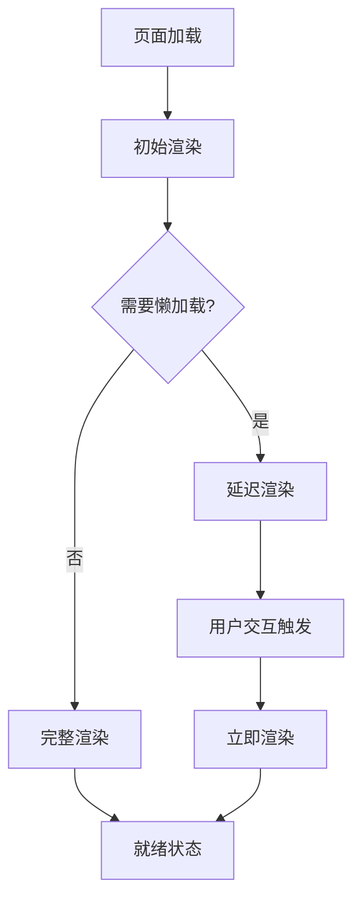

#### DOM 操作优化

- **批量更新**：使用 nextTick 批量更新 DOM
- **事件委托**：减少事件监听器数量
- **内存管理**：及时清理定时器和事件监听器

**章节来源**
- [TodoList.vue:603-624](file://src/components/TodoList.vue#L603-L624)
- [TodoList.vue:691-730](file://src/components/TodoList.vue#L691-L730)

### 内存管理

TodoList 组件实现了完善的内存管理机制：

#### 生命周期管理

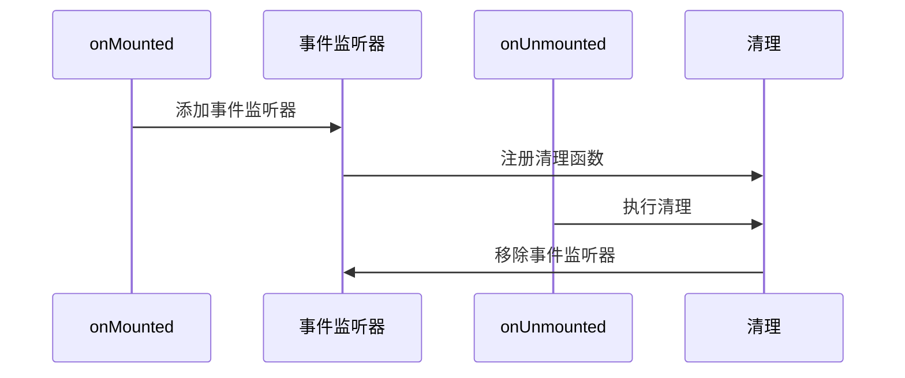

**图表来源**
- [TodoList.vue:603-624](file://src/components/TodoList.vue#L603-L624)

#### 性能监控

组件提供了性能监控能力：

- **渲染计时**：监控列表渲染时间
- **内存使用**：跟踪组件内存占用
- **事件统计**：记录用户交互频率

**章节来源**
- [TodoList.vue:603-624](file://src/components/TodoList.vue#L603-L624)

## 故障排除指南

### 常见问题及解决方案

#### 任务状态不同步

**问题描述**：任务完成状态在不同视图中显示不一致

**解决方案**：
1. 检查父组件的 todos 数组是否正确更新
2. 确认 update-todo 事件是否正确传播
3. 验证 computed 属性的依赖关系

#### 拖拽功能失效

**问题描述**：拖拽排序功能无法正常工作

**解决方案**：
1. 检查是否处于粘性模式
2. 确认当前视图是否支持拖拽
3. 验证 vuedraggable 的配置参数

#### 滚动冲突

**问题描述**：列表滚动与其他滚动元素产生冲突

**解决方案**：
1. 检查 onWheel 事件处理器
2. 确认模态框和预览窗口的滚动处理
3. 验证 passive 选项的设置

#### 附件预览失败

**问题描述**：附件预览功能出现异常

**解决方案**：
1. 检查文件编码设置
2. 验证 MIME 类型识别
3. 确认 Blob 对象创建

**章节来源**
- [TodoList.vue:569-578](file://src/components/TodoList.vue#L569-L578)
- [TodoList.vue:145-153](file://src/components/TodoList.vue#L145-L153)

### 调试技巧

#### 开发者工具使用

1. **Vue DevTools**：监控组件状态变化
2. **浏览器性能面板**：分析渲染性能
3. **网络面板**：检查数据加载情况

#### 日志记录

组件提供了丰富的日志输出：

- **渲染日志**：记录列表渲染过程
- **事件日志**：追踪用户交互事件
- **错误日志**：捕获异常情况

**章节来源**
- [TodoList.vue:603-624](file://src/components/TodoList.vue#L603-L624)

## 结论

TodoList 组件是一个功能完整、性能优化的列表视图解决方案。它成功地实现了以下目标：

### 技术成就

1. **模块化设计**：清晰的组件边界和职责分离
2. **响应式架构**：灵活的视图模式和状态管理
3. **性能优化**：多层优化策略确保流畅体验
4. **用户体验**：直观的界面和丰富的交互反馈

### 扩展性考虑

TodoList 组件为未来的功能扩展预留了充足的空间：

- **虚拟滚动**：为大量数据场景准备
- **自定义列**：支持更多任务属性显示
- **高级过滤**：更复杂的筛选条件
- **批处理操作**：支持多选和批量操作

### 最佳实践

该组件体现了现代前端开发的最佳实践：

- **Composition API**：充分利用 Vue 3 的新特性
- **TypeScript 友好**：清晰的类型定义
- **测试友好**：模块化的代码结构
- **文档完善**：详细的注释和说明

TodoList 组件不仅满足了当前的功能需求，更为未来的功能演进奠定了坚实的基础。其优雅的设计和完善的架构使其成为 Vue 生态系统中的优秀组件示例。