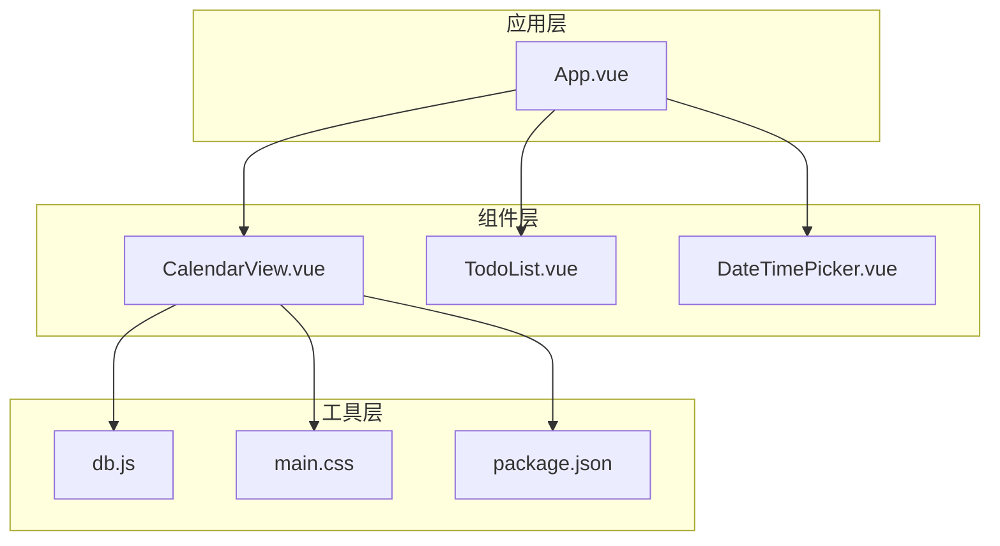
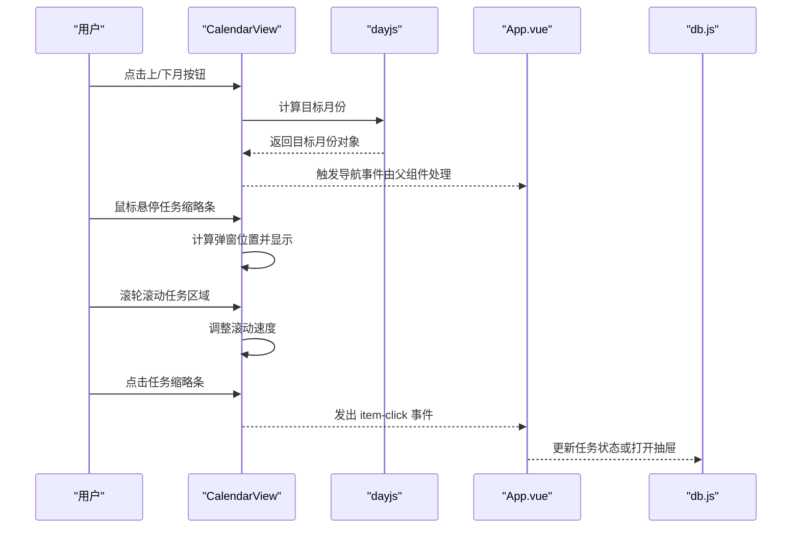
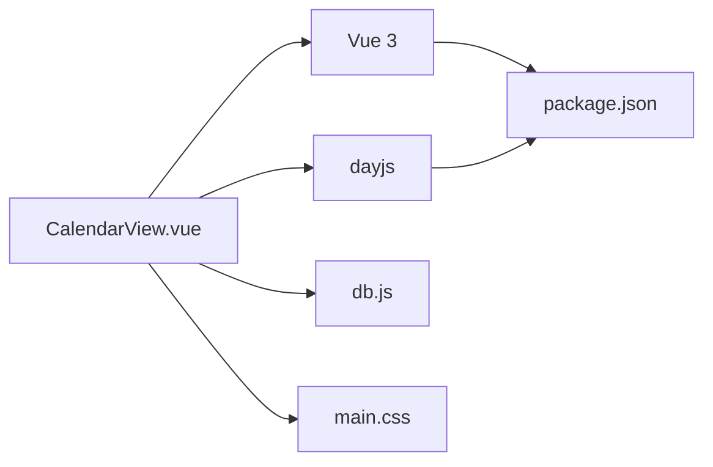

# 日历视图

<cite>
**本文引用的文件**
- [CalendarView.vue](file://src/components/CalendarView.vue)
- [App.vue](file://src/App.vue)
- [db.js](file://src/utils/db.js)
- [main.css](file://src/main.css)
- [main.js](file://src/main.js)
- [package.json](file://package.json)
- [DateTimePicker.vue](file://src/components/DateTimePicker.vue)
</cite>

## 目录
1. [简介](#简介)
2. [项目结构](#项目结构)
3. [核心组件](#核心组件)
4. [架构总览](#架构总览)
5. [详细组件分析](#详细组件分析)
6. [依赖关系分析](#依赖关系分析)
7. [性能考量](#性能考量)
8. [故障排查指南](#故障排查指南)
9. [结论](#结论)
10. [附录](#附录)

## 简介
本文件面向“日历视图”组件（CalendarView）的综合技术文档，聚焦于以下方面：
- 日历渲染机制：月份网格生成、日期计算与边界处理
- 交互功能：日期选择、任务悬停弹窗、滚轮缩放、响应式布局适配
- 数据映射逻辑：任务按日期分组、优先级可视化、完成状态显示
- 性能优化策略：滚动优化、虚拟化与内存管理
- 自定义配置选项：主题样式、显示模式与交互行为

## 项目结构
日历视图作为应用的一个视图组件，位于 src/components 目录下，并由应用入口在 App.vue 中根据当前视图模式进行条件渲染。全局样式通过 main.css 提供主题变量与暗/亮主题支持；运行时依赖通过 package.json 声明。

图表来源
- [App.vue](file://src/App.vue)
- [CalendarView.vue](file://src/components/CalendarView.vue)
- [db.js](file://src/utils/db.js)
- [main.css](file://src/main.css)
- [package.json](file://package.json)

章节来源
- [CalendarView.vue](file://src/components/CalendarView.vue)
- [App.vue](file://src/App.vue)
- [main.css](file://src/main.css)
- [package.json](file://package.json)

## 核心组件
- CalendarView：负责渲染月度日历网格、展示当月/非当月日期、渲染当日高亮、渲染任务缩略条、处理日期导航与交互事件。
- App：作为容器组件，向 CalendarView 注入任务列表与事件回调，控制视图切换与上下文菜单等。
- db：提供本地存储读写接口，CalendarView 的任务数据来源于此。
- main.css：提供主题变量与暗/亮主题切换能力，CalendarView 使用 CSS 变量实现主题适配。
- package.json：声明运行时依赖（如 dayjs、vue 等），CalendarView 使用 dayjs 进行日期计算。

章节来源
- [CalendarView.vue](file://src/components/CalendarView.vue)
- [App.vue](file://src/App.vue)
- [db.js](file://src/utils/db.js)
- [main.css](file://src/main.css)
- [package.json](file://package.json)

## 架构总览
CalendarView 采用组合式 API（Composition API）实现，使用 dayjs 进行日期计算，基于 Vue 的响应式系统驱动视图更新。组件通过 props 接收任务数组，内部维护当前月份状态与悬停弹窗状态，向外发出点击、更新与右键菜单事件。

图表来源
- [CalendarView.vue](file://src/components/CalendarView.vue)
- [App.vue](file://src/App.vue)
- [db.js](file://src/utils/db.js)

## 详细组件分析

### 日历渲染机制
- 月份网格生成
  - 以当前月份起始日的周一开始，结束于月末所在周的周日，形成 42 个格子的网格（6×7）。
  - 通过 dayjs 的 startOf('month')、endOf('month')、startOf('week')、endOf('week') 计算起止边界。
  - 渲染时为每个日期单元设置类名以区分“当月/非当月”、“今日”。

- 日期计算与边界处理
  - 使用 dayjs 对象进行日期运算，避免浏览器原生 Date 的时区与精度问题。
  - 边界处理包含：周起始/结束对齐、跨月日期填充、今日高亮样式。

- 任务渲染与分组
  - 每个日期单元内，通过过滤函数筛选当天到期的任务，渲染为“任务缩略条”。
  - 缩略条使用 TransitionGroup 实现进入/离开动画，提升交互体验。

章节来源
- [CalendarView.vue:22-36](file://src/components/CalendarView.vue#L22-L36)
- [CalendarView.vue:38-43](file://src/components/CalendarView.vue#L38-L43)
- [CalendarView.vue:131-158](file://src/components/CalendarView.vue#L131-L158)

### 交互功能
- 日期选择
  - 组件提供“上一月/下一月/回到今天”按钮，用于导航当前月份。
  - 日期点击事件由父组件 App.vue 处理，CalendarView 通过 emit 将 item-click 事件传递给父组件。

- 任务悬停弹窗
  - 鼠标进入任务缩略条时触发 showPopover，计算弹窗位置并考虑窗口边界（右/下/左边界），确保弹窗不溢出。
  - 弹窗支持延迟隐藏与鼠标移入取消隐藏，避免误触。
  - 弹窗内可直接切换任务完成状态，UI 即时更新。

- 滚轮缩放
  - 在任务缩略条容器上监听滚轮事件，降低滚动速度（deltaY × 0.35），避免快速滚动跳过任务项。
  - 通过阻止默认行为与冒泡，保证滚动体验稳定。

- 响应式布局适配
  - 使用 CSS Grid 实现 7 列网格，自动行高 minmax(96px, 1fr)，在不同尺寸下保持单元格比例一致。
  - 使用 CSS 变量与媒体查询实现主题切换，组件样式随根元素主题类名变化而更新。

章节来源
- [CalendarView.vue:45-55](file://src/components/CalendarView.vue#L45-L55)
- [CalendarView.vue:70-108](file://src/components/CalendarView.vue#L70-L108)
- [CalendarView.vue:110-115](file://src/components/CalendarView.vue#L110-L115)
- [CalendarView.vue:178-338](file://src/components/CalendarView.vue#L178-L338)

### 数据映射逻辑
- 任务按日期分组
  - 通过 getTodosForDate 过滤当天到期的任务，渲染到对应日期单元格。
  - 该过滤基于 dueDate 字段与 dayjs 的同日比较。

- 优先级可视化
  - 任务缩略条根据 priority 属性应用不同背景色：high、medium、low、normal。
  - 弹窗标题旁的小圆点同样反映优先级颜色。

- 完成状态显示
  - 已完成任务缩略条应用灰色/去饱和效果与删除线样式。
  - 弹窗标题支持删除线与颜色变化，同步显示完成状态。

- 与父组件的联动
  - 父组件 App.vue 将 currentTodos（经过分类/排序后的任务集合）传入 CalendarView。
  - 父组件负责任务更新、历史记录与完成态变更的持久化。

章节来源
- [CalendarView.vue:38-43](file://src/components/CalendarView.vue#L38-L43)
- [CalendarView.vue:144-155](file://src/components/CalendarView.vue#L144-L155)
- [CalendarView.vue:364-374](file://src/components/CalendarView.vue#L364-L374)
- [CalendarView.vue:315-321](file://src/components/CalendarView.vue#L315-L321)
- [App.vue:2332-2338](file://src/App.vue#L2332-L2338)

### 性能优化策略
- 滚动优化
  - 通过降低滚轮增量（deltaY × 0.35）减少滚动跳过，提升浏览体验。
  - 任务容器启用垂直滚动，隐藏滚动条，避免视觉干扰。

- 虚拟化与内存管理
  - 当前实现未采用虚拟滚动（virtual scrolling）。对于大量任务场景，建议：
    - 仅渲染可视区域内日期单元格的任务缩略条；
    - 对超出可视范围的任务进行懒加载或占位符；
    - 合理使用 v-show/v-if 控制弹窗与动画节点生命周期，避免长列表动画造成卡顿。

- 动画与过渡
  - 使用 TransitionGroup 实现任务缩略条的进入/离开动画，注意在大量任务时可能带来额外开销。
  - 可通过设置 appear=false 或在大数据量时禁用动画来缓解性能压力。

- 主题与样式
  - 使用 CSS 变量统一颜色与阴影，减少重复样式计算。
  - 暗/亮主题切换通过根元素类名切换实现，避免频繁重排。

章节来源
- [CalendarView.vue:110-115](file://src/components/CalendarView.vue#L110-L115)
- [CalendarView.vue:142](file://src/components/CalendarView.vue#L142)
- [CalendarView.vue:394-416](file://src/components/CalendarView.vue#L394-L416)
- [main.css:1-170](file://src/main.css#L1-L170)

### 自定义配置选项
- 主题样式
  - 支持系统主题（prefers-color-scheme）、浅色主题、深色主题三种模式。
  - 通过 CSS 变量覆盖颜色、边框、阴影等，CalendarView 的样式完全依赖这些变量。

- 显示模式
  - 由父组件 App.vue 控制视图模式（list/calendar），CalendarView 仅负责渲染日历网格。

- 交互行为
  - 任务缩略条支持点击打开抽屉、右键菜单、悬停弹窗与完成状态切换。
  - 滚轮滚动行为可通过 props 扩展（例如增加节流/防抖参数）。

- 日期选择器集成
  - 应用中存在独立的日期选择器组件，可与日历视图配合使用（例如在弹窗中打开日期选择器）。

章节来源
- [main.css:95-136](file://src/main.css#L95-L136)
- [main.css:139-170](file://src/main.css#L139-L170)
- [App.vue:2332-2338](file://src/App.vue#L2332-L2338)
- [DateTimePicker.vue:54-92](file://src/components/DateTimePicker.vue#L54-L92)

## 依赖关系分析
- 组件依赖
  - CalendarView 依赖 dayjs 进行日期计算，依赖 Vue 的响应式系统与模板语法。
  - 通过 emit 与父组件通信，接收任务数组与事件回调。

- 工具与样式
  - db.js 提供数据持久化能力，CalendarView 不直接操作数据，而是通过父组件更新后重新渲染。
  - main.css 提供主题变量，CalendarView 的样式完全依赖 CSS 变量。

- 运行时依赖
  - package.json 声明了 dayjs、vue 等依赖，CalendarView 的日期与响应式能力来自这些库。

图表来源
- [CalendarView.vue](file://src/components/CalendarView.vue)
- [db.js](file://src/utils/db.js)
- [main.css](file://src/main.css)
- [package.json](file://package.json)

章节来源
- [CalendarView.vue](file://src/components/CalendarView.vue)
- [db.js](file://src/utils/db.js)
- [main.css](file://src/main.css)
- [package.json](file://package.json)

## 性能考量
- 当前实现
  - 使用 dayjs 进行日期计算，复杂度较低。
  - 通过 CSS Grid 与 Flex 布局实现响应式，渲染成本可控。
  - TransitionGroup 在小规模任务时表现良好，但在大规模任务时可能产生性能压力。

- 建议优化
  - 虚拟滚动：仅渲染可见区域内的任务缩略条，减少 DOM 节点数量。
  - 动画降级：在大数据量时禁用或简化动画，或使用 requestAnimationFrame 控制帧率。
  - 事件节流：对滚轮事件与弹窗显示/隐藏进行节流/防抖，避免高频触发。
  - 内存管理：及时清理定时器与事件监听器，避免弹窗关闭后残留的计时器占用内存。

## 故障排查指南
- 悬停弹窗位置异常
  - 检查窗口尺寸变化是否影响边界判断，确认弹窗定位逻辑在窗口 resize 时能重新计算。
  - 确认弹窗容器的固定定位与 z-index 设置。

- 滚轮滚动过快或过慢
  - 调整 handleWheel 中的系数值，平衡滚动速度与体验。
  - 确保阻止默认行为与冒泡，避免页面整体滚动被触发。

- 任务缩略条不显示
  - 检查 dueDate 字段是否正确传入，以及 getTodosForDate 的过滤条件。
  - 确认任务数组是否由父组件正确传入。

- 主题切换无效
  - 确认根元素的 theme-mode 类名是否正确切换，CSS 变量是否生效。
  - 检查媒体查询与手动主题覆盖的优先级。

章节来源
- [CalendarView.vue:70-108](file://src/components/CalendarView.vue#L70-L108)
- [CalendarView.vue:110-115](file://src/components/CalendarView.vue#L110-L115)
- [CalendarView.vue:38-43](file://src/components/CalendarView.vue#L38-L43)
- [main.css:95-136](file://src/main.css#L95-L136)

## 结论
CalendarView 以简洁的实现提供了完整的月度日历渲染与交互能力，结合父组件的分类/排序与数据持久化，形成了可用的日历视图。在任务量较大的场景下，建议引入虚拟滚动与动画降级策略以进一步提升性能与稳定性。同时，主题系统与响应式布局为多端适配提供了良好基础。

## 附录
- 相关文件路径
  - 组件：src/components/CalendarView.vue
  - 容器：src/App.vue
  - 数据：src/utils/db.js
  - 样式：src/main.css
  - 入口：src/main.js
  - 依赖：package.json
  - 日期选择器：src/components/DateTimePicker.vue