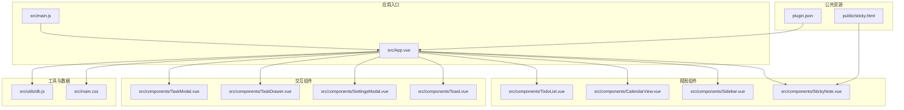
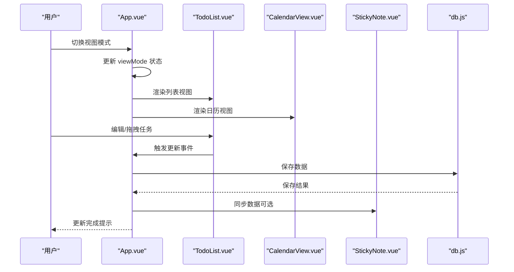
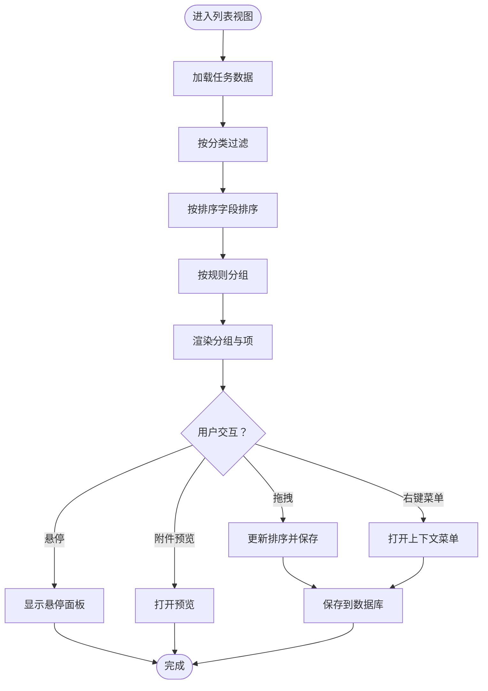
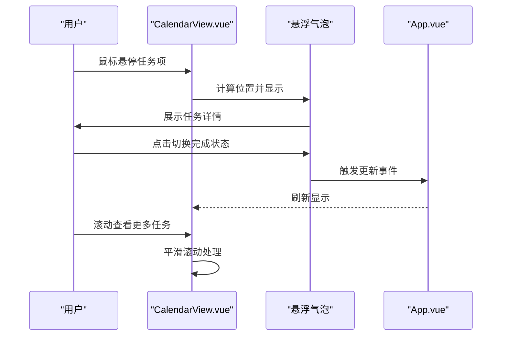
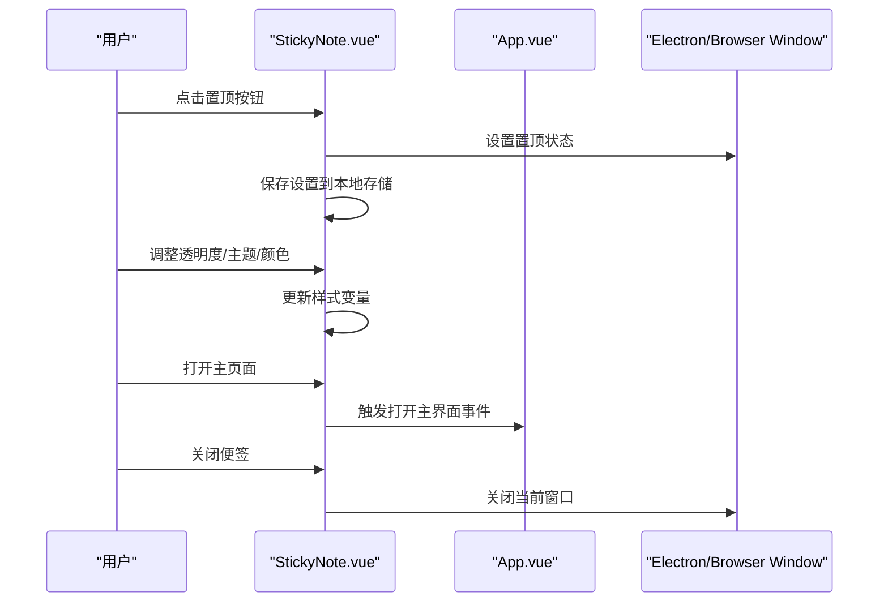
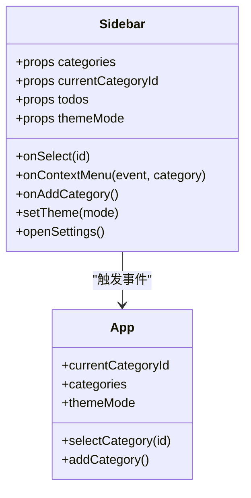
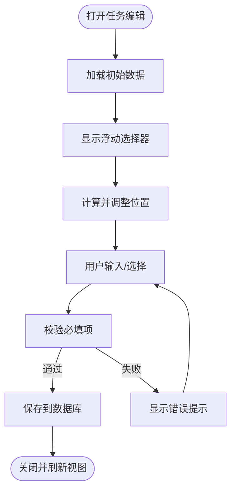
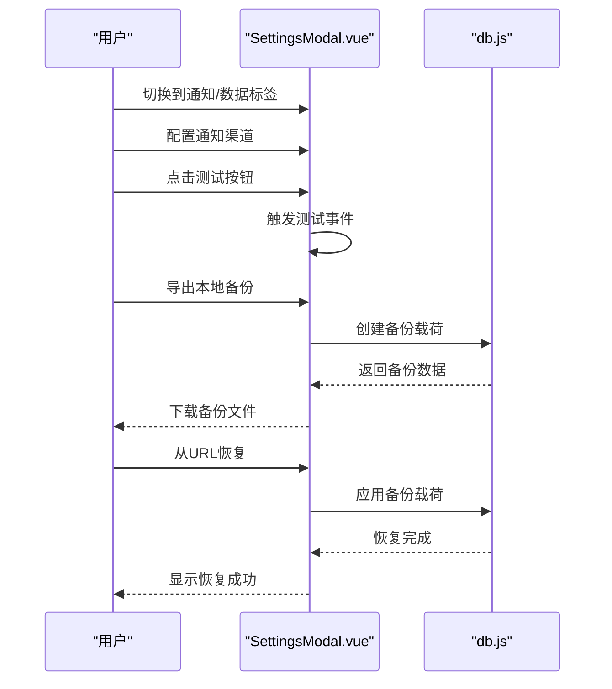

# 视图管理系统

<cite>
**本文档引用的文件**
- [src/App.vue](file://src/App.vue)
- [src/main.js](file://src/main.js)
- [src/components/TodoList.vue](file://src/components/TodoList.vue)
- [src/components/CalendarView.vue](file://src/components/CalendarView.vue)
- [src/components/StickyNote.vue](file://src/components/StickyNote.vue)
- [src/components/Sidebar.vue](file://src/components/Sidebar.vue)
- [src/components/TaskModal.vue](file://src/components/TaskModal.vue)
- [src/components/TaskDrawer.vue](file://src/components/TaskDrawer.vue)
- [src/components/SettingsModal.vue](file://src/components/SettingsModal.vue)
- [src/components/Toast.vue](file://src/components/Toast.vue)
- [src/utils/db.js](file://src/utils/db.js)
- [src/main.css](file://src/main.css)
- [public/sticky.html](file://public/sticky.html)
- [plugin.json](file://plugin.json)
- [package.json](file://package.json)
</cite>

## 目录
1. [简介](#简介)
2. [项目结构](#项目结构)
3. [核心组件](#核心组件)
4. [架构总览](#架构总览)
5. [详细组件分析](#详细组件分析)
6. [依赖关系分析](#依赖关系分析)
7. [性能考虑](#性能考虑)
8. [故障排除指南](#故障排除指南)
9. [结论](#结论)
10. [附录](#附录)

## 简介
本系统是一个基于 Vue 3 的跨平台待办事项应用，支持列表视图与日历视图的切换、便签模式（悬浮窗）管理、置顶显示、窗口状态保持、视图状态管理、响应式布局以及多视图数据同步。系统通过统一的状态管理与事件驱动的组件通信，实现了视图间的无缝切换与一致的数据体验。

## 项目结构
项目采用基于功能模块的组织方式，主要由应用入口、核心状态管理、视图组件、工具模块和公共资源组成：

**图表来源**
- [src/main.js:1-6](file://src/main.js#L1-L6)
- [src/App.vue:1-120](file://src/App.vue#L1-L120)
- [src/components/TodoList.vue:1-40](file://src/components/TodoList.vue#L1-L40)
- [src/components/CalendarView.vue:1-20](file://src/components/CalendarView.vue#L1-L20)
- [src/components/StickyNote.vue:1-30](file://src/components/StickyNote.vue#L1-L30)
- [src/components/Sidebar.vue:1-30](file://src/components/Sidebar.vue#L1-L30)
- [src/components/TaskModal.vue:1-40](file://src/components/TaskModal.vue#L1-L40)
- [src/components/TaskDrawer.vue:1-40](file://src/components/TaskDrawer.vue#L1-L40)
- [src/components/SettingsModal.vue:1-30](file://src/components/SettingsModal.vue#L1-L30)
- [src/components/Toast.vue:1-20](file://src/components/Toast.vue#L1-L20)
- [src/utils/db.js:1-40](file://src/utils/db.js#L1-L40)
- [src/main.css:1-40](file://src/main.css#L1-L40)
- [public/sticky.html:1-21](file://public/sticky.html#L1-L21)
- [plugin.json:1-21](file://plugin.json#L1-L21)

**章节来源**
- [src/main.js:1-6](file://src/main.js#L1-L6)
- [src/App.vue:1-120](file://src/App.vue#L1-L120)
- [src/main.css:1-40](file://src/main.css#L1-L40)
- [plugin.json:1-21](file://plugin.json#L1-L21)

## 核心组件
- 应用根组件：负责全局状态、视图切换、数据持久化、通知与提醒、主题与便签模式集成。
- 列表视图组件：提供分组、排序、拖拽、附件预览、子任务进度等能力。
- 日历视图组件：提供月历网格、浮动气泡、滚动优化与边界检测。
- 便签组件：提供悬浮窗、置顶、透明度、主题与颜色管理、窗口重建与状态保持。
- 侧边栏：提供智能分类与自定义分类导航、键盘快捷键与主题切换。
- 任务弹窗/抽屉：提供任务编辑、重复规则、提醒设置、附件上传与预览。
- 设置面板：提供通知渠道配置、本地与 WebDAV 备份恢复。
- 工具模块：提供数据库抽象、备份/恢复、通知触发与跨视图同步。

**章节来源**
- [src/App.vue:23-120](file://src/App.vue#L23-L120)
- [src/components/TodoList.vue:1-80](file://src/components/TodoList.vue#L1-L80)
- [src/components/CalendarView.vue:1-60](file://src/components/CalendarView.vue#L1-L60)
- [src/components/StickyNote.vue:1-120](file://src/components/StickyNote.vue#L1-L120)
- [src/components/Sidebar.vue:1-80](file://src/components/Sidebar.vue#L1-L80)
- [src/components/TaskModal.vue:1-120](file://src/components/TaskModal.vue#L1-L120)
- [src/components/TaskDrawer.vue:1-120](file://src/components/TaskDrawer.vue#L1-L120)
- [src/components/SettingsModal.vue:1-120](file://src/components/SettingsModal.vue#L1-L120)
- [src/utils/db.js:102-157](file://src/utils/db.js#L102-L157)

## 架构总览
系统采用“根组件集中管理 + 子组件职责清晰”的架构模式，通过响应式状态与事件总线实现跨视图数据同步与交互。

**图表来源**
- [src/App.vue:29-40](file://src/App.vue#L29-L40)
- [src/components/TodoList.vue:30-40](file://src/components/TodoList.vue#L30-L40)
- [src/components/CalendarView.vue:12-20](file://src/components/CalendarView.vue#L12-L20)
- [src/components/StickyNote.vue:1-40](file://src/components/StickyNote.vue#L1-L40)
- [src/utils/db.js:102-133](file://src/utils/db.js#L102-L133)

**章节来源**
- [src/App.vue:29-120](file://src/App.vue#L29-L120)
- [src/utils/db.js:102-133](file://src/utils/db.js#L102-L133)

## 详细组件分析

### 列表视图组件（TodoList.vue）
- 分组与排序：根据当前分类与排序状态生成分组，支持“今日/计划/紧急/已完成”等智能分组与自定义分组。
- 交互能力：支持拖拽排序（在特定条件下）、右键菜单、悬停面板、附件预览、子任务进度展示。
- 性能优化：分组计算与滚动状态监听，避免不必要的重渲染；在便签模式下禁用滚动以提升体验。

**图表来源**
- [src/components/TodoList.vue:299-495](file://src/components/TodoList.vue#L299-L495)
- [src/components/TodoList.vue:555-624](file://src/components/TodoList.vue#L555-L624)

**章节来源**
- [src/components/TodoList.vue:176-495](file://src/components/TodoList.vue#L176-L495)
- [src/components/TodoList.vue:555-730](file://src/components/TodoList.vue#L555-L730)

### 日历视图组件（CalendarView.vue）
- 月历网格：生成当月日历，支持上一月/下一月/回到今天导航。
- 悬浮气泡：在日期单元格内显示任务缩略信息，支持切换完成状态与右键菜单。
- 边界检测与滚动：自动调整气泡位置，避免越界；提供平滑滚动以避免跳页。

**图表来源**
- [src/components/CalendarView.vue:70-116](file://src/components/CalendarView.vue#L70-L116)
- [src/components/CalendarView.vue:118-176](file://src/components/CalendarView.vue#L118-L176)

**章节来源**
- [src/components/CalendarView.vue:18-176](file://src/components/CalendarView.vue#L18-L176)

### 便签模式组件（StickyNote.vue）
- 窗口管理：支持置顶显示、透明度调节、主题与颜色管理、窗口重建与状态保持。
- 数据同步：通过事件向上游传递任务更新，确保主界面与便签数据一致。
- 交互控制：提供菜单、关闭按钮、打开主页面等功能。

**图表来源**
- [src/components/StickyNote.vue:368-545](file://src/components/StickyNote.vue#L368-L545)
- [src/components/StickyNote.vue:552-598](file://src/components/StickyNote.vue#L552-L598)

**章节来源**
- [src/components/StickyNote.vue:30-140](file://src/components/StickyNote.vue#L30-L140)
- [src/components/StickyNote.vue:368-598](file://src/components/StickyNote.vue#L368-L598)
- [public/sticky.html:8-18](file://public/sticky.html#L8-L18)

### 侧边栏组件（Sidebar.vue）
- 智能分类：提供“今日/计划/全部/优先级/已完成”快速导航。
- 自定义分类：支持拖拽排序与右键菜单，提供添加分类入口。
- 主题切换：提供轻/暗/系统三种主题模式切换。

**图表来源**
- [src/components/Sidebar.vue:6-32](file://src/components/Sidebar.vue#L6-L32)
- [src/App.vue:548-570](file://src/App.vue#L548-L570)

**章节来源**
- [src/components/Sidebar.vue:29-108](file://src/components/Sidebar.vue#L29-L108)
- [src/App.vue:548-570](file://src/App.vue#L548-L570)

### 任务弹窗与抽屉（TaskModal.vue / TaskDrawer.vue）
- 表单能力：内容、描述、分类、优先级、截止时间、提醒设置、重复规则、子任务与附件。
- 浮动选择器：日期/时间选择器定位与边界适配，自动滚动到可视区域。
- 通知渠道：支持桌面、邮件、Bark、Webhook 等渠道配置与测试。

**图表来源**
- [src/components/TaskModal.vue:84-181](file://src/components/TaskModal.vue#L84-L181)
- [src/components/TaskDrawer.vue:397-435](file://src/components/TaskDrawer.vue#L397-L435)

**章节来源**
- [src/components/TaskModal.vue:183-521](file://src/components/TaskModal.vue#L183-L521)
- [src/components/TaskDrawer.vue:358-761](file://src/components/TaskDrawer.vue#L358-L761)

### 设置面板（SettingsModal.vue）
- 通知管理：桌面通知、邮件、Bark、Webhook 配置与测试。
- 数据管理：本地备份导出、HTTP/URL 恢复、WebDAV 备份与恢复。
- 备份流程：构建备份载荷、导出/导入、WebDAV 文件列表与选择。

**图表来源**
- [src/components/SettingsModal.vue:308-376](file://src/components/SettingsModal.vue#L308-L376)
- [src/utils/db.js:47-100](file://src/utils/db.js#L47-L100)

**章节来源**
- [src/components/SettingsModal.vue:1-120](file://src/components/SettingsModal.vue#L1-L120)
- [src/utils/db.js:47-100](file://src/utils/db.js#L47-L100)

## 依赖关系分析
- 组件依赖：App.vue 作为根组件，统一管理视图模式、分类与任务数据；各视图组件通过 props 与事件与根组件通信。
- 外部依赖：Vue 3、dayjs、uuid、vuedraggable、canvas-confetti、html2canvas、jspdf、remixicon。
- 插件集成：通过 plugin.json 定义插件入口与命令，public/preload/services.js 提供预加载服务。

```mermaid
graph TB
APP["App.vue"] --> LIST["TodoList.vue"]
APP --> CALENDAR["CalendarView.vue"]
APP --> SIDEBAR["Sidebar.vue"]
APP --> STICKY["StickyNote.vue"]
APP --> TASK_MODAL["TaskModal.vue"]
APP --> TASK_DRAWER["TaskDrawer.vue"]
APP --> SETTINGS["SettingsModal.vue"]
APP --> DB["db.js"]
APP --> CSS["main.css"]
PKG["package.json"] --> VUE["vue"]
PKG --> DAYJS["dayjs"]
PKG --> UUID["uuid"]
PKG --> DRAG["vuedraggable"]
PKG --> CONFETTI["canvas-confetti"]
PKG --> HTML2CANVAS["html2canvas"]
PKG --> JSPDF["jspdf"]
PKG --> ICONS["remixicon"]
PLUGIN["plugin.json"] --> MAIN["index.html"]
```

**图表来源**
- [src/App.vue:1-15](file://src/App.vue#L1-L15)
- [package.json:7-16](file://package.json#L7-L16)
- [plugin.json:1-21](file://plugin.json#L1-L21)

**章节来源**
- [package.json:1-24](file://package.json#L1-L24)
- [plugin.json:1-21](file://plugin.json#L1-L21)

## 性能考虑
- 响应式与计算属性：通过 computed 与 watch 降低重复计算，仅在必要时更新视图。
- 虚拟滚动与懒加载：日历视图通过平滑滚动减少跳页感；列表视图在便签模式下禁用滚动以避免性能问题。
- 缓存机制：通知缓存、模块动态导入（html2canvas/jspdf）延迟加载，减少首屏负担。
- 数据同步：使用 BroadcastChannel 与 localStorage 实现跨窗口/标签页同步，避免频繁全量刷新。

**章节来源**
- [src/App.vue:58-115](file://src/App.vue#L58-L115)
- [src/components/CalendarView.vue:110-116](file://src/components/CalendarView.vue#L110-L116)
- [src/components/TodoList.vue:555-567](file://src/components/TodoList.vue#L555-L567)

## 故障排除指南
- 数据加载失败：检查 db.js 的 getDoc/putDoc 实现与环境差异（utools vs 浏览器），查看控制台错误信息。
- 通知未触发：确认通知设置中的渠道配置是否正确，测试按钮是否可用；检查系统权限与网络连接。
- 便签置顶无效：检查 Electron 窗口 API 是否可用，尝试重新创建窗口；确认透明度与颜色设置未影响窗口层级。
- 视图不同步：确认 BroadcastChannel 与 localStorage 同步逻辑是否正常，检查数据变更广播与 reload 时机。

**章节来源**
- [src/utils/db.js:21-43](file://src/utils/db.js#L21-L43)
- [src/components/SettingsModal.vue:392-407](file://src/components/SettingsModal.vue#L392-L407)
- [src/components/StickyNote.vue:228-266](file://src/components/StickyNote.vue#L228-L266)
- [src/App.vue:116-141](file://src/App.vue#L116-L141)

## 结论
该视图管理系统通过清晰的组件划分与统一的状态管理，实现了列表与日历视图的无缝切换、便签模式的置顶与窗口状态保持、以及跨视图的数据同步。配合通知与备份功能，提供了良好的用户体验与可扩展性。建议后续可引入虚拟滚动与更细粒度的懒加载策略，进一步优化大数据量场景下的性能表现。

## 附录
- API 接口与配置选项
  - 视图切换：通过根组件的 viewMode 状态控制，支持 'list'/'calendar'。
  - 便签模式：通过 URL 参数 mode=sticky 或 hash 中携带 sticky 控制；支持 pin 参数控制置顶。
  - 主题与颜色：支持 light/dark/system 主题，便签支持自定义颜色与透明度。
  - 通知渠道：桌面、邮件、Bark、Webhook，支持测试与配置。
  - 备份与恢复：本地文件、HTTP URL、WebDAV，支持批量文件管理与选择恢复。

- 新视图类型添加方法
  - 在 App.vue 中新增视图模式与渲染逻辑。
  - 创建对应组件并实现与根组件的事件通信。
  - 在 Sidebar 或导航中添加入口，确保分类与任务数据正确传递。
  - 如需便签模式，参考 StickyNote.vue 的窗口管理与状态保持逻辑。

**章节来源**
- [src/App.vue:29-40](file://src/App.vue#L29-L40)
- [public/sticky.html:8-18](file://public/sticky.html#L8-L18)
- [src/components/SettingsModal.vue:308-376](file://src/components/SettingsModal.vue#L308-L376)
- [src/components/StickyNote.vue:368-545](file://src/components/StickyNote.vue#L368-L545)