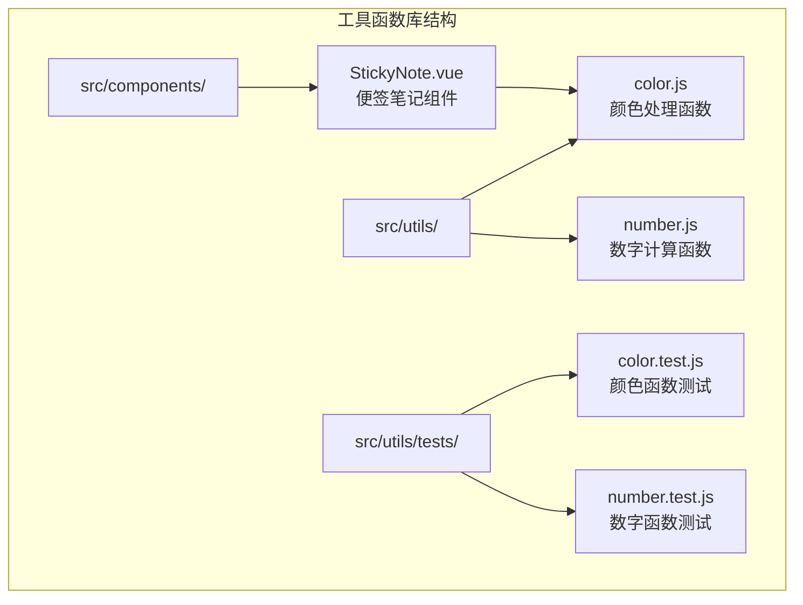
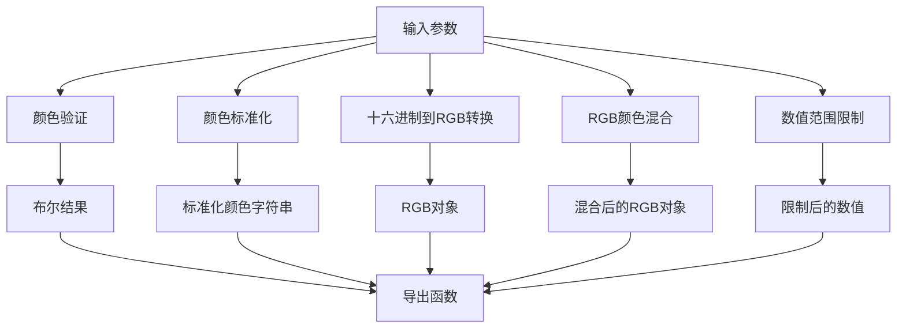
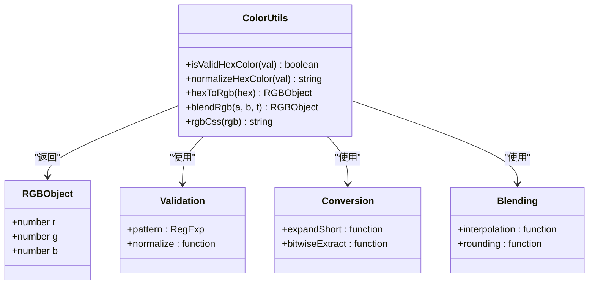
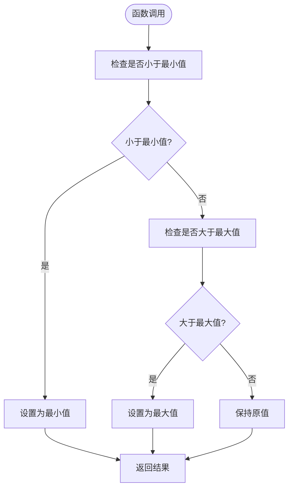
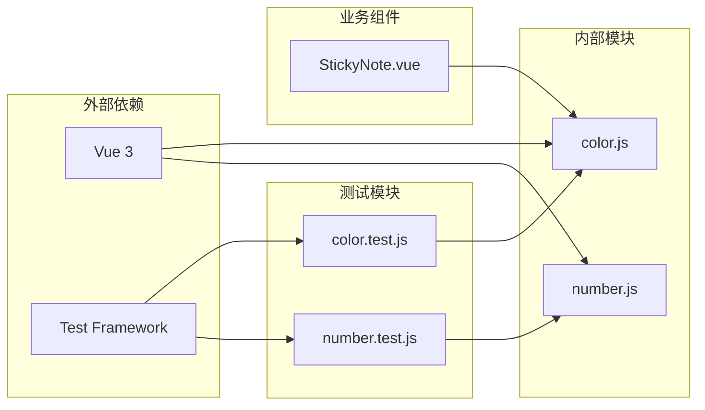

# 工具函数库

<cite>
**本文档引用的文件**
- [color.js](file://src/utils/color.js)
- [number.js](file://src/utils/number.js)
- [color.test.js](file://src/utils/color.test.js)
- [number.test.js](file://src/utils/number.test.js)
- [StickyNote.vue](file://src/components/StickyNote.vue)
</cite>

## 目录
1. [简介](#简介)
2. [项目结构](#项目结构)
3. [核心组件](#核心组件)
4. [架构概览](#架构概览)
5. [详细组件分析](#详细组件分析)
6. [依赖关系分析](#依赖关系分析)
7. [性能考虑](#性能考虑)
8. [故障排除指南](#故障排除指南)
9. [结论](#结论)

## 简介

Just-Todo 项目的工具函数库提供了颜色处理和数字计算的核心功能。该库包含两个主要模块：颜色工具（color.js）和数字工具（number.js），这些工具函数被广泛应用于项目中的各种组件，特别是便签笔记组件（StickyNote.vue）的颜色主题系统中。

颜色工具库专注于颜色格式转换、验证和混合算法，而数字工具库则提供基础的数值范围限制功能。这些工具函数具有高度的可复用性和性能优化特性，能够在Vue 3组件中高效运行。

## 项目结构

工具函数库位于 `src/utils/` 目录下，采用模块化设计，每个工具函数都独立导出，便于按需导入和测试。

**图表来源**
- [color.js:1-27](file://src/utils/color.js#L1-L27)
- [number.js:1-3](file://src/utils/number.js#L1-L3)
- [StickyNote.vue:148-185](file://src/components/StickyNote.vue#L148-L185)

**章节来源**
- [color.js:1-27](file://src/utils/color.js#L1-L27)
- [number.js:1-3](file://src/utils/number.js#L1-L3)

## 核心组件

### 颜色处理工具库

颜色处理工具库提供了完整的颜色格式处理解决方案，包括十六进制颜色验证、标准化、RGB转换和颜色混合算法。

### 数字计算工具库

数字计算工具库提供了基础的数值范围限制功能，确保数值在指定范围内有效。

**章节来源**
- [color.js:1-27](file://src/utils/color.js#L1-L27)
- [number.js:1-3](file://src/utils/number.js#L1-L3)

## 架构概览

工具函数库采用纯函数设计模式，所有函数都是无状态的，接受输入参数并返回确定性的结果。这种设计确保了函数的可测试性和可复用性。

**图表来源**
- [color.js:1-27](file://src/utils/color.js#L1-L27)
- [number.js:1-3](file://src/utils/number.js#L1-L3)

## 详细组件分析

### 颜色处理工具库

#### 颜色验证函数

`isValidHexColor` 函数负责验证十六进制颜色格式的有效性，支持标准的6位十六进制颜色代码和简写形式的3位颜色代码。

**函数签名**: `isValidHexColor(val) -> boolean`

**参数说明**:
- `val`: 输入的颜色值，可以是字符串或任何类型

**返回值**: 
- `true`: 当输入符合十六进制颜色格式时
- `false`: 当输入不符合格式要求时

**实现特点**:
- 使用正则表达式 `/^#([0-9a-fA-F]{6}|[0-9a-fA-F]{3})$/` 进行精确匹配
- 自动处理空值和空白字符
- 支持大小写字母

#### 颜色标准化函数

`normalizeHexColor` 函数负责将输入的颜色值标准化为统一格式。

**函数签名**: `normalizeHexColor(val) -> string`

**参数说明**:
- `val`: 输入的颜色值

**返回值**: 标准化的十六进制颜色字符串

**实现特点**:
- 移除首尾空白字符
- 转换为小写字母
- 确保以 `#` 开头的标准格式

#### 十六进制到RGB转换

`hexToRgb` 函数将十六进制颜色代码转换为RGB对象。

**函数签名**: `hexToRgb(hex) -> {r, g, b}`

**参数说明**:
- `hex`: 十六进制颜色代码

**返回值**: 包含 `r`、`g`、`b` 属性的对象，每个属性的取值范围为0-255

**实现特点**:
- 自动处理3位和6位十六进制格式
- 对于3位格式自动扩展为6位格式
- 使用位运算进行高效的数值提取

#### RGB颜色混合算法

`blendRgb` 函数实现了线性插值的颜色混合算法。

**函数签名**: `blendRgb(a, b, t) -> {r, g, b}`

**参数说明**:
- `a`: 源RGB对象
- `b`: 目标RGB对象  
- `t`: 混合因子，取值范围0-1

**返回值**: 混合后的RGB对象

**实现特点**:
- 使用线性插值公式：`result = source + (target - source) * t`
- 结果通过四舍五入确保整数值
- 支持任意范围内的混合因子

#### RGB格式化函数

`rgbCss` 函数将RGB对象格式化为CSS兼容的字符串。

**函数签名**: `rgbCss(rgb) -> string`

**参数说明**:
- `rgb`: RGB对象

**返回值**: 格式化的CSS字符串

**实现特点**:
- 生成逗号分隔的数值格式
- 用于CSS `rgb()` 函数的参数

**图表来源**
- [color.js:1-27](file://src/utils/color.js#L1-L27)

**章节来源**
- [color.js:1-27](file://src/utils/color.js#L1-L27)
- [color.test.js:1-36](file://src/utils/color.test.js#L1-L36)

### 数字计算工具库

#### 数值范围限制函数

`clamp` 函数提供基础的数值范围限制功能。

**函数签名**: `clamp(val, min, max) -> number`

**参数说明**:
- `val`: 待限制的数值
- `min`: 最小允许值
- `max`: 最大允许值

**返回值**: 在指定范围内的数值

**实现特点**:
- 使用嵌套的 `Math.min` 和 `Math.max` 函数
- 确保数值不会超出指定范围
- 支持任意数值类型的比较

**图表来源**
- [number.js:1-3](file://src/utils/number.js#L1-L3)

**章节来源**
- [number.js:1-3](file://src/utils/number.js#L1-L3)
- [number.test.js:1-18](file://src/utils/number.test.js#L1-L18)

### 组件集成分析

#### StickyNote 组件中的颜色处理

在便签笔记组件中，颜色处理功能被广泛应用于主题系统和视觉效果中。

**关键实现点**:
- `hexToRgb` 函数用于将十六进制颜色转换为RGB对象
- `mix` 函数实现颜色混合算法，支持与白色或黑色的混合
- `clamp` 函数确保RGB值在有效范围内

**应用场景**:
- 主题切换时的颜色调整
- 高亮效果的颜色混合
- 透明度计算和应用

**章节来源**
- [StickyNote.vue:148-185](file://src/components/StickyNote.vue#L148-L185)

## 依赖关系分析

工具函数库具有极低的耦合度，所有函数都是独立的纯函数，不依赖外部状态。

**图表来源**
- [color.js:1-27](file://src/utils/color.js#L1-L27)
- [number.js:1-3](file://src/utils/number.js#L1-L3)
- [StickyNote.vue:148-185](file://src/components/StickyNote.vue#L148-L185)

**章节来源**
- [color.js:1-27](file://src/utils/color.js#L1-L27)
- [number.js:1-3](file://src/utils/number.js#L1-L3)

## 性能考虑

### 时间复杂度分析

所有工具函数都具有优秀的性能特征：

- **颜色验证**: O(n) 时间复杂度，其中n是字符串长度
- **颜色标准化**: O(n) 时间复杂度，字符串处理操作
- **十六进制到RGB转换**: O(1) 时间复杂度，固定数量的操作
- **颜色混合**: O(1) 时间复杂度，数学运算
- **数值限制**: O(1) 时间复杂度，简单的比较操作

### 内存使用优化

- 所有函数都使用原生JavaScript数据类型，避免额外的对象分配
- 颜色转换过程中只创建必要的中间变量
- 测试用例中使用断言而非实际渲染，减少内存开销

### 缓存策略

由于函数都是纯函数，可以利用JavaScript引擎的优化特性：
- 相同输入的重复调用可以受益于引擎的内联缓存
- 函数调用栈深度有限，避免栈溢出问题

## 故障排除指南

### 常见问题及解决方案

#### 颜色格式错误

**问题**: `isValidHexColor` 返回 `false`
**原因**: 输入格式不符合十六进制颜色规范
**解决方案**: 确保输入以 `#` 开头，且只包含有效的十六进制字符

#### 颜色转换异常

**问题**: `hexToRgb` 抛出异常
**原因**: 无效的颜色字符串或格式错误
**解决方案**: 先使用 `isValidHexColor` 验证，再进行转换

#### 混合算法结果异常

**问题**: `blendRgb` 返回超出范围的值
**原因**: 混合因子 `t` 不在0-1范围内
**解决方案**: 使用 `clamp` 函数限制混合因子范围

#### 性能问题

**问题**: 大量颜色计算导致性能下降
**解决方案**: 
- 复用已计算的颜色对象
- 避免在渲染循环中重复计算
- 使用计算属性缓存结果

**章节来源**
- [color.test.js:1-36](file://src/utils/color.test.js#L1-L36)
- [number.test.js:1-18](file://src/utils/number.test.js#L1-L18)

## 结论

Just-Todo 项目的工具函数库展现了优秀的软件工程实践：

### 设计优势

1. **模块化设计**: 每个函数职责单一，易于理解和维护
2. **纯函数特性**: 无副作用，可预测的行为
3. **类型安全**: 明确的输入输出规范
4. **高可测试性**: 完整的单元测试覆盖

### 应用价值

- **颜色处理**: 提供了完整的颜色格式处理解决方案
- **数字计算**: 简洁高效的数值范围限制功能
- **组件集成**: 广泛应用于便签笔记组件的主题系统
- **性能优化**: 低复杂度算法确保良好的运行效率

### 扩展建议

1. **增加颜色空间支持**: 可以添加HSL、HSV等其他颜色空间的转换
2. **批量处理功能**: 实现颜色数组的批量处理能力
3. **性能监控**: 添加函数执行时间的监控机制
4. **错误处理增强**: 提供更详细的错误信息和恢复策略

这些工具函数为Just-Todo项目提供了坚实的基础，其设计理念和实现方式值得在其他Vue 3项目中借鉴和应用。