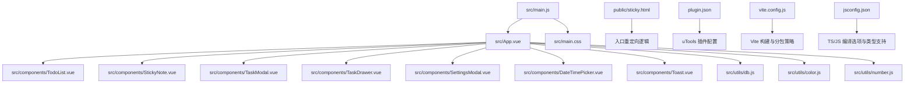
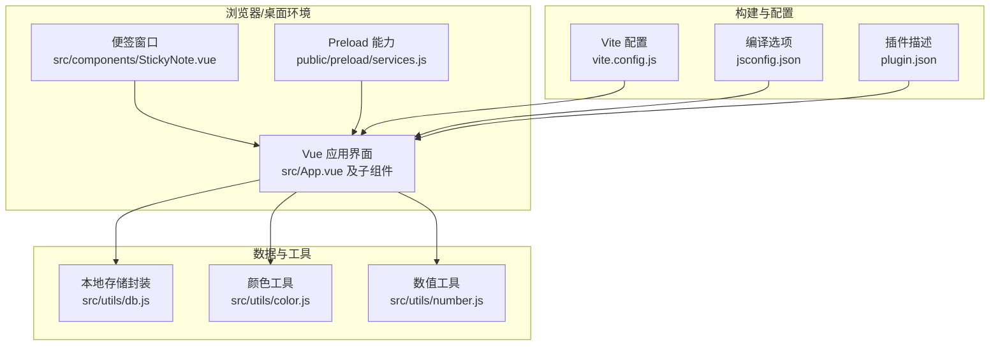
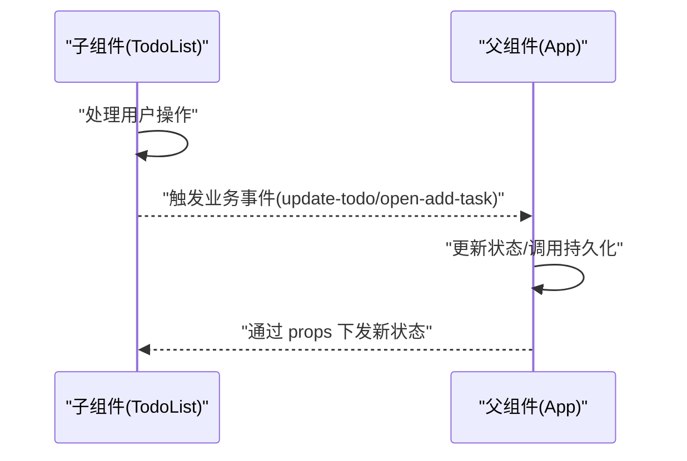
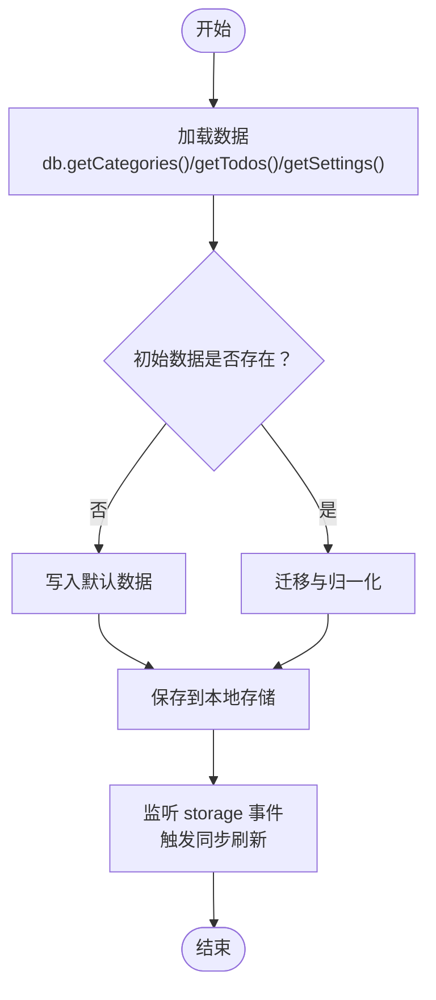
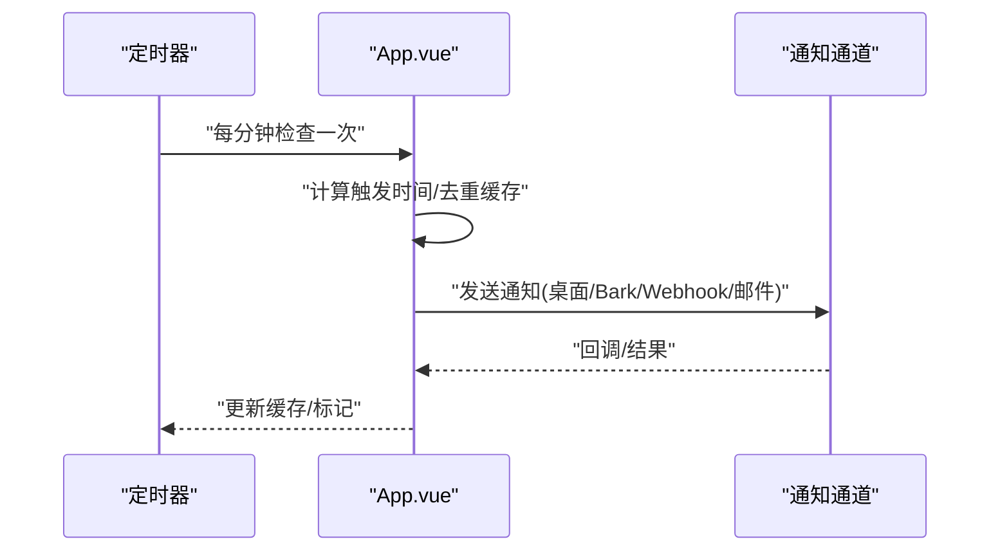
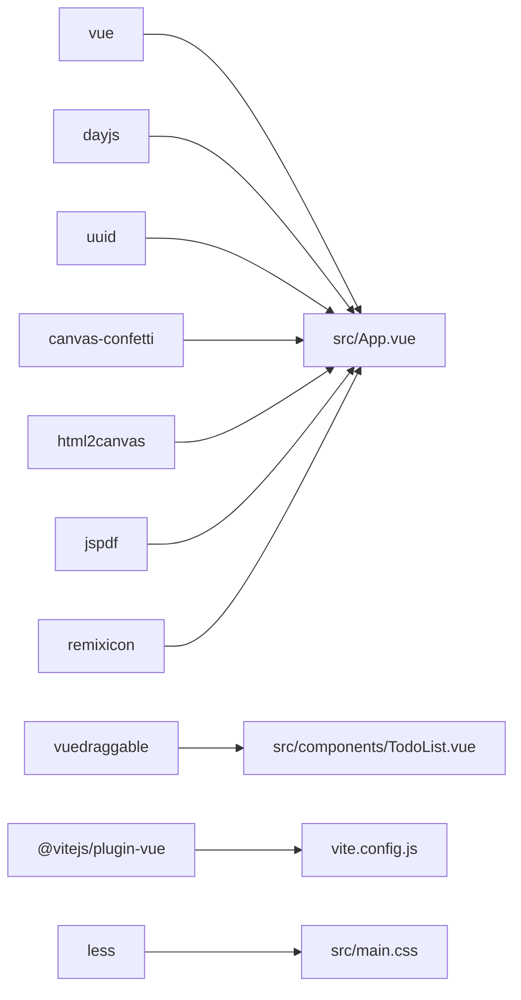

# 代码规范与约定

<cite>
**本文引用的文件**
- [package.json](file://package.json)
- [vite.config.js](file://vite.config.js)
- [jsconfig.json](file://jsconfig.json)
- [plugin.json](file://plugin.json)
- [public/sticky.html](file://public/sticky.html)
- [src/main.js](file://src/main.js)
- [src/main.css](file://src/main.css)
- [src/App.vue](file://src/App.vue)
- [src/components/TodoList.vue](file://src/components/TodoList.vue)
- [src/components/StickyNote.vue](file://src/components/StickyNote.vue)
- [src/components/ToggleSwitch.vue](file://src/components/ToggleSwitch.vue)
- [src/utils/db.js](file://src/utils/db.js)
- [src/utils/color.js](file://src/utils/color.js)
- [src/utils/number.js](file://src/utils/number.js)
</cite>

## 目录
1. [引言](#引言)
2. [项目结构](#项目结构)
3. [核心组件](#核心组件)
4. [架构总览](#架构总览)
5. [详细组件分析](#详细组件分析)
6. [依赖分析](#依赖分析)
7. [性能考虑](#性能考虑)
8. [故障排查指南](#故障排查指南)
9. [结论](#结论)
10. [附录](#附录)

## 引言
本规范旨在为 Just-Todo 项目提供统一的代码风格、组件开发约定与工程化实践，覆盖 Vue 3 组件命名与组织、JavaScript 编码标准、CSS/SCSS 规范、Git 提交与分支管理、代码审查流程等，确保团队协作一致性与长期可维护性。

## 项目结构
项目采用基于功能域的目录组织方式，核心入口与样式位于 src 根目录，组件按功能划分为 components 子目录，通用工具函数置于 utils 子目录；构建与运行通过 Vite 驱动，插件元信息由 plugin.json 描述。

图表来源
- [src/main.js:1-6](file://src/main.js#L1-L6)
- [src/App.vue:1-120](file://src/App.vue#L1-L120)
- [src/components/TodoList.vue:1-40](file://src/components/TodoList.vue#L1-L40)
- [src/components/StickyNote.vue:1-40](file://src/components/StickyNote.vue#L1-L40)
- [src/utils/db.js:1-40](file://src/utils/db.js#L1-L40)
- [src/utils/color.js:1-27](file://src/utils/color.js#L1-L27)
- [src/utils/number.js:1-3](file://src/utils/number.js#L1-L3)
- [public/sticky.html:1-21](file://public/sticky.html#L1-L21)
- [plugin.json:1-21](file://plugin.json#L1-L21)
- [vite.config.js:1-28](file://vite.config.js#L1-L28)
- [jsconfig.json:1-21](file://jsconfig.json#L1-L21)

章节来源
- [src/main.js:1-6](file://src/main.js#L1-L6)
- [src/main.css:1-170](file://src/main.css#L1-L170)
- [src/App.vue:1-120](file://src/App.vue#L1-L120)
- [vite.config.js:1-28](file://vite.config.js#L1-L28)
- [jsconfig.json:1-21](file://jsconfig.json#L1-L21)
- [plugin.json:1-21](file://plugin.json#L1-L21)
- [public/sticky.html:1-21](file://public/sticky.html#L1-L21)

## 核心组件
- 应用根组件：负责全局状态、主题切换、通知调度、数据持久化与跨模块通信。
- 列表组件：提供任务列表渲染、分组、拖拽排序、附件预览、子任务与上下文菜单交互。
- 便签组件：独立窗口模式，支持置顶、透明度、主题与颜色配置，桥接主应用交互。
- 开关组件：语义化开关控件，统一事件模型与无障碍属性。
- 工具模块：数据库抽象层、颜色与数值工具函数。

章节来源
- [src/App.vue:1-120](file://src/App.vue#L1-L120)
- [src/components/TodoList.vue:1-40](file://src/components/TodoList.vue#L1-L40)
- [src/components/StickyNote.vue:1-40](file://src/components/StickyNote.vue#L1-L40)
- [src/components/ToggleSwitch.vue:1-84](file://src/components/ToggleSwitch.vue#L1-L84)
- [src/utils/db.js:1-157](file://src/utils/db.js#L1-L157)
- [src/utils/color.js:1-27](file://src/utils/color.js#L1-L27)
- [src/utils/number.js:1-3](file://src/utils/number.js#L1-L3)

## 架构总览
系统以 Vue 3 单页应用为核心，结合 uTools 插件生态与 Electron 环境能力，实现桌面端待办管理与便携式便签模式。构建阶段通过 Vite 进行模块打包与按需分包，开发时启用热更新与类型提示。

图表来源
- [src/App.vue:1-120](file://src/App.vue#L1-L120)
- [src/components/StickyNote.vue:1-40](file://src/components/StickyNote.vue#L1-L40)
- [src/utils/db.js:1-157](file://src/utils/db.js#L1-L157)
- [src/utils/color.js:1-27](file://src/utils/color.js#L1-L27)
- [src/utils/number.js:1-3](file://src/utils/number.js#L1-L3)
- [vite.config.js:1-28](file://vite.config.js#L1-L28)
- [jsconfig.json:1-21](file://jsconfig.json#L1-L21)
- [plugin.json:1-21](file://plugin.json#L1-L21)

## 详细组件分析

### 组件命名规范与文件组织
- 命名：采用 PascalCase（如 TodoList.vue），组件名称与文件名保持一致。
- 文件扩展：单文件组件使用 .vue，工具函数使用 .js。
- 组织：按功能域划分目录，组件集中于 src/components，工具函数集中于 src/utils。
- 导入路径：优先使用相对路径，避免隐式解析歧义；在复杂层级下建议使用明确的相对路径或别名（当前项目未配置别名，保持相对路径即可）。

章节来源
- [src/components/TodoList.vue:1-40](file://src/components/TodoList.vue#L1-L40)
- [src/components/StickyNote.vue:1-40](file://src/components/StickyNote.vue#L1-L40)
- [src/components/ToggleSwitch.vue:1-84](file://src/components/ToggleSwitch.vue#L1-L84)
- [src/utils/db.js:1-40](file://src/utils/db.js#L1-L40)

### Props 类型定义与事件约定
- Props 定义：所有对外暴露的属性均显式声明类型、默认值与必填性，避免运行时类型错误。
- 事件命名：遵循“update:prop”用于双向绑定场景；业务事件使用语义化动词短语，如 open-add-task、update-todo、context-menu、item-click。
- 事件载荷：尽量传递最小必要数据，避免传递大型对象；必要时拆分事件或使用选择性参数。

图表来源
- [src/components/TodoList.vue:29-37](file://src/components/TodoList.vue#L29-L37)
- [src/App.vue:572-614](file://src/App.vue#L572-L614)

章节来源
- [src/components/TodoList.vue:9-28](file://src/components/TodoList.vue#L9-L28)
- [src/components/TodoList.vue:30-37](file://src/components/TodoList.vue#L30-L37)
- [src/components/StickyNote.vue:5-23](file://src/components/StickyNote.vue#L5-L23)
- [src/components/ToggleSwitch.vue:2-13](file://src/components/ToggleSwitch.vue#L2-L13)

### JavaScript 编码标准
- 模块化：使用 ES Module 语法，避免混用 CommonJS；第三方依赖通过 npm 管理。
- 类型支持：通过 jsconfig.json 启用类型检查与 DOM 类型，提升开发体验。
- 异步加载：对大体积依赖采用动态 import，减少首屏体积。
- 事件与生命周期：在 onMounted/onUnmounted 中注册/清理全局事件，避免内存泄漏。
- 数据持久化：统一通过 db 封装访问本地存储，保证兼容性与一致性。

章节来源
- [jsconfig.json:1-21](file://jsconfig.json#L1-L21)
- [src/App.vue:104-115](file://src/App.vue#L104-L115)
- [src/utils/db.js:1-43](file://src/utils/db.js#L1-L43)

### CSS/SCSS 编写规范
- 变量与主题：通过 CSS 自定义属性集中管理主题变量，支持明暗主题与系统偏好联动。
- 作用域：组件样式使用 scoped，避免全局污染；全局样式集中于 src/main.css。
- 动态样式：通过内联样式或 CSS 变量注入动态主题色与布局参数。
- 可访问性：按钮与交互元素具备焦点状态与无障碍属性，提升可用性。

章节来源
- [src/main.css:1-170](file://src/main.css#L1-L170)
- [src/components/StickyNote.vue:773-84](file://src/components/StickyNote.vue#L773-L84)
- [src/components/TodoList.vue:733-771](file://src/components/TodoList.vue#L733-L771)

### 组件开发规范
- 统一使用 Composition API 与 <script setup> 语法，简化样板代码。
- 事件与状态：优先使用响应式引用与计算属性，减少重复渲染。
- 交互细节：上下文菜单、悬浮面板、预览弹窗等交互需处理边界情况与性能开销。
- 可复用性：将通用逻辑抽取为工具函数或组合式函数，降低耦合度。

章节来源
- [src/App.vue:1-120](file://src/App.vue#L1-L120)
- [src/components/TodoList.vue:1-40](file://src/components/TodoList.vue#L1-L40)
- [src/components/StickyNote.vue:1-40](file://src/components/StickyNote.vue#L1-L40)

### 数据流与持久化
- 数据模型：任务包含内容、分类、优先级、截止时间、提醒、重复规则、子任务与附件等字段。
- 持久化策略：通过 db 封装统一读写 categories、todos、settings；开发环境使用 localStorage，生产环境使用 uTools db。
- 同步机制：使用 BroadcastChannel 与 localStorage 事件进行跨标签页同步，保障数据一致性。

图表来源
- [src/utils/db.js:102-156](file://src/utils/db.js#L102-L156)
- [src/App.vue:489-535](file://src/App.vue#L489-L535)
- [src/App.vue:455-486](file://src/App.vue#L455-L486)

章节来源
- [src/utils/db.js:1-157](file://src/utils/db.js#L1-L157)
- [src/App.vue:489-535](file://src/App.vue#L489-L535)

### 通知与提醒
- 触发条件：根据 dueDate/remindAt 计算触发时间，结合缓存避免重复推送。
- 通道选择：支持桌面通知、Bark、Webhook、邮件等多种通道，按用户配置启用。
- 用户交互：点击通知后唤起主窗口并打开提醒抽屉。

图表来源
- [src/App.vue:941-1015](file://src/App.vue#L941-L1015)
- [src/App.vue:1017-1178](file://src/App.vue#L1017-L1178)

章节来源
- [src/App.vue:941-1015](file://src/App.vue#L941-L1015)
- [src/App.vue:1017-1178](file://src/App.vue#L1017-L1178)

## 依赖分析
- 运行时依赖：Vue 3、dayjs、uuid、vuedraggable、canvas-confetti、html2canvas、jspdf、remixicon。
- 开发依赖：Vite、@vitejs/plugin-vue、less、utools-api-types。
- 构建优化：通过 Vite 的 manualChunks 将大依赖拆分为独立 chunk，提升缓存命中率与加载性能。

图表来源
- [package.json:7-22](file://package.json#L7-L22)
- [vite.config.js:1-28](file://vite.config.js#L1-L28)
- [src/App.vue:1-20](file://src/App.vue#L1-L20)
- [src/components/TodoList.vue:1-10](file://src/components/TodoList.vue#L1-L10)

章节来源
- [package.json:1-24](file://package.json#L1-L24)
- [vite.config.js:1-28](file://vite.config.js#L1-L28)

## 性能考虑
- 懒加载与分包：对大依赖采用动态 import，减少首屏体积；Vite 手动分包策略按库维度拆分。
- 渲染优化：列表组件使用虚拟滚动与分组，避免一次性渲染大量节点；过渡动画仅在必要时启用。
- 主题与样式：CSS 变量驱动主题切换，避免频繁重排；全局滚动条隐藏策略跨浏览器兼容。
- 通知节流：通过缓存与 TTL 控制通知频率，降低资源消耗。

章节来源
- [vite.config.js:14-26](file://vite.config.js#L14-L26)
- [src/main.css:76-93](file://src/main.css#L76-L93)
- [src/App.vue:941-1015](file://src/App.vue#L941-L1015)
- [src/components/TodoList.vue:555-578](file://src/components/TodoList.vue#L555-L578)

## 故障排查指南
- 数据加载失败：检查 db 封装与本地存储权限，确认开发/生产环境差异。
- 通知不生效：核对浏览器通知权限、Bark/Webhook 配置与网络连通性。
- 便签窗口异常：确认 preload 能力与窗口置顶 API 调用链路。
- 构建问题：检查 Vite 配置与依赖版本，关注 manualChunks 是否导致缓存失效。

章节来源
- [src/utils/db.js:21-43](file://src/utils/db.js#L21-L43)
- [src/App.vue:1017-1178](file://src/App.vue#L1017-L1178)
- [public/sticky.html:1-21](file://public/sticky.html#L1-L21)
- [vite.config.js:11-26](file://vite.config.js#L11-L26)

## 结论
本规范从组件命名、文件组织、编码标准、样式规范到构建与部署形成闭环，结合实际代码实现提炼出可执行的约定。建议在后续迭代中持续完善 ESLint/Prettier 配置，并补充单元测试与端到端测试，进一步提升质量与稳定性。

## 附录

### Git 提交与分支管理
- 分支策略：采用 feature/bugfix/release/patch 分支前缀，主分支仅合并稳定版本。
- 提交信息：采用类型+范围+简述的格式，示例：feat(components): 添加 TodoList 组件；fix(utils): 修复颜色转换异常；docs: 更新 README。
- 合并与审核：所有改动必须通过 Pull Request，至少一名成员审核通过后方可合并。

[本节为通用实践建议，不直接分析具体文件]

### 代码审查流程
- 审查清单：是否符合命名与组织规范、是否存在潜在性能问题、是否处理了边界与异常、是否提供必要的注释与文档。
- 工具支持：建议引入 ESLint 与 Prettier，统一代码风格；对样式使用 Stylelint。
- 回归测试：涉及 UI 或交互变更时，需在多分辨率与主题模式下验证。

[本节为通用实践建议，不直接分析具体文件]