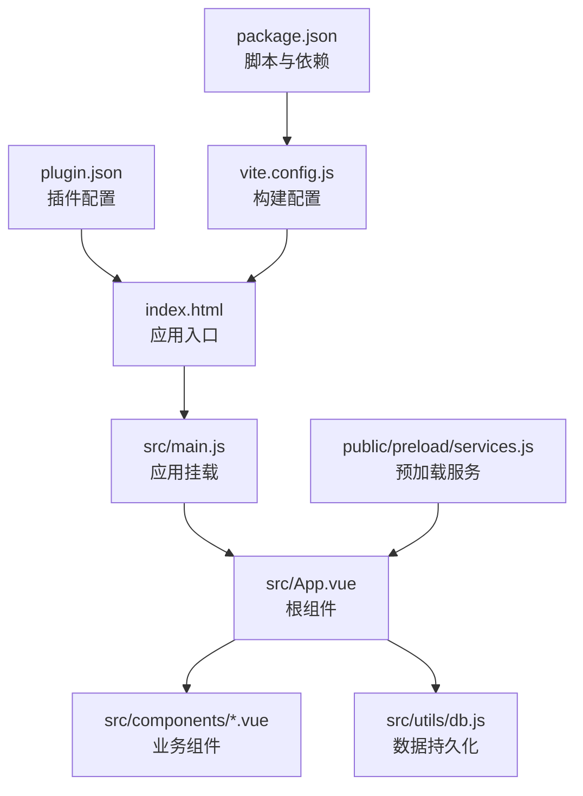
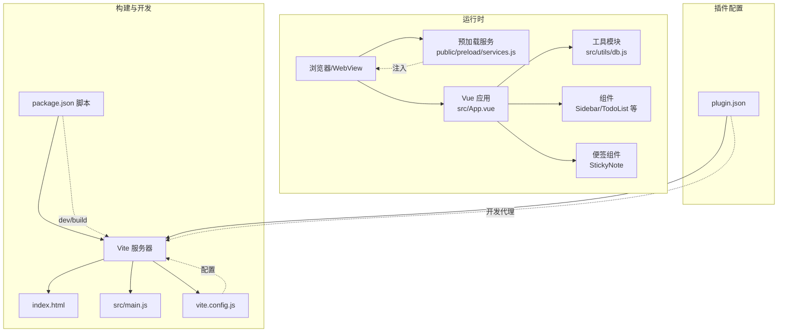
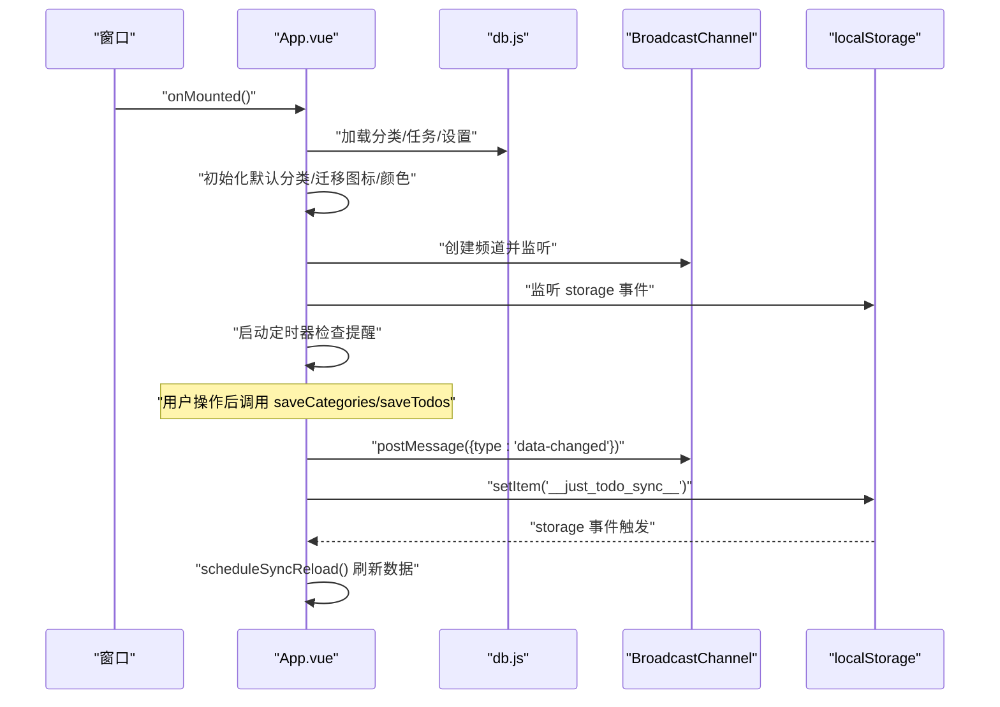
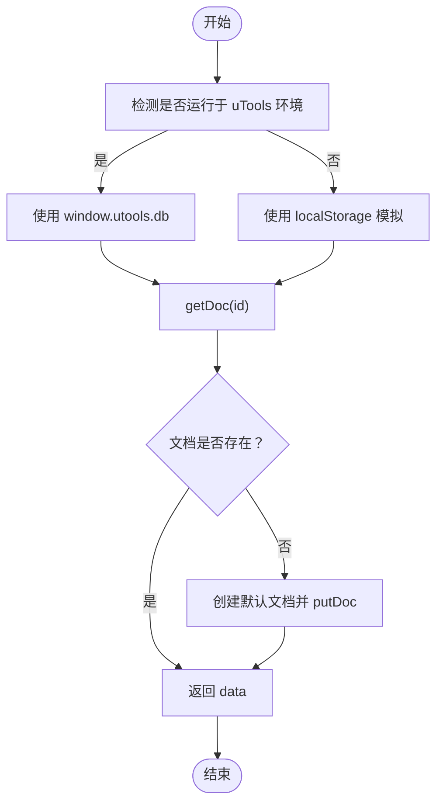
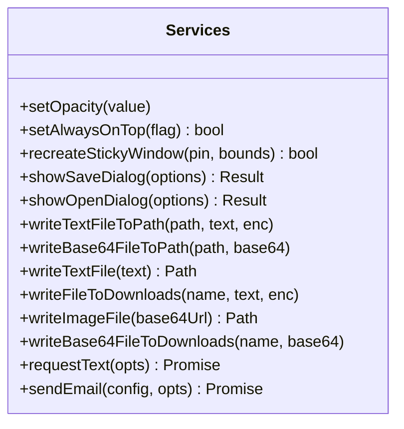
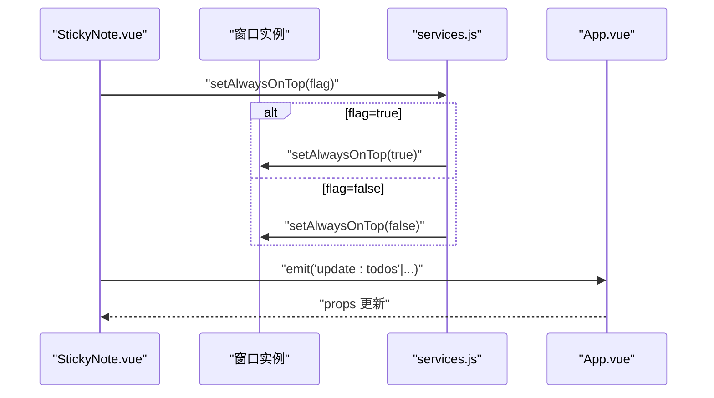
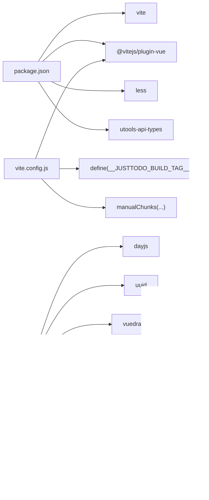

# 开发指南

<cite>
**本文引用的文件**
- [package.json](file://package.json)
- [vite.config.js](file://vite.config.js)
- [index.html](file://index.html)
- [src/main.js](file://src/main.js)
- [src/App.vue](file://src/App.vue)
- [src/main.css](file://src/main.css)
- [src/utils/db.js](file://src/utils/db.js)
- [src/components/StickyNote.vue](file://src/components/StickyNote.vue)
- [src/components/ToggleSwitch.vue](file://src/components/ToggleSwitch.vue)
- [src/components/StickyNote.test.js](file://src/components/StickyNote.test.js)
- [src/utils/color.test.js](file://src/utils/color.test.js)
- [src/utils/number.test.js](file://src/utils/number.test.js)
- [public/sticky.html](file://public/sticky.html)
- [public/preload/services.js](file://public/preload/services.js)
- [plugin.json](file://plugin.json)
</cite>

## 目录
1. [简介](#简介)
2. [项目结构](#项目结构)
3. [核心组件](#核心组件)
4. [架构总览](#架构总览)
5. [详细组件分析](#详细组件分析)
6. [依赖关系分析](#依赖关系分析)
7. [性能与内存优化](#性能与内存优化)
8. [调试与故障排查](#调试与故障排查)
9. [结论](#结论)
10. [附录](#附录)

## 简介
本指南面向参与 Just-Todo 项目的开发者，目标是帮助团队建立统一的代码规范、开发流程与调试实践；深入解析 Vite 构建配置与开发服务器行为、热重载机制；明确单元测试策略、代码质量检查与持续集成流程；提供开发环境配置建议、IDE 设置与调试工具推荐；并总结性能优化方法、内存管理与错误监控策略。

## 项目结构
项目采用 Vue 3 单页应用（SPA）与 uTools 插件模式结合的组织方式：
- 应用入口与样式：index.html、src/main.js、src/main.css
- 核心应用逻辑：src/App.vue（包含状态、分类、任务、通知、主题等）
- 组件层：src/components 下的可复用组件（如 StickyNote、ToggleSwitch 等）
- 工具与持久化：src/utils/db.js（封装本地存储与 uTools 数据库适配）
- 预加载服务：public/preload/services.js（为渲染进程注入系统能力）
- 插件配置：plugin.json（声明主页面、开发时代理、功能特性）
- 构建与脚本：package.json、vite.config.js

**图示来源**
- [index.html:1-12](file://index.html#L1-L12)
- [src/main.js:1-6](file://src/main.js#L1-L6)
- [src/App.vue:1-120](file://src/App.vue#L1-L120)
- [src/utils/db.js:1-157](file://src/utils/db.js#L1-L157)
- [public/preload/services.js:1-358](file://public/preload/services.js#L1-L358)
- [plugin.json:1-21](file://plugin.json#L1-L21)
- [vite.config.js:1-28](file://vite.config.js#L1-L28)
- [package.json:1-24](file://package.json#L1-L24)

**章节来源**
- [index.html:1-12](file://index.html#L1-L12)
- [src/main.js:1-6](file://src/main.js#L1-L6)
- [src/main.css:1-170](file://src/main.css#L1-L170)
- [src/App.vue:1-120](file://src/App.vue#L1-L120)
- [src/utils/db.js:1-157](file://src/utils/db.js#L1-L157)
- [public/preload/services.js:1-358](file://public/preload/services.js#L1-L358)
- [plugin.json:1-21](file://plugin.json#L1-L21)
- [vite.config.js:1-28](file://vite.config.js#L1-L28)
- [package.json:1-24](file://package.json#L1-L24)

## 核心组件
- 应用根组件：负责主题、通知、分类与任务的全局状态与生命周期；提供数据加载、保存、广播同步、提醒调度等能力。
- 数据持久化：db 封装了 categories、todos、settings 的读写，并在浏览器开发模式下使用 localStorage 模拟，uTools 环境下使用 window.utools.db。
- 预加载服务：为渲染进程提供 setOpacity、setAlwaysOnTop、文件对话框、网络请求、邮件发送等能力。
- 便签模式：StickyNote 提供悬浮便签视图，支持置顶、透明度、主题与颜色等个性化设置。
- 可复用控件：ToggleSwitch 提供开关交互。

**章节来源**
- [src/App.vue:1-120](file://src/App.vue#L1-L120)
- [src/utils/db.js:1-157](file://src/utils/db.js#L1-L157)
- [public/preload/services.js:1-358](file://public/preload/services.js#L1-L358)
- [src/components/StickyNote.vue:1-120](file://src/components/StickyNote.vue#L1-L120)
- [src/components/ToggleSwitch.vue:1-84](file://src/components/ToggleSwitch.vue#L1-L84)

## 架构总览
应用以 Vue 3 Composition API 为核心，结合 uTools/Electron 环境能力，实现跨平台桌面插件体验。构建与开发由 Vite 驱动，预加载脚本注入系统服务，插件配置定义开发代理与功能入口。

**图示来源**
- [src/App.vue:1-120](file://src/App.vue#L1-L120)
- [src/utils/db.js:1-157](file://src/utils/db.js#L1-L157)
- [public/preload/services.js:1-358](file://public/preload/services.js#L1-L358)
- [src/components/StickyNote.vue:1-120](file://src/components/StickyNote.vue#L1-L120)
- [index.html:1-12](file://index.html#L1-L12)
- [src/main.js:1-6](file://src/main.js#L1-L6)
- [vite.config.js:1-28](file://vite.config.js#L1-L28)
- [package.json:1-24](file://package.json#L1-L24)
- [plugin.json:1-21](file://plugin.json#L1-L21)

## 详细组件分析

### 应用根组件（App.vue）
职责与要点：
- 全局状态：主题模式、分类、任务列表、当前选中分类、视图模式、上下文菜单、日期选择器、任务抽屉/模态框、设置、通知通道等。
- 生命周期：监听 storage 事件与 BroadcastChannel 实现多窗口/多实例同步；定时器检查提醒；加载默认分类与迁移图标/颜色。
- 数据处理：提供 add/updateTodo、分类增删改、任务排序、重复规则处理、完成/撤销历史记录、提醒弹窗与延迟等。
- 广播同步：通过 BroadcastChannel 与 localStorage 广播“数据变更”消息，避免自身触发的循环刷新。
- 异步依赖：按需动态导入 html2canvas、jspdf、confetti 等大体积库，减少首屏体积。

**图示来源**
- [src/App.vue:455-486](file://src/App.vue#L455-L486)
- [src/App.vue:116-141](file://src/App.vue#L116-L141)
- [src/App.vue:489-535](file://src/App.vue#L489-L535)
- [src/utils/db.js:102-156](file://src/utils/db.js#L102-L156)

**章节来源**
- [src/App.vue:1-120](file://src/App.vue#L1-L120)
- [src/App.vue:455-486](file://src/App.vue#L455-L486)
- [src/App.vue:489-535](file://src/App.vue#L489-L535)
- [src/utils/db.js:102-156](file://src/utils/db.js#L102-L156)

### 数据持久化（db.js）
职责与要点：
- 环境适配：在 uTools 环境使用 window.utools.db，在浏览器开发环境使用 localStorage 模拟。
- 文档模型：categories、todos、settings 三类文档，含 _id、data、_rev 等字段。
- 初始化：若不存在则创建默认文档。
- 备份/恢复：导出备份负载与校验、应用备份负载并确保默认分类存在。
- 主题持久化：备份时记录主题模式，恢复后写回 localStorage。

**图示来源**
- [src/utils/db.js:1-157](file://src/utils/db.js#L1-L157)

**章节来源**
- [src/utils/db.js:1-157](file://src/utils/db.js#L1-L157)

### 预加载服务（services.js）
职责与要点：
- 窗口控制：setOpacity、setAlwaysOnTop、recreateStickyWindow（支持 pin 参数切换置顶）。
- 文件与对话框：showSaveDialog、showOpenDialog、写入文本/图片/base64 文件至下载目录。
- 网络请求：requestText 支持 GET/POST/headers/body/timeout。
- 邮件发送：sendEmail 使用 nodemailer。
- 兼容性：polyfill setImmediate，适配不同运行时。

**图示来源**
- [public/preload/services.js:1-358](file://public/preload/services.js#L1-L358)

**章节来源**
- [public/preload/services.js:1-358](file://public/preload/services.js#L1-L358)

### 便签组件（StickyNote.vue）
职责与要点：
- 便签视图：支持透明度、主题、颜色、置顶等设置；与全局主题联动。
- 窗口交互：通过 window.services 或原生窗口 API 控制置顶、透明度、重建窗口。
- 本地持久化：便签设置（主题、颜色、透明度、置顶）保存在 localStorage。
- 与主应用通信：通过 emits 与父组件同步任务列表、上下文菜单、打开添加任务等。

**图示来源**
- [src/components/StickyNote.vue:228-266](file://src/components/StickyNote.vue#L228-L266)
- [public/preload/services.js:69-132](file://public/preload/services.js#L69-L132)
- [src/App.vue:572-594](file://src/App.vue#L572-L594)

**章节来源**
- [src/components/StickyNote.vue:1-120](file://src/components/StickyNote.vue#L1-L120)
- [src/components/StickyNote.vue:228-266](file://src/components/StickyNote.vue#L228-L266)
- [public/preload/services.js:69-132](file://public/preload/services.js#L69-L132)

### 可复用控件（ToggleSwitch.vue）
职责与要点：
- 双向绑定：通过 update:modelValue 与 change 事件实现 v-model 与回调。
- 禁用态：禁用时点击无效，视觉反馈降低不透明度。
- 无障碍：aria-pressed 属性指示当前状态。

**章节来源**
- [src/components/ToggleSwitch.vue:1-84](file://src/components/ToggleSwitch.vue#L1-L84)

## 依赖关系分析
- 构建与开发：Vite 作为开发服务器与打包工具；Vue 插件用于单文件组件编译；Less 支持样式预处理；utools-api-types 提供类型提示。
- 运行时依赖：Vue 3、dayjs（时间）、uuid（生成 ID）、vuedraggable（拖拽）、remixicon（图标）、html2canvas/jspdf/canvas-confetti（截图/PDF/特效）。
- 插件与环境：plugin.json 声明开发时代理到本地 Vite；uTools 环境通过 window.utools 与 Electron remote 访问系统能力。

**图示来源**
- [package.json:1-24](file://package.json#L1-L24)
- [vite.config.js:1-28](file://vite.config.js#L1-L28)
- [src/App.vue:1-20](file://src/App.vue#L1-L20)

**章节来源**
- [package.json:1-24](file://package.json#L1-L24)
- [vite.config.js:1-28](file://vite.config.js#L1-L28)
- [src/App.vue:1-20](file://src/App.vue#L1-L20)

## 性能与内存优化
- 代码分割与懒加载
  - Vite 手动分包策略将大体积库拆分为独立 chunk（如 html2canvas、jspdf、effects、drag、dayjs、vue），减少首屏依赖，提升缓存命中率。
  - App.vue 中对 html2canvas、jspdf、confetti 采用动态 import，仅在需要时加载，降低初始包体。
- 构建与产物
  - base: "./" 保证相对路径资源正确加载。
  - define 注入构建标签，便于版本追踪与调试。
- 内存与事件
  - 在卸载时移除媒体查询监听、清理定时器、解除 storage 监听、关闭 BroadcastChannel，避免内存泄漏。
  - 通过 Set 缓存已提醒任务，避免重复弹窗。
- 渲染与计算
  - 使用 computed 与响应式 ref 管理状态，避免不必要的重渲染。
  - Todo 列表排序与过滤在计算属性中完成，减少副作用。
- 窗口与资源
  - 便签模式下透明背景与置顶窗口需谨慎使用，避免过度占用 GPU/CPU；通过透明度与置顶开关控制资源消耗。

**章节来源**
- [vite.config.js:11-26](file://vite.config.js#L11-L26)
- [src/App.vue:104-115](file://src/App.vue#L104-L115)
- [src/App.vue:306-322](file://src/App.vue#L306-L322)
- [src/App.vue:58-81](file://src/App.vue#L58-L81)
- [src/components/StickyNote.vue:215-226](file://src/components/StickyNote.vue#L215-L226)

## 调试与故障排查
- 开发服务器与热重载
  - 启动：npm run dev；Vite 默认监听端口 5173；开发代理指向 http://127.0.0.1:5173。
  - 热重载：Vite 通过 WebSocket 推送变更，组件级热替换生效。
- 插件开发联调
  - plugin.json development.main 指向本地 Vite；确保 uTools 插件加载时访问本地地址。
- 数据与同步
  - 若多窗口未同步，检查 BroadcastChannel 是否可用、localStorage storage 事件是否触发、广播消息是否携带 sourceId 避免自刷新。
- 便签模式问题
  - 置顶失效：优先调用 window.services.setAlwaysOnTop，其次回退到原生窗口 API；若仍失败，尝试 recreateStickyWindow。
  - 透明度设置：通过 window.services.setOpacity 或原生窗口 setOpacity。
- 测试与验证
  - 单元测试：使用 Vitest 与 @vue/test-utils；StickyNote.test.js 验证置顶、透明度、菜单关闭、自定义颜色编辑等场景。
  - 工具函数测试：color.test.js 与 number.test.js 覆盖颜色与数值工具函数。
- 错误监控
  - App.vue 中对数据加载异常进行捕获并可通过 uTools 显示通知。
  - 预加载服务对关键 API 调用进行 try/catch 并记录错误日志。

**章节来源**
- [plugin.json:5-7](file://plugin.json#L5-L7)
- [src/App.vue:526-534](file://src/App.vue#L526-L534)
- [src/components/StickyNote.vue:228-266](file://src/components/StickyNote.vue#L228-L266)
- [public/preload/services.js:69-132](file://public/preload/services.js#L69-L132)
- [src/components/StickyNote.test.js:1-84](file://src/components/StickyNote.test.js#L1-L84)
- [src/utils/color.test.js:1-36](file://src/utils/color.test.js#L1-L36)
- [src/utils/number.test.js:1-18](file://src/utils/number.test.js#L1-L18)

## 结论
本指南从架构、组件、构建与测试四个维度梳理了 Just-Todo 的开发要点。通过合理的代码分割、懒加载与生命周期管理，兼顾了性能与可维护性；借助 Vite 与 uTools 生态，实现了高效的开发与稳定的运行体验。建议在后续迭代中持续完善测试覆盖、引入 ESLint/Prettier 规范、探索 CI 自动化与覆盖率上报，进一步提升质量与效率。

## 附录

### Vite 构建与开发配置要点
- 插件：@vitejs/plugin-vue
- 基础路径：base: "./"
- 定义常量：__JUSTTODO_BUILD_TAG__（用于版本标记）
- 代码分割：manualChunks 按库拆分，提升缓存与加载效率
- 脚本：dev/build

**章节来源**
- [vite.config.js:1-28](file://vite.config.js#L1-L28)
- [package.json:3-6](file://package.json#L3-L6)

### 插件与开发代理
- development.main 指向本地 Vite 地址，便于联调。
- features 声明命令与功能标识。

**章节来源**
- [plugin.json:5-19](file://plugin.json#L5-L19)

### 便签页面跳转
- public/sticky.html 通过查询参数 target 与 pin 控制目标页面与置顶状态，并进行 URL 替换。

**章节来源**
- [public/sticky.html:1-21](file://public/sticky.html#L1-L21)