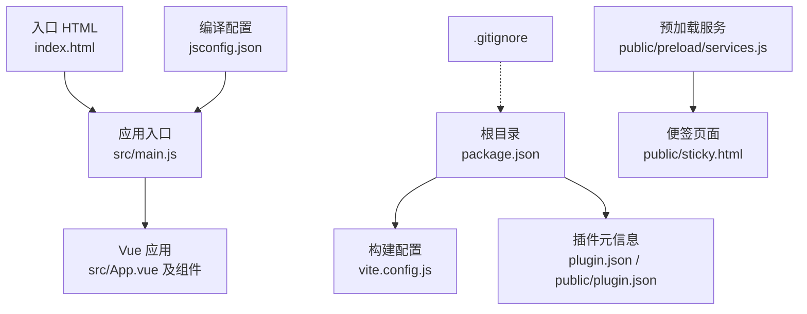
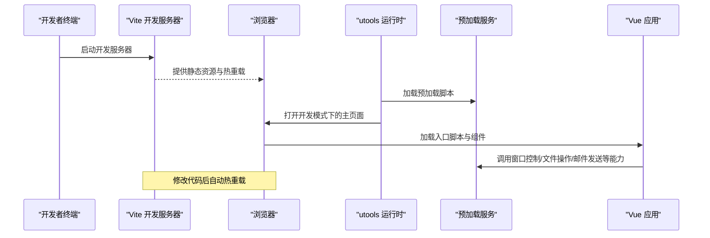
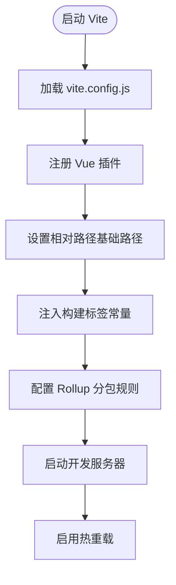
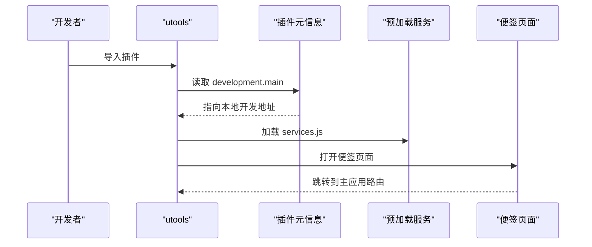
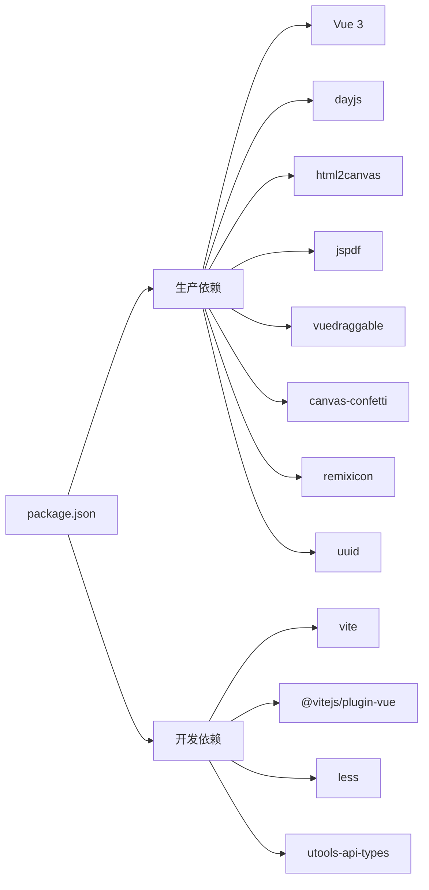

# 开发环境搭建

<cite>
**本文档引用的文件**
- [package.json](file://package.json)
- [vite.config.js](file://vite.config.js)
- [plugin.json](file://plugin.json)
- [public/plugin.json](file://public/plugin.json)
- [jsconfig.json](file://jsconfig.json)
- [index.html](file://index.html)
- [public/preload/package.json](file://public/preload/package.json)
- [public/preload/services.js](file://public/preload/services.js)
- [src/main.js](file://src/main.js)
- [src/utils/db.js](file://src/utils/db.js)
- [src/main.css](file://src/main.css)
- [public/sticky.html](file://public/sticky.html)
- [.gitignore](file://.gitignore)
</cite>

## 目录
1. [简介](#简介)
2. [项目结构](#项目结构)
3. [核心组件](#核心组件)
4. [架构总览](#架构总览)
5. [详细组件分析](#详细组件分析)
6. [依赖分析](#依赖分析)
7. [性能考虑](#性能考虑)
8. [故障排除指南](#故障排除指南)
9. [结论](#结论)
10. [附录](#附录)

## 简介
本指南面向刚接触 Just-Todo 项目的开发者，帮助你快速完成本地开发环境搭建与调试。内容涵盖 Node.js 版本要求、包管理器选择、依赖安装、Vite 开发服务器配置、热重载与代理设置、IDE 推荐配置与插件、utools 开发环境集成、插件调试工具与浏览器兼容性设置，并提供常见问题排查与解决方案。

## 项目结构
该项目采用 Vue 3 + Vite 的前端工程化方案，结合 utools 插件运行时环境，支持在桌面应用中以 Web 技术实现待办事项功能。核心目录与文件如下：
- 根目录：package.json（脚本与依赖）、vite.config.js（构建与分包策略）、plugin.json（utools 插件元信息）
- public：静态资源与预加载脚本（preload/services.js），以及便签页面入口（sticky.html）
- src：Vue 应用源码（main.js、App.vue、组件与工具函数）
- 配置：jsconfig.json（TypeScript/JS 编译选项与类型声明）、index.html（应用入口）

**图表来源**
- [package.json:1-24](file://package.json#L1-L24)
- [vite.config.js:1-28](file://vite.config.js#L1-L28)
- [plugin.json:1-21](file://plugin.json#L1-L21)
- [public/plugin.json:1-21](file://public/plugin.json#L1-L21)
- [index.html:1-12](file://index.html#L1-L12)
- [src/main.js:1-6](file://src/main.js#L1-L6)
- [public/preload/services.js:1-358](file://public/preload/services.js#L1-L358)
- [public/sticky.html:1-21](file://public/sticky.html#L1-L21)
- [jsconfig.json:1-21](file://jsconfig.json#L1-L21)

**章节来源**
- [package.json:1-24](file://package.json#L1-L24)
- [vite.config.js:1-28](file://vite.config.js#L1-L28)
- [plugin.json:1-21](file://plugin.json#L1-L21)
- [public/plugin.json:1-21](file://public/plugin.json#L1-L21)
- [jsconfig.json:1-21](file://jsconfig.json#L1-L21)
- [index.html:1-12](file://index.html#L1-L12)
- [public/preload/services.js:1-358](file://public/preload/services.js#L1-L358)
- [public/sticky.html:1-21](file://public/sticky.html#L1-L21)

## 核心组件
- 构建与开发服务器：基于 Vite 6，使用 Vue 插件进行单文件组件编译与热重载
- 插件运行时：通过 utools 提供的运行时 API 访问数据库、对话框、邮件等能力
- 预加载服务：在渲染进程中注入 Node/Electron 能力（如文件系统、邮件发送、窗口控制）
- 数据持久化：在 utools 环境中使用内置数据库，在浏览器开发环境下回退到 localStorage

**章节来源**
- [package.json:3-6](file://package.json#L3-L6)
- [vite.config.js:1-28](file://vite.config.js#L1-L28)
- [public/preload/services.js:1-358](file://public/preload/services.js#L1-L358)
- [src/utils/db.js:1-157](file://src/utils/db.js#L1-L157)

## 架构总览
下面的序列图展示了从启动开发服务器到在 utools 中运行插件的整体流程：

**图表来源**
- [vite.config.js:1-28](file://vite.config.js#L1-L28)
- [plugin.json:5-7](file://plugin.json#L5-L7)
- [public/plugin.json:5-7](file://public/plugin.json#L5-L7)
- [public/preload/services.js:1-358](file://public/preload/services.js#L1-L358)
- [src/main.js:1-6](file://src/main.js#L1-L6)

## 详细组件分析

### Node.js 与包管理器
- Node.js 版本要求：根据 Vite 依赖声明，推荐使用 Node.js 18/20/22 LTS 版本之一，确保兼容性与性能
- 包管理器选择：项目使用 npm（package.json 为模块化脚本与依赖定义），可直接使用 npm install 安装依赖；如需更快安装可选 pnpm 或 yarn
- 依赖安装：执行 npm install 后，会安装生产依赖与开发依赖，包括 Vue 3、Vite 6、Vue 插件与 utools 类型声明

**章节来源**
- [package.json:1-24](file://package.json#L1-L24)
- [package-lock.json:1539-1644](file://package-lock.json#L1539-L1644)

### Vite 开发服务器配置
- 基础配置：启用 Vue 插件、设置相对路径基础路径、通过 define 注入构建标签变量
- 分包策略：Rollup 输出按依赖特征拆分为独立 chunk（如 html2canvas、jspdf、effects、drag、dayjs、vue、vendor），优化缓存与加载性能
- 开发模式：通过 npm scripts 的 dev 脚本启动 Vite，默认监听端口为 5173（见 utools development 配置）

**图表来源**
- [vite.config.js:1-28](file://vite.config.js#L1-L28)

**章节来源**
- [vite.config.js:1-28](file://vite.config.js#L1-L28)
- [package.json:3-6](file://package.json#L3-L6)

### utools 开发环境集成
- 插件元信息：根目录与 public 目录均包含 plugin.json，开发阶段 main 指向本地 Vite 地址（127.0.0.1:5173 或 localhost:5173）
- 预加载服务：在渲染进程中注入 Node/Electron 能力，包括窗口控制、文件对话框、文本/图片写入、HTTP 请求与邮件发送
- 便签页面：sticky.html 作为便签窗口入口，动态跳转至主应用对应路由

**图表来源**
- [plugin.json:5-7](file://plugin.json#L5-L7)
- [public/plugin.json:5-7](file://public/plugin.json#L5-L7)
- [public/preload/services.js:1-358](file://public/preload/services.js#L1-L358)
- [public/sticky.html:1-21](file://public/sticky.html#L1-L21)

**章节来源**
- [plugin.json:1-21](file://plugin.json#L1-L21)
- [public/plugin.json:1-21](file://public/plugin.json#L1-L21)
- [public/preload/services.js:1-358](file://public/preload/services.js#L1-L358)
- [public/sticky.html:1-21](file://public/sticky.html#L1-L21)

### IDE 推荐配置与插件
- 编译目标与类型：jsconfig.json 指定 ES2020 目标、Node 模块解析、DOM/DOM.Iterable 库，并引入 utools-api-types 类型声明
- 推荐插件：Vue Language Features（Volar）、ESLint、Prettier、EditorConfig、GitLens
- 调试环境：在 VS Code 中可直接运行 npm scripts 启动开发服务器；若需要远程调试，可在浏览器中打开 Vite 开发地址进行断点调试

**章节来源**
- [jsconfig.json:1-21](file://jsconfig.json#L1-L21)
- [package.json:1-24](file://package.json#L1-L24)

### 浏览器兼容性与样式
- 兼容性：目标为现代浏览器，使用 CSS 变量与媒体查询实现主题切换；在暗色/亮色主题下提供对比度优化
- 样式：全局样式集中于 main.css，包含颜色变量、阴影、圆角、输入框与滚动条处理等

**章节来源**
- [src/main.css:1-170](file://src/main.css#L1-L170)

### 数据层与持久化
- 数据访问：db.js 在 utools 环境中使用内置数据库 API，在浏览器开发环境回退到 localStorage
- 初始化：首次访问会创建默认清单、空待办列表与默认设置文档

**章节来源**
- [src/utils/db.js:1-157](file://src/utils/db.js#L1-L157)

## 依赖分析
- 生产依赖：Vue 3、日历/时间处理（dayjs）、截图与 PDF（html2canvas/jspdf）、拖拽（vuedraggable）、彩蛋效果（canvas-confetti）、图标（remixicon）、UUID
- 开发依赖：Vite 6、Vue 插件、Less、utools-api-types
- 构建产物：dist 目录由 Vite 生成，包含按需分包的资源

**图表来源**
- [package.json:7-22](file://package.json#L7-L22)

**章节来源**
- [package.json:1-24](file://package.json#L1-L24)

## 性能考虑
- 分包策略：通过 manualChunks 将第三方库按功能拆分，提升缓存命中率与并行加载效率
- 资源基路径：设置相对路径基础路径，避免在子路径部署时的资源加载问题
- 开发体验：Vite 的热重载与快速冷启动显著提升迭代速度

**章节来源**
- [vite.config.js:11-26](file://vite.config.js#L11-L26)

## 故障排除指南
- Node.js 版本不匹配
  - 症状：安装或启动时报错，提示 Node 版本过低
  - 解决：升级到 Node.js 18/20/22 LTS
- 依赖安装失败
  - 症状：npm install 报错或卡住
  - 解决：清理缓存后重试；必要时改用 pnpm/yarn；检查网络代理
- Vite 启动端口占用
  - 症状：端口 5173 被占用导致无法启动
  - 解决：更换端口或释放端口；确认防火墙放行
- utools 开发模式无法加载
  - 症状：development.main 指向地址无法访问
  - 解决：确认 Vite 已在 127.0.0.1:5173 或 localhost:5173 启动；核对 plugin.json 中的 development.main
- 预加载服务缺失
  - 症状：渲染进程调用 window.services 报错
  - 解决：确认 public/preload/services.js 存在且未被忽略；检查打包输出
- 浏览器样式异常
  - 症状：主题切换无效或滚动条显示
  - 解决：确认 CSS 变量与媒体查询正确；检查浏览器兼容性

**章节来源**
- [plugin.json:5-7](file://plugin.json#L5-L7)
- [public/plugin.json:5-7](file://public/plugin.json#L5-L7)
- [public/preload/services.js:1-358](file://public/preload/services.js#L1-L358)
- [vite.config.js:7-10](file://vite.config.js#L7-L10)
- [src/main.css:95-136](file://src/main.css#L95-L136)

## 结论
Just-Todo 项目采用现代化前端技术栈与 utools 运行时相结合的方式，具备良好的开发体验与扩展性。按照本指南完成环境搭建后，即可通过 Vite 快速启动开发服务器，并在 utools 中进行插件调试与功能验证。

## 附录
- 入口文件与应用挂载：index.html 引入 src/main.js，main.js 创建并挂载 Vue 应用
- 预加载依赖：public/preload/package.json 声明了 nodemailer、setimmediate 等依赖
- 忽略文件：.gitignore 规范了 node_modules、dist 等目录的提交行为

**章节来源**
- [index.html:1-12](file://index.html#L1-L12)
- [src/main.js:1-6](file://src/main.js#L1-L6)
- [public/preload/package.json:1-8](file://public/preload/package.json#L1-L8)
- [.gitignore:1-25](file://.gitignore#L1-L25)