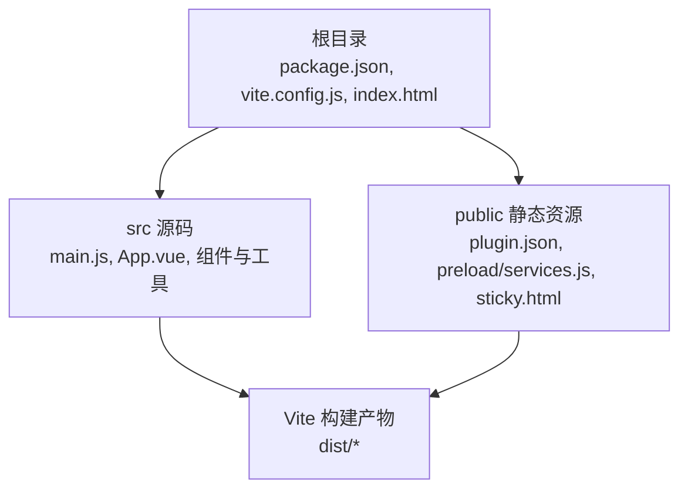
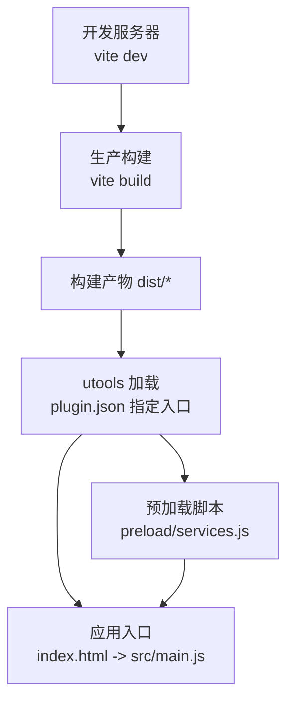
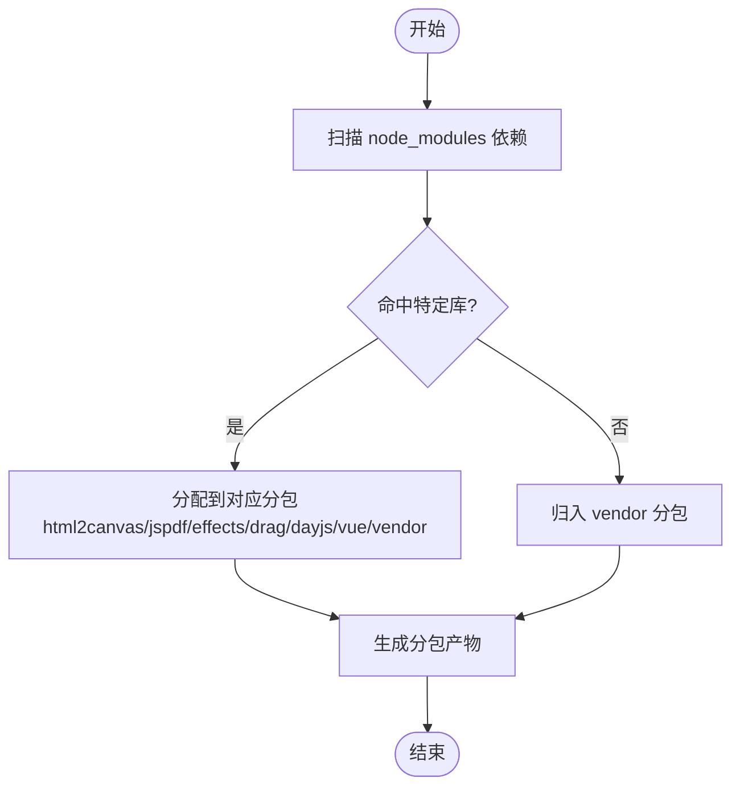
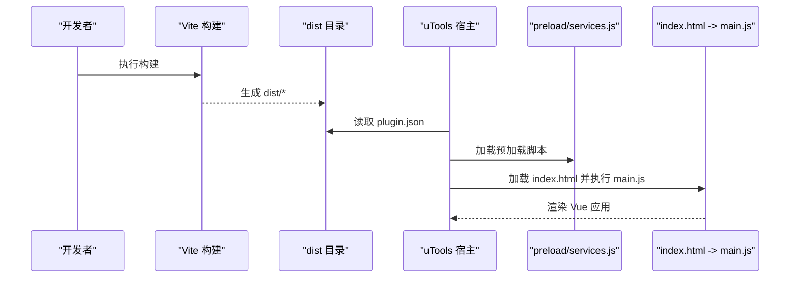
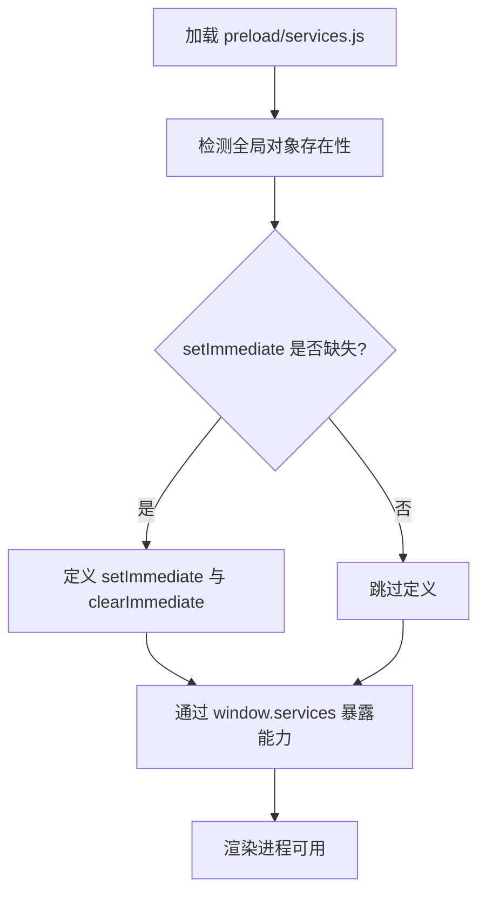
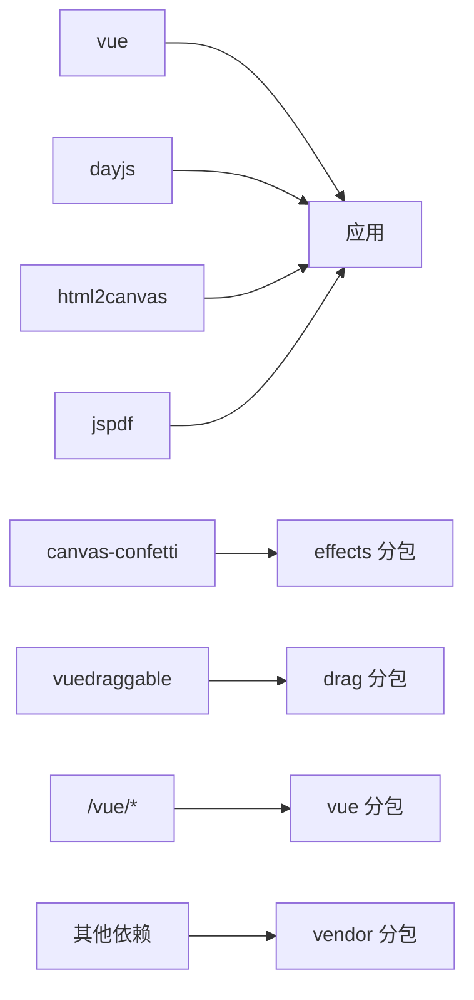

# 构建与部署

<cite>
**本文引用的文件**
- [vite.config.js](file://vite.config.js)
- [package.json](file://package.json)
- [plugin.json](file://plugin.json)
- [public/plugin.json](file://public/plugin.json)
- [index.html](file://index.html)
- [src/main.js](file://src/main.js)
- [public/preload/services.js](file://public/preload/services.js)
- [public/sticky.html](file://public/sticky.html)
- [src/components/StickyNote.test.js](file://src/components/StickyNote.test.js)
- [src/utils/color.test.js](file://src/utils/color.test.js)
</cite>

## 目录
1. [简介](#简介)
2. [项目结构](#项目结构)
3. [核心组件](#核心组件)
4. [架构总览](#架构总览)
5. [详细组件分析](#详细组件分析)
6. [依赖分析](#依赖分析)
7. [性能考虑](#性能考虑)
8. [故障排查指南](#故障排查指南)
9. [结论](#结论)
10. [附录](#附录)

## 简介
本指南面向 Just-Todo 项目的构建与部署，聚焦以下主题：
- Vite 构建配置与代码分割策略
- 生产构建参数、资源压缩与缓存策略
- utools 插件打包流程、版本管理与发布步骤
- 浏览器兼容性、polyfill 使用与性能优化
- CI/CD 流程配置、自动化测试与部署流水线建议

## 项目结构
该项目为一个基于 Vue 3 的 utools 插件前端应用，采用 Vite 作为构建工具。核心目录与职责概览如下：
- 根目录：构建脚本、插件元数据与入口页面
- src：Vue 应用源码（组件、工具函数、入口）
- public：静态资源与预加载脚本（含 polyfill 与服务封装）

图表来源
- [package.json](file://package.json)
- [vite.config.js](file://vite.config.js)
- [index.html](file://index.html)
- [src/main.js](file://src/main.js)
- [public/plugin.json](file://public/plugin.json)
- [public/preload/services.js](file://public/preload/services.js)
- [public/sticky.html](file://public/sticky.html)

章节来源
- [package.json](file://package.json)
- [vite.config.js](file://vite.config.js)
- [index.html](file://index.html)
- [src/main.js](file://src/main.js)
- [public/plugin.json](file://public/plugin.json)
- [public/preload/services.js](file://public/preload/services.js)
- [public/sticky.html](file://public/sticky.html)

## 核心组件
- 构建工具链
  - Vite：开发服务器与生产构建
  - Vue 插件：支持单文件组件与模板编译
- 插件元数据
  - 开发与生产主入口、预加载脚本、功能定义
- 预加载服务
  - polyfill 注入与 Node/Electron 能力桥接
- 应用入口
  - 创建 Vue 应用、挂载根组件

章节来源
- [vite.config.js](file://vite.config.js)
- [package.json](file://package.json)
- [plugin.json](file://plugin.json)
- [public/plugin.json](file://public/plugin.json)
- [src/main.js](file://src/main.js)
- [public/preload/services.js](file://public/preload/services.js)

## 架构总览
下图展示从开发到生产的整体流程，以及关键文件在流程中的作用。

图表来源
- [vite.config.js](file://vite.config.js)
- [package.json](file://package.json)
- [plugin.json](file://plugin.json)
- [public/plugin.json](file://public/plugin.json)
- [index.html](file://index.html)
- [src/main.js](file://src/main.js)
- [public/preload/services.js](file://public/preload/services.js)

## 详细组件分析

### Vite 构建配置与代码分割
- 基础路径与常量注入
  - 基础路径设置为相对路径，适配插件目录结构
  - 通过 define 注入构建标签常量，便于运行时识别构建时间
- 代码分割策略
  - 使用 Rollup 的 manualChunks 将第三方依赖按功能分包：
    - html2canvas、jspdf、canvas-confetti、vuedraggable、dayjs、vue、vendor 等
  - 该策略有助于：
    - 首屏加载优化：减少首屏非必要包
    - 缓存复用：稳定第三方库版本时可长期缓存
    - 按需加载：未来可扩展为动态导入进一步拆分

图表来源
- [vite.config.js](file://vite.config.js)

章节来源
- [vite.config.js](file://vite.config.js)

### utools 插件打包与入口配置
- 元数据文件
  - 根级 plugin.json：开发环境主入口指向本地 Vite 开发服务器；生产环境主入口指向 dist/index.html
  - public/plugin.json：与打包后 public 目录一致，用于实际加载
- 预加载脚本
  - 提供 setImmediate polyfill 与 Node/Electron 能力桥接（如窗口置顶、文件对话框等）
  - 通过 window.services 向渲染进程暴露能力，供应用使用
- 应用入口
  - index.html 引入模块入口 src/main.js，创建并挂载 Vue 应用
  - public/sticky.html 作为便签子窗口的轻量跳转页，根据查询参数重定向至主应用路由

图表来源
- [plugin.json](file://plugin.json)
- [public/plugin.json](file://public/plugin.json)
- [index.html](file://index.html)
- [src/main.js](file://src/main.js)
- [public/preload/services.js](file://public/preload/services.js)
- [public/sticky.html](file://public/sticky.html)

章节来源
- [plugin.json](file://plugin.json)
- [public/plugin.json](file://public/plugin.json)
- [index.html](file://index.html)
- [src/main.js](file://src/main.js)
- [public/preload/services.js](file://public/preload/services.js)
- [public/sticky.html](file://public/sticky.html)

### 浏览器兼容性与 polyfill 使用
- polyfill 注入
  - 在预加载脚本中为 setImmediate 提供跨环境补丁，解决 Electron/uTools 环境差异
  - 对多个全局对象进行安全挂载，避免重复定义与不可写属性导致的异常
- 能力桥接
  - 通过 window.services 暴露窗口控制、文件对话框、网络请求、邮件发送等能力
  - 优先使用 uTools API，回退到 Electron remote，增强兼容性

图表来源
- [public/preload/services.js](file://public/preload/services.js)

章节来源
- [public/preload/services.js](file://public/preload/services.js)

### 性能优化要点
- 代码分割
  - 利用 manualChunks 将大体积依赖独立分包，提升缓存命中率
- 资源加载
  - 相对路径基础路径确保插件内资源正确解析
- 运行时优化
  - 预加载脚本中对 setImmediate 的兜底，避免异步调度异常影响性能
- 可选优化项（建议）
  - 动态导入：对非首屏功能模块使用动态导入，进一步降低首屏体积
  - Tree-shaking：确保依赖支持 ES Module，启用无用代码消除
  - 压缩与哈希：在生产构建中开启压缩与文件名哈希，结合 CDN 缓存策略

章节来源
- [vite.config.js](file://vite.config.js)
- [public/preload/services.js](file://public/preload/services.js)

### 自动化测试与质量保障
- 测试框架
  - 使用 Vitest 与 @vue/test-utils 进行单元与组件测试
- 示例测试
  - 组件测试：验证菜单交互、透明度与颜色持久化等行为
  - 工具函数测试：验证颜色校验、转换与混合逻辑
- 建议实践
  - 为每个新组件与工具函数补充测试用例
  - 在 CI 中集成测试命令，确保变更不破坏既有行为

章节来源
- [src/components/StickyNote.test.js](file://src/components/StickyNote.test.js)
- [src/utils/color.test.js](file://src/utils/color.test.js)

## 依赖分析
- 运行时依赖
  - Vue 3、RemixIcon、UUID、Day.js、html2canvas、jspdf、canvas-confetti、vuedraggable 等
- 开发依赖
  - Vite、@vitejs/plugin-vue、Less、utools-api-types 等
- 依赖关系与构建影响
  - 第三方库通过 manualChunks 独立分包，降低首屏体积
  - 预加载脚本依赖 Node/Electron 能力，需在打包后保持路径一致

图表来源
- [package.json](file://package.json)
- [vite.config.js](file://vite.config.js)

章节来源
- [package.json](file://package.json)
- [vite.config.js](file://vite.config.js)

## 性能考虑
- 代码分割
  - 依据库特征与使用频率划分分包，有利于缓存与加载性能
- 资源压缩与缓存
  - 生产构建默认启用压缩；建议配合 CDN 与长缓存策略
- 运行时稳定性
  - polyfill 保证异步调度一致性，减少因环境差异导致的性能波动
- 可持续优化
  - 动态导入、Tree-shaking、图片与字体优化、懒加载策略

## 故障排查指南
- 构建产物路径问题
  - 确认基础路径为相对路径，避免绝对路径导致插件加载失败
- 预加载脚本未生效
  - 检查 plugin.json 中 preload 路径与 public 目录结构是否一致
  - 确认 window.services 是否在渲染进程中可用
- setImmediate 报错
  - 确认 polyfill 已注入，且未被后续代码覆盖
- 测试失败
  - 检查测试环境模拟（如 window.services、requestAnimationFrame）是否正确设置与恢复

章节来源
- [vite.config.js](file://vite.config.js)
- [plugin.json](file://plugin.json)
- [public/plugin.json](file://public/plugin.json)
- [public/preload/services.js](file://public/preload/services.js)
- [src/components/StickyNote.test.js](file://src/components/StickyNote.test.js)

## 结论
本指南系统梳理了 Just-Todo 的构建与部署要点：以 Vite 为核心，结合 manualChunks 实现精细的代码分割；通过预加载脚本提供稳定的 polyfill 与能力桥接；借助插件元数据实现开发与生产的无缝衔接。建议在现有基础上引入动态导入、更严格的 Tree-shaking 与 CDN 缓存策略，并完善 CI/CD 与自动化测试，以持续提升性能与可靠性。

## 附录

### 生产构建参数与产物优化建议
- 构建命令
  - 使用生产构建命令生成 dist 目录
- 产物优化
  - 启用压缩与文件名哈希
  - 配合 CDN 与浏览器缓存头，设置较长缓存周期
- 版本管理
  - 通过构建标签常量区分不同版本产物，便于调试与回溯

章节来源
- [package.json](file://package.json)
- [vite.config.js](file://vite.config.js)

### utools 插件打包与发布流程
- 打包
  - 执行生产构建，产出 dist 目录
  - 确保 public/plugin.json 与打包后 public 目录一致
- 版本管理
  - 在插件元数据中更新版本号与变更日志
- 发布
  - 将 dist 与 public 目录提交至发布渠道或本地仓库
  - 在 uTools 中加载并验证功能

章节来源
- [plugin.json](file://plugin.json)
- [public/plugin.json](file://public/plugin.json)

### CI/CD 流程配置建议
- 触发条件
  - 推送至主分支或打标签触发构建
- 步骤建议
  - 安装依赖 → 单元测试 → 生产构建 → 产物上传（如 S3/CDN）
- 自动化测试
  - 在 CI 中运行测试命令，确保质量门禁

章节来源
- [package.json](file://package.json)
- [src/components/StickyNote.test.js](file://src/components/StickyNote.test.js)
- [src/utils/color.test.js](file://src/utils/color.test.js)