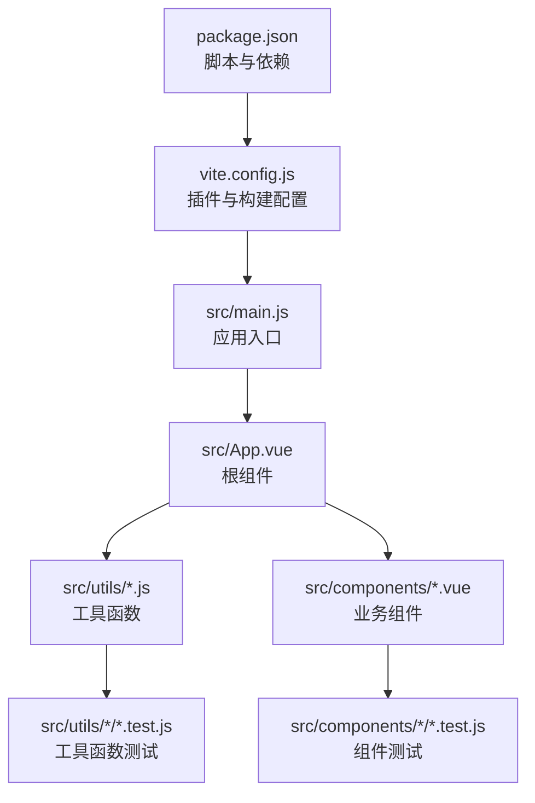
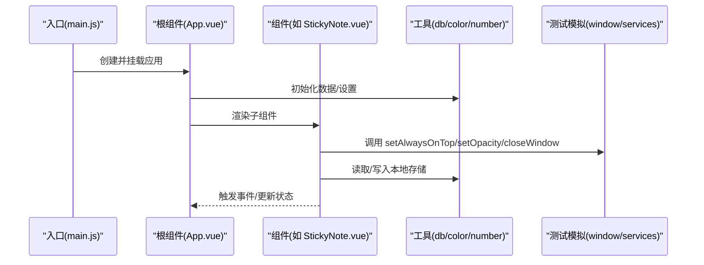
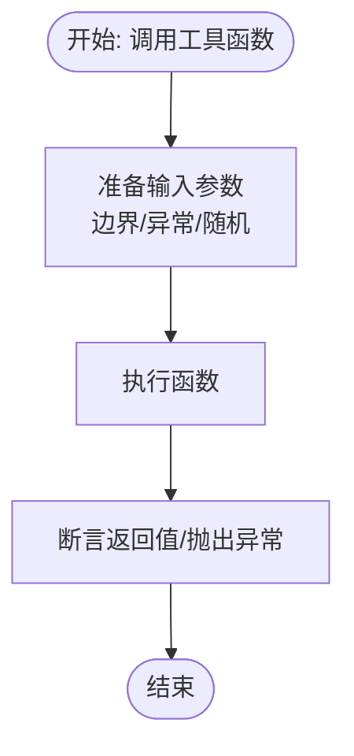
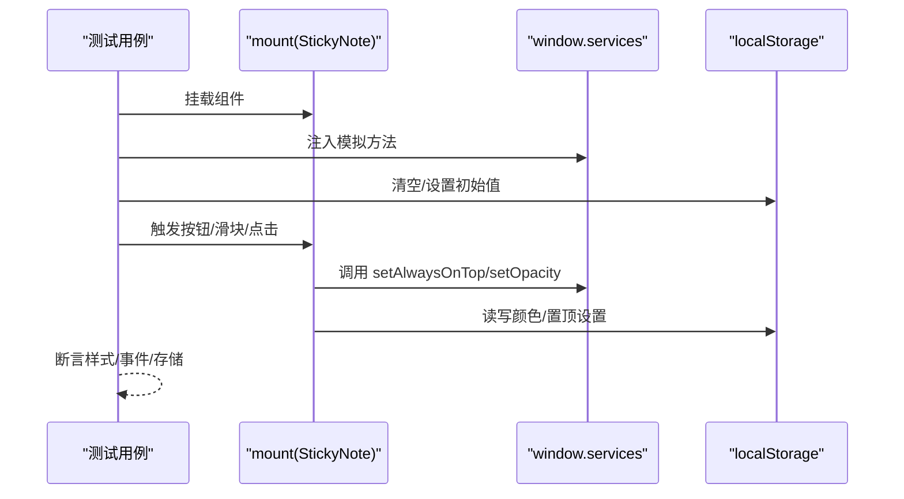
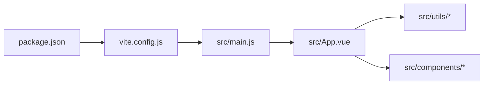

# 测试与调试

<cite>
**本文引用的文件**
- [package.json](file://package.json)
- [vite.config.js](file://vite.config.js)
- [jsconfig.json](file://jsconfig.json)
- [src/main.js](file://src/main.js)
- [src/App.vue](file://src/App.vue)
- [src/utils/db.js](file://src/utils/db.js)
- [src/utils/color.js](file://src/utils/color.js)
- [src/utils/number.js](file://src/utils/number.js)
- [src/components/StickyNote.vue](file://src/components/StickyNote.vue)
- [src/components/StickyNote.test.js](file://src/components/StickyNote.test.js)
- [src/components/ToggleSwitch.test.js](file://src/components/ToggleSwitch.test.js)
- [src/utils/color.test.js](file://src/utils/color.test.js)
- [src/utils/number.test.js](file://src/utils/number.test.js)
</cite>

## 目录
1. [引言](#引言)
2. [项目结构](#项目结构)
3. [核心组件](#核心组件)
4. [架构总览](#架构总览)
5. [详细组件分析](#详细组件分析)
6. [依赖分析](#依赖分析)
7. [性能考虑](#性能考虑)
8. [故障排查指南](#故障排查指南)
9. [结论](#结论)
10. [附录](#附录)

## 引言
本文件为 Just-Todo 项目的测试与调试策略文档，目标是帮助开发团队建立系统化的单元测试、组件测试、异步测试与调试实践，并配套性能分析与错误监控建议。当前仓库已具备基于 Vitest 的基础单元测试与 Vue 组件测试骨架，测试覆盖了工具函数与部分交互组件。本文将在此基础上补充测试框架选型、测试用例设计、模拟数据与异步处理策略、调试工具与断点技巧、性能分析与内存泄漏检测、以及测试自动化与持续集成建议。

## 项目结构
项目采用 Vite + Vue 3 单页应用结构，源码位于 src 目录，测试文件以 .test.js 命名并放置在对应组件或工具目录下。构建配置通过 vite.config.js 定义，类型声明由 jsconfig.json 提供。

图表来源
- [package.json:1-24](file://package.json#L1-L24)
- [vite.config.js:1-28](file://vite.config.js#L1-L28)
- [src/main.js:1-6](file://src/main.js#L1-L6)
- [src/App.vue:1-120](file://src/App.vue#L1-L120)

章节来源
- [package.json:1-24](file://package.json#L1-L24)
- [vite.config.js:1-28](file://vite.config.js#L1-L28)
- [jsconfig.json:1-20](file://jsconfig.json#L1-L20)
- [src/main.js:1-6](file://src/main.js#L1-L6)

## 核心组件
- 应用入口与根组件：负责全局状态、通知、提醒、主题切换、数据同步广播等逻辑。
- 数据层：db 模块封装本地存储与utools数据库适配，提供分类、任务、设置的读写与备份恢复。
- 工具函数：颜色处理、数值裁剪等纯函数，便于独立测试与复用。
- 交互组件：如 StickyNote（便签窗口）、ToggleSwitch（开关）等，具备用户交互与 DOM 行为，适合组件级测试。

章节来源
- [src/App.vue:1-120](file://src/App.vue#L1-L120)
- [src/utils/db.js:1-157](file://src/utils/db.js#L1-L157)
- [src/utils/color.js:1-27](file://src/utils/color.js#L1-L27)
- [src/utils/number.js:1-3](file://src/utils/number.js#L1-L3)
- [src/components/StickyNote.vue:1-120](file://src/components/StickyNote.vue#L1-L120)

## 架构总览
下图展示应用启动到组件渲染的关键路径，以及测试关注点（模拟外部服务、时间函数、存储）：

图表来源
- [src/main.js:1-6](file://src/main.js#L1-L6)
- [src/App.vue:1-120](file://src/App.vue#L1-L120)
- [src/components/StickyNote.vue:1-120](file://src/components/StickyNote.vue#L1-L120)
- [src/utils/db.js:1-157](file://src/utils/db.js#L1-L157)

## 详细组件分析

### 测试框架与运行环境
- 测试框架：仓库已使用 Vitest 进行单元与组件测试，测试文件中可见 describe/it/expect 及 @vue/test-utils 的 mount 使用。
- 运行环境：Vite 配置支持 ES 模块与 DOM 类型，jsconfig.json 启用了 DOM 类型与 utools API 类型，便于在测试中访问 window utools 等对象。

章节来源
- [src/components/StickyNote.test.js:1-84](file://src/components/StickyNote.test.js#L1-L84)
- [src/components/ToggleSwitch.test.js:1-29](file://src/components/ToggleSwitch.test.js#L1-L29)
- [src/utils/color.test.js:1-36](file://src/utils/color.test.js#L1-L36)
- [src/utils/number.test.js:1-18](file://src/utils/number.test.js#L1-L18)
- [vite.config.js:1-28](file://vite.config.js#L1-L28)
- [jsconfig.json:1-20](file://jsconfig.json#L1-L20)

### 工具函数测试策略
- color.js：验证十六进制颜色校验、归一化、RGB 转换、混合与 CSS 格式化。
- number.js：验证数值裁剪边界行为。
- 测试要点：边界值、异常输入、大小写与空白处理、浮点混合计算精度。

图表来源
- [src/utils/color.js:1-27](file://src/utils/color.js#L1-L27)
- [src/utils/number.js:1-3](file://src/utils/number.js#L1-L3)
- [src/utils/color.test.js:1-36](file://src/utils/color.test.js#L1-L36)
- [src/utils/number.test.js:1-18](file://src/utils/number.test.js#L1-L18)

章节来源
- [src/utils/color.js:1-27](file://src/utils/color.js#L1-L27)
- [src/utils/number.js:1-3](file://src/utils/number.js#L1-L3)
- [src/utils/color.test.js:1-36](file://src/utils/color.test.js#L1-L36)
- [src/utils/number.test.js:1-18](file://src/utils/number.test.js#L1-L18)

### 组件测试策略（StickyNote）
- 模拟外部服务：通过 window.services 注入 setAlwaysOnTop、setOpacity、closeWindow 等方法，避免真实窗口操作。
- 模拟动画帧：替换 requestAnimationFrame，确保异步定时器可预测。
- 本地存储：测试前清理 localStorage 并注入初始值，保证测试隔离性。
- 交互断言：菜单开关、滑块透明度、点击外部关闭、自定义颜色编辑与持久化。

图表来源
- [src/components/StickyNote.test.js:1-84](file://src/components/StickyNote.test.js#L1-L84)
- [src/components/StickyNote.vue:1-120](file://src/components/StickyNote.vue#L1-L120)

章节来源
- [src/components/StickyNote.test.js:1-84](file://src/components/StickyNote.test.js#L1-L84)
- [src/components/StickyNote.vue:1-120](file://src/components/StickyNote.vue#L1-L120)

### 组件测试策略（ToggleSwitch）
- Props 与事件：验证点击时是否正确触发 update:modelValue 与 change 事件；禁用态不应触发。
- 测试要点：事件发射次数与参数、禁用态分支。

章节来源
- [src/components/ToggleSwitch.test.js:1-29](file://src/components/ToggleSwitch.test.js#L1-L29)

### 数据层测试策略（db）
- 适配环境：在 utools 环境与浏览器环境之间切换读写逻辑。
- 备份/恢复：校验备份载荷结构、默认清单补齐、设置字段校验与回填。
- 测试要点：缺失文档初始化、版本兼容、错误抛出与回退。

章节来源
- [src/utils/db.js:1-157](file://src/utils/db.js#L1-L157)

### 异步测试与时间控制
- 替换 requestAnimationFrame：在测试中注入固定回调，使动画/定时器可预测。
- 使用 nextTick：确保 DOM 更新后断言。
- 全局清理：在 afterEach 中恢复 window.services 与 raf，避免跨用例污染。

章节来源
- [src/components/StickyNote.test.js:16-33](file://src/components/StickyNote.test.js#L16-L33)

### 覆盖率与测试用例设计建议
- 覆盖率目标：建议对核心模块（工具函数、db、关键交互组件）达到中高覆盖率（例如 80%+），对边界条件与异常路径进行重点覆盖。
- 用例分层：
  - 单元层：纯函数与工具函数（color、number）。
  - 组件层：交互组件（StickyNote、ToggleSwitch）。
  - 集成层：db 与外部存储交互、utools API 适配。
- 模拟策略：统一使用 vi.fn()/vi.spyOn 对外部依赖进行模拟，避免真实 I/O。

章节来源
- [src/utils/color.test.js:1-36](file://src/utils/color.test.js#L1-L36)
- [src/utils/number.test.js:1-18](file://src/utils/number.test.js#L1-L18)
- [src/components/StickyNote.test.js:1-84](file://src/components/StickyNote.test.js#L1-L84)
- [src/components/ToggleSwitch.test.js:1-29](file://src/components/ToggleSwitch.test.js#L1-L29)
- [src/utils/db.js:1-157](file://src/utils/db.js#L1-L157)

## 依赖分析
- 构建与打包：Vite 插件与手动分包策略，按第三方库拆分 chunk，减少 vendor 体积。
- 运行时依赖：Vue 3、dayjs、uuid、html2canvas、jspdf、canvas-confetti、vuedraggable、remixicon。
- 开发依赖：@vitejs/plugin-vue、less、utools-api-types、vite。

图表来源
- [package.json:1-24](file://package.json#L1-L24)
- [vite.config.js:1-28](file://vite.config.js#L1-L28)
- [src/main.js:1-6](file://src/main.js#L1-L6)
- [src/App.vue:1-120](file://src/App.vue#L1-L120)

章节来源
- [package.json:1-24](file://package.json#L1-L24)
- [vite.config.js:1-28](file://vite.config.js#L1-L28)

## 性能考虑
- 构建优化：利用 vite.config.js 的 manualChunks 将大依赖拆分，降低首屏加载压力。
- 组件渲染：对高频交互组件（如 StickyNote）避免不必要的重渲染，合理使用 computed/watch。
- 异步加载：对大型库（html2canvas/jspdf/canvas-confetti）采用动态 import，按需加载。
- 本地存储：批量写入与去抖（如 notified cache、同步广播）减少频繁 I/O。

章节来源
- [vite.config.js:11-26](file://vite.config.js#L11-L26)
- [src/App.vue:104-115](file://src/App.vue#L104-L115)
- [src/App.vue:116-131](file://src/App.vue#L116-L131)
- [src/App.vue:489-535](file://src/App.vue#L489-L535)

## 故障排查指南
- 断点调试
  - 在浏览器开发者工具中设置断点于组件事件处理器、生命周期钩子与异步回调。
  - 对动态导入的模块（如 canvas-confetti）在首次调用处设置断点，确认加载时机。
- 日志与计时
  - 使用 console.time/console.timeEnd 包裹耗时操作（如 loadData），定位慢点。
- 存储问题
  - 检查 localStorage 是否可用、键名是否一致、JSON 解析是否异常。
- 外部服务
  - 确认 window.services 与 window.utools 方法存在性与返回值，必要时提供降级实现。
- 内存泄漏检测
  - 关注定时器（setInterval、setTimeout）与事件监听器（storage、BroadcastChannel、matchMedia）在 onUnmounted 中清理。
  - 使用浏览器性能面板记录内存曲线，观察是否存在持续增长的对象引用链。

章节来源
- [src/App.vue:294-322](file://src/App.vue#L294-L322)
- [src/App.vue:455-486](file://src/App.vue#L455-L486)
- [src/App.vue:489-535](file://src/App.vue#L489-L535)
- [src/components/StickyNote.test.js:16-33](file://src/components/StickyNote.test.js#L16-L33)

## 结论
当前项目已具备良好的测试基础（Vitest + @vue/test-utils），测试覆盖了工具函数与关键交互组件。建议进一步完善覆盖率、增强异步与外部依赖模拟、补充集成测试与端到端场景，并在 CI 中引入自动化测试与覆盖率报告，以保障功能稳定性与可维护性。

## 附录

### 测试自动化与持续集成建议
- 测试命令扩展：在 package.json scripts 中新增 test:unit、test:coverage 等脚本，结合 vitest 的覆盖率选项生成报告。
- CI 流程：在 CI 中安装依赖、运行测试与覆盖率检查，失败即中断流水线。
- 回归测试：对关键交互（置顶、透明度、颜色、菜单外点击关闭）与数据层（备份/恢复、初始化）建立回归用例集。

章节来源
- [package.json:3-6](file://package.json#L3-L6)