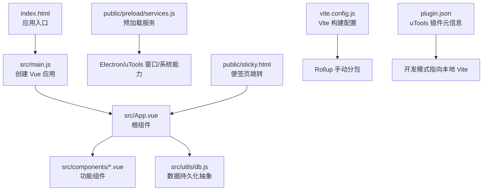
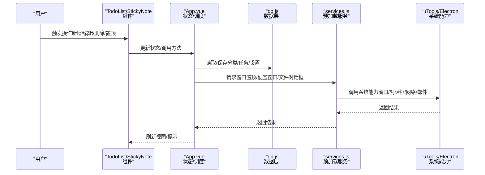
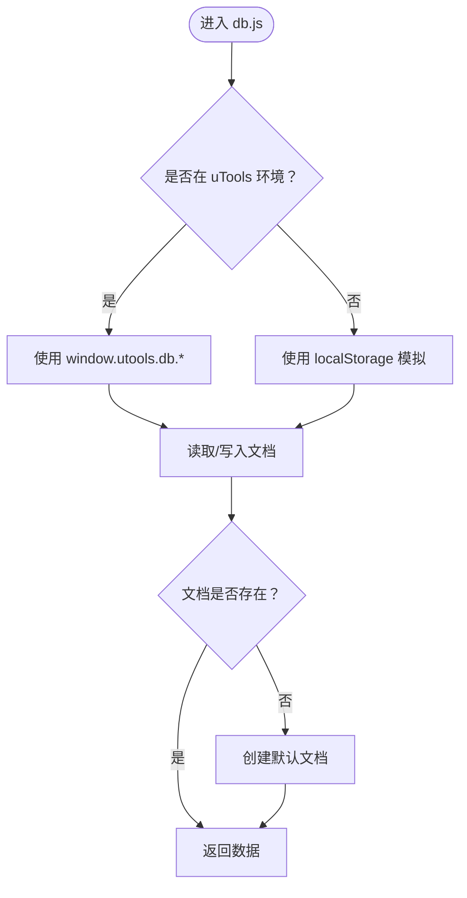
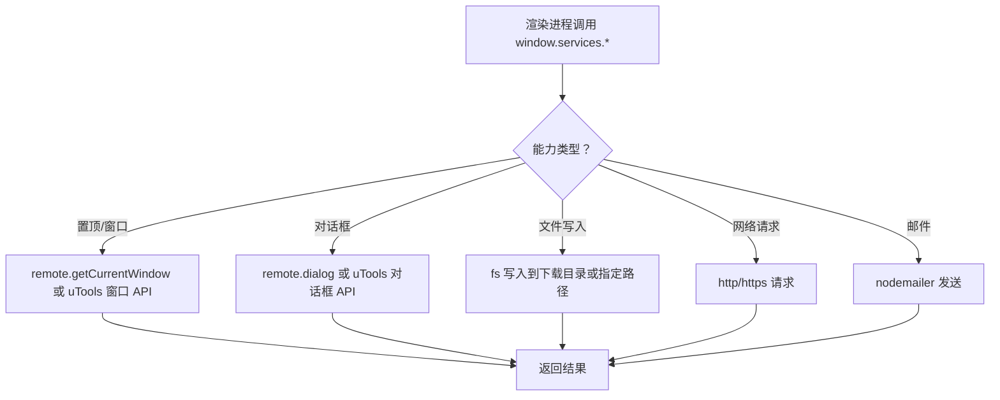
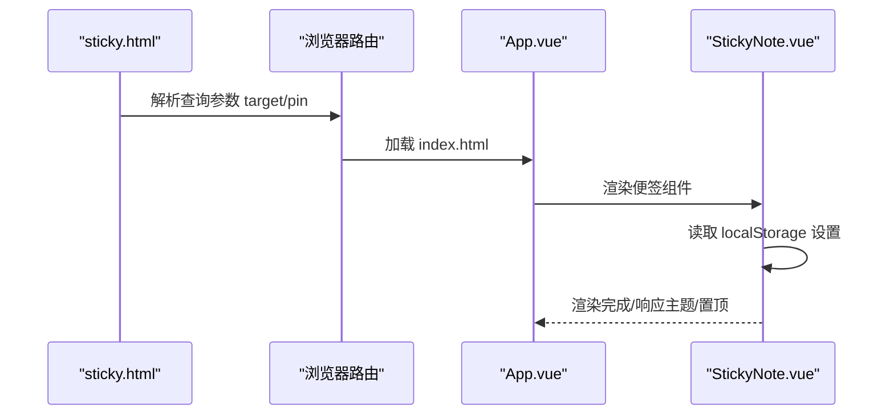
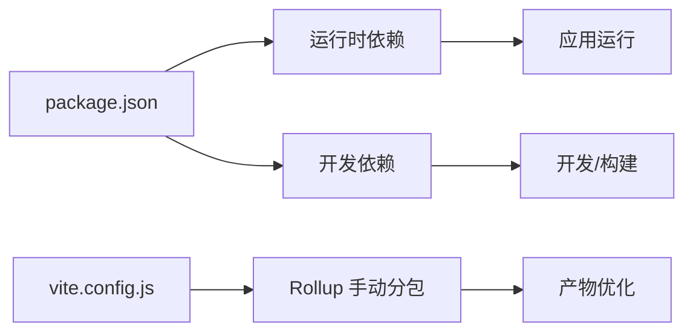

# 快速开始

<cite>
**本文引用的文件**
- [package.json](file://package.json)
- [vite.config.js](file://vite.config.js)
- [plugin.json](file://plugin.json)
- [public/plugin.json](file://public/plugin.json)
- [index.html](file://index.html)
- [src/main.js](file://src/main.js)
- [src/App.vue](file://src/App.vue)
- [src/utils/db.js](file://src/utils/db.js)
- [public/preload/services.js](file://public/preload/services.js)
- [public/sticky.html](file://public/sticky.html)
- [src/components/TodoList.vue](file://src/components/TodoList.vue)
- [src/components/StickyNote.vue](file://src/components/StickyNote.vue)
- [src/main.css](file://src/main.css)
- [jsconfig.json](file://jsconfig.json)
</cite>

## 目录
1. [简介](#简介)
2. [项目结构](#项目结构)
3. [核心组件](#核心组件)
4. [架构总览](#架构总览)
5. [详细组件分析](#详细组件分析)
6. [依赖分析](#依赖分析)
7. [性能考虑](#性能考虑)
8. [故障排查指南](#故障排查指南)
9. [结论](#结论)
10. [附录](#附录)

## 简介
Just-Todo 是一个基于 Vue 3 的跨平台待办事项插件，支持在 uTools 平台中使用，并可作为独立网页应用运行。它提供清单分类、任务管理、提醒与重复、便签模式、主题切换、数据导入导出等功能。本“快速开始”指南将帮助你从零搭建开发环境、安装依赖、本地运行与构建发布，并理解关键配置文件的作用。

## 项目结构
项目采用“根目录 + public 静态资源 + src 源代码”的组织方式，核心入口为 index.html 和 src/main.js；uTools 插件元信息位于根目录与 public 目录下的 plugin.json；打包与开发服务器由 Vite 提供；数据库访问通过统一的 db 工具模块抽象，既可在 uTools 环境中使用其数据库 API，也可在浏览器中回退到 localStorage。

图表来源
- [index.html](file://index.html)
- [src/main.js](file://src/main.js)
- [src/App.vue](file://src/App.vue)
- [src/utils/db.js](file://src/utils/db.js)
- [public/preload/services.js](file://public/preload/services.js)
- [public/sticky.html](file://public/sticky.html)
- [vite.config.js](file://vite.config.js)
- [plugin.json](file://plugin.json)

章节来源
- [index.html](file://index.html)
- [src/main.js](file://src/main.js)
- [src/App.vue](file://src/App.vue)
- [src/utils/db.js](file://src/utils/db.js)
- [public/preload/services.js](file://public/preload/services.js)
- [public/sticky.html](file://public/sticky.html)
- [vite.config.js](file://vite.config.js)
- [plugin.json](file://plugin.json)

## 核心组件
- 应用入口与启动
  - index.html：定义应用挂载点与模块入口脚本。
  - src/main.js：创建 Vue 应用实例，引入样式与图标字体，挂载根组件。
- 根组件与状态
  - src/App.vue：集中管理主题、通知、分类、任务、提醒弹窗等状态与逻辑，负责数据加载与同步广播。
- 数据层
  - src/utils/db.js：封装 uTools 数据库与浏览器 localStorage 的差异，提供 categories/todos/settings 的读写与初始化。
- 预加载服务
  - public/preload/services.js：在渲染进程中注入 Node/Electron 能力（如窗口置顶、便签窗口、对话框、网络请求、邮件发送），并提供通用文件读写接口。
- 便签模式
  - public/sticky.html：便签窗口的轻量跳转页，将参数转发至主应用的便签路由。
  - src/components/StickyNote.vue：便签窗口的主题、透明度、置顶、颜色等设置与交互。
- 列表组件
  - src/components/TodoList.vue：任务列表渲染、拖拽排序、附件预览与下载、时间轴等。

章节来源
- [index.html](file://index.html)
- [src/main.js](file://src/main.js)
- [src/App.vue](file://src/App.vue)
- [src/utils/db.js](file://src/utils/db.js)
- [public/preload/services.js](file://public/preload/services.js)
- [public/sticky.html](file://public/sticky.html)
- [src/components/StickyNote.vue](file://src/components/StickyNote.vue)
- [src/components/TodoList.vue](file://src/components/TodoList.vue)

## 架构总览
下图展示了从用户操作到数据持久化的端到端流程，以及便签模式与 uTools 窗口能力的集成。

图表来源
- [src/components/TodoList.vue](file://src/components/TodoList.vue)
- [src/components/StickyNote.vue](file://src/components/StickyNote.vue)
- [src/App.vue](file://src/App.vue)
- [src/utils/db.js](file://src/utils/db.js)
- [public/preload/services.js](file://public/preload/services.js)

## 详细组件分析

### 数据持久化与迁移（db.js）
- 设计要点
  - 在 uTools 环境中使用 window.utools.db.get/put；在浏览器中回退到 localStorage，模拟 _rev 版本号以保证更新一致性。
  - 提供 categories/todos/settings 的初始化与读写，确保首次运行时生成默认清单。
  - 提供备份/恢复负载的序列化与校验，包含版本号与主题模式字段。
- 关键路径
  - [getDoc/putDoc](file://src/utils/db.js)
  - [getCategories/saveCategories](file://src/utils/db.js)
  - [getTodos/saveTodos](file://src/utils/db.js)
  - [getSettings/saveSettings](file://src/utils/db.js)
  - [createBackupPayload/applyBackupPayload](file://src/utils/db.js)

图表来源
- [src/utils/db.js](file://src/utils/db.js)

章节来源
- [src/utils/db.js](file://src/utils/db.js)

### 预加载服务（services.js）
- 设计要点
  - 注入 polyfill 修复 setImmediate 缺失问题，兼容 Electron/uTools 环境。
  - 提供窗口透明度、置顶、便签窗口重建、文件对话框、文本/图片/二进制文件写入、HTTP 请求、SMTP 邮件发送等能力。
  - 通过 window.services 向渲染进程暴露这些能力。
- 关键路径
  - [setAlwaysOnTop/recreateStickyWindow](file://public/preload/services.js)
  - [showSaveDialog/showOpenDialog](file://public/preload/services.js)
  - [requestText/sendEmail](file://public/preload/services.js)

图表来源
- [public/preload/services.js](file://public/preload/services.js)

章节来源
- [public/preload/services.js](file://public/preload/services.js)

### 便签模式（StickyNote.vue + sticky.html）
- 设计要点
  - 通过查询参数 pin 控制是否置顶；支持主题跟随系统、自定义背景色、透明度与置顶开关。
  - 使用 localStorage 持久化便签设置；根据主题计算轴线与卡片颜色。
  - public/sticky.html 将目标路由重定向到 index.html 的便签模式。
- 关键路径
  - [sticky.html 参数解析与重定向](file://public/sticky.html)
  - [StickyNote.vue 主题与置顶逻辑](file://src/components/StickyNote.vue)

图表来源
- [public/sticky.html](file://public/sticky.html)
- [src/components/StickyNote.vue](file://src/components/StickyNote.vue)
- [src/App.vue](file://src/App.vue)

章节来源
- [public/sticky.html](file://public/sticky.html)
- [src/components/StickyNote.vue](file://src/components/StickyNote.vue)
- [src/App.vue](file://src/App.vue)

### 列表组件（TodoList.vue）
- 设计要点
  - 支持附件预览（文本/图片）、编码切换、下载；拖拽排序；时间轴分组与展开收起。
  - 与 App.vue 协作处理任务更新、上下文菜单、点击事件等。
- 关键路径
  - [附件预览/下载/编码切换](file://src/components/TodoList.vue)
  - [拖拽排序与更新回调](file://src/components/TodoList.vue)

章节来源
- [src/components/TodoList.vue](file://src/components/TodoList.vue)

## 依赖分析
- 运行时依赖
  - Vue 3、Vue 生态工具与 UI 基础库（如 vuedraggable）用于组件化与交互。
  - 日期与提醒相关库（dayjs）与 PDF/截图导出（html2canvas、jspdf）。
  - 图标字体（remixicon）与 UUID 生成器。
- 开发依赖
  - Vite 与 @vitejs/plugin-vue 用于开发与构建。
  - Less 与 utools-api-types 用于样式与类型支持。
- 关键文件
  - [package.json 依赖声明](file://package.json)
  - [vite.config.js 构建与分包策略](file://vite.config.js)

图表来源
- [package.json](file://package.json)
- [vite.config.js](file://vite.config.js)

章节来源
- [package.json](file://package.json)
- [vite.config.js](file://vite.config.js)

## 性能考虑
- 代码分割与手动分包
  - Vite 配置对第三方库进行手动分包，避免 vendor 包过大，提升缓存命中率与首屏加载速度。
  - 关键分包策略参考：html2canvas、jspdf、effects（confetti）、drag（vuedraggable）、dayjs、vue 等。
- 懒加载与按需导入
  - App.vue 中对 canvas-confetti、html2canvas、jspdf 采用动态 import，仅在需要时加载，减少初始包体。
- 本地存储与广播同步
  - 使用 localStorage 与 BroadcastChannel 实现多窗口/多标签页的数据同步与去抖刷新，降低频繁 IO。

章节来源
- [vite.config.js](file://vite.config.js)
- [src/App.vue](file://src/App.vue)

## 故障排查指南
- 开发环境无法热更新或端口占用
  - 确认本地开发服务器端口未被占用；Vite 默认端口通常为本地回环地址。
  - 参考命令：[npm 脚本 dev](file://package.json)
- uTools 插件无法加载或热更新异常
  - 检查 plugin.json 中 development.main 是否指向本地 Vite 地址。
  - 参考：[plugin.json development.main](file://plugin.json)
- 便签窗口不显示或无法置顶
  - 确认 sticky.html 的 target 参数正确；检查 services.js 中 recreateStickyWindow 与 setAlwaysOnTop 的调用链。
  - 参考：[public/sticky.html](file://public/sticky.html)，[public/preload/services.js](file://public/preload/services.js)
- 数据无法持久化或丢失
  - 在浏览器中运行时，db.js 回退到 localStorage；确认浏览器允许本地存储。
  - 参考：[src/utils/db.js](file://src/utils/db.js)
- 构建后样式或图标缺失
  - 确认 Vite base 配置与静态资源相对路径一致。
  - 参考：[vite.config.js base](file://vite.config.js)，[src/main.css](file://src/main.css)

章节来源
- [package.json](file://package.json)
- [plugin.json](file://plugin.json)
- [public/sticky.html](file://public/sticky.html)
- [public/preload/services.js](file://public/preload/services.js)
- [src/utils/db.js](file://src/utils/db.js)
- [vite.config.js](file://vite.config.js)
- [src/main.css](file://src/main.css)

## 结论
通过本指南，你可以完成 Just-Todo 的环境搭建、本地开发、构建与发布，并理解其核心模块与配置文件的作用。建议在开发过程中结合组件与数据流图进行调试，遇到问题优先检查插件元信息、预加载服务与数据层的边界条件。

## 附录

### 安装与运行步骤
- 环境要求
  - Node.js 与 npm（推荐使用长期支持版本）
  - uTools（可选，用于插件调试）
- 安装依赖
  - 在项目根目录执行安装命令（例如使用 npm）。
  - 参考：[package.json scripts](file://package.json)
- 本地开发
  - 启动开发服务器，自动打开浏览器访问本地 Vite。
  - 参考：[npm scripts dev](file://package.json)
- 构建发布
  - 生成生产构建产物，输出至 dist 目录。
  - 参考：[npm scripts build](file://package.json)，[vite.config.js](file://vite.config.js)
- 插件调试（uTools）
  - 在 uTools 中添加本地开发版插件，development.main 指向本地 Vite。
  - 参考：[plugin.json development.main](file://plugin.json)

章节来源
- [package.json](file://package.json)
- [vite.config.js](file://vite.config.js)
- [plugin.json](file://plugin.json)

### 关键配置文件说明
- package.json
  - 定义脚本、依赖与开发依赖。
  - 参考：[scripts 与 dependencies/devDependencies](file://package.json)
- vite.config.js
  - 配置 Vue 插件、基础路径、全局常量与 Rollup 手动分包。
  - 参考：[define 与 build.rollupOptions.manualChunks](file://vite.config.js)
- plugin.json（根目录）
  - 插件主入口、预加载脚本、Logo、开发模式与特性命令。
  - 参考：[main/preload/development/features](file://plugin.json)
- plugin.json（public 目录）
  - 与根目录对应，开发模式指向 localhost:5173。
  - 参考：[public/plugin.json](file://public/plugin.json)
- index.html
  - 应用入口与模块入口脚本。
  - 参考：[index.html](file://index.html)
- jsconfig.json
  - TypeScript/JS 编译选项与类型声明（utools-api-types）。
  - 参考：[jsconfig.json](file://jsconfig.json)

章节来源
- [package.json](file://package.json)
- [vite.config.js](file://vite.config.js)
- [plugin.json](file://plugin.json)
- [public/plugin.json](file://public/plugin.json)
- [index.html](file://index.html)
- [jsconfig.json](file://jsconfig.json)