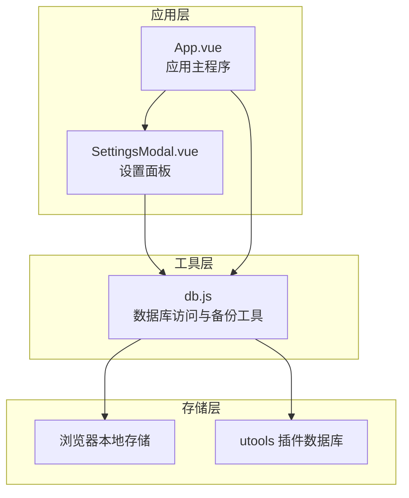
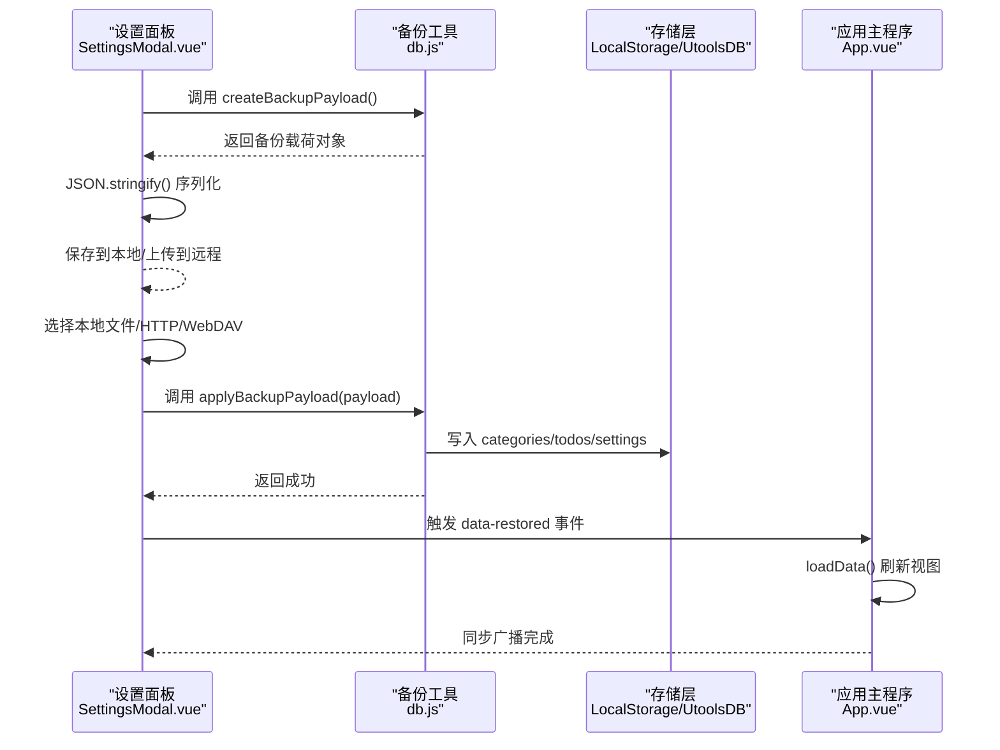
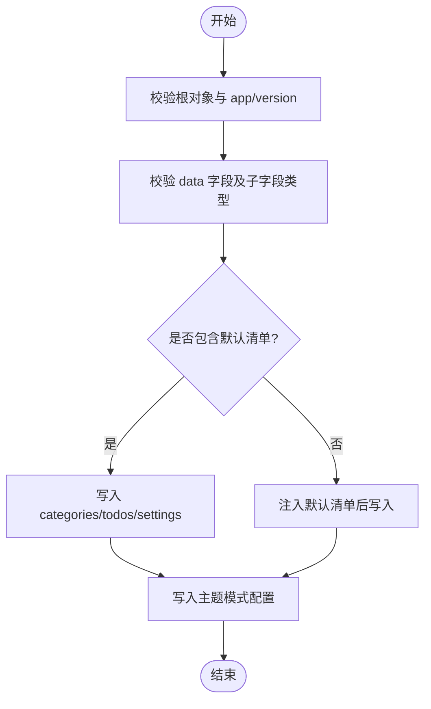
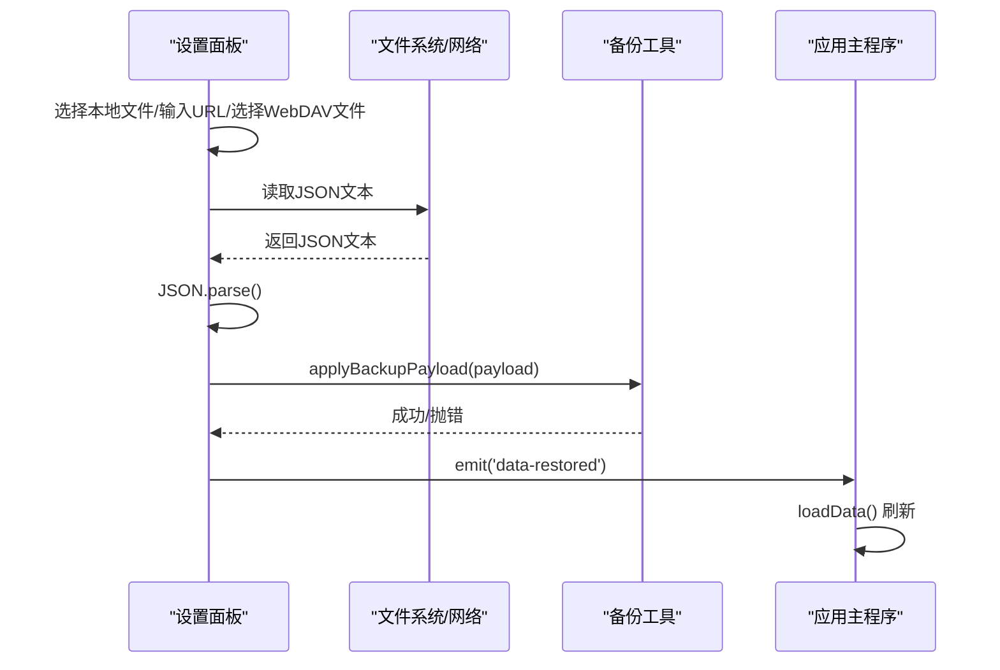
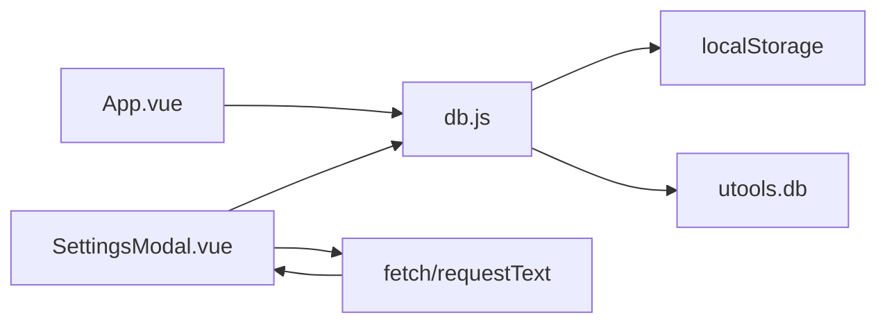

# 备份与恢复

<cite>
**本文引用的文件列表**
- [db.js](file://src/utils/db.js)
- [SettingsModal.vue](file://src/components/SettingsModal.vue)
- [App.vue](file://src/App.vue)
</cite>

## 目录
1. [简介](#简介)
2. [项目结构](#项目结构)
3. [核心组件](#核心组件)
4. [架构总览](#架构总览)
5. [详细组件分析](#详细组件分析)
6. [依赖关系分析](#依赖关系分析)
7. [性能考量](#性能考量)
8. [故障排查指南](#故障排查指南)
9. [结论](#结论)
10. [附录](#附录)

## 简介
本文件聚焦 Just-Todo 的“备份与恢复”能力，系统性说明备份数据结构设计、版本管理、完整性校验、序列化与存储格式，以及恢复流程中的数据验证、冲突处理与回滚机制。同时提供手动备份、自动备份策略与批量恢复场景的操作建议与最佳实践。

## 项目结构
备份与恢复功能主要由以下模块协作完成：
- 数据访问层：封装统一的数据读写接口，负责从本地存储或插件数据库中读取/写入分类、待办与设置等数据。
- 备份工具函数：生成备份载荷（包含版本号、导出时间、主题模式与业务数据）；解析并应用备份载荷。
- 设置面板：提供本地备份导出、HTTP/HTTPS 远程恢复、WebDAV 远程恢复等入口。
- 应用主程序：在恢复后刷新数据视图，触发同步广播，确保多窗口/多实例一致。

图表来源
- [db.js:1-157](file://src/utils/db.js#L1-L157)
- [SettingsModal.vue:193-644](file://src/components/SettingsModal.vue#L193-L644)
- [App.vue:489-535](file://src/App.vue#L489-L535)

章节来源
- [db.js:1-157](file://src/utils/db.js#L1-L157)
- [SettingsModal.vue:193-644](file://src/components/SettingsModal.vue#L193-L644)
- [App.vue:489-535](file://src/App.vue#L489-L535)

## 核心组件
- 备份载荷生成器：负责采集当前应用状态并打包为可持久化的 JSON 结构。
- 备份载荷应用器：负责对备份进行格式与内容校验，并将数据写回存储。
- 设置面板交互：提供本地文件导入、HTTP 下载恢复、WebDAV 文件列表与恢复。
- 应用主程序：在恢复后重新加载数据并广播同步事件。

章节来源
- [db.js:47-100](file://src/utils/db.js#L47-L100)
- [SettingsModal.vue:193-644](file://src/components/SettingsModal.vue#L193-L644)
- [App.vue:1190-1202](file://src/App.vue#L1190-L1202)

## 架构总览
备份与恢复的整体流程如下：
- 备份阶段：应用调用备份工具生成载荷，序列化为 JSON 文本，支持本地保存或上传至远程服务。
- 恢复阶段：从本地文件、HTTP 链接或 WebDAV 获取 JSON 载荷，进行格式与字段校验，然后写入数据库并刷新界面。

图表来源
- [db.js:47-100](file://src/utils/db.js#L47-L100)
- [SettingsModal.vue:469-644](file://src/components/SettingsModal.vue#L469-L644)
- [App.vue:1198-1202](file://src/App.vue#L1198-L1202)

## 详细组件分析

### 备份载荷生成器 createBackupPayload
- 功能概述
  - 采集当前应用的三类数据：分类、待办、设置。
  - 读取主题模式配置并纳入备份。
  - 附加元信息：应用标识、版本号、导出时间戳。
- 数据结构要点
  - 备份根对象包含 app、version、exportedAt、themeMode、data、extra 等字段。
  - data 字段包含 categories、todos、settings 三个数组/对象。
  - version 用于后续版本兼容性判断。
- 版本管理
  - 使用常量定义备份版本号，便于未来扩展与迁移。
- 存储格式
  - 通过 JSON.stringify 将载荷序列化为文本，便于本地保存或网络传输。
- 典型调用路径
  - 设置面板导出本地备份时调用该函数生成载荷。

章节来源
- [db.js:47-70](file://src/utils/db.js#L47-L70)
- [SettingsModal.vue:469-476](file://src/components/SettingsModal.vue#L469-L476)

### 备份载荷应用器 applyBackupPayload
- 功能概述
  - 对传入的备份载荷进行严格校验，确保格式正确且属于本应用。
  - 校验 data 字段下的 categories、todos、settings 是否存在且类型正确。
  - 若备份中缺失默认清单，自动补齐默认项以保证数据一致性。
  - 将备份数据写入数据库，并尝试写入主题模式配置。
- 完整性校验
  - 类型检查：对象、数组、字符串、数值等字段均进行类型判断。
  - 必填字段检查：app、data 及其子字段均需存在。
- 冲突处理
  - 默认清单缺失时，自动注入默认清单，避免恢复后界面异常。
- 回滚机制
  - 当前实现为一次性写入，未提供细粒度回滚。若需增强，可在写入前先备份当前数据并在失败时恢复。
- 典型调用路径
  - 本地文件恢复、HTTP 恢复、WebDAV 恢复均会调用该函数。

图表来源
- [db.js:72-100](file://src/utils/db.js#L72-L100)

章节来源
- [db.js:72-100](file://src/utils/db.js#L72-L100)

### 设置面板交互（本地/远程恢复）
- 本地备份导出
  - 生成备份载荷并序列化为 JSON 文本，弹出保存对话框，允许用户选择保存路径。
- 本地恢复
  - 选择本地 JSON 文件，读取文本并解析为对象，调用恢复函数。
- HTTP 恢复
  - 输入远程 URL，发起 GET 请求获取 JSON，解析后调用恢复函数。
- WebDAV 恢复
  - 填写服务器地址、目录、凭据，列出目录中的 JSON 文件，选择后下载并恢复。
- 错误处理
  - 所有恢复入口均捕获异常并通过提示框反馈错误信息。

图表来源
- [SettingsModal.vue:469-644](file://src/components/SettingsModal.vue#L469-L644)
- [App.vue:1198-1202](file://src/App.vue#L1198-L1202)

章节来源
- [SettingsModal.vue:193-644](file://src/components/SettingsModal.vue#L193-L644)
- [App.vue:1198-1202](file://src/App.vue#L1198-L1202)

### 应用主程序的数据加载与同步
- 数据加载
  - 从数据库读取分类、待办与设置，初始化通知与备份设置。
  - 若分类为空，注入默认分类；否则进行图标与颜色的迁移修复。
- 同步广播
  - 在数据变更时通过 BroadcastChannel 与本地存储广播“data-changed”，其他实例监听后自动刷新。
- 恢复后的刷新
  - 接收“data-restored”事件后重新加载数据并发出同步广播，确保多窗口一致。

章节来源
- [App.vue:489-535](file://src/App.vue#L489-L535)
- [App.vue:1198-1202](file://src/App.vue#L1198-L1202)

## 依赖关系分析
- 组件耦合
  - SettingsModal.vue 依赖 db.js 提供的备份工具函数。
  - App.vue 在恢复完成后负责刷新数据与广播同步。
- 数据流
  - 备份：App/Settings -> db.js -> JSON 文本 -> 本地/远程。
  - 恢复：本地/远程 -> JSON 文本 -> db.js -> 写入存储 -> App.loadData() -> 广播同步。
- 外部依赖
  - 浏览器本地存储（localStorage）与 utools 插件数据库（window.utools.db）。
  - fetch 或 utools 服务请求（window.services.requestText）用于网络请求。

图表来源
- [db.js:1-43](file://src/utils/db.js#L1-L43)
- [SettingsModal.vue:434-451](file://src/components/SettingsModal.vue#L434-L451)

章节来源
- [db.js:1-43](file://src/utils/db.js#L1-L43)
- [SettingsModal.vue:434-451](file://src/components/SettingsModal.vue#L434-L451)

## 性能考量
- 备份体积
  - 备份包含所有分类、待办与设置，数据量较大时 JSON 序列化与写入可能产生一定开销。
- 网络恢复
  - HTTP/WebDAV 恢复涉及网络请求与 JSON 解析，应考虑超时与重试策略。
- 同步刷新
  - 恢复后 loadData() 会重新读取全部数据并触发多次广播，建议在大量数据场景下优化渲染与缓存。

## 故障排查指南
- 常见问题
  - 备份文件格式错误：检查 JSON 是否完整、字段是否齐全。
  - 不是 Just Todo 备份文件：确认 app 字段是否为预期值。
  - 缺少 data 字段或子字段类型不正确：确保 categories、todos、settings 均为数组/对象。
  - 默认清单缺失导致界面异常：恢复流程会自动注入默认清单，如仍异常请检查数据库写入结果。
- 排查步骤
  - 本地恢复：确认文件可读、JSON 可解析、异常信息提示。
  - HTTP 恢复：确认 URL 可访问、返回状态码合法、响应体为有效 JSON。
  - WebDAV 恢复：确认凭据正确、目录存在、文件可读。
- 建议
  - 在关键操作前后记录日志（例如 console.time/console.log），定位耗时点。
  - 对于大体量数据，建议分批处理或延迟渲染，减少主线程阻塞。

章节来源
- [db.js:72-100](file://src/utils/db.js#L72-L100)
- [SettingsModal.vue:591-644](file://src/components/SettingsModal.vue#L591-L644)

## 结论
Just-Todo 的备份与恢复功能以简洁可靠为核心目标：通过统一的备份载荷生成与应用流程，结合严格的格式与字段校验，确保数据在不同介质间安全流转。当前实现未内置自动备份与细粒度回滚，但提供了清晰的扩展点（如在写入前备份当前数据）。建议在生产环境中配合外部调度工具实现周期性自动备份，并在需要时引入更完善的事务与回滚机制。

## 附录

### 备份数据结构与字段说明
- 根对象
  - app: 字符串，应用标识。
  - version: 数字，备份版本号。
  - exportedAt: 数字，导出时间戳。
  - themeMode: 字符串，主题模式。
  - data: 对象，包含 categories、todos、settings。
  - extra: 对象，扩展字段（可选）。
- data 子字段
  - categories: 数组，分类列表。
  - todos: 数组，待办列表。
  - settings: 对象，应用设置。

章节来源
- [db.js:47-70](file://src/utils/db.js#L47-L70)

### 操作示例

- 手动备份（本地）
  - 步骤：打开设置面板 -> 点击“导出备份” -> 选择保存路径 -> 生成 JSON 文件。
  - 关键调用：[createBackupPayload:47-70](file://src/utils/db.js#L47-L70)、[exportBackupLocal:469-476](file://src/components/SettingsModal.vue#L469-L476)。

- 手动恢复（本地）
  - 步骤：打开设置面板 -> 点击“从本地恢复” -> 选择 JSON 文件 -> 解析并恢复。
  - 关键调用：[onLocalBackupFile:591-606](file://src/components/SettingsModal.vue#L591-L606)、[applyBackupPayload:72-100](file://src/utils/db.js#L72-L100)。

- 手动恢复（HTTP）
  - 步骤：打开设置面板 -> 输入备份 URL -> 发起请求 -> 解析并恢复。
  - 关键调用：[restoreBackupHttp:608-629](file://src/components/SettingsModal.vue#L608-L629)、[applyBackupPayload:72-100](file://src/utils/db.js#L72-L100)。

- 手动恢复（WebDAV）
  - 步骤：打开设置面板 -> 填写服务器地址/目录/凭据 -> 列出文件 -> 选择 JSON -> 下载并恢复。
  - 关键调用：[loadWebdavFiles:577-583](file://src/components/SettingsModal.vue#L577-L583)、[restoreBackupWebdav:631-644](file://src/components/SettingsModal.vue#L631-L644)、[applyBackupPayload:72-100](file://src/utils/db.js#L72-L100)。

- 自动备份策略（建议）
  - 方案：使用外部任务调度器（如系统计划任务、云函数定时器）定期调用备份工具生成载荷并上传至 WebDAV 或对象存储。
  - 注意：避免频繁写入，建议在低峰时段执行；对大体量数据可考虑增量备份或压缩策略。

- 批量恢复场景（建议）
  - 场景：多设备或多实例部署，需要统一恢复。
  - 方案：将备份文件托管在共享存储（WebDAV/HTTP），各实例在启动或手动触发时拉取最新备份并应用。
  - 注意：恢复前应确保各实例处于离线或锁定状态，避免并发写入导致冲突。