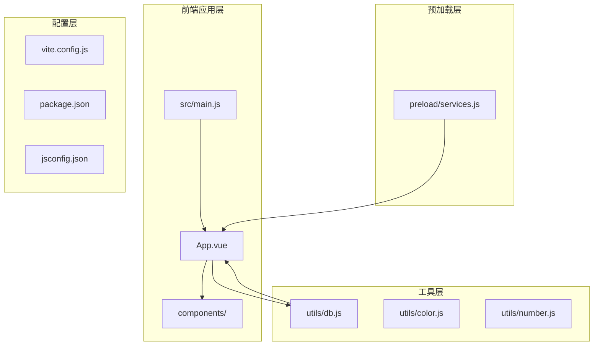
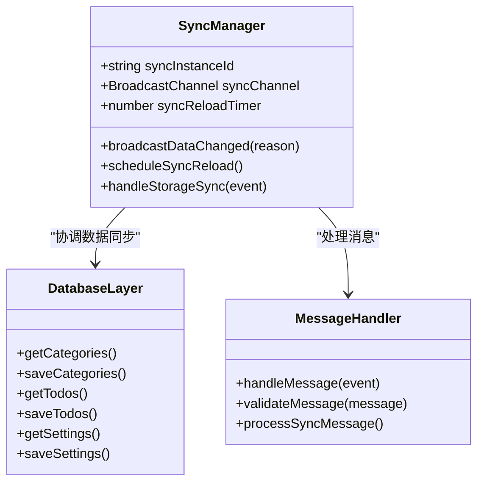
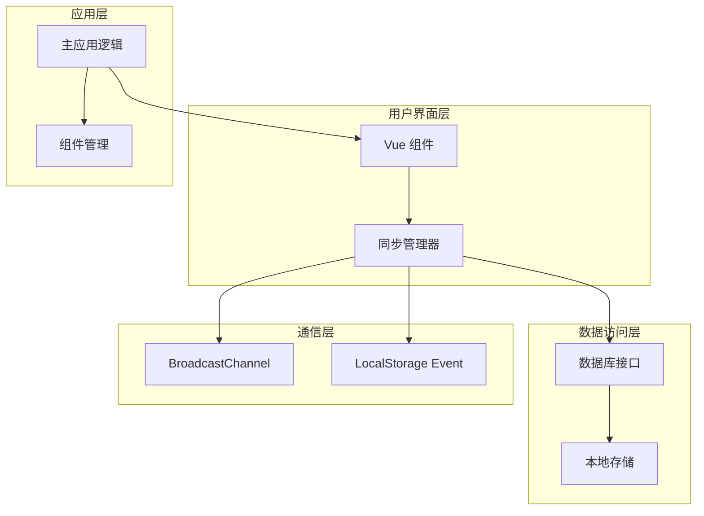
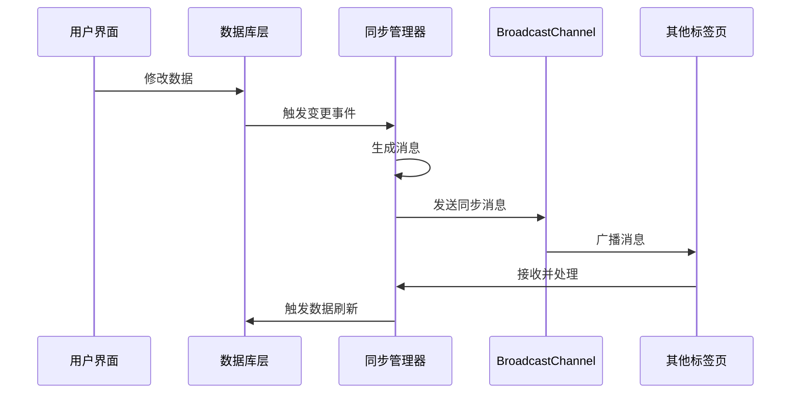
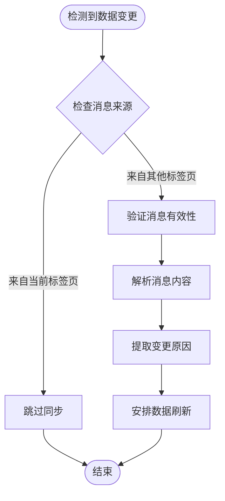
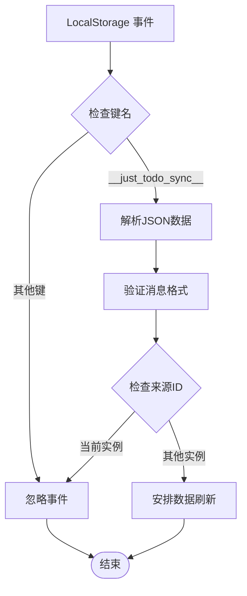
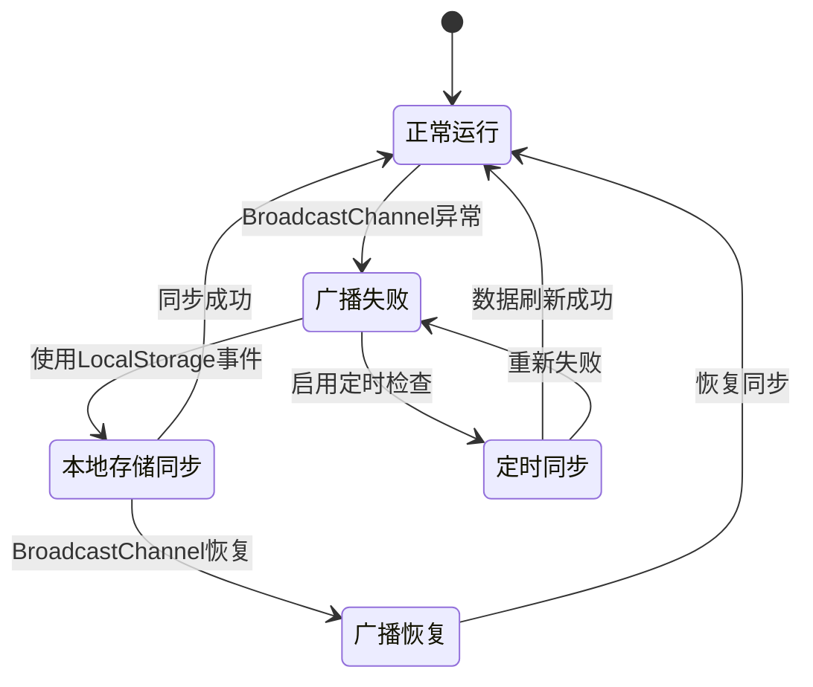
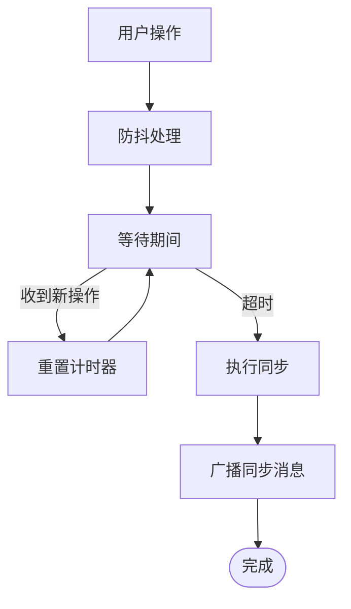
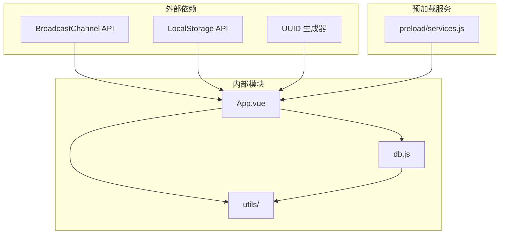

# 数据同步机制

<cite>
**本文档引用的文件**
- [src/App.vue](file://src/App.vue)
- [src/utils/db.js](file://src/utils/db.js)
- [src/main.js](file://src/main.js)
- [public/preload/services.js](file://public/preload/services.js)
</cite>

## 目录
1. [简介](#简介)
2. [项目结构](#项目结构)
3. [核心组件](#核心组件)
4. [架构概览](#架构概览)
5. [详细组件分析](#详细组件分析)
6. [依赖关系分析](#依赖关系分析)
7. [性能考虑](#性能考虑)
8. [故障排除指南](#故障排除指南)
9. [结论](#结论)

## 简介

Just-Todo 是一个基于 Vue.js 的待办事项管理应用，采用了多层数据同步机制来确保跨标签页和跨窗口的数据一致性。该应用实现了基于 BroadcastChannel API 的实时同步，同时提供了本地存储事件监听作为后备机制，形成了一个健壮的跨标签页数据同步系统。

该同步机制支持以下核心功能：
- 实时数据变更通知
- 冲突检测与解决
- 错误恢复机制
- 性能优化策略
- 多种同步触发时机

## 项目结构

Just-Todo 项目采用模块化架构，主要文件组织如下：

**图表来源**
- [src/main.js:1-6](file://src/main.js#L1-L6)
- [src/App.vue:1-25](file://src/App.vue#L1-L25)
- [src/utils/db.js:1-157](file://src/utils/db.js#L1-L157)

**章节来源**
- [src/main.js:1-6](file://src/main.js#L1-L6)
- [src/App.vue:1-25](file://src/App.vue#L1-L25)
- [src/utils/db.js:1-157](file://src/utils/db.js#L1-L157)

## 核心组件

### 同步实例管理

应用使用 UUID 生成器为每个实例创建唯一标识符，确保同步消息的正确路由：

**图表来源**
- [src/App.vue:99-131](file://src/App.vue#L99-L131)

### 数据变更监听机制

应用实现了多层次的数据变更监听机制：

1. **BroadcastChannel 监听器**：使用现代浏览器的 BroadcastChannel API
2. **LocalStorage 事件监听器**：作为后备机制确保兼容性
3. **定时同步检查**：防止网络异常导致的同步延迟

**章节来源**
- [src/App.vue:123-141](file://src/App.vue#L123-L141)
- [src/App.vue:455-486](file://src/App.vue#L455-L486)

## 架构概览

Just-Todo 的数据同步架构采用分层设计，确保了系统的可扩展性和可靠性：

**图表来源**
- [src/App.vue:455-486](file://src/App.vue#L455-L486)
- [src/utils/db.js:102-156](file://src/utils/db.js#L102-L156)

## 详细组件分析

### BroadcastChannel 实现

应用使用 BroadcastChannel API 实现高效的跨标签页通信：

#### 消息格式设计

同步消息采用统一的 JSON 格式，包含以下关键字段：

| 字段名 | 类型 | 描述 | 示例 |
|--------|------|------|------|
| type | string | 消息类型 | "data-changed" |
| sourceId | string | 发送方实例ID | "uuid-v4-格式" |
| reason | string | 变更原因 | "categories" |
| at | number | 时间戳 | Date.now() |

#### 同步触发时机

数据变更通过以下方法触发同步：

**图表来源**
- [src/App.vue:123-131](file://src/App.vue#L123-L131)
- [src/App.vue:455-486](file://src/App.vue#L455-L486)

#### 冲突解决策略

应用采用"最后修改者获胜"的策略处理并发冲突：

**图表来源**
- [src/App.vue:123-141](file://src/App.vue#L123-L141)

**章节来源**
- [src/App.vue:123-141](file://src/App.vue#L123-L141)
- [src/App.vue:455-486](file://src/App.vue#L455-L486)

### 数据变更监听机制

#### LocalStorage 事件处理

为了确保在不支持 BroadcastChannel 的环境中仍能正常工作，应用实现了 LocalStorage 事件监听：

**图表来源**
- [src/App.vue:132-141](file://src/App.vue#L132-L141)

#### 定时同步机制

应用还实现了定时同步机制，防止网络异常或广播失败导致的数据不同步：

**章节来源**
- [src/App.vue:116-122](file://src/App.vue#L116-L122)
- [src/App.vue:132-141](file://src/App.vue#L132-L141)

### 实时同步流程

#### 同步状态管理

应用维护了多个同步相关的状态变量：

| 状态变量 | 类型 | 用途 | 生命周期 |
|----------|------|------|----------|
| syncInstanceId | string | 实例唯一标识符 | 应用生命周期 |
| syncChannel | BroadcastChannel | 同步通道 | 应用生命周期 |
| syncReloadTimer | number | 刷新定时器 | 应用生命周期 |
| notifiedTasks | Set | 已通知任务集合 | 应用会话 |

#### 错误恢复机制

应用实现了多层次的错误恢复机制：

**图表来源**
- [src/App.vue:116-122](file://src/App.vue#L116-L122)
- [src/App.vue:455-486](file://src/App.vue#L455-L486)

**章节来源**
- [src/App.vue:99-101](file://src/App.vue#L99-L101)
- [src/App.vue:116-122](file://src/App.vue#L116-L122)

### 性能优化方案

#### 防抖机制

应用使用防抖技术避免频繁的同步请求：

#### 数据压缩策略

应用对传输的数据进行了优化，只传输必要的变更信息：

**章节来源**
- [src/App.vue:116-122](file://src/App.vue#L116-L122)

## 依赖关系分析

### 核心依赖关系

**图表来源**
- [src/App.vue:12-13](file://src/App.vue#L12-L13)
- [src/utils/db.js:1-157](file://src/utils/db.js#L1-157)

### 组件耦合分析

应用采用了松耦合的设计原则：

- **同步管理器**与**数据库层**通过接口分离
- **消息处理器**独立于业务逻辑
- **错误恢复机制**不影响主业务流程

**章节来源**
- [src/App.vue:12-13](file://src/App.vue#L12-L13)
- [src/utils/db.js:102-156](file://src/utils/db.js#L102-L156)

## 性能考虑

### 同步频率控制

应用通过以下机制控制同步频率：

1. **批量处理**：将短时间内多次变更合并为一次同步
2. **防抖处理**：避免用户快速操作导致的频繁同步
3. **条件同步**：仅在数据确实发生变化时才触发同步

### 内存管理

应用实现了合理的内存管理策略：

- 及时清理定时器和事件监听器
- 在组件卸载时释放 BroadcastChannel
- 避免内存泄漏

## 故障排除指南

### 常见问题及解决方案

#### BroadcastChannel 不可用

**问题症状**：同步消息无法在标签页间传递

**解决方案**：
1. 检查浏览器对 BroadcastChannel API 的支持
2. 确保同源策略满足要求
3. 验证频道名称的一致性

#### 同步循环问题

**问题症状**：数据在多个标签页间无限同步

**解决方案**：
1. 检查实例 ID 生成逻辑
2. 验证消息来源过滤机制
3. 确认防抖机制正常工作

#### 数据不同步

**问题症状**：某些标签页显示过期数据

**解决方案**：
1. 检查 LocalStorage 事件监听器
2. 验证定时同步机制
3. 确认网络连接状态

**章节来源**
- [src/App.vue:306-322](file://src/App.vue#L306-L322)
- [src/App.vue:132-141](file://src/App.vue#L132-L141)

## 结论

Just-Todo 的跨标签页数据同步机制展现了现代前端应用的最佳实践。通过采用多层次的同步策略，应用不仅确保了数据的一致性，还提供了良好的用户体验和健壮的错误恢复能力。

### 主要优势

1. **多层冗余**：BroadcastChannel + LocalStorage + 定时同步
2. **智能防抖**：避免不必要的同步开销
3. **冲突检测**：通过实例 ID 识别和避免循环同步
4. **性能优化**：合理的同步频率控制和内存管理

### 技术亮点

- 使用 UUID 确保实例唯一性
- 采用统一的消息格式便于扩展
- 实现了完整的错误恢复机制
- 提供了详细的同步状态监控

该同步机制为类似的应用开发提供了优秀的参考模板，展示了如何在保证数据一致性的同时，最大化用户体验和系统性能。