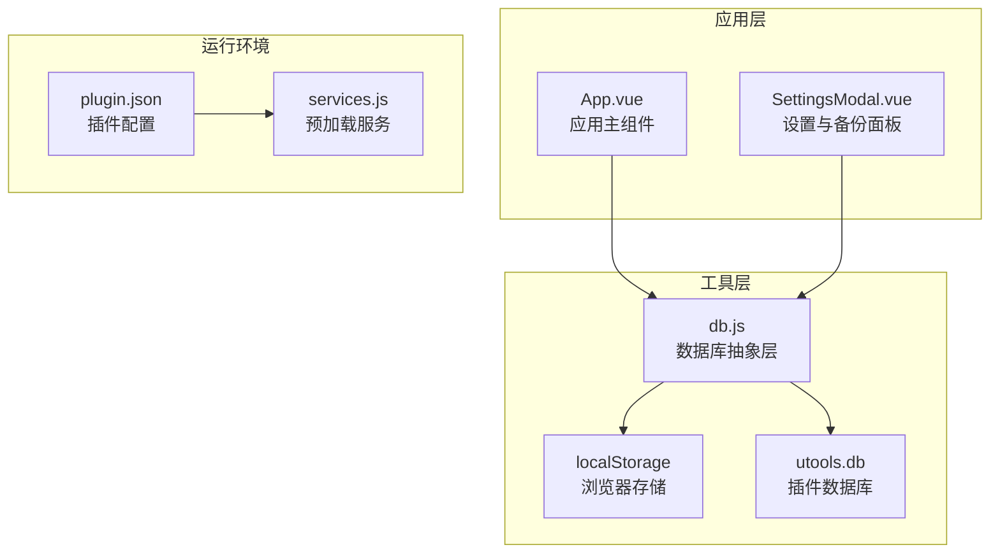
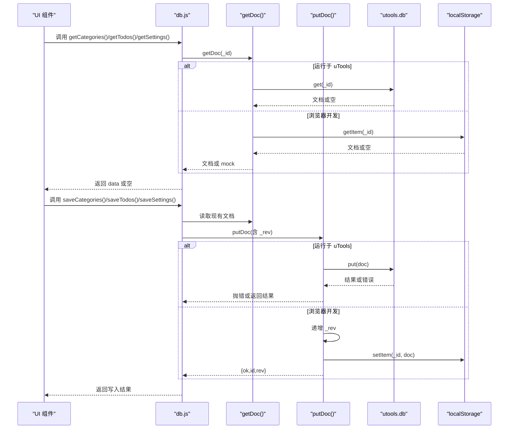
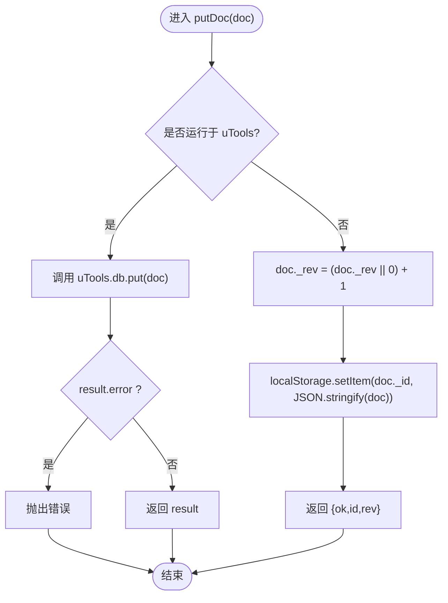
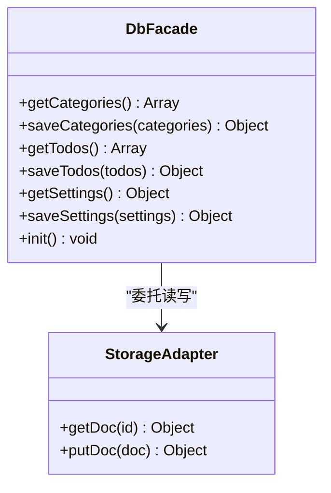
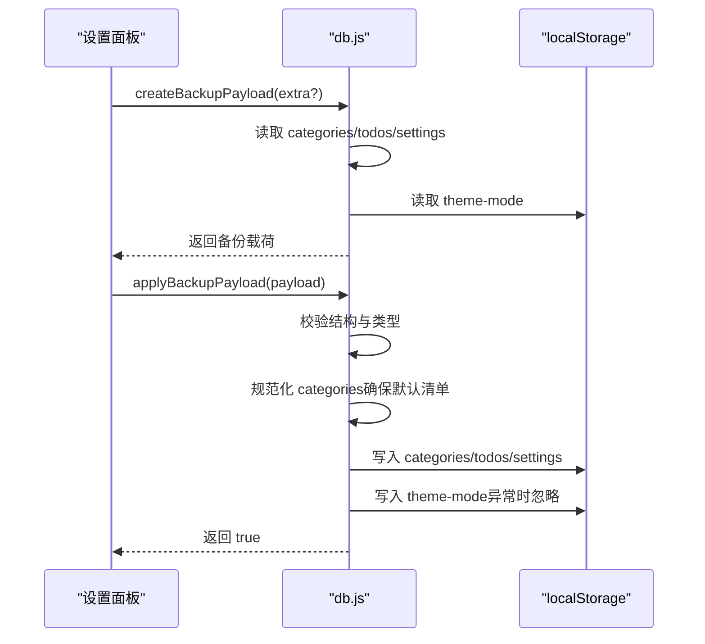
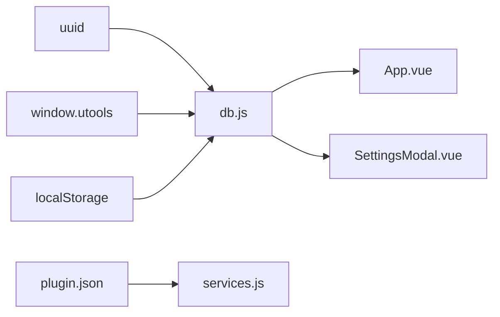

# 数据库抽象层

<cite>
**本文引用的文件列表**
- [db.js](file://src/utils/db.js)
- [App.vue](file://src/App.vue)
- [SettingsModal.vue](file://src/components/SettingsModal.vue)
- [plugin.json](file://plugin.json)
- [services.js](file://public/preload/services.js)
</cite>

## 目录
1. [简介](#简介)
2. [项目结构](#项目结构)
3. [核心组件](#核心组件)
4. [架构总览](#架构总览)
5. [详细组件分析](#详细组件分析)
6. [依赖关系分析](#依赖关系分析)
7. [性能考量](#性能考量)
8. [故障排查指南](#故障排查指南)
9. [结论](#结论)
10. [附录：数据模型与使用示例](#附录数据模型与使用示例)

## 简介
本文件面向 Just-Todo 项目的数据库抽象层，系统性解析 src/utils/db.js 的设计与实现，重点说明：
- 双存储机制：utools 数据库与浏览器 localStorage 的适配
- getDoc 与 putDoc 的工作原理，以及对 CouchDB 风格 _id/_rev 的模拟
- 初始化流程、数据结构设计与错误处理策略
- 如何在应用中使用该抽象层进行 categories、todos、settings 的读写
- 备份与恢复流程（包含主题模式持久化）

## 项目结构
数据库抽象层位于 utils 子目录，通过模块导出统一接口供上层组件调用；同时，应用入口与设置面板组件直接消费该接口。

图表来源
- [db.js:1-157](file://src/utils/db.js#L1-L157)
- [App.vue:488-545](file://src/App.vue#L488-L545)
- [SettingsModal.vue:287-290](file://src/components/SettingsModal.vue#L287-L290)
- [plugin.json:1-21](file://plugin.json#L1-L21)
- [services.js:1-358](file://public/preload/services.js#L1-L358)

章节来源
- [db.js:1-157](file://src/utils/db.js#L1-L157)
- [App.vue:488-545](file://src/App.vue#L488-L545)
- [SettingsModal.vue:287-290](file://src/components/SettingsModal.vue#L287-L290)
- [plugin.json:1-21](file://plugin.json#L1-L21)
- [services.js:1-358](file://public/preload/services.js#L1-L358)

## 核心组件
- 双存储适配器
  - getDoc(id): 在 uTools 环境调用 window.utools.db.get；在浏览器环境从 localStorage 读取，若无则回退到内置 mock 数据
  - putDoc(doc): 在 uTools 环境调用 window.utools.db.put 并抛错；在浏览器环境模拟 _rev 自增并写入 localStorage，返回 ok/id/rev
- 数据访问器
  - db.getCategories()/saveCategories()
  - db.getTodos()/saveTodos()
  - db.getSettings()/saveSettings()
  - db.init(): 初始化三类文档
- 备份与恢复
  - createBackupPayload(extra?): 生成备份载荷，包含 categories/todos/settings 与主题模式
  - applyBackupPayload(payload): 校验并恢复备份，确保默认清单存在，写入主题模式

章节来源
- [db.js:21-43](file://src/utils/db.js#L21-L43)
- [db.js:102-156](file://src/utils/db.js#L102-L156)
- [db.js:47-100](file://src/utils/db.js#L47-L100)

## 架构总览
数据库抽象层通过环境检测（window.utools）选择后端存储，并以“文档”形式管理三类数据：categories、todos、settings。每类文档具有一个稳定 _id（如 categories、todos、settings），其 data 字段承载实际数组或对象内容。在浏览器开发模式下，未找到对应文档时会自动创建初始文档并写入。

图表来源
- [db.js:21-43](file://src/utils/db.js#L21-L43)
- [db.js:102-156](file://src/utils/db.js#L102-L156)

## 详细组件分析

### 双存储机制与环境检测
- 环境判定：通过 window.utools 是否存在决定是否走 uTools 数据库路径
- 开发回退：浏览器环境下，若 localStorage 中不存在对应文档，则回退到内置 mock 数据，保证首次运行可用

章节来源
- [db.js:3](file://src/utils/db.js#L3)
- [db.js:21-28](file://src/utils/db.js#L21-L28)
- [db.js:5-19](file://src/utils/db.js#L5-L19)

### getDoc 工作原理
- uTools 路径：直接调用 window.utools.db.get(id)，返回文档或空
- 浏览器路径：从 localStorage.getItem(id) 读取；若为空则返回内置 mock 数据（categories/todos）
- 返回值：文档对象或 mock 对象

章节来源
- [db.js:21-28](file://src/utils/db.js#L21-L28)
- [db.js:5-19](file://src/utils/db.js#L5-L19)

### putDoc 工作原理与 _rev 版本控制
- uTools 路径：调用 window.utools.db.put(doc)，若 result.error 则抛出错误；否则返回结果
- 浏览器路径：模拟 CouchDB 风格版本控制
  - 若 doc._rev 为空则设为 0；每次写入自增 1
  - 写入 localStorage 后返回 { ok: true, id: doc._id, rev: doc._rev }
- 设计意图：为后续冲突检测与增量同步提供基础（当前实现未使用 _rev 做冲突检测）

图表来源
- [db.js:30-43](file://src/utils/db.js#L30-L43)

章节来源
- [db.js:30-43](file://src/utils/db.js#L30-L43)

### 数据访问器（db 对象）
- getCategories/getTodos/getSettings
  - 先 getDoc 读取；若不存在则创建默认文档并 putDoc 写入
  - 返回 doc.data 或默认空数组/空对象
- saveCategories/saveTodos/saveSettings
  - 先 getDoc 读取现有文档，再更新 data 并 putDoc 写入
- init
  - 依次触发三类文档的 get，确保初始数据存在

图表来源
- [db.js:102-156](file://src/utils/db.js#L102-L156)
- [db.js:21-43](file://src/utils/db.js#L21-L43)

章节来源
- [db.js:102-156](file://src/utils/db.js#L102-L156)

### 备份与恢复流程
- createBackupPayload
  - 读取 categories/todos/settings
  - 读取主题模式（localStorage 中的 theme-mode，缺省 system）
  - 组装包含 app/version/exportedAt/themeMode/data/extra 的载荷
- applyBackupPayload
  - 校验 payload/app/data 结构
  - 校验 categories/todos/settings 类型与完整性
  - 确保 categories 包含默认清单（若缺失则前置插入）
  - 写入 categories/todos/settings
  - 写入 theme-mode（异常时静默忽略）

图表来源
- [db.js:47-100](file://src/utils/db.js#L47-L100)

章节来源
- [db.js:47-100](file://src/utils/db.js#L47-L100)
- [SettingsModal.vue:287-290](file://src/components/SettingsModal.vue#L287-L290)

### 应用内集成与数据同步
- App.vue
  - 加载阶段：调用 db.getCategories()/getTodos()/getSettings() 初始化状态
  - 保存阶段：调用 db.saveCategories()/saveTodos()/saveSettings() 写入
  - 同步机制：通过 BroadcastChannel 与 localStorage 双通道广播“数据变更”，并在接收方延时重载
- SettingsModal.vue
  - 使用 createBackupPayload 生成备份
  - 使用 applyBackupPayload 恢复备份

章节来源
- [App.vue:488-545](file://src/App.vue#L488-L545)
- [App.vue:116-141](file://src/App.vue#L116-L141)
- [SettingsModal.vue:287-290](file://src/components/SettingsModal.vue#L287-L290)

## 依赖关系分析
- db.js 依赖
  - uuid：用于生成任务等实体的唯一标识
  - window.utools：用于检测运行环境与调用 uTools 数据库 API
  - localStorage：浏览器开发模式下的持久化存储
- 运行时依赖
  - plugin.json 指定 preload/services.js，为渲染进程注入 Node/Electron 能力（与数据库抽象层无直接耦合）
  - uTools 插件生命周期事件（如 onPluginEnter）由 App.vue 处理，间接驱动 db 初始化

图表来源
- [db.js:1](file://src/utils/db.js#L1)
- [db.js:3](file://src/utils/db.js#L3)
- [App.vue:488-545](file://src/App.vue#L488-L545)
- [SettingsModal.vue:287-290](file://src/components/SettingsModal.vue#L287-L290)
- [plugin.json:1-21](file://plugin.json#L1-L21)
- [services.js:1-358](file://public/preload/services.js#L1-L358)

章节来源
- [db.js:1](file://src/utils/db.js#L1)
- [db.js:3](file://src/utils/db.js#L3)
- [plugin.json:1-21](file://plugin.json#L1-L21)
- [services.js:1-358](file://public/preload/services.js#L1-L358)

## 性能考量
- getDoc/putDoc 为 O(1) 读写，localStorage 与 uTools.db 均为键值存储
- 浏览器回退时使用内置 mock 数据，避免网络请求开销
- 备份载荷仅包含必要字段，体积可控
- 同步采用延时重载（60ms）减少频繁刷新

[本节为通用建议，不涉及具体文件分析]

## 故障排查指南
- uTools 环境写入报错
  - 现象：putDoc 返回 error 或抛出异常
  - 排查：确认 window.utools.db.put 返回的 result.error/message
  - 处理：捕获异常并提示用户
- 浏览器环境读取不到数据
  - 现象：getDoc 返回空，随后回退到 mock
  - 排查：确认 localStorage 中是否存在对应 _id 键
  - 处理：首次运行会自动创建默认文档
- 备份/恢复失败
  - 现象：applyBackupPayload 抛出错误
  - 排查：检查 payload/app/data 结构与类型；确认 categories/todos/settings 完整性
  - 处理：修正备份文件或重新导出

章节来源
- [db.js:30-43](file://src/utils/db.js#L30-L43)
- [db.js:72-100](file://src/utils/db.js#L72-L100)

## 结论
数据库抽象层以最小改动实现了“uTools 数据库 + 浏览器 localStorage”的双存储适配，通过 CouchDB 风格的 _id/_rev 语义为未来扩展（如冲突检测、增量同步）预留空间。结合应用内的广播同步与设置面板的备份/恢复能力，形成完整的本地数据管理闭环。

[本节为总结，不涉及具体文件分析]

## 附录：数据模型与使用示例

### 数据模型定义
- categories 文档
  - _id: 固定字符串（如 categories）
  - data: 数组，元素为清单项对象，包含 id/name/sort/icon/color 等字段
- todos 文档
  - _id: 固定字符串（如 todos）
  - data: 数组，元素为任务对象，包含 id/content/categoryId/description/isCompleted/priority/createdAt/... 等字段
- settings 文档
  - _id: 固定字符串（如 settings）
  - data: 对象，包含默认清单 id、通知与备份等配置

章节来源
- [db.js:102-156](file://src/utils/db.js#L102-L156)
- [db.js:5-19](file://src/utils/db.js#L5-L19)

### 使用示例（步骤说明）
- 读取数据
  - 从 App.vue 中调用 db.getCategories()/getTodos()/getSettings() 获取初始状态
  - 参考路径：[App.vue:488-545](file://src/App.vue#L488-L545)
- 写入数据
  - 修改状态后调用 db.saveCategories()/saveTodos()/saveSettings() 持久化
  - 参考路径：[App.vue:537-545](file://src/App.vue#L537-L545)
- 备份与恢复
  - 导出：调用 createBackupPayload() 生成备份文本，参考路径：[db.js:47-70](file://src/utils/db.js#L47-L70)
  - 恢复：调用 applyBackupPayload(payload) 恢复数据，参考路径：[db.js:72-100](file://src/utils/db.js#L72-L100)
- 初始化
  - 首次运行可调用 db.init() 确保三类文档存在，参考路径：[db.js:150-156](file://src/utils/db.js#L150-L156)

[本节为使用说明，不包含具体代码片段]