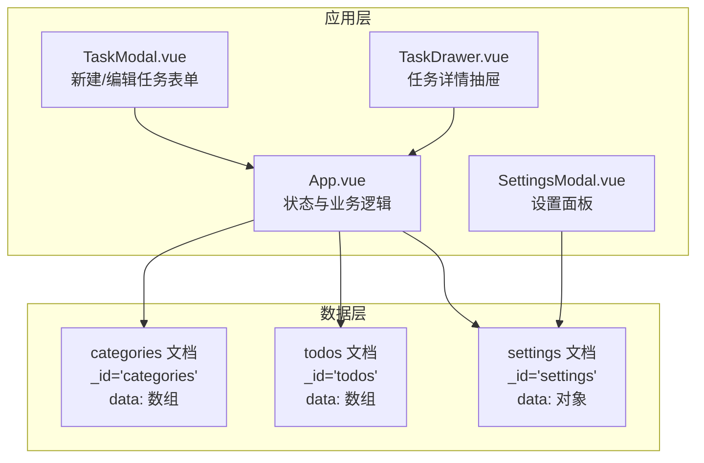
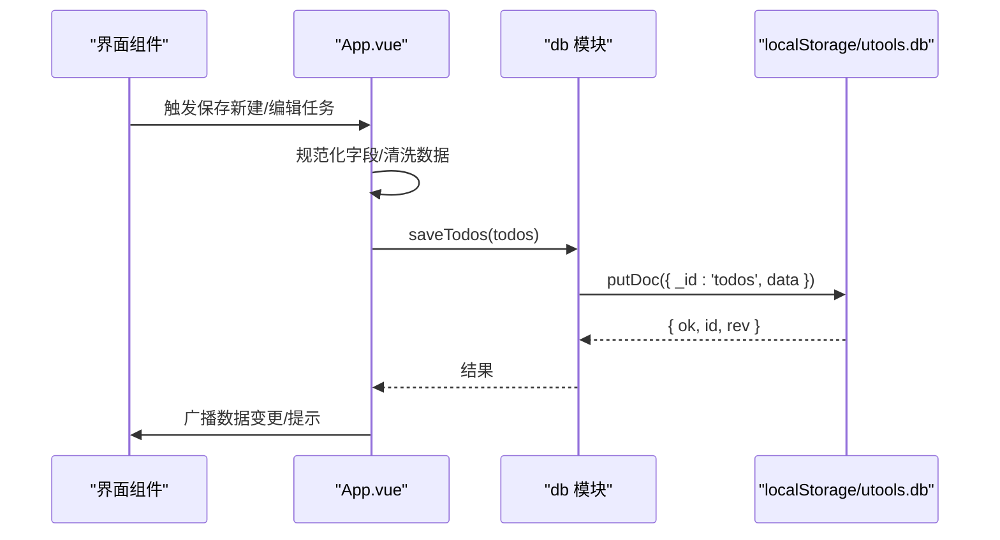
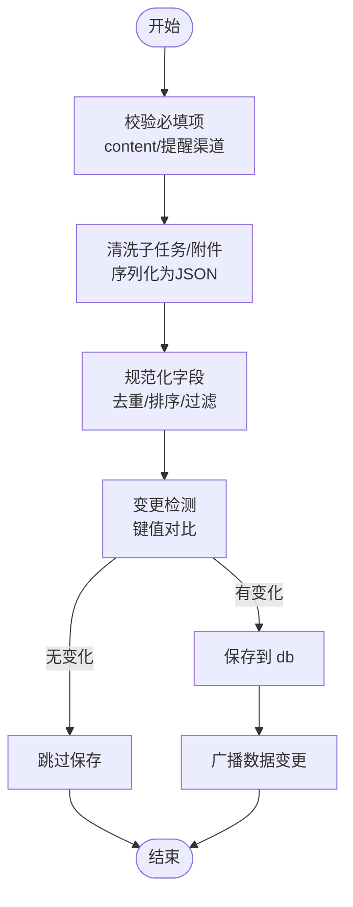
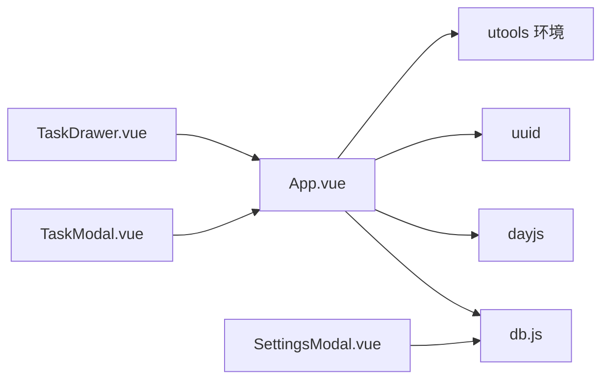

# 数据模型

<cite>
**本文引用的文件**
- [db.js](file://src/utils/db.js)
- [App.vue](file://src/App.vue)
- [TaskModal.vue](file://src/components/TaskModal.vue)
- [TaskDrawer.vue](file://src/components/TaskDrawer.vue)
- [SettingsModal.vue](file://src/components/SettingsModal.vue)
</cite>

## 目录
1. [简介](#简介)
2. [项目结构与数据存储概览](#项目结构与数据存储概览)
3. [核心数据实体](#核心数据实体)
4. [架构总览](#架构总览)
5. [关键组件与数据流](#关键组件与数据流)
6. [依赖关系分析](#依赖关系分析)
7. [性能与一致性考虑](#性能与一致性考虑)
8. [故障排查指南](#故障排查指南)
9. [结论](#结论)

## 简介
本文件系统性梳理 Just-Todo 项目的“数据模型”，聚焦于三大核心实体：分类（Category）、任务（Todo）与设置（Settings）。文档从字段规范、数据类型、约束条件、关系设计、数据完整性、验证规则、默认值与转换逻辑等维度进行说明，并结合实际代码路径给出最佳实践与使用场景。

## 项目结构与数据存储概览
- 数据持久化通过统一的数据库适配层实现：
  - 在插件环境（utools）下，使用窗口对象提供的本地数据库接口；
  - 在浏览器开发环境下，使用本地存储模拟文档型存储。
- 每个实体对应一个“文档”（doc），包含固定标识符与数据数组：
  - categories 文档：存放分类列表
  - todos 文档：存放任务列表
  - settings 文档：存放应用设置（含通知、备份等）

图表来源
- [db.js:102-156](file://src/utils/db.js#L102-L156)
- [App.vue:489-535](file://src/App.vue#L489-L535)

章节来源
- [db.js:1-157](file://src/utils/db.js#L1-L157)
- [App.vue:489-535](file://src/App.vue#L489-L535)

## 核心数据实体

### 实体一：分类（Category）
- 存储位置：categories 文档
- 数据结构：数组元素为对象，每个对象代表一个分类
- 字段规范与约束
  - id: 字符串，唯一标识；用于关联任务
  - name: 字符串，分类名称
  - sort: 数字，排序序号
  - icon: 字符串，图标标识（建议使用语义化图标类名）
  - color: 字符串，颜色值（十六进制或语义色）
- 默认值与迁移
  - 应用启动时若不存在默认分类，会自动写入默认清单
  - 迁移逻辑会补全缺失的 icon 与 color 字段
- 关系与完整性
  - 任务 categoryId 必须指向存在的分类 id
  - 删除分类时，应用会同步清理该分类下的所有任务并调整当前选中分类
- 数据转换
  - 加载时确保 icon 与 color 合法化
  - 保存时保持数组顺序与去重

字段与类型对照
- id: string
- name: string
- sort: number
- icon: string
- color: string

章节来源
- [db.js:6-19](file://src/utils/db.js#L6-L19)
- [db.js:102-118](file://src/utils/db.js#L102-L118)
- [App.vue:498-525](file://src/App.vue#L498-L525)
- [App.vue:1522-1576](file://src/App.vue#L1522-L1576)

### 实体二：任务（Todo）
- 存储位置：todos 文档
- 数据结构：数组元素为对象，每个对象代表一个任务
- 字段规范与约束
  - id: 字符串，唯一标识
  - content: 字符串，任务内容（必填）
  - categoryId: 字符串，所属分类 id
  - description: 字符串，备注
  - isCompleted: 布尔，是否完成
  - completedAt: 数字时间戳，完成时间（仅在完成/重置时更新）
  - priority: 枚举字符串，'high' | 'medium' | 'low' | 'normal'
  - createdAt: 数字时间戳，创建时间
  - dueDate: 字符串或空，截止日期时间（YYYY-MM-DD 或 YYYY-MM-DD HH:mm）
  - reminderEnabled: 布尔，是否启用提醒
  - remindAt: 字符串或空，提醒时间
  - notifyChannels: 字符串数组，通知渠道集合（如 desktop/email/bark/webhook）
  - repeatRule: 枚举字符串或空，'none'|'daily'|'weekly'|'monthly'|'yearly'
  - repeatWeekDays: 数字数组，周重复的星期索引（0-6）
  - repeatMonthDays: 数字数组，月重复的日期（1-31）
  - subtasks: 对象数组，子任务列表（含 id/content/isCompleted）
  - attachments: 对象数组，附件列表（含 id/name/size/mimeType/dataUrl）
  - history: 对象数组，事件时间线（create/complete/uncomplete/update/delay）
  - recurrenceFromId: 字符串（可选），重复衍生任务的来源 id
- 默认值与校验
  - 新建任务时，priority 默认为 'medium'，reminderEnabled 默认 false
  - 当 repeatRule 非 'none' 时，dueDate 缺省会被补全为当天 23:59
  - 保存前会对 subtasks/attachments 进行清洗与序列化
- 数据转换与规范化
  - 通知渠道去重并排序后拼接为字符串键，用于变更检测
  - 数字列表（周/月重复）过滤非法值并排序
  - 子任务与附件序列化为 JSON 字符串，便于稳定比较
  - 完成/重置时自动维护 completedAt 与历史记录
- 关系与完整性
  - categoryId 必须指向存在的分类 id
  - 重复任务完成后，若 repeatRule 存在且未有同源未完成任务，则触发衍生任务创建
  - 变更检测基于规范化后的键值，避免无效更新与历史冗余

字段与类型对照
- id: string
- content: string
- categoryId: string
- description: string
- isCompleted: boolean
- completedAt: number?
- priority: enum
- createdAt: number
- dueDate: string?
- reminderEnabled: boolean
- remindAt: string?
- notifyChannels: string[]
- repeatRule: enum?
- repeatWeekDays: number[]
- repeatMonthDays: number[]
- subtasks: object[]
- attachments: object[]
- history: object[]
- recurrenceFromId: string?

章节来源
- [App.vue:617-638](file://src/App.vue#L617-L638)
- [App.vue:653-790](file://src/App.vue#L653-L790)
- [App.vue:792-841](file://src/App.vue#L792-L841)
- [TaskModal.vue:183-197](file://src/components/TaskModal.vue#L183-L197)
- [TaskDrawer.vue:43-57](file://src/components/TaskDrawer.vue#L43-L57)

### 实体三：设置（Settings）
- 存储位置：settings 文档
- 数据结构：对象，包含多个配置域
- 主要配置域
  - notification: 通知设置对象
    - desktop: { enabled: boolean }
    - email: { enabled: boolean, alias: string, host: string, port: number, secure: boolean, user: string, pass: string, to: string }
    - bark: { enabled: boolean, serverUrl: string, level: string, sound: string, badge: number }
    - webhook: { enabled: boolean, url: string, method: string, contentType: string, headers: array, customBody: string }
  - backup: 备份设置对象
    - webdav: { baseUrl: string, directory: string, username: string, password: string }
    - http: { url: string }
- 默认值与初始化
  - 应用启动时若不存在 settings 文档，会写入默认通知设置（桌面通知默认开启）
- 数据转换
  - 保存时合并传入的新设置，覆盖旧值
  - 备份设置与通知设置分别保存

字段与类型对照
- notification: object
- backup: object

章节来源
- [db.js:135-148](file://src/utils/db.js#L135-L148)
- [App.vue:1181-1202](file://src/App.vue#L1181-L1202)
- [SettingsModal.vue:308-322](file://src/components/SettingsModal.vue#L308-L322)
- [SettingsModal.vue:372-376](file://src/components/SettingsModal.vue#L372-L376)

## 架构总览
- 数据访问层
  - db 模块封装了 getDoc/putDoc 与 CRUD 方法，屏蔽平台差异
  - 支持备份/恢复流程，包含版本号与主题模式字段
- 业务层
  - App.vue 负责数据加载、保存、过滤、排序、通知调度、导出等
  - TaskModal.vue 与 TaskDrawer.vue 负责任务表单与详情抽屉的输入与校验
  - SettingsModal.vue 负责设置面板的输入与测试

图表来源
- [App.vue:617-638](file://src/App.vue#L617-L638)
- [App.vue:653-790](file://src/App.vue#L653-L790)
- [db.js:30-43](file://src/utils/db.js#L30-L43)

章节来源
- [db.js:102-156](file://src/utils/db.js#L102-L156)
- [App.vue:489-535](file://src/App.vue#L489-L535)

## 关键组件与数据流

### 任务创建与更新（最佳实践）
- 创建
  - 使用 App.vue 的 addTodo，传入规范化后的任务对象
  - 注意：priority 默认 medium，reminderEnabled 默认 false
  - 保存后立即广播数据变更
- 更新
  - 使用 App.vue 的 updateTodo，内部进行规范化与变更检测
  - 重要：完成/重置会更新 completedAt 与历史记录
  - 重复任务完成后，若 repeatRule 存在且无同源未完成任务，触发衍生任务创建
- 表单层
  - TaskModal.vue 与 TaskDrawer.vue 提供输入校验与数据清洗
  - 通知渠道为空时禁止保存，提醒时间缺失时提示

图表来源
- [TaskModal.vue:801-822](file://src/components/TaskModal.vue#L801-L822)
- [TaskDrawer.vue:743-761](file://src/components/TaskDrawer.vue#L743-L761)
- [App.vue:653-790](file://src/App.vue#L653-L790)

章节来源
- [App.vue:617-638](file://src/App.vue#L617-L638)
- [App.vue:653-790](file://src/App.vue#L653-L790)
- [TaskModal.vue:801-822](file://src/components/TaskModal.vue#L801-L822)
- [TaskDrawer.vue:743-761](file://src/components/TaskDrawer.vue#L743-L761)

### 查询与筛选
- 分类筛选：按 categoryId 过滤
- 状态筛选：按 isCompleted 过滤
- 时间筛选：按 dueDate 与 dayjs 比较
- 排序：支持 createdAt/dueDate/priority 三种字段与升/降序切换
- 自定义排序：当用户选择自定义排序时，覆盖默认排序策略

章节来源
- [App.vue:351-415](file://src/App.vue#L351-L415)

### 删除与迁移
- 删除分类：检查默认分类不可删除；删除时清理相关任务并调整当前分类
- 删除任务：直接从数组移除
- 迁移：加载时补齐 icon/color；若无默认分类则注入默认清单

章节来源
- [App.vue:1522-1576](file://src/App.vue#L1522-L1576)
- [App.vue:498-525](file://src/App.vue#L498-L525)

### 备份与恢复
- 备份：收集 categories/todos/settings 与主题模式，生成备份负载
- 恢复：校验备份格式，确保 categories 包含默认清单，然后写回 db

章节来源
- [db.js:47-100](file://src/utils/db.js#L47-L100)

## 依赖关系分析
- 组件依赖
  - App.vue 依赖 db 模块进行数据读写
  - TaskModal.vue/TaskDrawer.vue 依赖 App.vue 的保存回调
  - SettingsModal.vue 依赖 db 模块进行设置保存
- 数据依赖
  - Todo 依赖 Category 的 id 关联
  - Todo 的通知与提醒依赖 Settings 的 notification 配置
- 外部依赖
  - dayjs 用于日期解析与比较
  - uuid 用于生成任务 id
  - utools 环境下的本地数据库与通知能力

图表来源
- [App.vue:1-21](file://src/App.vue#L1-L21)
- [db.js:1-157](file://src/utils/db.js#L1-L157)

章节来源
- [App.vue:1-21](file://src/App.vue#L1-L21)
- [db.js:1-157](file://src/utils/db.js#L1-L157)

## 性能与一致性考虑
- 变更检测
  - 通过规范化后的键值对比，避免无效保存与历史冗余
  - 完成/重置与近期更新会跳过重复记录
- 批量更新
  - 列表拖拽排序后统一保存一次，减少多次写入
- 通知调度
  - 定时器每分钟检查一次，避免频繁唤醒
- 本地存储
  - 浏览器环境使用 localStorage，注意容量限制与序列化开销

章节来源
- [App.vue:653-790](file://src/App.vue#L653-L790)
- [App.vue:482-486](file://src/App.vue#L482-L486)

## 故障排查指南
- 数据加载失败
  - 检查 db.getCategories()/getTodos()/getSettings 是否返回空
  - 若为空，确认 db.init 是否调用
- 保存异常
  - 检查 putDoc 返回的错误信息
  - 确认必填字段与通知渠道是否满足要求
- 重复任务未生成
  - 确认 repeatRule 非 none 且无同源未完成任务
  - 检查 handleRecurrence 的触发条件
- 设置无法保存
  - 确认 SettingsModal.vue 的保存回调已正确合并并写入 db

章节来源
- [db.js:21-43](file://src/utils/db.js#L21-L43)
- [App.vue:792-841](file://src/App.vue#L792-L841)
- [SettingsModal.vue:372-376](file://src/components/SettingsModal.vue#L372-L376)

## 结论
Just-Todo 的数据模型以文档型存储为核心，围绕分类、任务与设置三类实体构建。通过严格的字段规范、默认值与迁移策略、数据清洗与规范化、变更检测与广播机制，实现了良好的数据完整性与用户体验。建议在扩展新功能时遵循现有规范化与校验流程，确保数据一致性与可维护性。