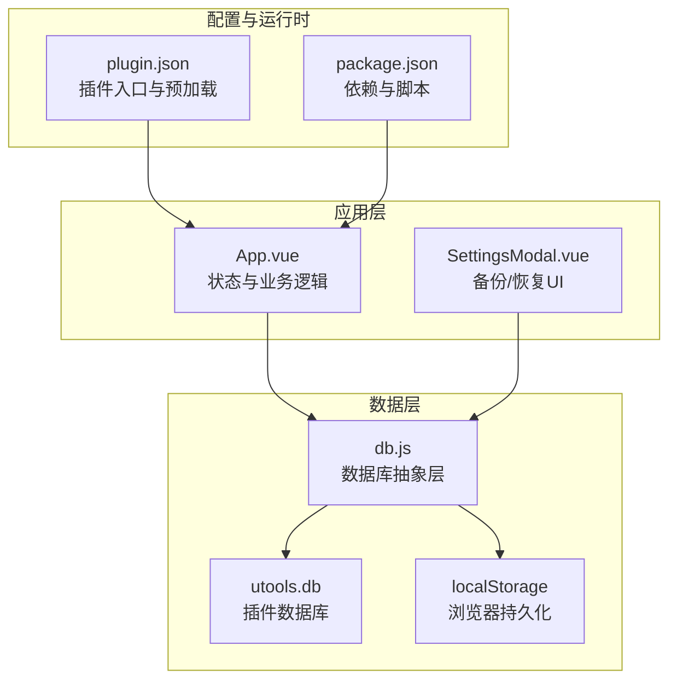
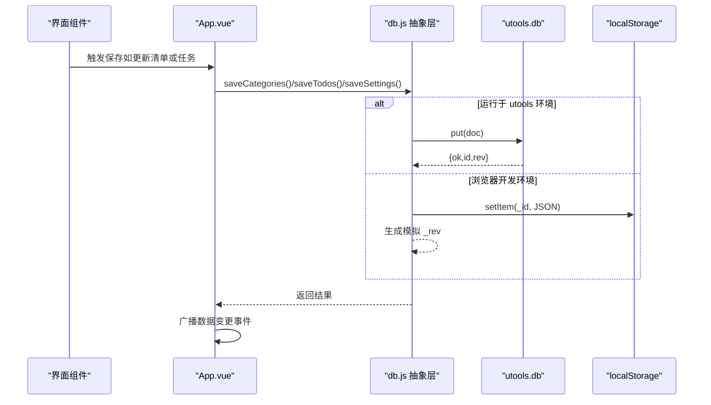
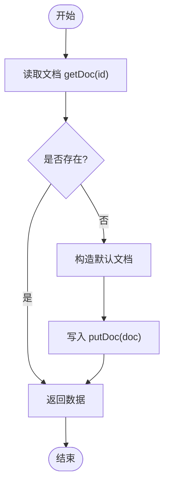
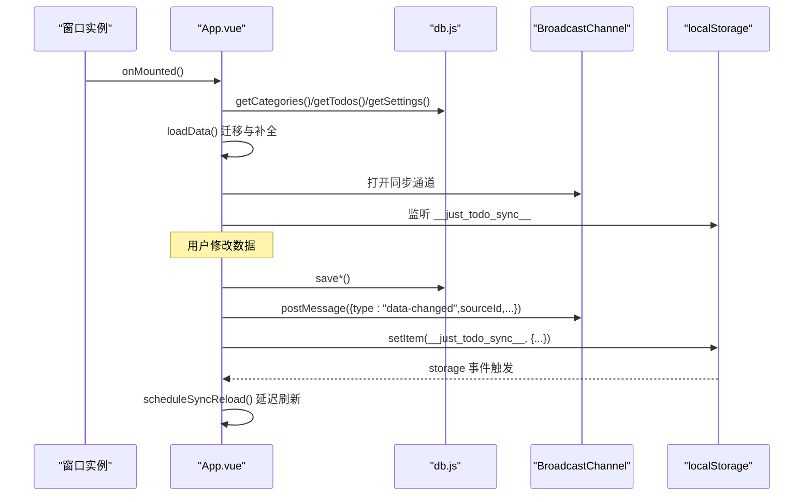
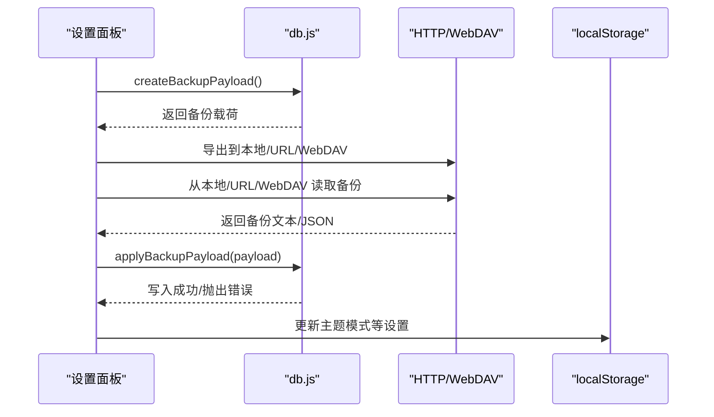
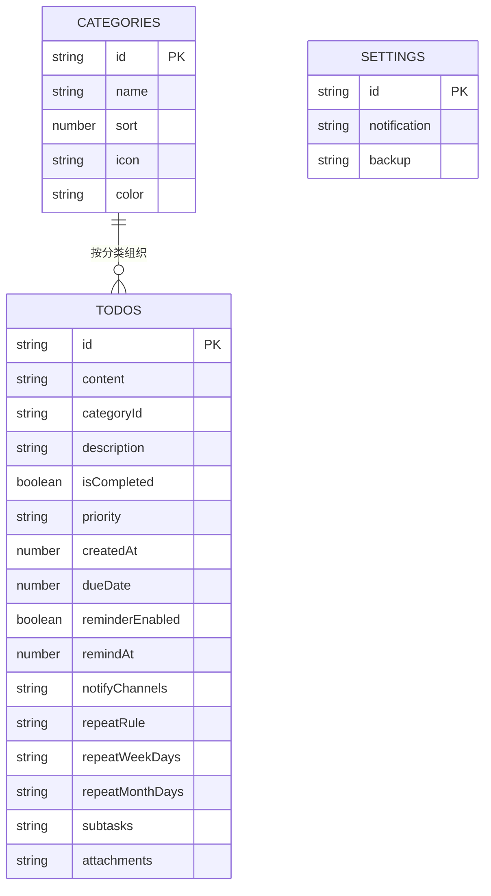
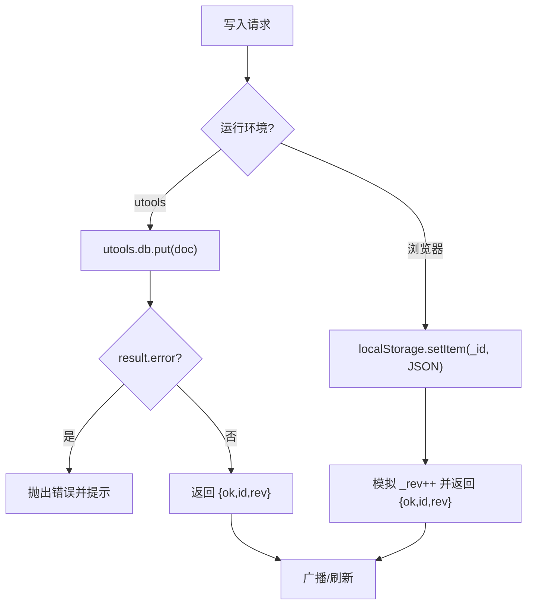
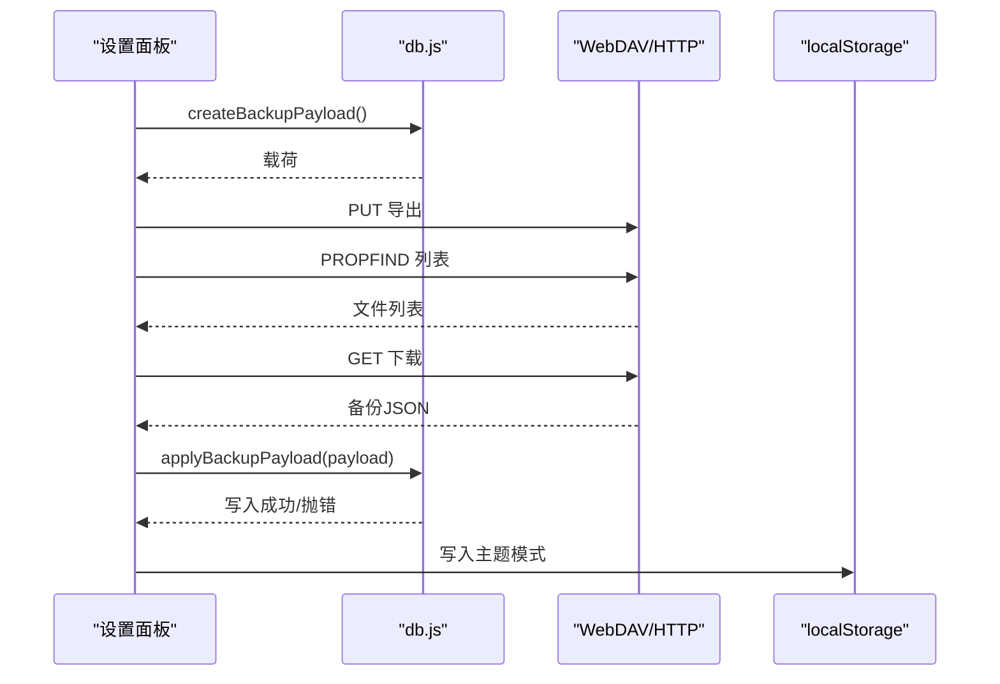
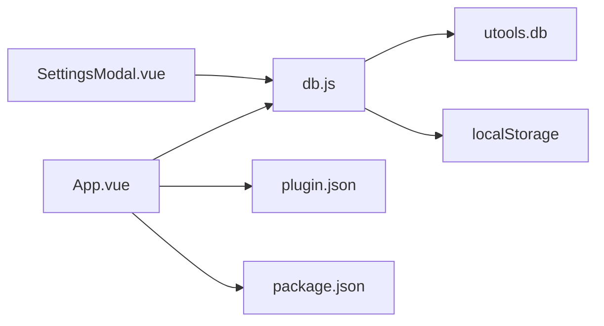

# 数据管理

<cite>
**本文引用的文件**
- [db.js](file://src/utils/db.js)
- [App.vue](file://src/App.vue)
- [SettingsModal.vue](file://src/components/SettingsModal.vue)
- [plugin.json](file://public/plugin.json)
- [package.json](file://package.json)
</cite>

## 目录
1. [简介](#简介)
2. [项目结构](#项目结构)
3. [核心组件](#核心组件)
4. [架构总览](#架构总览)
5. [详细组件分析](#详细组件分析)
6. [依赖关系分析](#依赖关系分析)
7. [性能考量](#性能考量)
8. [故障排查指南](#故障排查指南)
9. [结论](#结论)
10. [附录](#附录)

## 简介
本文件面向 Just-Todo 项目的“数据管理系统”，系统性阐述数据库抽象层设计、数据模型与持久化策略，以及双存储机制（utools 数据库与浏览器 localStorage）的实现方式、数据同步与冲突处理、备份恢复流程、性能优化与错误处理，并总结数据访问模式、缓存策略与并发控制的最佳实践。

## 项目结构
Just-Todo 的数据层位于 utils/db.js，应用层通过 App.vue 与设置面板组件 SettingsModal.vue 调用数据接口；插件元信息由 public/plugin.json 描述，运行时环境通过 window.utools 判定是否在 utools 环境中执行。

图表来源
- [db.js:1-157](file://src/utils/db.js#L1-L157)
- [App.vue:12-12](file://src/App.vue#L12-L12)
- [SettingsModal.vue:288-290](file://src/components/SettingsModal.vue#L288-L290)
- [plugin.json:1-21](file://public/plugin.json#L1-L21)
- [package.json:1-24](file://package.json#L1-L24)

章节来源
- [db.js:1-157](file://src/utils/db.js#L1-L157)
- [App.vue:12-12](file://src/App.vue#L12-L12)
- [SettingsModal.vue:288-290](file://src/components/SettingsModal.vue#L288-L290)
- [plugin.json:1-21](file://public/plugin.json#L1-L21)
- [package.json:1-24](file://package.json#L1-L24)

## 核心组件
- 数据库抽象层（db.js）
  - 提供统一的 get/save 接口，内部根据运行环境选择后端存储（utools.db 或 localStorage）。
  - 维护三类文档：categories（清单）、todos（任务）、settings（设置）。
  - 提供备份/恢复能力：createBackupPayload 与 applyBackupPayload。
- 应用主程序（App.vue）
  - 初始化数据、监听跨窗口/多实例同步事件、触发保存与广播。
  - 对数据进行规范化与迁移处理，保证兼容性。
- 设置面板（SettingsModal.vue）
  - 实现本地备份导出、本地恢复、HTTP 远程恢复、WebDAV 导出/拉取/恢复。
- 插件配置（plugin.json）
  - 定义主入口、预加载服务脚本，为 utools 环境下的数据与网络能力提供桥接。

章节来源
- [db.js:102-157](file://src/utils/db.js#L102-L157)
- [App.vue:488-535](file://src/App.vue#L488-L535)
- [SettingsModal.vue:198-275](file://src/components/SettingsModal.vue#L198-L275)
- [plugin.json:1-21](file://public/plugin.json#L1-L21)

## 架构总览
数据层采用“抽象层 + 双后端”的设计：在 utools 环境下使用 window.utools.db，在浏览器开发环境下使用 localStorage 模拟文档存储。抽象层负责：
- 文档读写：getDoc/putDoc
- 版本化与回退：缺失文档时自动初始化默认数据
- 备份/恢复：统一的备份载荷结构与校验
- 同步广播：通过 BroadcastChannel 与 localStorage 事件实现跨窗口/多实例同步

图表来源
- [db.js:21-43](file://src/utils/db.js#L21-L43)
- [db.js:102-157](file://src/utils/db.js#L102-L157)
- [App.vue:123-131](file://src/App.vue#L123-L131)

## 详细组件分析

### 数据库抽象层（db.js）
- 存储后端选择
  - 通过 window.utools 判定运行环境，决定使用 utools.db 或 localStorage。
- 文档模型
  - categories：清单列表，包含 id、name、sort、icon、color 等字段。
  - todos：任务列表，包含内容、分类、优先级、截止时间、提醒、重复规则、子任务、附件等。
  - settings：应用设置，包含通知与备份相关配置。
- 读写与版本化
  - getDoc：若不存在则返回 mock 默认数据或空结构，随后 putDoc 写入以确保文档存在。
  - putDoc：utools 环境返回原生结果并抛错；浏览器环境模拟 _rev 自增并返回标准结构。
- 备份与恢复
  - createBackupPayload：收集 categories/todos/settings 与主题模式，输出统一载荷。
  - applyBackupPayload：严格校验载荷结构，确保 categories/todos/settings 数组/对象有效；若缺失默认清单则补齐；写入数据并可写入主题模式。
- 初始化
  - db.init：调用 getCategories/getTodos/getSettings，确保首次启动即有默认文档。

图表来源
- [db.js:21-43](file://src/utils/db.js#L21-L43)
- [db.js:102-157](file://src/utils/db.js#L102-L157)

章节来源
- [db.js:1-157](file://src/utils/db.js#L1-L157)

### 应用主程序（App.vue）的数据访问与同步
- 数据访问模式
  - loadData：从 db.js 读取 categories/todos/settings，必要时进行迁移与补全。
  - saveCategories/saveTodos：深拷贝当前状态，调用 db.save* 并广播数据变更。
- 同步与并发
  - 使用 BroadcastChannel 与 localStorage storage 事件实现跨窗口/多实例同步。
  - 通过 __just_todo_sync__ 键与消息携带 sourceId 避免自播自听，定时去抖 reload。
- 迁移与容错
  - 对 categories 做图标/颜色补全与默认修正，失败时记录日志并提示。
- 通知与缓存
  - 使用 localStorage 缓存已提醒任务 ID，避免重复提醒。

图表来源
- [App.vue:488-535](file://src/App.vue#L488-L535)
- [App.vue:116-131](file://src/App.vue#L116-L131)
- [App.vue:461-467](file://src/App.vue#L461-L467)

章节来源
- [App.vue:488-535](file://src/App.vue#L488-L535)
- [App.vue:116-131](file://src/App.vue#L116-L131)
- [App.vue:461-467](file://src/App.vue#L461-L467)

### 设置面板（SettingsModal.vue）的备份与恢复
- 本地备份导出
  - 调用 createBackupPayload 生成备份 JSON，触发系统保存对话框或下载。
- 本地恢复
  - 读取用户选择的 .json 文件，解析为备份载荷，调用 applyBackupPayload 写入数据。
- HTTP 恢复
  - 支持在 utools 环境通过 services.requestText 或浏览器 fetch 获取远程备份 JSON 并恢复。
- WebDAV 备份
  - 支持设置 baseUrl、directory、用户名/密码；自动创建目录；列出 .json 文件；支持导出与恢复。
- 错误处理
  - 对载荷格式、字段类型、URL 可达性进行严格校验，失败时弹窗提示。

图表来源
- [SettingsModal.vue:198-275](file://src/components/SettingsModal.vue#L198-L275)
- [SettingsModal.vue:572-624](file://src/components/SettingsModal.vue#L572-L624)
- [db.js:47-100](file://src/utils/db.js#L47-L100)

章节来源
- [SettingsModal.vue:198-275](file://src/components/SettingsModal.vue#L198-L275)
- [SettingsModal.vue:572-624](file://src/components/SettingsModal.vue#L572-L624)
- [db.js:47-100](file://src/utils/db.js#L47-L100)

### 数据模型与持久化策略
- 数据模型
  - categories：清单数组，包含标识、名称、排序、图标、颜色。
  - todos：任务数组，包含内容、分类、描述、完成状态、优先级、创建/完成时间、截止/提醒时间、通知渠道、重复规则与天数列表、子任务、附件等。
  - settings：应用设置，包含通知配置与备份配置。
- 持久化策略
  - utools 环境：使用 window.utools.db.put/get，具备内置版本号与错误返回。
  - 浏览器环境：使用 localStorage，模拟 _rev 自增，便于上层判断变更。
- 初始化与迁移
  - 首次启动自动写入默认 categories/todos/settings。
  - 对 categories 做图标/颜色补全，确保默认清单存在。

图表来源
- [db.js:102-157](file://src/utils/db.js#L102-L157)
- [App.vue:617-691](file://src/App.vue#L617-L691)

章节来源
- [db.js:102-157](file://src/utils/db.js#L102-L157)
- [App.vue:617-691](file://src/App.vue#L617-L691)

### 双存储机制与冲突解决
- 双存储机制
  - utools 环境：使用 window.utools.db，具备原子写入与错误返回。
  - 浏览器环境：使用 localStorage，模拟 _rev 自增，便于上层做乐观更新。
- 冲突解决策略
  - utools 环境：put 返回 error 时抛出异常，上层捕获并提示。
  - 浏览器环境：通过 _rev 递增实现“版本号”语义，建议上层在读取后比较 _rev，若不一致则回滚或合并。
  - 同步层面：通过 BroadcastChannel 与 storage 事件检测外部变更，延迟刷新，避免竞态。

图表来源
- [db.js:21-43](file://src/utils/db.js#L21-L43)
- [App.vue:123-131](file://src/App.vue#L123-L131)

章节来源
- [db.js:21-43](file://src/utils/db.js#L21-L43)
- [App.vue:123-131](file://src/App.vue#L123-L131)

### 备份与恢复流程
- 备份
  - 收集 categories/todos/settings 与主题模式，生成统一载荷，包含应用标识、版本、导出时间戳与额外扩展字段。
- 恢复
  - 校验载荷结构与字段类型；若 categories 缺少默认清单则补齐；分别写入 categories/todos/settings，并可写入主题模式。
- WebDAV
  - 自动创建目录；支持 PROPFIND 列表 .json 文件；支持 GET/PUT 导出/恢复。

图表来源
- [db.js:47-100](file://src/utils/db.js#L47-L100)
- [SettingsModal.vue:572-624](file://src/components/SettingsModal.vue#L572-L624)

章节来源
- [db.js:47-100](file://src/utils/db.js#L47-L100)
- [SettingsModal.vue:572-624](file://src/components/SettingsModal.vue#L572-L624)

## 依赖关系分析
- 运行时依赖
  - utools 环境：通过 window.utools 与 window.services 访问数据库与网络能力。
  - 浏览器环境：通过 localStorage 与 fetch/webdav 协议实现数据持久化与网络操作。
- 组件耦合
  - App.vue 与 db.js 强耦合，负责数据读写与迁移。
  - SettingsModal.vue 与 db.js 解耦，仅通过 createBackupPayload/applyBackupPayload 交互。
- 外部依赖
  - uuid 用于生成唯一 ID。
  - dayjs 用于时间解析与格式化。
  - html2canvas/jspdf 用于导出场景（非数据持久化）。

图表来源
- [App.vue:12-12](file://src/App.vue#L12-L12)
- [SettingsModal.vue:288-290](file://src/components/SettingsModal.vue#L288-L290)
- [db.js:1-157](file://src/utils/db.js#L1-L157)
- [plugin.json:1-21](file://public/plugin.json#L1-L21)
- [package.json:1-24](file://package.json#L1-L24)

章节来源
- [App.vue:12-12](file://src/App.vue#L12-L12)
- [SettingsModal.vue:288-290](file://src/components/SettingsModal.vue#L288-L290)
- [db.js:1-157](file://src/utils/db.js#L1-L157)
- [plugin.json:1-21](file://public/plugin.json#L1-L21)
- [package.json:1-24](file://package.json#L1-L24)

## 性能考量
- 读写路径
  - 将深拷贝与 JSON 序列化限制在必要的边界，减少不必要的序列化成本。
  - 在浏览器环境模拟 _rev，避免频繁写入导致的存储抖动。
- 同步刷新
  - 使用定时器去抖（scheduleSyncReload），降低频繁刷新带来的渲染压力。
- 通知与缓存
  - 使用 localStorage 缓存已提醒任务 ID，避免重复计算与通知。
- 大数据量优化建议
  - 对 todos 列表分页或虚拟滚动展示。
  - 对附件等大字段采用懒加载或外部存储方案（当前实现为内嵌 dataUrl）。

## 故障排查指南
- utools 环境写入失败
  - 现象：put 返回 error。
  - 处理：捕获异常并提示；检查插件权限与数据库可用性。
- 浏览器环境数据丢失
  - 现象：localStorage 清空或被清理。
  - 处理：确认备份/恢复流程；检查浏览器隐私模式或存储配额。
- WebDAV 目录不可用
  - 现象：MKCOL/PROPFIND/GET/PUT 失败。
  - 处理：核对 baseUrl、directory、认证信息；确认网络可达性与权限。
- 同步不同步
  - 现象：多窗口/多实例未及时刷新。
  - 处理：确认 BroadcastChannel 可用与 storage 事件监听；检查 sourceId 过滤逻辑。

章节来源
- [db.js:30-43](file://src/utils/db.js#L30-L43)
- [SettingsModal.vue:440-451](file://src/components/SettingsModal.vue#L440-L451)
- [App.vue:116-131](file://src/App.vue#L116-L131)

## 结论
Just-Todo 的数据管理系统以“抽象层 + 双存储”为核心，兼顾 utools 与浏览器两种运行环境，提供统一的读写接口、完善的备份/恢复与跨实例同步能力。通过严格的载荷校验、迁移补全与错误处理，系统在易用性与可靠性之间取得平衡。建议后续在大数据量场景下引入分页/虚拟化与更细粒度的并发控制策略，进一步提升性能与稳定性。

## 附录
- 最佳实践
  - 数据访问：统一通过 db.js 的 get/save 方法，避免直接操作 localStorage/utools.db。
  - 缓存策略：利用 localStorage 缓存轻量状态（如已提醒任务 ID），减少重复计算。
  - 并发控制：写入前深拷贝，写入后统一广播；读取后比较版本号（_rev）以处理冲突。
  - 备份恢复：始终校验载荷结构与字段类型，确保默认数据完备后再写入。
  - 错误处理：对外统一提示，对内记录日志，必要时回滚或降级。