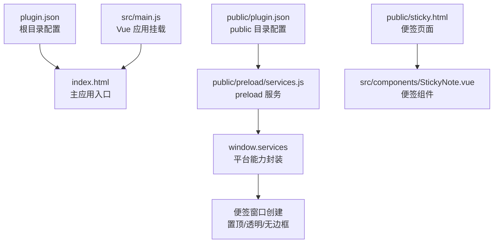
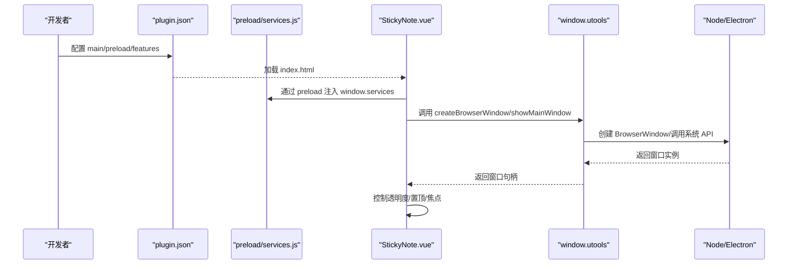
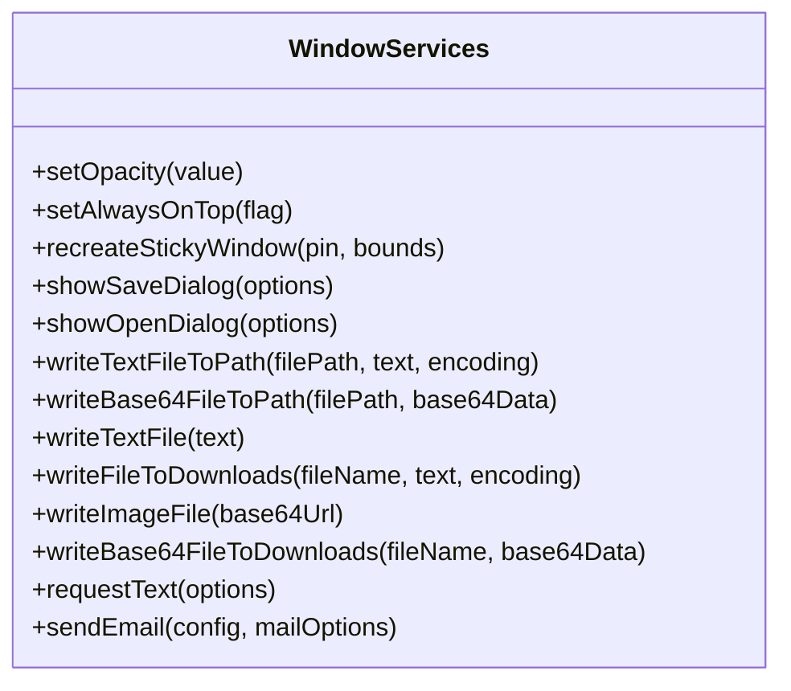
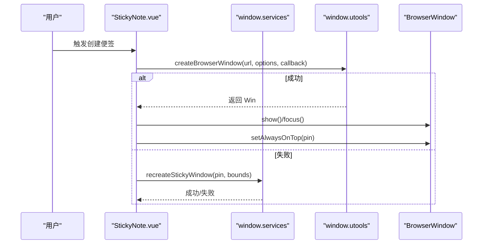
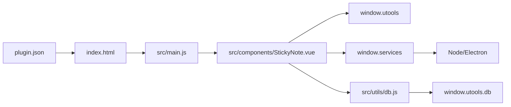

# 平台集成方案

<cite>
**本文档引用的文件**
- [plugin.json](file://plugin.json)
- [public/plugin.json](file://public/plugin.json)
- [public/preload/services.js](file://public/preload/services.js)
- [package.json](file://package.json)
- [public/sticky.html](file://public/sticky.html)
- [index.html](file://index.html)
- [src/main.js](file://src/main.js)
- [src/components/StickyNote.vue](file://src/components/StickyNote.vue)
- [src/App.vue](file://src/App.vue)
- [src/utils/db.js](file://src/utils/db.js)
- [jsconfig.json](file://jsconfig.json)
</cite>

## 目录
1. [简介](#简介)
2. [项目结构](#项目结构)
3. [核心组件](#核心组件)
4. [架构总览](#架构总览)
5. [详细组件分析](#详细组件分析)
6. [依赖关系分析](#依赖关系分析)
7. [性能考量](#性能考量)
8. [故障排除指南](#故障排除指南)
9. [结论](#结论)
10. [附录](#附录)

## 简介
本方案面向 Just-Todo 项目在 utools 插件平台上的集成，系统性阐述插件配置、preload 服务机制、window.utools API 使用方式，并深入解析便签模式、悬浮窗口与置顶显示等桌面应用特性。同时提供跨平台兼容性处理、权限管理与安全考虑的最佳实践，以及平台 API 的使用指南与配置示例。

## 项目结构
Just-Todo 采用标准的 Vue 3 + Vite 开发流程，结合 utools 插件规范进行打包与运行：
- 插件配置文件位于根目录与 public 目录各一份，分别用于生产与开发环境
- preload 服务脚本负责向渲染进程注入 Node/Electron 能力与平台 API 封装
- 主应用入口通过 index.html 加载 Vue 应用
- 便签页面通过 sticky.html 实现轻量跳转与参数传递

图表来源
- [plugin.json:1-21](file://plugin.json#L1-L21)
- [public/plugin.json:1-21](file://public/plugin.json#L1-L21)
- [public/preload/services.js:1-358](file://public/preload/services.js#L1-L358)
- [public/sticky.html:1-21](file://public/sticky.html#L1-L21)
- [src/main.js:1-6](file://src/main.js#L1-L6)

章节来源
- [plugin.json:1-21](file://plugin.json#L1-L21)
- [public/plugin.json:1-21](file://public/plugin.json#L1-L21)
- [public/preload/services.js:1-358](file://public/preload/services.js#L1-L358)
- [public/sticky.html:1-21](file://public/sticky.html#L1-L21)
- [index.html:1-12](file://index.html#L1-L12)
- [src/main.js:1-6](file://src/main.js#L1-L6)

## 核心组件
- 插件配置文件：定义主入口、preload 脚本、logo、开发模式下的本地调试地址以及功能指令
- preload 服务：向渲染进程注入 window.services，提供窗口控制、文件对话框、文本/图片写入、HTTP 请求与邮件发送等能力
- 便签组件：基于 window.utools API 创建透明、无边框、可置顶的悬浮窗口，支持透明度调节与主题切换
- 数据持久化：通过 window.utools.db 在插件环境中存储数据；浏览器开发模式下回退至 localStorage

章节来源
- [plugin.json:1-21](file://plugin.json#L1-L21)
- [public/plugin.json:1-21](file://public/plugin.json#L1-L21)
- [public/preload/services.js:58-358](file://public/preload/services.js#L58-L358)
- [src/components/StickyNote.vue:1-200](file://src/components/StickyNote.vue#L1-L200)
- [src/utils/db.js:1-157](file://src/utils/db.js#L1-L157)

## 架构总览
Just-Todo 的平台集成采用“配置驱动 + preload 注入 + 渲染进程调用”的三层架构：
- 配置层：plugin.json 定义入口与功能指令，development 字段指向本地开发服务器
- 预加载层：services.js 注入 window.services，统一封装平台 API 与 Node 能力
- 渲染层：Vue 组件通过 window.utools 与 window.services 调用平台能力，实现便签窗口、置顶显示、文件操作等功能

图表来源
- [plugin.json:1-21](file://plugin.json#L1-L21)
- [public/preload/services.js:58-358](file://public/preload/services.js#L58-L358)
- [src/components/StickyNote.vue:478-612](file://src/components/StickyNote.vue#L478-L612)

## 详细组件分析

### 插件配置文件（plugin.json）
- main：指定主入口 HTML 文件
- preload：指定 preload 脚本路径
- logo：插件图标路径
- development.main：开发模式下指向本地 Vite 服务器
- features：定义功能码、说明与触发命令列表

章节来源
- [plugin.json:1-21](file://plugin.json#L1-L21)
- [public/plugin.json:1-21](file://public/plugin.json#L1-L21)

### preload 服务（window.services）
- 窗口控制：setOpacity、setAlwaysOnTop、recreateStickyWindow
- 文件对话框：showSaveDialog、showOpenDialog
- 文件写入：writeTextFileToPath、writeBase64FileToPath、writeTextFile、writeImageFile、writeBase64FileToDownloads
- 网络请求：requestText（基于原生 http/https）
- 邮件发送：sendEmail（基于 nodemailer）
- 兼容性处理：polyfill setImmediate，适配不同环境下的 window.utools 与 remote

图表来源
- [public/preload/services.js:58-358](file://public/preload/services.js#L58-L358)

章节来源
- [public/preload/services.js:1-47](file://public/preload/services.js#L1-L47)
- [public/preload/services.js:58-358](file://public/preload/services.js#L58-L358)

### 便签模式与悬浮窗口
- 便签页面：sticky.html 通过查询参数决定目标路由与是否置顶
- 便签组件：根据 pin 参数初始化置顶状态，支持透明度调节与主题切换
- 窗口创建：优先使用 window.utools.createBrowserWindow；若不可用则回退至 preload 中的 recreateStickyWindow 或 Electron remote
- 置顶策略：多级 setAlwaysOnTop 调用，确保在不同平台上稳定生效

图表来源
- [src/components/StickyNote.vue:417-521](file://src/components/StickyNote.vue#L417-L521)
- [src/components/StickyNote.vue:521-598](file://src/components/StickyNote.vue#L521-L598)
- [public/preload/services.js:133-218](file://public/preload/services.js#L133-L218)

章节来源
- [public/sticky.html:1-21](file://public/sticky.html#L1-L21)
- [src/components/StickyNote.vue:1-200](file://src/components/StickyNote.vue#L1-L200)
- [src/components/StickyNote.vue:417-521](file://src/components/StickyNote.vue#L417-L521)
- [src/components/StickyNote.vue:521-598](file://src/components/StickyNote.vue#L521-L598)
- [public/preload/services.js:133-218](file://public/preload/services.js#L133-L218)

### 置顶显示与透明度控制
- 置顶控制：setAlwaysOnTop 支持布尔值切换；在失败时尝试多种参数组合与延时重试
- 透明度控制：setOpacity 优先通过 window.services，其次回退到当前窗口实例
- 焦点与层级：moveTop/focus 确保便签在置顶后仍可交互

章节来源
- [src/components/StickyNote.vue:228-260](file://src/components/StickyNote.vue#L228-L260)
- [public/preload/services.js:69-132](file://public/preload/services.js#L69-L132)

### 数据持久化与备份
- 环境检测：IS_UTOOLS 判断是否在 utools 环境中
- 数据库封装：db.getCategories/db.saveCategories/db.getTodos/db.saveTodos/db.getSettings/db.saveSettings
- 备份导出：createBackupPayload 生成包含版本、时间戳与数据的备份负载
- 恢复导入：applyBackupPayload 校验并写入数据，支持主题模式同步

章节来源
- [src/utils/db.js:1-157](file://src/utils/db.js#L1-L157)

### 开发与类型支持
- 类型声明：jsconfig.json 引入 utools-api-types，提供 window.utools API 的类型提示
- 开发模式：plugin.json development.main 指向本地 Vite 服务器，便于热更新调试

章节来源
- [jsconfig.json:1-20](file://jsconfig.json#L1-L20)
- [plugin.json:5-7](file://plugin.json#L5-L7)

## 依赖关系分析
- 插件配置依赖 preload 服务与主应用入口
- 便签组件依赖 window.utools 与 window.services
- 数据模块依赖 window.utools.db 或 localStorage 回退
- 预加载服务依赖 Electron remote 与 Node 内置模块

图表来源
- [plugin.json:1-21](file://plugin.json#L1-L21)
- [index.html:1-12](file://index.html#L1-L12)
- [src/main.js:1-6](file://src/main.js#L1-L6)
- [src/components/StickyNote.vue:1-200](file://src/components/StickyNote.vue#L1-L200)
- [public/preload/services.js:58-358](file://public/preload/services.js#L58-L358)
- [src/utils/db.js:1-157](file://src/utils/db.js#L1-L157)

章节来源
- [plugin.json:1-21](file://plugin.json#L1-L21)
- [index.html:1-12](file://index.html#L1-L12)
- [src/main.js:1-6](file://src/main.js#L1-L6)
- [src/components/StickyNote.vue:1-200](file://src/components/StickyNote.vue#L1-L200)
- [public/preload/services.js:58-358](file://public/preload/services.js#L58-L358)
- [src/utils/db.js:1-157](file://src/utils/db.js#L1-L157)

## 性能考量
- 窗口创建与置顶：避免频繁调用 setAlwaysOnTop，建议在状态变更时才触发
- 透明度与渲染：透明窗口在高刷新率下可能增加 GPU/CPU 压力，建议按需调整背景色与动画
- 网络请求：requestText 提供超时控制，建议在 UI 层添加加载态与错误提示
- 文件写入：批量写入时合并请求，减少磁盘 IO 次数

## 故障排除指南
- 置顶无效：检查 setAlwaysOnTop 的返回值与异常捕获；尝试多种参数组合与延时重试
- 窗口无法创建：确认 window.utools.createBrowserWindow 可用；回退至 preload 的 recreateStickyWindow
- 透明度设置失败：优先使用 window.services.setOpacity；若不可用再回退到当前窗口实例
- 数据写入异常：window.utools.db.put 返回 error 时抛出异常；浏览器开发模式下回退至 localStorage

章节来源
- [public/preload/services.js:69-132](file://public/preload/services.js#L69-L132)
- [src/components/StickyNote.vue:228-260](file://src/components/StickyNote.vue#L228-L260)
- [src/utils/db.js:30-43](file://src/utils/db.js#L30-L43)

## 结论
Just-Todo 通过清晰的三层架构实现了与 utools 平台的深度集成：配置层明确入口与功能，预加载层统一注入平台能力，渲染层以组件形式提供便签与置顶等桌面特性。该方案兼顾跨平台兼容性与安全性，提供完善的开发与调试支持，并具备良好的扩展性与维护性。

## 附录

### 平台 API 使用指南与最佳实践
- 窗口创建
  - 优先使用 window.utools.createBrowserWindow，传入 options 与回调函数
  - 便签窗口建议 frame=false、transparent=true、alwaysOnTop=false、skipTaskbar=true
- 置顶显示
  - 使用 setAlwaysOnTop(true/false)，必要时多次调用以覆盖平台差异
  - 置顶后调用 show()/focus()/moveTop() 确保可见与可交互
- 透明度控制
  - 通过 window.services.setOpacity 或当前窗口实例 setOpacity
- 文件对话框与写入
  - 使用 showSaveDialog/showOpenDialog 获取路径
  - 使用 writeTextFile/writeImageFile 等方法写入下载目录或指定路径
- 网络请求与邮件
  - requestText 支持 GET/POST 与自定义 headers，注意超时与错误处理
  - sendEmail 使用 nodemailer，注意运行时 setImmediate 兼容性

章节来源
- [public/preload/services.js:58-358](file://public/preload/services.js#L58-L358)
- [src/components/StickyNote.vue:478-612](file://src/components/StickyNote.vue#L478-L612)

### 配置示例与集成步骤
- 插件配置
  - main 指向 index.html
  - preload 指向 public/preload/services.js
  - development.main 指向本地开发服务器地址
  - features 定义功能码与触发命令
- 便签窗口参数
  - frame=false、transparent=true、backgroundColor=#00000000
  - alwaysOnTop=false、skipTaskbar=true
  - webPreferences 启用 nodeIntegration/contextIsolation/enableRemoteModule
- 便签页面跳转
  - sticky.html 通过查询参数 target/pin 控制目标路由与置顶状态

章节来源
- [plugin.json:1-21](file://plugin.json#L1-L21)
- [public/plugin.json:1-21](file://public/plugin.json#L1-L21)
- [public/sticky.html:1-21](file://public/sticky.html#L1-L21)
- [src/components/StickyNote.vue:417-521](file://src/components/StickyNote.vue#L417-L521)