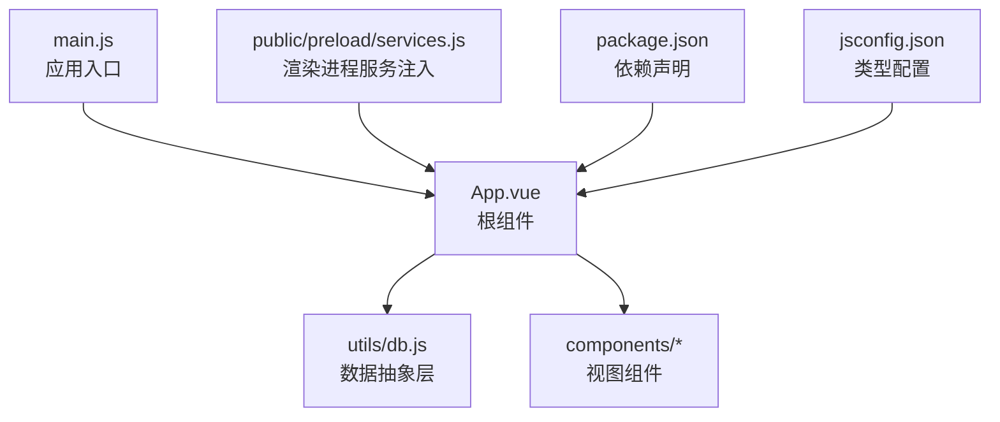
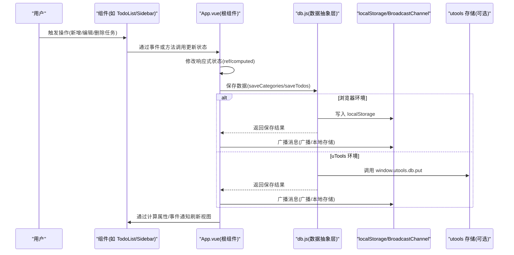
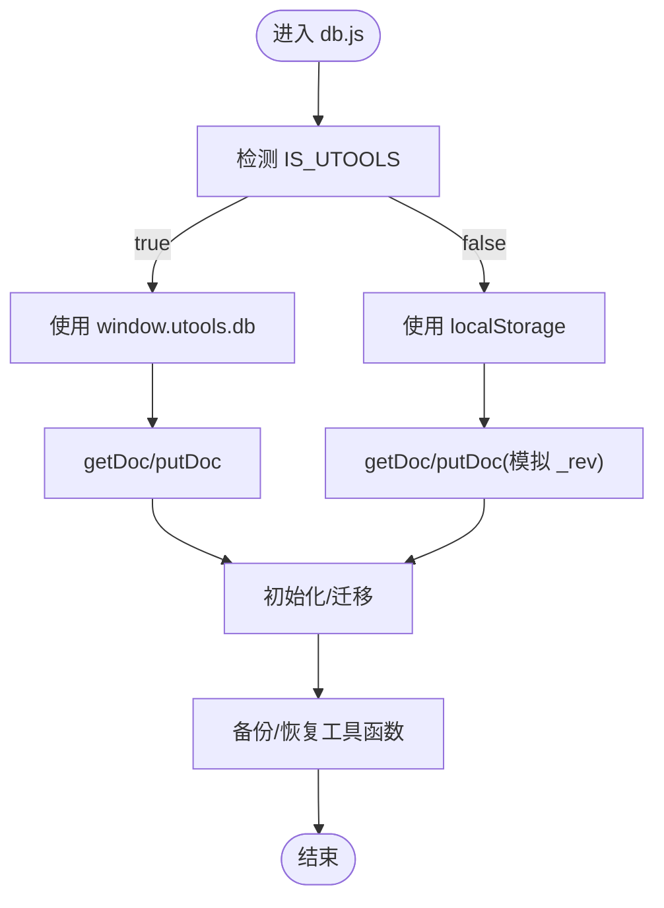
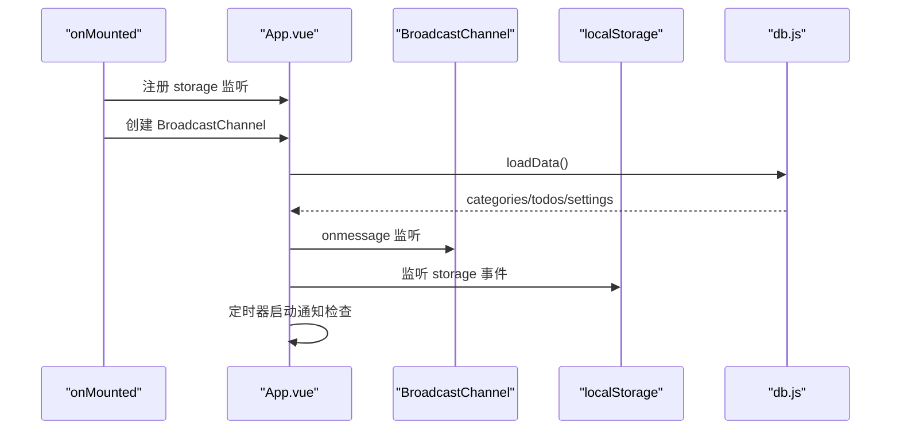
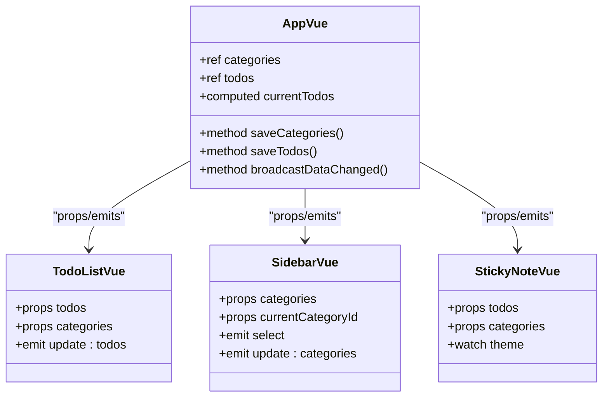
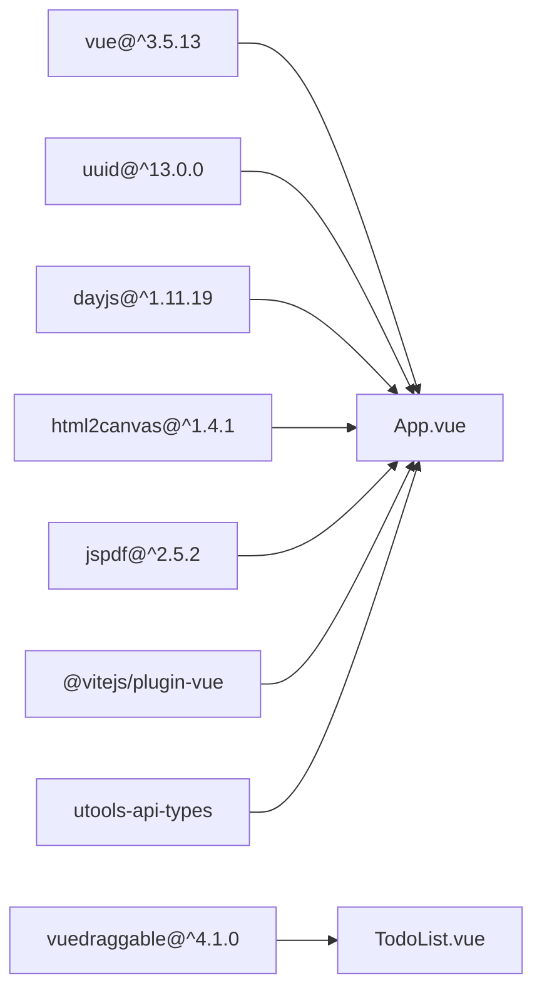

# 数据流设计

<cite>
**本文引用的文件**   
- [db.js](file://src/utils/db.js)
- [App.vue](file://src/App.vue)
- [main.js](file://src/main.js)
- [services.js](file://public/preload/services.js)
- [TodoList.vue](file://src/components/TodoList.vue)
- [Sidebar.vue](file://src/components/Sidebar.vue)
- [StickyNote.vue](file://src/components/StickyNote.vue)
- [package.json](file://package.json)
- [jsconfig.json](file://jsconfig.json)
</cite>

## 目录
1. [简介](#简介)
2. [项目结构](#项目结构)
3. [核心组件](#核心组件)
4. [架构总览](#架构总览)
5. [详细组件分析](#详细组件分析)
6. [依赖关系分析](#依赖关系分析)
7. [性能考量](#性能考量)
8. [故障排查指南](#故障排查指南)
9. [结论](#结论)
10. [附录](#附录)

## 简介
本文件面向 Just-Todo 项目的数据流设计，聚焦于基于 Vue 3 响应式系统构建的前端数据流架构。内容涵盖：
- 全局状态管理与本地存储策略
- 跨组件数据共享机制
- 用户操作到状态更新再到持久化的完整流程
- db.js 数据抽象层的设计思路与兼容性处理（utools 与浏览器）
- 数据同步机制（BroadcastChannel 与 localStorage）的技术实现与性能考量
- 数据流图与具体代码示例路径

## 项目结构
项目采用 Vue 3 单页应用结构，核心入口在 main.js 中挂载 App.vue；数据持久化与跨端兼容由 utils/db.js 抽象层统一处理；公共能力通过 preload/services.js 注入到渲染进程。

图表来源
- [main.js:1-6](file://src/main.js#L1-L6)
- [App.vue:1-30](file://src/App.vue#L1-L30)
- [db.js:1-157](file://src/utils/db.js#L1-L157)
- [services.js:1-358](file://public/preload/services.js#L1-L358)
- [package.json:1-24](file://package.json#L1-L24)
- [jsconfig.json:1-20](file://jsconfig.json#L1-L20)

章节来源
- [main.js:1-6](file://src/main.js#L1-L6)
- [package.json:1-24](file://package.json#L1-L24)
- [jsconfig.json:1-20](file://jsconfig.json#L1-L20)

## 核心组件
- 数据抽象层：db.js 提供 categories/todos/settings 的读取与保存，并在浏览器与 uTools 环境间自动切换实现。
- 根组件：App.vue 维护全局响应式状态（如 categories、todos、currentCategoryId、viewMode 等），负责加载数据、保存数据、触发跨组件同步。
- 视图组件：TodoList.vue、Sidebar.vue、StickyNote.vue 等通过 props 与 emits 接收/传递数据，实现跨组件共享与交互。
- 渲染进程服务：services.js 向渲染进程注入 Node/Electron 能力，用于窗口置顶、便签窗口重建等。

章节来源
- [db.js:102-156](file://src/utils/db.js#L102-L156)
- [App.vue:23-60](file://src/App.vue#L23-L60)
- [TodoList.vue:1-37](file://src/components/TodoList.vue#L1-L37)
- [Sidebar.vue:1-25](file://src/components/Sidebar.vue#L1-L25)
- [StickyNote.vue:1-23](file://src/components/StickyNote.vue#L1-L23)
- [services.js:58-358](file://public/preload/services.js#L58-L358)

## 架构总览
整体数据流遵循“用户操作 -> 响应式状态变更 -> 本地持久化 -> 跨组件同步”的闭环。db.js 抽象了底层存储差异，App.vue 作为状态中枢协调数据生命周期，组件通过 props/emits 实现跨组件通信，同时利用 BroadcastChannel 与 localStorage 实现多实例/多窗口同步。

图表来源
- [App.vue:488-545](file://src/App.vue#L488-L545)
- [db.js:21-43](file://src/utils/db.js#L21-L43)
- [db.js:102-148](file://src/utils/db.js#L102-L148)

## 详细组件分析

### 数据抽象层：db.js 设计与兼容性
- 环境检测：通过 window.utools 判断是否运行在 uTools 环境，自动选择存储后端。
- 读取逻辑：getDoc 在 uTools 环境使用 window.utools.db.get，在浏览器环境使用 localStorage 或返回 mock 数据。
- 写入逻辑：putDoc 在 uTools 环境使用 window.utools.db.put 并抛出错误；在浏览器环境模拟 _rev 版本号并写入 localStorage。
- 初始化与迁移：db.getCategories/db.getTodos/db.getSettings 在首次访问时确保文档存在，必要时写回默认值。
- 备份与恢复：createBackupPayload/applyBackupPayload 支持导出/导入全量数据，含主题模式与校验逻辑。

图表来源
- [db.js:3-43](file://src/utils/db.js#L3-L43)
- [db.js:102-156](file://src/utils/db.js#L102-L156)
- [db.js:47-100](file://src/utils/db.js#L47-L100)

章节来源
- [db.js:1-157](file://src/utils/db.js#L1-L157)

### 根组件：App.vue 的全局状态与同步
- 全局状态：categories、todos、currentCategoryId、viewMode、sortState、themeMode、notificationSettings、backupSettings 等。
- 生命周期：onMounted 中注册 storage 事件监听与 BroadcastChannel，启动通知定时器，加载数据。
- 数据加载与迁移：loadData 从 db.js 读取 categories/todos/settings，并对旧版数据进行迁移与补全。
- 数据保存：saveCategories/saveTodos 将响应式状态序列化后写入 db.js，并触发跨组件同步。
- 同步机制：broadcastDataChanged 通过 BroadcastChannel 与 localStorage 双通道广播“data-changed”消息；handleStorageSync 在 storage 事件中去重并延迟刷新。
- 通知与提醒：定时器检查通知，支持延时提醒与重复规则处理。

图表来源
- [App.vue:455-486](file://src/App.vue#L455-L486)
- [App.vue:488-535](file://src/App.vue#L488-L535)
- [App.vue:123-141](file://src/App.vue#L123-L141)

章节来源
- [App.vue:23-60](file://src/App.vue#L23-L60)
- [App.vue:455-486](file://src/App.vue#L455-L486)
- [App.vue:488-545](file://src/App.vue#L488-L545)
- [App.vue:123-141](file://src/App.vue#L123-L141)

### 视图组件：跨组件数据共享
- TodoList.vue：接收 todos/categories/sortState 等 props，通过 update:todos 事件向上游传递排序/拖拽后的列表变更。
- Sidebar.vue：接收 categories/currentCategoryId，通过 select/update:categories 等事件与根组件交互，实现分类选择与排序。
- StickyNote.vue：在便签模式下独立维护主题与颜色设置，但通过根组件的全局主题类名影响子组件样式。

图表来源
- [App.vue:350-415](file://src/App.vue#L350-L415)
- [TodoList.vue:1-37](file://src/components/TodoList.vue#L1-L37)
- [Sidebar.vue:1-25](file://src/components/Sidebar.vue#L1-L25)
- [StickyNote.vue:1-23](file://src/components/StickyNote.vue#L1-L23)

章节来源
- [TodoList.vue:1-37](file://src/components/TodoList.vue#L1-L37)
- [Sidebar.vue:1-25](file://src/components/Sidebar.vue#L1-L25)
- [StickyNote.vue:1-23](file://src/components/StickyNote.vue#L1-L23)

### 渲染进程服务：窗口与系统能力
- services.js 向 window 注入服务，包括窗口置顶、便签窗口重建、文件读写、HTTP 请求、邮件发送等。
- 该模块在 Electron/uTools 环境下为渲染进程提供 Node/Electron 能力，便于实现高级功能（如置顶、便签窗口等）。

章节来源
- [services.js:58-358](file://public/preload/services.js#L58-L358)

## 依赖关系分析
- Vue 3：响应式系统与组合式 API 驱动状态管理与组件通信。
- uuid：生成唯一标识符。
- dayjs：日期时间解析与比较。
- html2canvas/jspdf：截图与 PDF 导出（按需加载）。
- vuedraggable：拖拽排序。
- utools-api-types：uTools 类型定义。

图表来源
- [package.json:7-22](file://package.json#L7-L22)
- [jsconfig.json:12-14](file://jsconfig.json#L12-L14)

章节来源
- [package.json:1-24](file://package.json#L1-L24)
- [jsconfig.json:1-20](file://jsconfig.json#L1-L20)

## 性能考量
- 延迟刷新与节流：scheduleSyncReload 使用定时器合并多次变更，避免频繁重载。
- 事件去重：BroadcastChannel 与 localStorage 同步均通过 sourceId 与消息体过滤自身发出的消息，防止循环触发。
- 计算属性优化：currentTodos 基于 computed 缓存，仅在依赖变化时重新计算。
- 按需加载：html2canvas/jsPDF 通过动态 import 减少首屏体积。
- 通知轮询：每分钟检查一次通知，可根据业务需求调整频率。

章节来源
- [App.vue:116-122](file://src/App.vue#L116-L122)
- [App.vue:123-141](file://src/App.vue#L123-L141)
- [App.vue:350-415](file://src/App.vue#L350-L415)
- [App.vue:104-115](file://src/App.vue#L104-L115)

## 故障排查指南
- 数据无法持久化
  - 检查 db.js 的 getDoc/putDoc 是否正确执行；在浏览器环境确认 localStorage 权限与容量。
  - 在 uTools 环境确认 window.utools.db 是否可用。
- 同步不生效
  - 确认 BroadcastChannel 是否可用；检查 handleStorageSync 的 storage 事件是否被注册。
  - 核对 broadcastDataChanged 的 sourceId 过滤逻辑，避免自触发。
- 主题与样式异常
  - 检查 App.vue 中 themeMode 的 watch 与 applyTheme 的执行顺序。
  - 确认 StickyNote.vue 中的全局主题类名同步逻辑。
- 通知未触发
  - 检查 notificationTimer 的创建与清理，确认 checkNotifications 的调用时机。
  - 核对 notifiedTasks/Set 的去重逻辑与缓存持久化。

章节来源
- [db.js:21-43](file://src/utils/db.js#L21-L43)
- [App.vue:455-486](file://src/App.vue#L455-L486)
- [App.vue:123-141](file://src/App.vue#L123-L141)
- [App.vue:281-291](file://src/App.vue#L281-L291)
- [StickyNote.vue:121-139](file://src/components/StickyNote.vue#L121-L139)

## 结论
Just-Todo 的数据流以 Vue 3 响应式为核心，db.js 抽象层屏蔽了 uTools 与浏览器的存储差异，App.vue 作为全局状态中枢协调数据生命周期与跨组件同步。通过 BroadcastChannel 与 localStorage 的双通道同步，保证多实例/多窗口的一致性。组件间通过 props/emits 实现清晰的单向数据流与事件驱动交互。整体设计简洁可靠，具备良好的扩展性与可维护性。

## 附录
- 数据流示例路径
  - 用户新增任务：[App.vue:617-638](file://src/App.vue#L617-L638) -> [App.vue:542-545](file://src/App.vue#L542-L545) -> [db.js:129-133](file://src/utils/db.js#L129-L133)
  - 用户编辑任务：[App.vue:653-790](file://src/App.vue#L653-L790) -> [App.vue:542-545](file://src/App.vue#L542-L545) -> [db.js:129-133](file://src/utils/db.js#L129-L133)
  - 分类变更保存：[App.vue:537-541](file://src/App.vue#L537-L541) -> [db.js:114-118](file://src/utils/db.js#L114-L118)
  - 同步广播：[App.vue:123-131](file://src/App.vue#L123-L131) -> [App.vue:460-468](file://src/App.vue#L460-L468) -> [App.vue:132-141](file://src/App.vue#L132-L141)