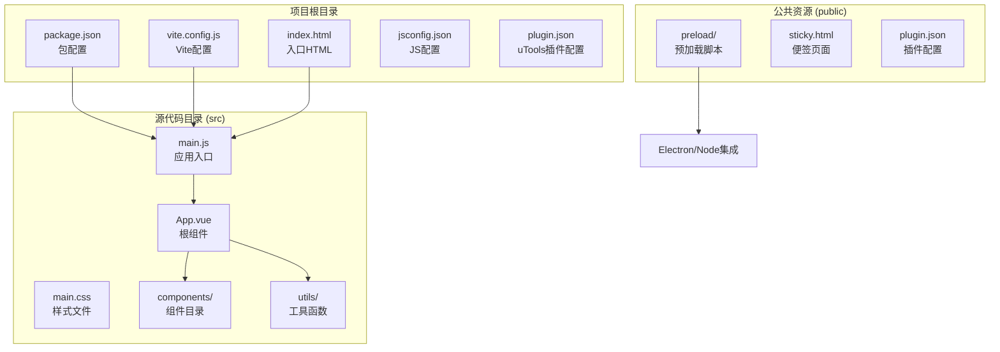
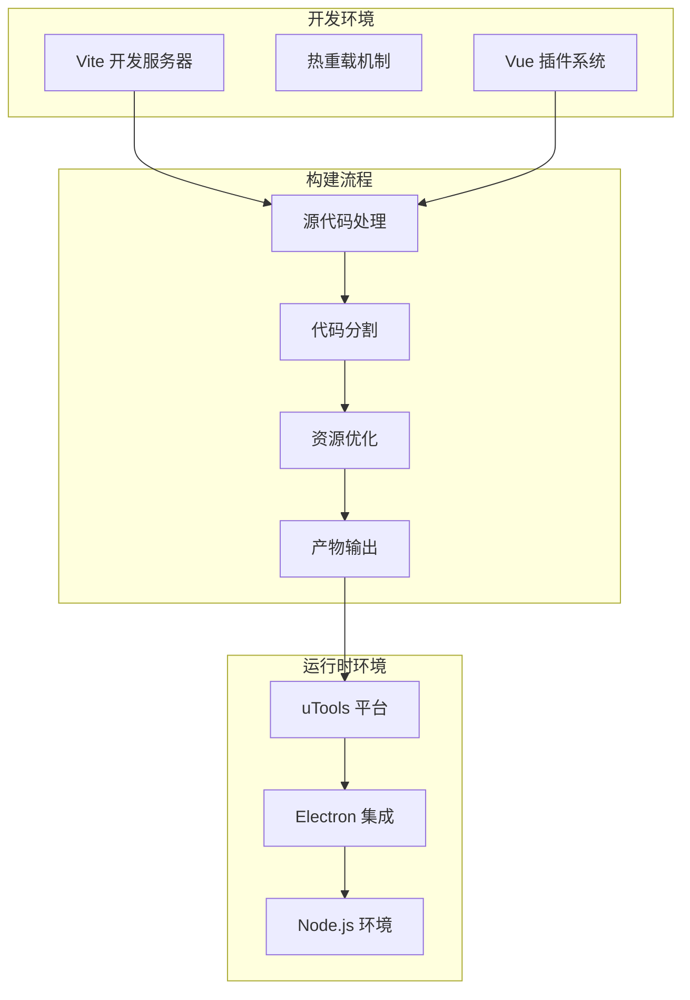
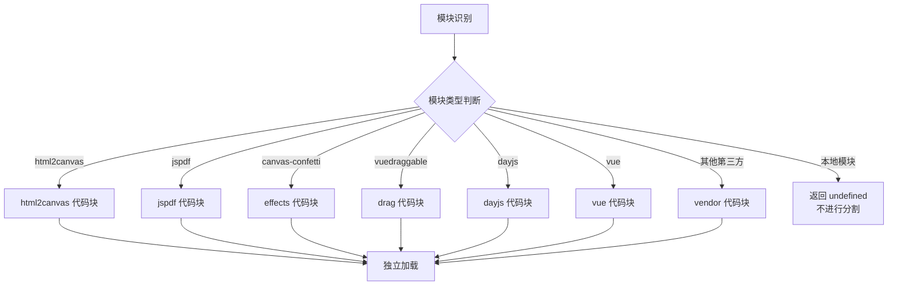
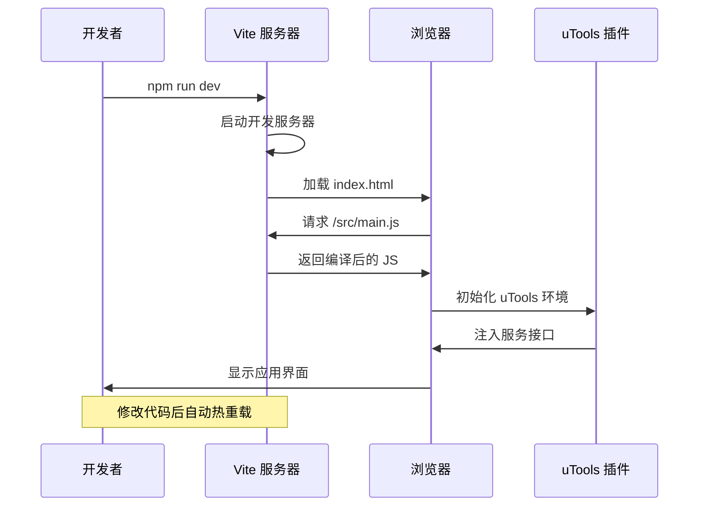
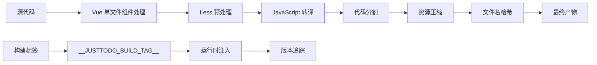
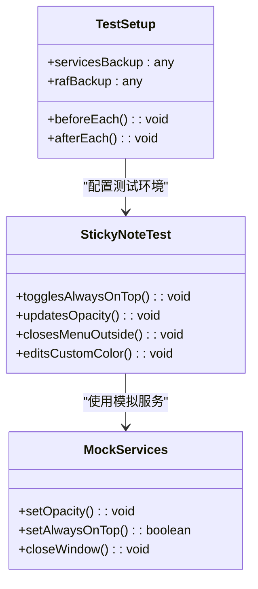
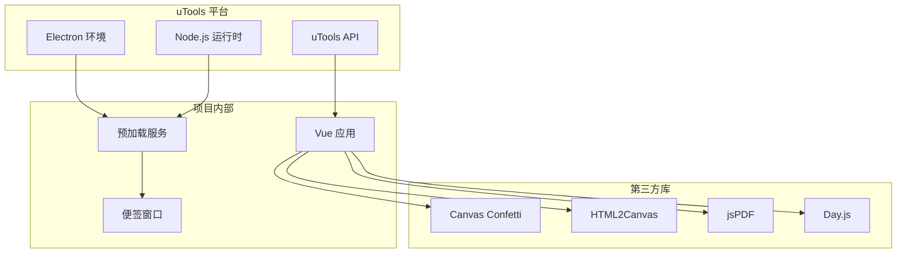
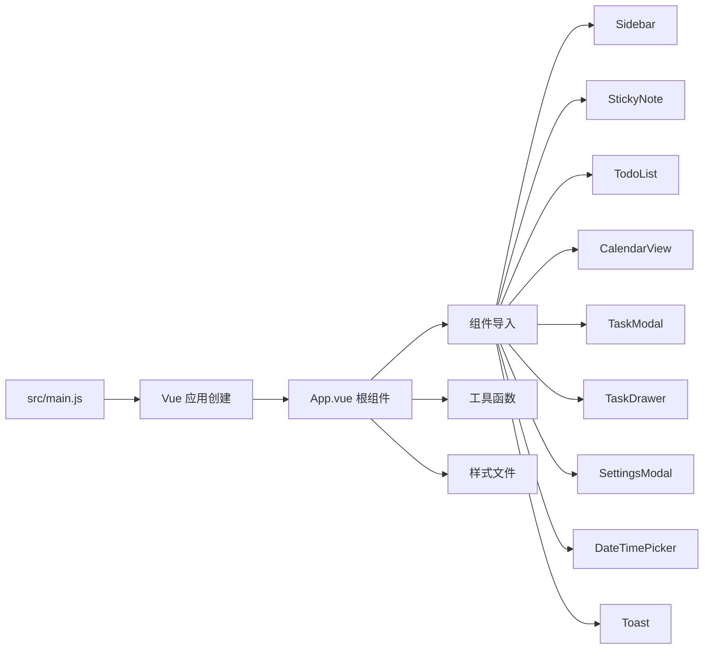
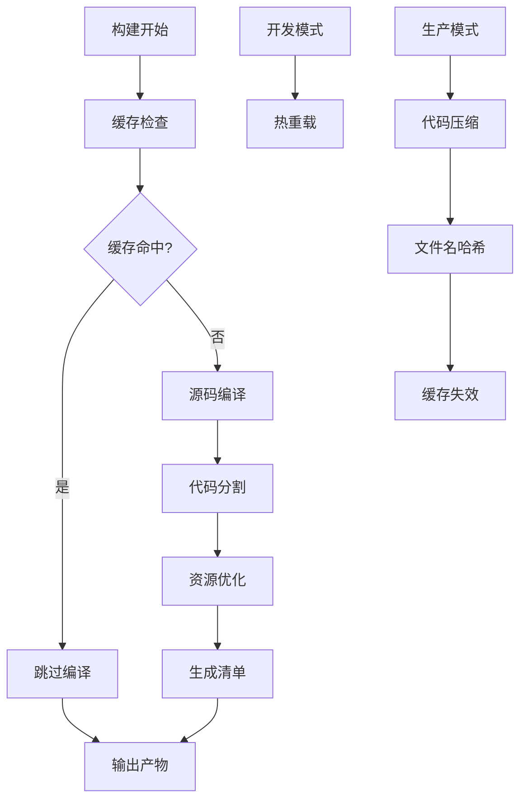

# 构建系统配置

<cite>
**本文档引用的文件**
- [package.json](file://package.json)
- [vite.config.js](file://vite.config.js)
- [index.html](file://index.html)
- [src/main.js](file://src/main.js)
- [plugin.json](file://plugin.json)
- [src/App.vue](file://src/App.vue)
- [src/main.css](file://src/main.css)
- [public/preload/services.js](file://public/preload/services.js)
- [public/sticky.html](file://public/sticky.html)
- [jsconfig.json](file://jsconfig.json)
- [src/components/StickyNote.test.js](file://src/components/StickyNote.test.js)
</cite>

## 目录
1. [简介](#简介)
2. [项目结构](#项目结构)
3. [核心组件](#核心组件)
4. [架构概览](#架构概览)
5. [详细组件分析](#详细组件分析)
6. [依赖关系分析](#依赖关系分析)
7. [性能考虑](#性能考虑)
8. [故障排除指南](#故障排除指南)
9. [结论](#结论)

## 简介

Just-Todo 是一个基于 Vue 3 和 Vite 的现代化待办事项应用，专为 uTools 平台设计。该项目采用现代前端构建技术栈，提供了完整的开发和生产环境配置。本文档详细介绍了基于 Vite 的构建系统配置，包括开发服务器设置、代码分割策略、生产环境优化以及相关的依赖管理和配置文件。

## 项目结构

Just-Todo 项目遵循标准的前端项目结构，主要包含以下关键目录和文件：



**图表来源**
- [package.json:1-24](file://package.json#L1-L24)
- [vite.config.js:1-28](file://vite.config.js#L1-L28)
- [index.html:1-12](file://index.html#L1-L12)

**章节来源**
- [package.json:1-24](file://package.json#L1-L24)
- [vite.config.js:1-28](file://vite.config.js#L1-L28)
- [index.html:1-12](file://index.html#L1-L12)

## 核心组件

### Vite 构建配置

Vite 配置文件提供了现代化的构建系统基础，支持热重载开发和高效的生产构建。

**关键配置特性：**
- Vue 插件集成，支持单文件组件
- 基础路径配置为相对路径
- 自定义构建标签定义
- 手动代码分割策略

### 包管理配置

package.json 定义了完整的依赖生态系统：

**生产依赖：**
- Vue 3 核心框架
- Canvas Confetti 效果库
- Day.js 时间处理
- HTML2Canvas 截图功能
- jsPDF 文档生成
- RemixIcon 图标字体
- UUID 标识符生成
- VueDraggable 拖拽功能

**开发依赖：**
- Vite 构建工具
- Vue 插件
- Less 预处理器
- uTools API 类型定义

### 应用入口配置

主入口文件负责应用初始化和模块导入：

- Vue 应用创建和挂载
- 全局样式导入
- RemixIcon 字体引入
- 根组件加载

**章节来源**
- [vite.config.js:1-28](file://vite.config.js#L1-L28)
- [package.json:7-22](file://package.json#L7-L22)
- [src/main.js:1-6](file://src/main.js#L1-L6)

## 架构概览

Just-Todo 采用了模块化的架构设计，结合了现代前端技术和桌面应用平台特性：



**图表来源**
- [vite.config.js:5-27](file://vite.config.js#L5-L27)
- [plugin.json:1-21](file://plugin.json#L1-L21)

### 代码分割策略

项目实现了精细的手动代码分割策略，将不同功能模块分离到独立的代码块中：



**图表来源**
- [vite.config.js:14-24](file://vite.config.js#L14-L24)

**章节来源**
- [vite.config.js:11-26](file://vite.config.js#L11-L26)

## 详细组件分析

### 开发服务器配置

Vite 开发服务器提供了快速的开发体验，支持热重载和实时错误反馈：



**图表来源**
- [package.json:3-5](file://package.json#L3-L5)
- [plugin.json:5-7](file://plugin.json#L5-L7)

### 生产环境优化

生产构建经过多层优化以确保最佳性能：



**图表来源**
- [vite.config.js:8-10](file://vite.config.js#L8-L10)
- [vite.config.js:25](file://vite.config.js#L25)

### 依赖管理系统

项目采用分层依赖管理策略：

```mermaid
graph TB
subgraph "运行时依赖"
A[Vue 3.5.13]
B[Day.js 1.11.19]
C[Canvas Confetti 1.9.4]
D[HTML2Canvas 1.4.1]
E[jsPDF 2.5.2]
F[RemixIcon 4.8.0]
G[UUID 13.0.0]
H[VueDraggable 4.1.0]
end
subgraph "开发时依赖"
I[Vite 6.0.11]
J[@vitejs/plugin-vue 5.2.1]
K[Less 4.5.1]
L[utools-api-types 6.1.0]
end
subgraph "构建时依赖"
M[Rollup 构建器]
N[ESLint 代码检查]
O[Vitest 测试框架]
end
```

**图表来源**
- [package.json:7-22](file://package.json#L7-L22)

**章节来源**
- [package.json:1-24](file://package.json#L1-L24)

### 测试配置分析

项目集成了 Vitest 测试框架，支持组件级别的单元测试：



**图表来源**
- [src/components/StickyNote.test.js:12-44](file://src/components/StickyNote.test.js#L12-L44)

**章节来源**
- [src/components/StickyNote.test.js:1-84](file://src/components/StickyNote.test.js#L1-L84)

## 依赖关系分析

### 外部依赖关系

项目与多个外部系统存在依赖关系：



**图表来源**
- [plugin.json:1-21](file://plugin.json#L1-L21)
- [public/preload/services.js:58-357](file://public/preload/services.js#L58-L357)

### 模块导入关系



**图表来源**
- [src/main.js:1-6](file://src/main.js#L1-L6)
- [src/App.vue:1-12](file://src/App.vue#L1-L12)

**章节来源**
- [plugin.json:1-21](file://plugin.json#L1-L21)
- [public/preload/services.js:1-358](file://public/preload/services.js#L1-L358)

## 性能考虑

### 代码分割优化

手动代码分割策略有效减少了初始包大小：

- **html2canvas**: 独立代码块，按需加载截图功能
- **jspdf**: 独立代码块，延迟加载 PDF 生成
- **effects**: 特效相关库独立打包
- **drag**: 拖拽功能独立模块
- **dayjs**: 时间处理库独立模块
- **vue**: Vue 核心库独立模块
- **vendor**: 其他第三方库统一打包

### 构建性能优化



**图表来源**
- [vite.config.js:12-26](file://vite.config.js#L12-L26)

### 内存和资源管理

项目在运行时采用了多种资源管理策略：

- **懒加载**: 大型库如 html2canvas 和 jsPDF 仅在需要时加载
- **缓存机制**: 第三方库实例缓存避免重复创建
- **事件清理**: 组件卸载时清理定时器和事件监听器
- **内存泄漏防护**: 及时清理同步通道和广播频道

**章节来源**
- [src/App.vue:104-115](file://src/App.vue#L104-L115)
- [src/App.vue:306-322](file://src/App.vue#L306-L322)

## 故障排除指南

### 常见构建问题

**开发服务器启动失败**
- 检查端口占用情况
- 确认 Node.js 版本兼容性
- 验证依赖安装完整性

**热重载不生效**
- 检查文件保存状态
- 确认浏览器开发者工具未禁用
- 验证网络连接稳定性

**代码分割异常**
- 检查模块路径包含关系
- 验证第三方库版本兼容性
- 确认 Rollup 配置正确性

### 运行时问题诊断

**uTools 环境集成问题**
- 验证 plugin.json 配置正确性
- 检查预加载脚本执行状态
- 确认 Node.js API 可用性

**内存泄漏检测**
- 使用浏览器开发者工具监控内存
- 检查组件生命周期钩子
- 验证事件监听器清理

**性能问题排查**
- 分析代码分割效果
- 检查第三方库使用情况
- 优化大组件渲染逻辑

**章节来源**
- [plugin.json:1-21](file://plugin.json#L1-L21)
- [public/preload/services.js:1-47](file://public/preload/services.js#L1-L47)

## 结论

Just-Todo 项目展示了现代前端构建系统的最佳实践。通过精心设计的 Vite 配置、合理的代码分割策略和完善的依赖管理，项目实现了优秀的开发体验和运行性能。

**关键优势：**
- 基于 Vite 的快速开发环境
- 精细的代码分割优化
- 完整的 uTools 平台集成
- 清晰的模块化架构
- 全面的测试覆盖

**未来改进建议：**
- 添加更详细的构建分析报告
- 实现渐进式 Web 应用特性
- 优化第三方库的 Tree Shaking
- 增强错误边界和恢复机制

这个构建系统为类似的桌面应用开发提供了良好的参考模板，展示了如何在保持开发效率的同时实现高性能的应用交付。