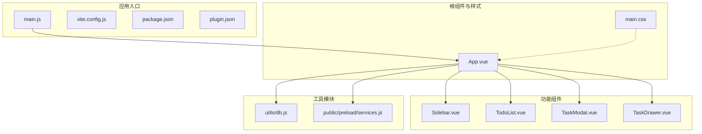
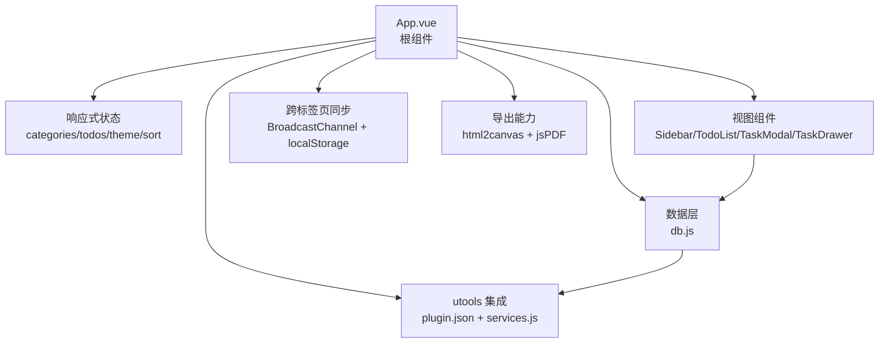
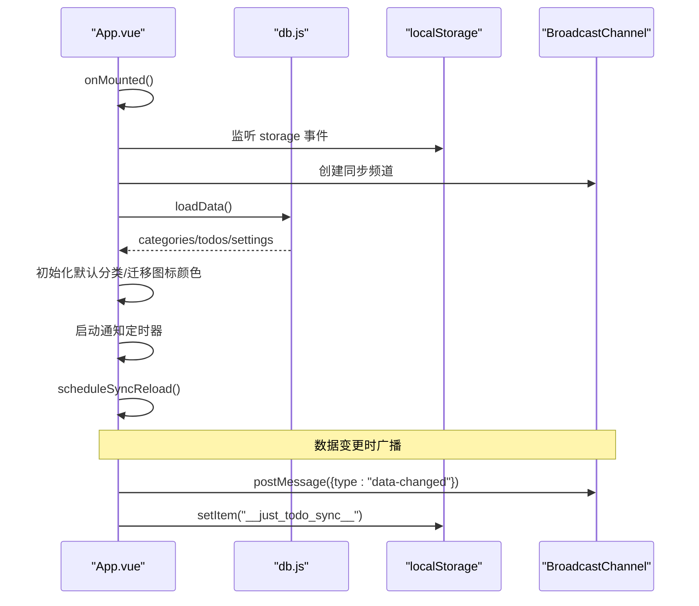
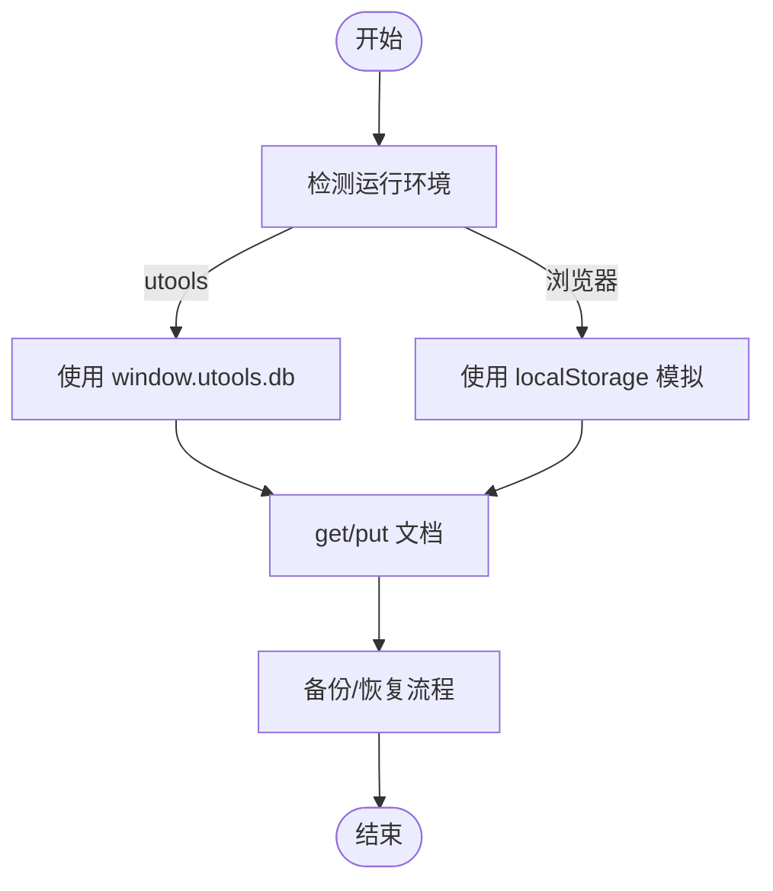
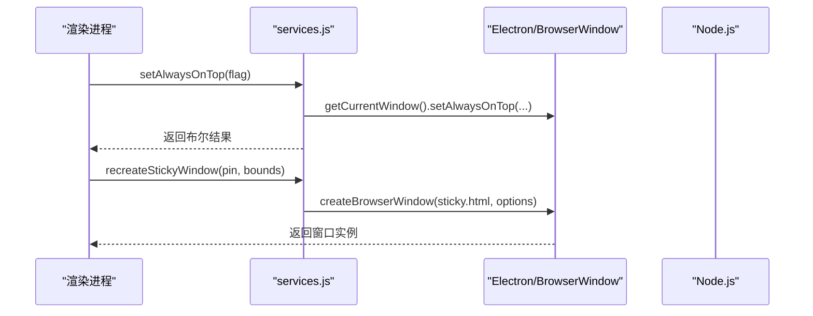
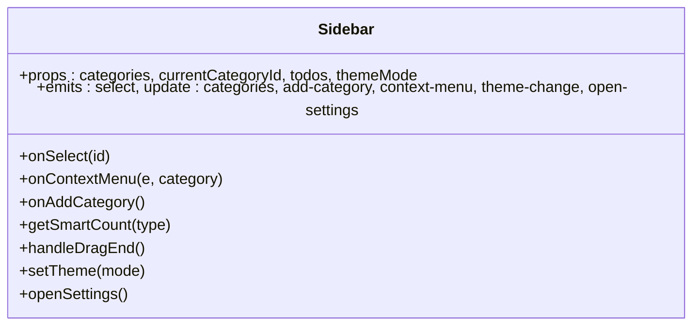
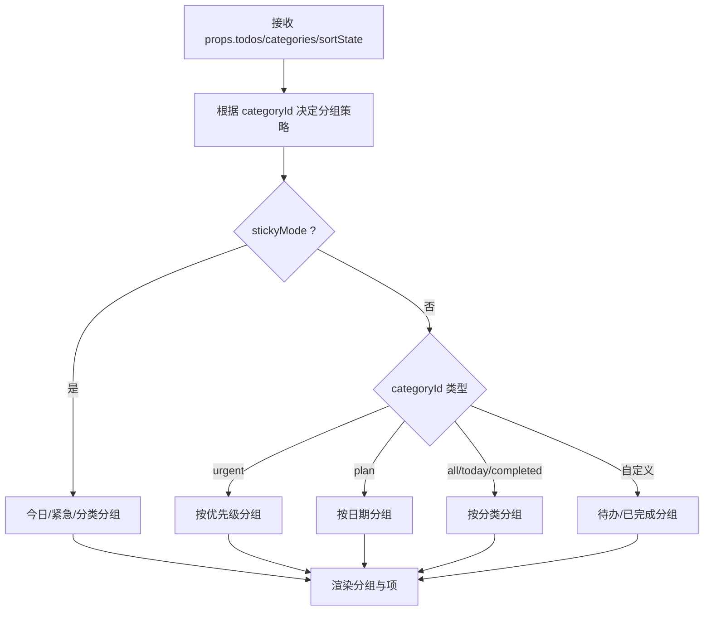
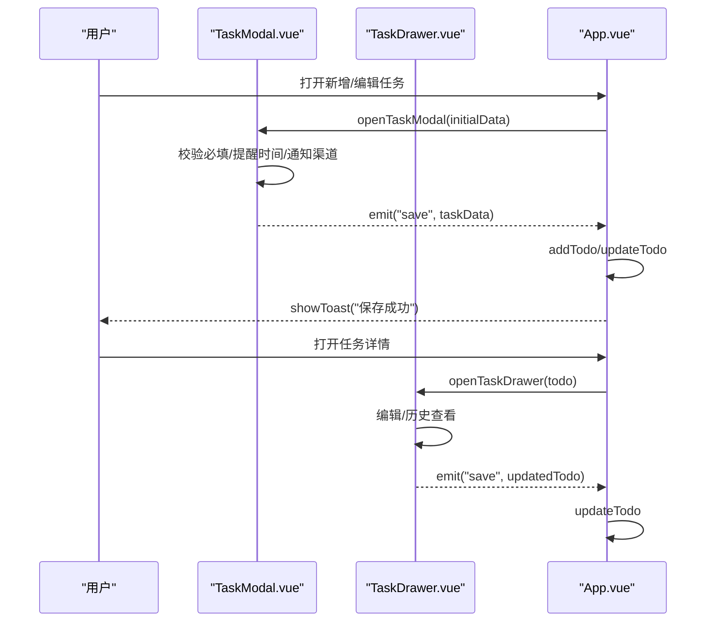
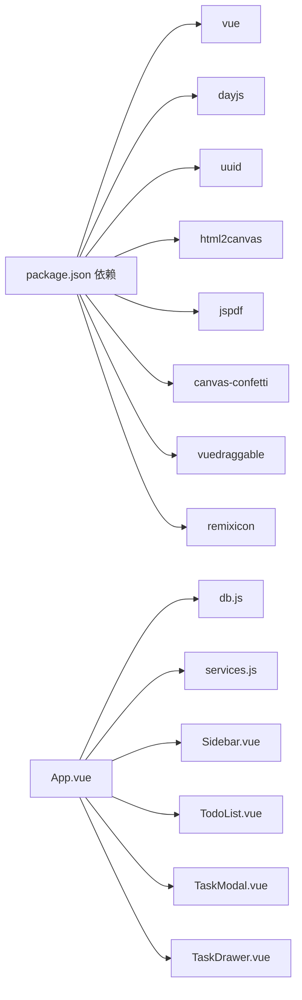

# 核心架构

<cite>
**本文档引用的文件**
- [App.vue](file://src/App.vue)
- [main.js](file://src/main.js)
- [vite.config.js](file://vite.config.js)
- [package.json](file://package.json)
- [plugin.json](file://plugin.json)
- [db.js](file://src/utils/db.js)
- [services.js](file://public/preload/services.js)
- [Sidebar.vue](file://src/components/Sidebar.vue)
- [TodoList.vue](file://src/components/TodoList.vue)
- [TaskModal.vue](file://src/components/TaskModal.vue)
- [TaskDrawer.vue](file://src/components/TaskDrawer.vue)
- [main.css](file://src/main.css)
</cite>

## 目录
1. [简介](#简介)
2. [项目结构](#项目结构)
3. [核心组件](#核心组件)
4. [架构总览](#架构总览)
5. [详细组件分析](#详细组件分析)
6. [依赖关系分析](#依赖关系分析)
7. [性能考虑](#性能考虑)
8. [故障排除指南](#故障排除指南)
9. [结论](#结论)

## 简介
本项目为基于 Vue 3 + Vite 的跨平台待办事项应用，面向 utools 插件生态，提供桌面便签模式与主界面双形态。系统采用组件化架构，结合响应式数据流与插件化设计，实现本地数据持久化、跨标签页同步、通知与导出等核心能力。本文档从架构视角解析其设计理念、数据流与扩展点，并给出性能优化建议与故障排除指引。

## 项目结构
项目采用“功能模块 + 组件化”的组织方式：
- 应用入口与构建配置：main.js、vite.config.js、package.json、plugin.json
- 根组件与样式：App.vue、main.css
- 功能组件：Sidebar、TodoList、TaskModal、TaskDrawer 等
- 工具模块：db 数据层、services 预加载服务

图表来源
- [main.js:1-6](file://src/main.js#L1-L6)
- [vite.config.js:1-28](file://vite.config.js#L1-L28)
- [package.json:1-24](file://package.json#L1-L24)
- [plugin.json:1-21](file://plugin.json#L1-L21)
- [App.vue:1-120](file://src/App.vue#L1-L120)
- [main.css:1-170](file://src/main.css#L1-L170)
- [Sidebar.vue:1-502](file://src/components/Sidebar.vue#L1-L502)
- [TodoList.vue:1-800](file://src/components/TodoList.vue#L1-L800)
- [TaskModal.vue:1-800](file://src/components/TaskModal.vue#L1-L800)
- [TaskDrawer.vue:1-800](file://src/components/TaskDrawer.vue#L1-L800)
- [db.js:1-157](file://src/utils/db.js#L1-L157)
- [services.js:1-358](file://public/preload/services.js#L1-L358)

章节来源
- [main.js:1-6](file://src/main.js#L1-L6)
- [vite.config.js:1-28](file://vite.config.js#L1-L28)
- [package.json:1-24](file://package.json#L1-L24)
- [plugin.json:1-21](file://plugin.json#L1-L21)

## 核心组件
- App.vue：根组件，负责全局状态管理、视图切换、通知与提醒、便签模式、导出与同步广播等。
- Sidebar.vue：侧边栏导航与分类管理，支持拖拽排序与上下文菜单。
- TodoList.vue：任务列表展示与分组，支持多种分组策略与交互。
- TaskModal.vue：新增/编辑任务的弹窗表单。
- TaskDrawer.vue：任务详情抽屉，支持编辑与历史记录。
- db.js：统一的数据访问层，兼容浏览器与 utools 环境。
- services.js：预加载服务，提供窗口置顶、便签窗口创建、文件保存等能力。

章节来源
- [App.vue:1-120](file://src/App.vue#L1-L120)
- [Sidebar.vue:1-502](file://src/components/Sidebar.vue#L1-L502)
- [TodoList.vue:1-800](file://src/components/TodoList.vue#L1-L800)
- [TaskModal.vue:1-800](file://src/components/TaskModal.vue#L1-L800)
- [TaskDrawer.vue:1-800](file://src/components/TaskDrawer.vue#L1-L800)
- [db.js:1-157](file://src/utils/db.js#L1-L157)
- [services.js:1-358](file://public/preload/services.js#L1-L358)

## 架构总览
系统采用“根组件集中控制 + 子组件职责清晰”的架构模式：
- 响应式状态：使用 Vue 3 Composition API 管理全局状态（分类、任务、主题、排序、提醒等）。
- 数据持久化：db 层抽象不同运行环境（浏览器/utools），统一提供 CRUD。
- utools 集成：通过 plugin.json 与 preload services.js 实现窗口控制、便签模式、通知通道等。
- 同步机制：BroadcastChannel + localStorage 双通道跨标签页同步。
- 导出能力：支持 PNG/PDF/Markdown 三种导出格式，结合 html2canvas 与 jsPDF。

图表来源
- [App.vue:1-120](file://src/App.vue#L1-L120)
- [db.js:102-157](file://src/utils/db.js#L102-L157)
- [services.js:59-358](file://public/preload/services.js#L59-L358)

## 详细组件分析

### 根组件 App.vue 设计要点
- 全局状态与生命周期
  - 使用 ref/computed/watch 管理分类、任务、主题、排序、提醒、上下文菜单等状态。
  - 生命周期钩子中注册存储事件监听、定时器清理、BroadcastChannel 监听等。
- 视图与模式
  - 支持列表/日历两种视图；支持便签模式（sticky）与普通主界面。
- 数据管理
  - loadData/saveCategories/saveTodos 封装数据读写，包含默认分类迁移与兼容处理。
- 通知与提醒
  - 定时器检查到期任务，支持桌面、邮件、Bark、Webhook 多通道通知。
- 便签模式
  - utools 窗口置顶、便签窗口创建与控制。
- 导出与同步
  - 导出 PNG/PDF/Markdown；跨标签页同步通过 BroadcastChannel 与 localStorage。

图表来源
- [App.vue:455-486](file://src/App.vue#L455-L486)
- [App.vue:116-131](file://src/App.vue#L116-L131)
- [App.vue:489-535](file://src/App.vue#L489-L535)
- [db.js:102-157](file://src/utils/db.js#L102-L157)

章节来源
- [App.vue:1-120](file://src/App.vue#L1-L120)
- [App.vue:455-486](file://src/App.vue#L455-L486)
- [App.vue:489-535](file://src/App.vue#L489-L535)
- [App.vue:116-131](file://src/App.vue#L116-L131)

### 数据层 db.js 抽象
- 环境适配：在 utools 环境调用 window.utools.db，在浏览器使用 localStorage 模拟。
- 文档模型：categories/todos/settings 三个文档，统一 get/put 接口。
- 备份与恢复：提供备份载荷构造与恢复流程，包含主题模式与版本号。

图表来源
- [db.js:3-43](file://src/utils/db.js#L3-L43)
- [db.js:47-100](file://src/utils/db.js#L47-L100)

章节来源
- [db.js:1-157](file://src/utils/db.js#L1-L157)

### utools 集成 services.js
- 窗口控制：设置透明度、置顶、创建便签窗口等。
- 文件与对话框：保存/打开文件对话框、下载目录写入。
- 网络请求：通用文本请求封装。
- 邮件发送：基于 nodemailer 的 sendEmail。

图表来源
- [services.js:69-132](file://public/preload/services.js#L69-L132)
- [services.js:133-218](file://public/preload/services.js#L133-L218)

章节来源
- [services.js:1-358](file://public/preload/services.js#L1-L358)

### 侧边栏 Sidebar.vue
- 负责分类列表、智能筛选（今日/计划/全部/优先级/已完成）、主题切换、设置入口。
- 支持拖拽排序与上下文菜单（置顶、重命名、设为默认、删除、置顶窗口）。

图表来源
- [Sidebar.vue:1-502](file://src/components/Sidebar.vue#L1-L502)

章节来源
- [Sidebar.vue:1-502](file://src/components/Sidebar.vue#L1-L502)

### 任务列表 TodoList.vue
- 支持多种分组策略：优先级、日期、分类、自定义（My List）。
- 支持展开/折叠分组、滚动状态管理、悬浮面板（子任务/描述）。
- 与 App.vue 的排序状态联动，支持拖拽排序（自定义分类的“待办”分组）。

图表来源
- [TodoList.vue:300-495](file://src/components/TodoList.vue#L300-L495)

章节来源
- [TodoList.vue:1-800](file://src/components/TodoList.vue#L1-L800)

### 任务表单 TaskModal.vue 与 TaskDrawer.vue
- 表单字段：内容、描述、分类、优先级、截止日期、提醒、通知渠道、重复规则、附件、子任务。
- 交互细节：浮动选择器定位、自动滚动、编码预览、文件读取与下载、重复规则计算。
- Drawer 在关闭时自动保存，避免数据丢失。

图表来源
- [TaskModal.vue:482-521](file://src/components/TaskModal.vue#L482-L521)
- [TaskDrawer.vue:358-395](file://src/components/TaskDrawer.vue#L358-L395)
- [App.vue:572-594](file://src/App.vue#L572-L594)
- [App.vue:617-651](file://src/App.vue#L617-L651)

章节来源
- [TaskModal.vue:1-800](file://src/components/TaskModal.vue#L1-L800)
- [TaskDrawer.vue:1-800](file://src/components/TaskDrawer.vue#L1-L800)
- [App.vue:572-594](file://src/App.vue#L572-L594)
- [App.vue:617-651](file://src/App.vue#L617-L651)

## 依赖关系分析
- 构建与运行时依赖
  - Vue 3、Vite、dayjs、uuid、html2canvas、jspdf、canvas-confetti、vuedraggable、remixicon。
- 插件配置
  - plugin.json 定义主入口、预加载脚本、开发环境代理、功能特性。
- 代码依赖
  - App.vue 依赖 db.js、services.js、各组件；组件间通过 props/emits 解耦。

图表来源
- [package.json:7-16](file://package.json#L7-L16)
- [App.vue:1-15](file://src/App.vue#L1-L15)
- [db.js:1-1](file://src/utils/db.js#L1-L1)
- [services.js:1-58](file://public/preload/services.js#L1-L58)

章节来源
- [package.json:1-24](file://package.json#L1-L24)
- [plugin.json:1-21](file://plugin.json#L1-L21)

## 性能考虑
- 代码分割与懒加载
  - Vite Rollup 手动分包策略：html2canvas、jspdf、effects、drag、dayjs、vue、vendor，减少首屏体积与提升缓存命中。
- 渲染优化
  - TodoList 分组与滚动状态动态计算，避免不必要的重排。
  - 通知定时器每分钟检查一次，避免高频轮询。
- 异步资源
  - html2canvas/jsPDF 按需动态导入，降低初始加载压力。
- 主题与样式
  - CSS 变量与媒体查询，减少重复样式与主题切换成本。

章节来源
- [vite.config.js:14-26](file://vite.config.js#L14-L26)
- [App.vue:104-115](file://src/App.vue#L104-L115)
- [TodoList.vue:556-567](file://src/components/TodoList.vue#L556-L567)

## 故障排除指南
- 数据加载失败
  - App.vue 在 loadData 中捕获异常并通过 utools.showNotification 提示。
- 通知通道异常
  - HTML5 Notification API 失败时回退到 utools 原生通知；邮件发送失败会提示错误信息。
- 便签窗口置顶失败
  - services.js 中对 setAlwaysOnTop 进行多策略尝试与回退，失败时记录错误。
- 跨标签页同步延迟
  - 使用 localStorage 与 BroadcastChannel 双通道，配合防抖定时器 scheduleSyncReload。

章节来源
- [App.vue:526-532](file://src/App.vue#L526-L532)
- [App.vue:1017-1149](file://src/App.vue#L1017-L1149)
- [services.js:69-132](file://public/preload/services.js#L69-L132)
- [App.vue:116-131](file://src/App.vue#L116-L131)
- [App.vue:116-131](file://src/App.vue#L116-L131)

## 结论
本项目以 Vue 3 + Vite 为基础，构建了可扩展、可移植的待办应用。通过根组件集中控制、组件职责清晰、数据层抽象与 utools 集成，实现了从本地数据持久化到跨标签页同步、从桌面通知到多格式导出的完整闭环。建议在后续迭代中进一步完善单元测试、增强错误边界与可观测性，并持续优化首屏性能与交互体验。