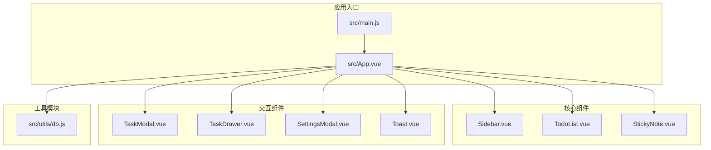
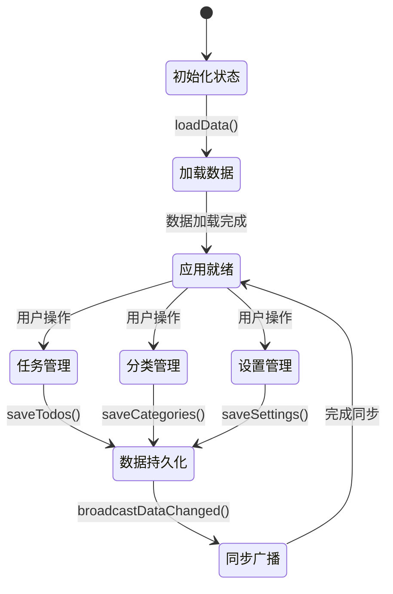
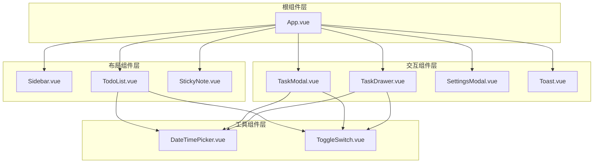
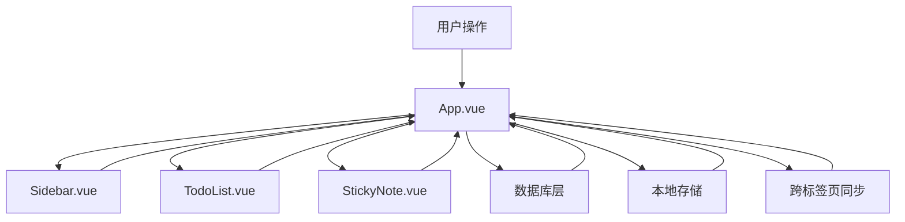
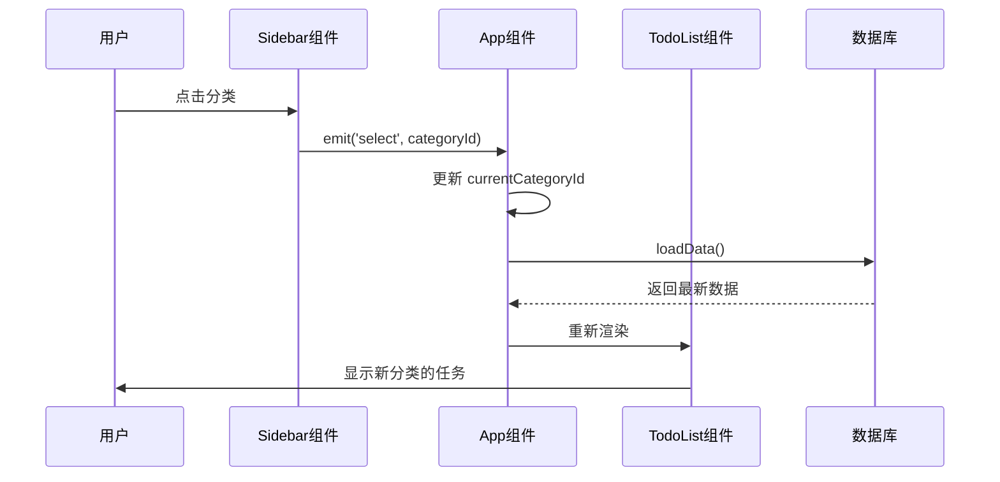
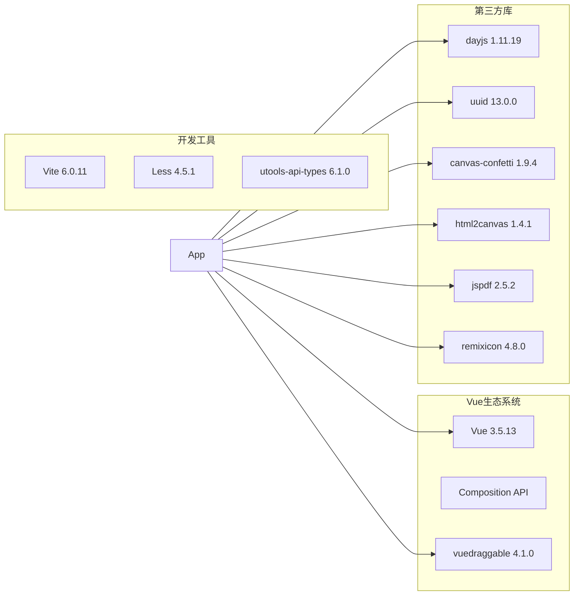
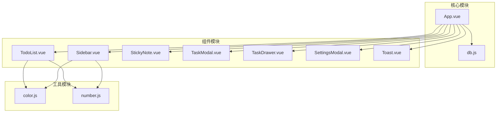

# 组件架构设计

<cite>
**本文档引用的文件**
- [App.vue](file://src/App.vue)
- [Sidebar.vue](file://src/components/Sidebar.vue)
- [TodoList.vue](file://src/components/TodoList.vue)
- [StickyNote.vue](file://src/components/StickyNote.vue)
- [TaskModal.vue](file://src/components/TaskModal.vue)
- [TaskDrawer.vue](file://src/components/TaskDrawer.vue)
- [SettingsModal.vue](file://src/components/SettingsModal.vue)
- [Toast.vue](file://src/components/Toast.vue)
- [db.js](file://src/utils/db.js)
- [main.js](file://src/main.js)
- [package.json](file://package.json)
</cite>

## 目录
1. [项目概述](#项目概述)
2. [项目结构](#项目结构)
3. [核心组件架构](#核心组件架构)
4. [组件层次结构](#组件层次结构)
5. [数据流与状态管理](#数据流与状态管理)
6. [组件通信机制](#组件通信机制)
7. [依赖关系分析](#依赖关系分析)
8. [性能优化策略](#性能优化策略)
9. [组件复用策略](#组件复用策略)
10. [最佳实践指南](#最佳实践指南)
11. [故障排除指南](#故障排除指南)
12. [总结](#总结)

## 项目概述

Just-Todo 是一个基于 Vue 3 Composition API 的现代化待办事项管理应用，采用模块化组件架构设计。该项目支持桌面便签模式、多视图模式（列表视图和日历视图）以及丰富的任务管理功能。

### 主要特性
- **多视图支持**：列表视图、日历视图、便签视图
- **任务管理**：任务创建、编辑、删除、完成状态管理
- **分类管理**：自定义任务分类和图标
- **通知系统**：多种通知渠道支持
- **数据持久化**：本地存储和备份恢复
- **主题切换**：明暗主题和系统主题跟随

## 项目结构



**图表来源**
- [main.js:1-6](file://src/main.js#L1-L6)
- [App.vue:1-15](file://src/App.vue#L1-L15)

**章节来源**
- [main.js:1-6](file://src/main.js#L1-L6)
- [package.json:1-24](file://package.json#L1-L24)

## 核心组件架构

### App.vue - 根组件设计

App.vue 作为整个应用的根组件，采用了集中式状态管理模式，通过 Composition API 实现了完整的应用状态管理。

#### 设计理念
- **单一职责原则**：集中管理应用状态和业务逻辑
- **响应式设计**：利用 Vue 3 的响应式系统实现数据驱动界面
- **模块化组织**：将不同功能域的状态分离管理

#### 核心状态管理



**图表来源**
- [App.vue:489-545](file://src/App.vue#L489-L545)

#### 关键状态属性

| 状态类型 | 属性名称 | 描述 | 数据类型 |
|---------|----------|------|----------|
| 应用配置 | isSticky, viewMode, themeMode | 应用模式和主题设置 | Boolean/String |
| 数据管理 | categories, todos, defaultCategoryId | 分类和任务数据 | Array/Object |
| 视图控制 | currentCategoryId, sortState | 当前视图和排序状态 | String/Object |
| 通知管理 | notificationSettings, enabledNotifyChannels | 通知配置和可用通道 | Object/Array |
| 对话框状态 | taskModal, taskDrawer, settingsVisible | 各种对话框显示状态 | Object/Boolean |

**章节来源**
- [App.vue:23-56](file://src/App.vue#L23-L56)
- [App.vue:294-322](file://src/App.vue#L294-L322)

## 组件层次结构

### 核心组件层次



**图表来源**
- [App.vue:3-11](file://src/App.vue#L3-L11)
- [Sidebar.vue:1-5](file://src/components/Sidebar.vue#L1-L5)
- [TodoList.vue:1-8](file://src/components/TodoList.vue#L1-L8)

### 组件职责分工

#### Sidebar 组件
- **职责**：管理应用导航和分类列表
- **功能**：分类选择、智能筛选、主题切换、设置入口
- **数据源**：接收 categories 和 todos 作为 props

#### TodoList 组件  
- **职责**：渲染和管理任务列表
- **功能**：任务展示、分组排序、拖拽重排、附件管理
- **数据源**：接收 todos 数组和分类信息

#### StickyNote 组件
- **职责**：提供桌面便签模式
- **功能**：透明便签、置顶窗口、颜色主题、便签设置
- **数据源**：接收全局任务数据进行过滤显示

**章节来源**
- [Sidebar.vue:6-25](file://src/components/Sidebar.vue#L6-L25)
- [TodoList.vue:9-28](file://src/components/TodoList.vue#L9-L28)
- [StickyNote.vue:5-23](file://src/components/StickyNote.vue#L5-L23)

## 数据流与状态管理

### 单向数据流设计



**图表来源**
- [App.vue:123-141](file://src/App.vue#L123-L141)
- [db.js:102-156](file://src/utils/db.js#L102-L156)

### 状态提升原则

组件间的状态提升遵循以下原则：

1. **就近原则**：共享状态应放置在最近的共同祖先组件中
2. **单一事实来源**：每个状态只在一个地方修改
3. **单向数据流**：状态变更通过事件向上冒泡传递

### 数据绑定示例

#### Props 传递模式
```javascript
// 父组件向子组件传递数据
<Sidebar 
  :categories="categories"
  :currentCategoryId="currentCategoryId"
  :todos="todos"
  :themeMode="themeMode"
/>

// 子组件接收并使用数据
const props = defineProps({
  categories: Array,
  currentCategoryId: String,
  todos: Array,
  themeMode: String
});
```

#### 事件冒泡模式
```javascript
// 子组件触发事件
const emit = defineEmits(['select', 'update:categories'])

// 父组件监听事件
<Sidebar @select="handleCategorySelect" />

// 父组件处理函数
const handleCategorySelect = (categoryId) => {
  currentCategoryId.value = categoryId
}
```

**章节来源**
- [App.vue:548-570](file://src/App.vue#L548-L570)
- [Sidebar.vue:34-45](file://src/components/Sidebar.vue#L34-L45)

## 组件通信机制

### 事件系统设计



**图表来源**
- [Sidebar.vue:34-36](file://src/components/Sidebar.vue#L34-L36)
- [App.vue:548-551](file://src/App.vue#L548-L551)

### 事件类型定义

| 事件名称 | 触发场景 | 参数 | 用途 |
|---------|----------|------|------|
| select | 分类选择 | categoryId | 切换当前分类 |
| update:categories | 分类排序 | categories数组 | 更新分类顺序 |
| add-category | 添加分类 | 无 | 打开分类创建对话框 |
| context-menu | 右键菜单 | {event, type, item} | 显示上下文菜单 |
| theme-change | 主题切换 | themeMode | 切换应用主题 |
| open-settings | 设置按钮 | 无 | 打开设置对话框 |
| update:todos | 任务列表更新 | todos数组 | 更新任务排序 |
| update-todo | 任务状态变更 | todo对象 | 更新任务状态 |
| open-add-task | 添加任务 | categoryId | 打开任务创建对话框 |
| context-menu | 任务右键菜单 | {event, type, item} | 显示任务菜单 |
| item-click | 任务点击 | todo对象 | 打开任务详情抽屉 |

**章节来源**
- [Sidebar.vue:25](file://src/components/Sidebar.vue#L25)
- [TodoList.vue:31-37](file://src/components/TodoList.vue#L31-L37)

## 依赖关系分析

### 外部依赖



**图表来源**
- [package.json:7-22](file://package.json#L7-L22)

### 内部模块依赖



**图表来源**
- [App.vue:12-14](file://src/App.vue#L12-L14)
- [Sidebar.vue:2-4](file://src/components/Sidebar.vue#L2-L4)

**章节来源**
- [package.json:1-24](file://package.json#L1-L24)

## 性能优化策略

### 渲染优化

1. **计算属性缓存**：使用 `computed` 缓存复杂计算结果
2. **条件渲染**：使用 `v-if` 控制组件渲染
3. **懒加载**：动态导入大型依赖库

### 数据优化

1. **状态最小化**：只在必要时更新状态
2. **批量更新**：使用 `nextTick` 进行批量 DOM 更新
3. **防抖节流**：对频繁触发的操作进行优化

### 内存管理

1. **生命周期清理**：在 `onUnmounted` 中清理事件监听器
2. **定时器管理**：及时清除定时器和轮询
3. **资源释放**：及时释放大对象和临时数据

**章节来源**
- [App.vue:306-322](file://src/App.vue#L306-L322)
- [TodoList.vue:617-624](file://src/components/TodoList.vue#L617-L624)

## 组件复用策略

### 抽象通用功能

1. **表单组件抽象**：将重复的表单逻辑抽象为可复用的组合函数
2. **对话框组件**：统一的模态框组件设计
3. **列表组件**：通用的列表渲染和交互模式

### 组合式函数设计

```javascript
// 可复用的表单逻辑
function useForm(initialData) {
  const form = ref(initialData)
  const errors = ref({})
  
  const validate = () => {
    // 验证逻辑
  }
  
  const reset = () => {
    form.value = initialData
    errors.value = {}
  }
  
  return {
    form,
    errors,
    validate,
    reset
  }
}
```

### 组件接口标准化

1. **统一的 props 接口**：确保组件间接口一致性
2. **标准化的事件命名**：使用约定俗成的事件命名规范
3. **可配置的样式系统**：支持主题定制和样式覆盖

**章节来源**
- [TaskModal.vue:1-17](file://src/components/TaskModal.vue#L1-L17)
- [TaskDrawer.vue:8-17](file://src/components/TaskDrawer.vue#L8-L17)

## 最佳实践指南

### 组件设计原则

1. **单一职责**：每个组件只负责一个功能领域
2. **可测试性**：组件设计要考虑单元测试的便利性
3. **可维护性**：代码结构清晰，注释完整

### 状态管理最佳实践

1. **状态集中管理**：共享状态放在最近的共同祖先组件
2. **状态不可变性**：避免直接修改响应式数据
3. **状态更新原子性**：确保状态更新的完整性

### 错误处理策略

1. **边界情况处理**：对空值、异常输入进行处理
2. **用户反馈**：提供友好的错误提示
3. **降级方案**：在网络异常时提供基本功能

**章节来源**
- [App.vue:526-534](file://src/App.vue#L526-L534)
- [db.js:30-43](file://src/utils/db.js#L30-L43)

## 故障排除指南

### 常见问题诊断

#### 数据同步问题
- **症状**：多个标签页数据不一致
- **原因**：跨标签页同步机制失效
- **解决方案**：检查 BroadcastChannel 和 localStorage 事件监听

#### 主题切换问题  
- **症状**：主题切换后样式不生效
- **原因**：CSS 变量未正确更新
- **解决方案**：确保在 watch 中正确更新根元素类名

#### 任务状态异常
- **症状**：任务完成状态无法正常切换
- **原因**：状态更新逻辑错误
- **解决方案**：检查 `updateTodo` 方法中的状态合并逻辑

### 调试技巧

1. **Vue DevTools**：使用浏览器扩展调试组件状态
2. **日志记录**：在关键路径添加详细的日志输出
3. **断点调试**：利用浏览器调试器逐步执行代码

**章节来源**
- [App.vue:455-486](file://src/App.vue#L455-L486)
- [StickyNote.vue:268-288](file://src/components/StickyNote.vue#L268-L288)

## 总结

Just-Todo 项目展现了现代 Vue 3 应用的最佳实践，通过合理的组件架构设计实现了高度的模块化和可维护性。项目的核心优势包括：

1. **清晰的架构层次**：从根组件到具体功能组件的层次分明
2. **完善的通信机制**：基于事件系统的组件间通信
3. **高效的状态管理**：集中式状态管理和响应式数据流
4. **优秀的用户体验**：流畅的动画效果和直观的交互设计
5. **强大的扩展能力**：模块化的组件设计便于功能扩展

该架构为类似任务管理应用提供了优秀的参考模板，开发者可以在此基础上快速构建功能丰富、性能优异的应用程序。