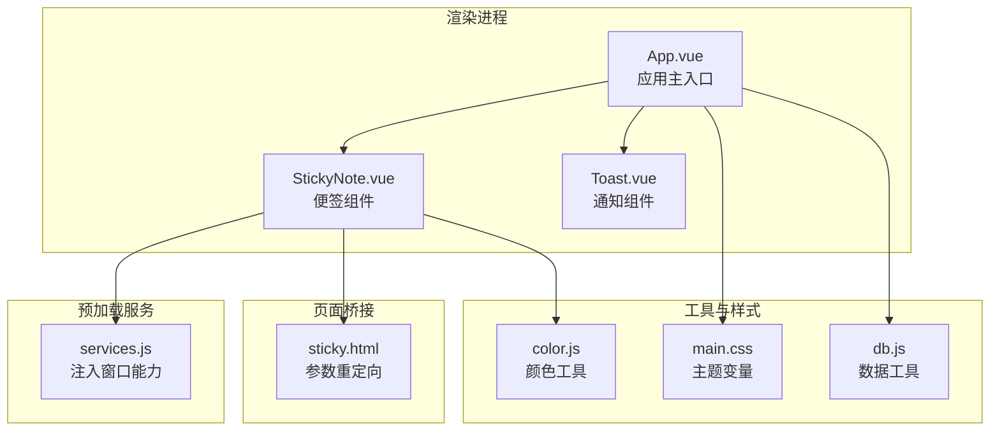
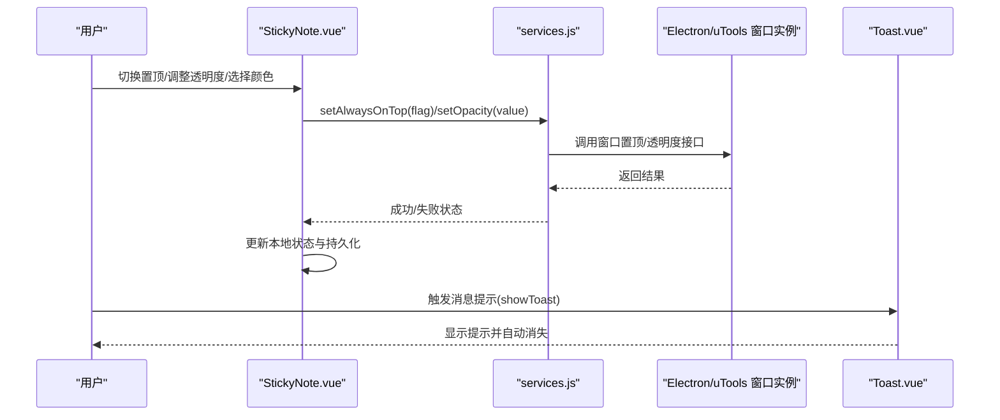
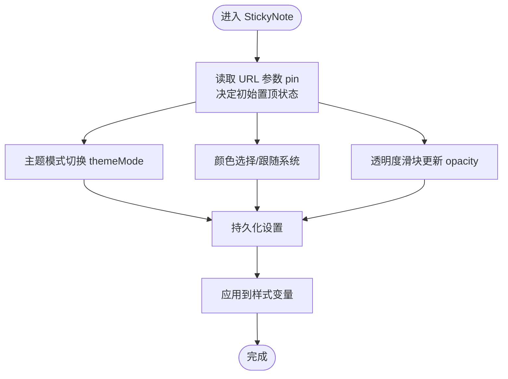
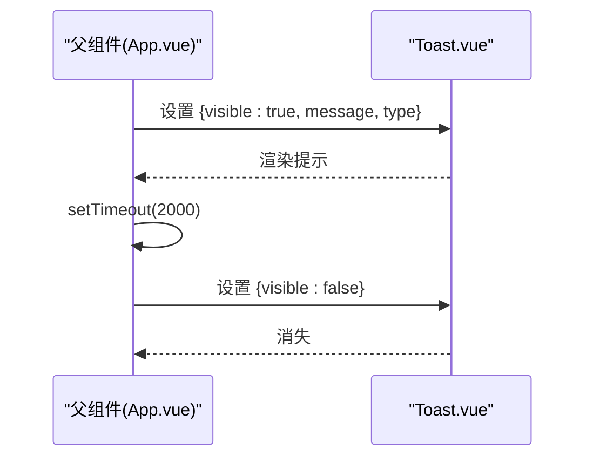
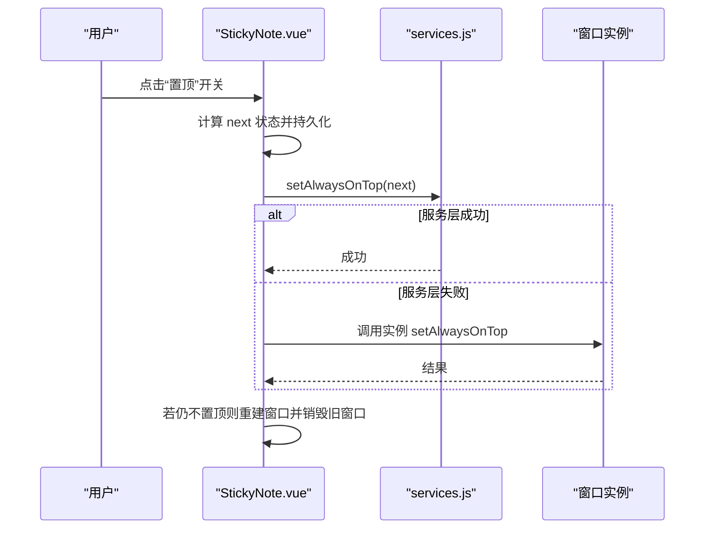
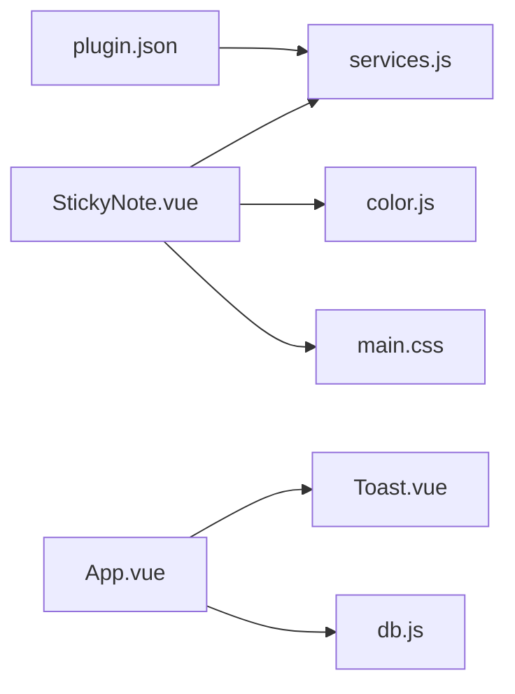

# 专用组件

<cite>
**本文引用的文件**
- [StickyNote.vue](file://src/components/StickyNote.vue)
- [Toast.vue](file://src/components/Toast.vue)
- [sticky.html](file://public/sticky.html)
- [services.js](file://public/preload/services.js)
- [color.js](file://src/utils/color.js)
- [main.css](file://src/main.css)
- [db.js](file://src/utils/db.js)
- [App.vue](file://src/App.vue)
- [StickyNote.test.js](file://src/components/StickyNote.test.js)
- [plugin.json](file://plugin.json)
</cite>

## 目录
1. [简介](#简介)
2. [项目结构](#项目结构)
3. [核心组件](#核心组件)
4. [架构总览](#架构总览)
5. [详细组件分析](#详细组件分析)
6. [依赖关系分析](#依赖关系分析)
7. [性能考量](#性能考量)
8. [故障排查指南](#故障排查指南)
9. [结论](#结论)
10. [附录](#附录)

## 简介
本文件聚焦于两个专用功能组件：StickyNote 便签组件与 Toast 通知组件。前者负责在桌面应用中以悬浮窗形式呈现，支持置顶显示、窗口透明度控制、主题与颜色系统，并提供菜单化配置；后者负责消息提示，具备自动消失与样式定制能力。文档将从架构、数据流、处理逻辑、事件监听与状态同步、初始化配置、动态更新与销毁清理等方面进行深入解析，并讨论桌面应用与跨平台兼容性。

## 项目结构
- 组件层
  - StickyNote.vue：便签悬浮窗核心组件，包含置顶、透明度、颜色与主题控制、菜单交互等。
  - Toast.vue：通知提示组件，基于可见性属性驱动展示与自动消失。
- 预加载服务层
  - public/preload/services.js：向渲染进程注入窗口操作能力（置顶、透明度、重建便签窗口）。
- 页面桥接层
  - public/sticky.html：便签窗口的轻量桥接页，用于根据查询参数重定向至目标路由或页面。
- 工具与样式
  - src/utils/color.js：颜色校验与混合工具。
  - src/main.css：全局主题变量与暗/亮模式适配。
  - src/utils/db.js：数据存取与备份恢复工具。
- 应用入口与集成
  - src/App.vue：应用主入口，负责任务列表、提醒弹窗、便签窗口创建与状态同步。
  - plugin.json：插件配置，声明主入口与预加载脚本。

**图表来源**
- [App.vue:1-120](file://src/App.vue#L1-L120)
- [StickyNote.vue:1-120](file://src/components/StickyNote.vue#L1-L120)
- [Toast.vue:1-63](file://src/components/Toast.vue#L1-L63)
- [services.js:59-132](file://public/preload/services.js#L59-L132)
- [sticky.html:1-21](file://public/sticky.html#L1-L21)
- [color.js:1-27](file://src/utils/color.js#L1-L27)
- [main.css:1-170](file://src/main.css#L1-L170)
- [db.js:1-157](file://src/utils/db.js#L1-L157)

**章节来源**
- [plugin.json:1-21](file://plugin.json#L1-L21)

## 核心组件
- StickyNote 便签组件
  - 功能要点：悬浮窗、置顶显示、透明度控制、主题与颜色系统、菜单交互、窗口重建与销毁。
  - 关键实现：通过 window.services 注入的能力进行置顶与透明度设置；通过 URL 参数 pin 控制是否置顶；本地持久化主题与颜色设置；响应系统主题变化。
- Toast 通知组件
  - 功能要点：消息提示、自动消失、类型区分（成功/错误）、样式定制。
  - 关键实现：基于 visible 属性控制显示；使用 Vue 过渡动画实现淡入淡出；固定定位与 z-index 确保层级。

**章节来源**
- [StickyNote.vue:1-120](file://src/components/StickyNote.vue#L1-L120)
- [Toast.vue:1-63](file://src/components/Toast.vue#L1-L63)

## 架构总览
StickyNote 与 Toast 的运行时交互如下：

**图表来源**
- [StickyNote.vue:215-266](file://src/components/StickyNote.vue#L215-L266)
- [services.js:60-132](file://public/preload/services.js#L60-L132)
- [App.vue:143-156](file://src/App.vue#L143-L156)
- [Toast.vue:12-20](file://src/components/Toast.vue#L12-L20)

## 详细组件分析

### StickyNote 便签组件
- 悬浮窗口与置顶显示
  - 窗口置顶：优先通过 window.services.setAlwaysOnTop 执行；若不可用则回退到当前窗口实例方法；对不同平台/环境采用多级策略与异常兜底。
  - 窗口重建：当切换置顶状态时，若检测到当前窗口未置顶，会调用 recreateStickyWindow 或重新创建窗口，确保行为一致。
  - URL 参数 pin：通过查询参数 pin 控制初始置顶状态，并在菜单切换时同步更新 URL。
- 透明度控制
  - 通过滑块输入更新 opacity 响应式值，并直接作用于根元素样式变量，实现整体透明度调节。
- 主题与颜色系统
  - 主题模式：支持 light/dark/system，结合系统主题监听动态切换。
  - 颜色方案：预设颜色与自定义颜色；支持跟随系统主题自动切换；颜色变更后持久化存储。
  - 样式变量：通过 CSS 变量传递背景、强调色、轴线色、卡片背景与光晕效果，保证明暗主题一致性。
- 菜单与交互
  - 独立菜单：包含置顶开关、主题切换、透明度滑块、颜色选择与自定义颜色编辑/删除。
  - 点击外部关闭菜单：通过全局点击事件监听实现。
- 窗口管理与生命周期
  - 挂载阶段：设置透明背景、根据初始 pin 决定是否置顶、注册系统主题监听。
  - 销毁：通过 window.close 或窗口实例 destroy/close 实现。
- 数据持久化与状态同步
  - 本地存储：sticky 设置、自定义颜色列表；主题模式变更与颜色/透明度/置顶状态变更均触发持久化。
  - 全局主题类：通过 watch 将主题类同步到 documentElement，供子组件共享。

**图表来源**
- [StickyNote.vue:30-113](file://src/components/StickyNote.vue#L30-L113)
- [StickyNote.vue:115-139](file://src/components/StickyNote.vue#L115-L139)
- [StickyNote.vue:147-186](file://src/components/StickyNote.vue#L147-L186)

**章节来源**
- [StickyNote.vue:1-1283](file://src/components/StickyNote.vue#L1-L1283)
- [services.js:69-132](file://public/preload/services.js#L69-L132)
- [sticky.html:9-17](file://public/sticky.html#L9-L17)
- [color.js:1-27](file://src/utils/color.js#L1-L27)
- [main.css:1-170](file://src/main.css#L1-L170)

### Toast 通知组件
- 消息提示机制
  - 通过 visible 属性控制显示；message 与 type 属性分别承载内容与类型（默认 success）。
- 自动消失逻辑
  - 在父组件中通过 setTimeout 在指定时间后将 visible 设为 false，实现自动隐藏。
- 样式定制
  - 固定定位、胶囊形状、阴影与边框；根据类型设置图标与颜色；使用 CSS 变量适配主题。
- 动画与过渡
  - 使用 Vue 过渡类名实现淡入淡出与位移动画，提升交互体验。

**图表来源**
- [App.vue:143-156](file://src/App.vue#L143-L156)
- [Toast.vue:12-20](file://src/components/Toast.vue#L12-L20)
- [Toast.vue:52-61](file://src/components/Toast.vue#L52-L61)

**章节来源**
- [Toast.vue:1-63](file://src/components/Toast.vue#L1-L63)
- [App.vue:143-156](file://src/App.vue#L143-L156)

### 窗口管理与事件监听
- 置顶切换流程
  - 通过菜单按钮触发 togglePin；内部计算 next 状态并持久化；随后调用 setWindowTop；若检测到未置顶，执行 recreateStickyWindow 或重新创建窗口；最后销毁旧窗口。
- 透明度设置
  - 通过 setWindowOpacity 调用 services.setOpacity 或窗口实例 setOpacity。
- 系统主题监听
  - onMounted 中注册系统主题变更监听，实时更新 effectiveTheme 并同步到根元素类名。
- 菜单外点击关闭
  - 在 mounted 中注册 document.click 监听，点击非菜单区域时关闭菜单。

**图表来源**
- [StickyNote.vue:368-545](file://src/components/StickyNote.vue#L368-L545)
- [services.js:69-132](file://public/preload/services.js#L69-L132)

**章节来源**
- [StickyNote.vue:228-266](file://src/components/StickyNote.vue#L228-L266)
- [StickyNote.vue:268-288](file://src/components/StickyNote.vue#L268-L288)
- [StickyNote.vue:606-608](file://src/components/StickyNote.vue#L606-L608)

### 初始化配置、动态更新与销毁清理
- 初始化配置
  - 读取 URL 查询参数 pin 决定初始置顶；从本地存储加载主题、颜色、透明度与置顶状态；注册系统主题监听。
- 动态更新
  - 通过 watch 监听主题、颜色、透明度与置顶状态，实时持久化；通过 CSS 变量与根元素类名同步样式。
- 销毁清理
  - 点击关闭按钮或菜单项时调用 window.close；若存在窗口实例则优先使用 destroy/close；在置顶切换流程中也包含销毁旧窗口的逻辑。

**章节来源**
- [StickyNote.vue:30-113](file://src/components/StickyNote.vue#L30-L113)
- [StickyNote.vue:132-139](file://src/components/StickyNote.vue#L132-L139)
- [StickyNote.vue:294-296](file://src/components/StickyNote.vue#L294-L296)
- [StickyNote.vue:519-544](file://src/components/StickyNote.vue#L519-L544)

### 桌面应用中的特殊处理与跨平台兼容性
- 环境探测与降级
  - 优先使用 window.services 提供的能力；若不可用则回退到 window.utools.getCurrentBrowserWindow 或 Electron remote.getCurrentWindow。
  - 对 setAlwaysOnTop 的不同平台级别（如 screen-saver/floating/normal）进行多次尝试，确保兼容性。
- 透明背景与拖拽区域
  - 便签窗口使用透明背景与无边框框架；标题栏区域设置为可拖拽，避免误触控件。
- 颜色与主题
  - 通过 CSS 变量与系统主题监听，适配明/暗主题；颜色混合算法保证在不同背景下具有合适的对比度。
- 插件与预加载
  - plugin.json 声明预加载脚本，使渲染进程获得 Node/Electron 能力；sticky.html 作为桥接页处理参数重定向。

**章节来源**
- [services.js:69-132](file://public/preload/services.js#L69-L132)
- [StickyNote.vue:806-823](file://src/components/StickyNote.vue#L806-L823)
- [main.css:95-136](file://src/main.css#L95-L136)
- [plugin.json:1-21](file://plugin.json#L1-L21)

## 依赖关系分析
- 组件依赖
  - StickyNote 依赖 services.js 提供的窗口能力；依赖 color.js 进行颜色转换与混合；依赖 main.css 的主题变量。
  - Toast 依赖 App.vue 的状态管理与定时器。
- 数据与状态
  - StickyNote 通过本地存储与 watch 实现状态持久化；App.vue 通过 localStorage 与 BroadcastChannel 实现跨标签页同步。
- 外部集成
  - 通过 plugin.json 注入预加载脚本，使渲染进程具备窗口操作能力。

**图表来源**
- [StickyNote.vue:1-120](file://src/components/StickyNote.vue#L1-L120)
- [services.js:59-132](file://public/preload/services.js#L59-L132)
- [color.js:1-27](file://src/utils/color.js#L1-L27)
- [main.css:1-170](file://src/main.css#L1-L170)
- [App.vue:1-120](file://src/App.vue#L1-L120)
- [Toast.vue:1-63](file://src/components/Toast.vue#L1-L63)
- [db.js:1-157](file://src/utils/db.js#L1-L157)
- [plugin.json:1-21](file://plugin.json#L1-L21)

**章节来源**
- [StickyNote.vue:1-120](file://src/components/StickyNote.vue#L1-L120)
- [App.vue:1-120](file://src/App.vue#L1-L120)
- [plugin.json:1-21](file://plugin.json#L1-L21)

## 性能考量
- 渲染与样式
  - 通过 CSS 变量与根元素类名切换减少重复计算；颜色混合与主题切换仅在必要时触发。
- 事件与监听
  - 系统主题监听与全局点击事件在组件挂载时注册，卸载时清理，避免内存泄漏。
- 窗口操作
  - 置顶与透明度设置在服务层统一处理，减少重复调用；对异常进行捕获，避免阻塞主线程。
- 通知提示
  - Toast 的自动消失使用 setTimeout，建议在组件卸载时清理定时器，防止内存泄漏。

[本节为通用指导，无需特定文件引用]

## 故障排查指南
- 置顶无效
  - 检查 window.services.setAlwaysOnTop 是否可用；若不可用，确认窗口实例方法是否可用；查看 setAlwaysOnTop 的多级尝试日志。
- 透明度不生效
  - 确认 opacity 值是否正确更新；检查根元素样式变量是否被覆盖；验证窗口实例 setOpacity 是否可用。
- 颜色无法保存
  - 检查本地存储权限；确认颜色变更后是否调用持久化函数；核对自定义颜色列表的更新逻辑。
- 菜单无法关闭
  - 确认 document.click 监听是否注册；检查点击事件是否被菜单内部阻止冒泡。
- 测试用例参考
  - 参考单元测试对置顶切换、透明度更新、菜单外点击与自定义颜色编辑的断言，定位问题范围。

**章节来源**
- [StickyNote.test.js:12-83](file://src/components/StickyNote.test.js#L12-L83)
- [StickyNote.vue:290-300](file://src/components/StickyNote.vue#L290-L300)
- [StickyNote.vue:547-550](file://src/components/StickyNote.vue#L547-L550)

## 结论
StickyNote 与 Toast 组件在本项目中实现了清晰的职责分离：StickyNote 负责悬浮窗的窗口管理与视觉配置，Toast 负责消息提示与自动消失。二者通过预加载服务与应用入口实现稳定集成，并在桌面应用环境中提供了良好的跨平台兼容性与用户体验。通过本地持久化与主题监听，组件能够适应用户的偏好与系统变化，保持一致的交互与外观。

## 附录
- 相关工具与样式
  - 颜色工具：提供颜色校验、标准化与 RGB 混合能力。
  - 主题样式：提供明/暗主题变量与媒体查询适配。
  - 数据工具：提供分类、待办与设置的读写与备份恢复能力。
- 页面桥接
  - sticky.html 用于根据查询参数重定向至目标页面，便于便签窗口的参数传递与状态同步。

**章节来源**
- [color.js:1-27](file://src/utils/color.js#L1-L27)
- [main.css:1-170](file://src/main.css#L1-L170)
- [db.js:1-157](file://src/utils/db.js#L1-L157)
- [sticky.html:9-17](file://public/sticky.html#L9-L17)