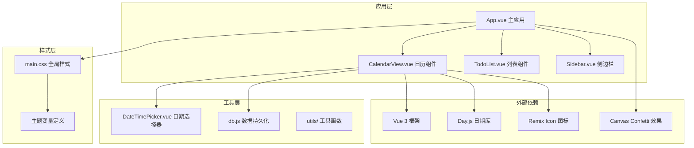
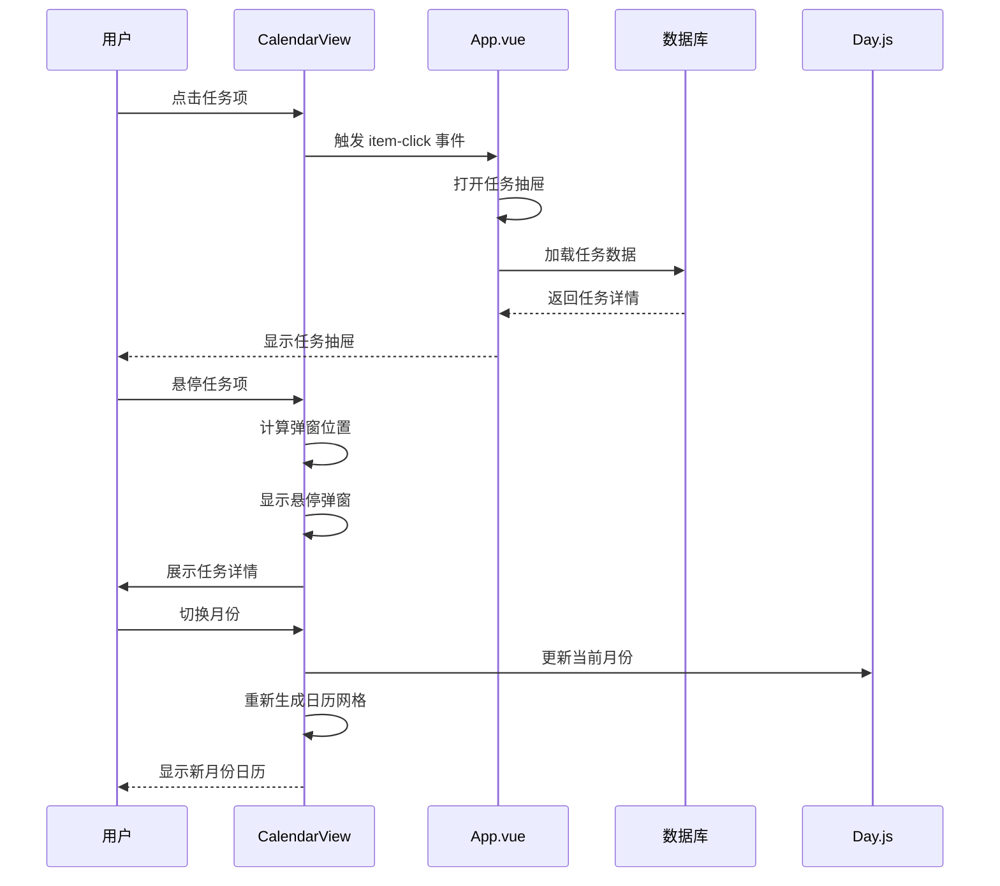
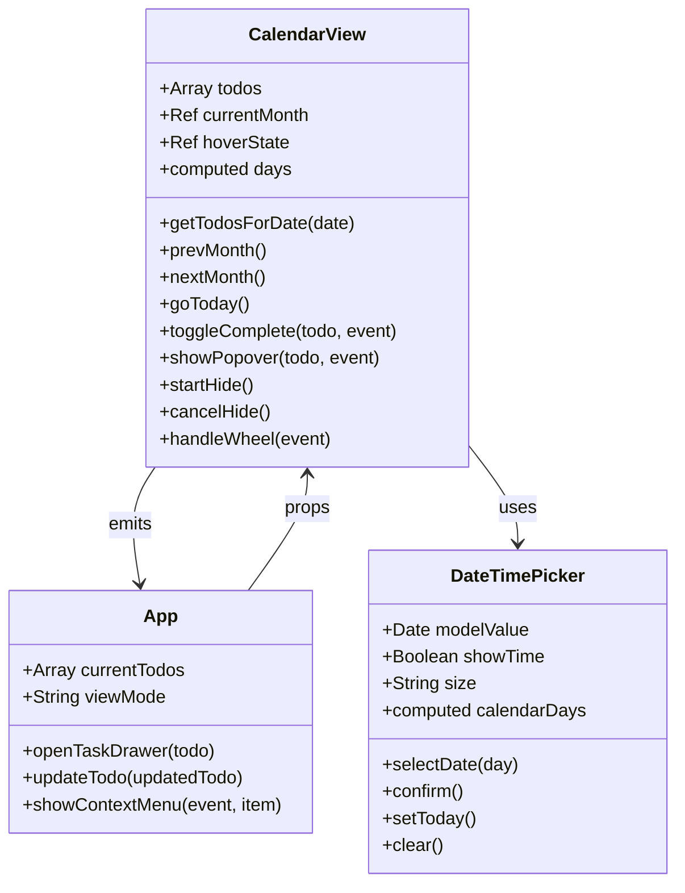
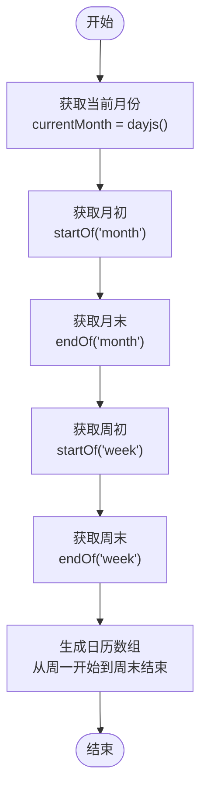
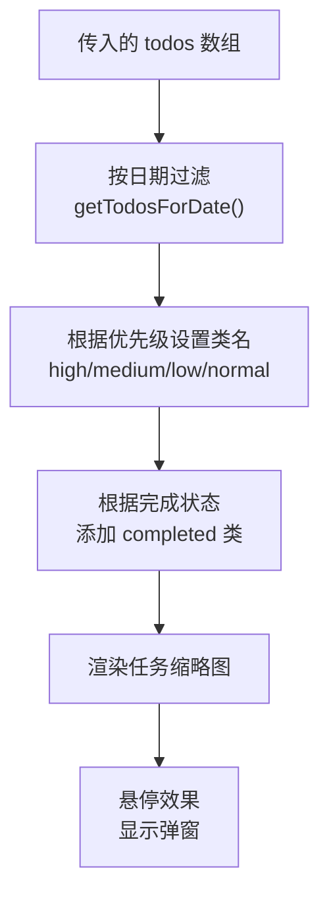
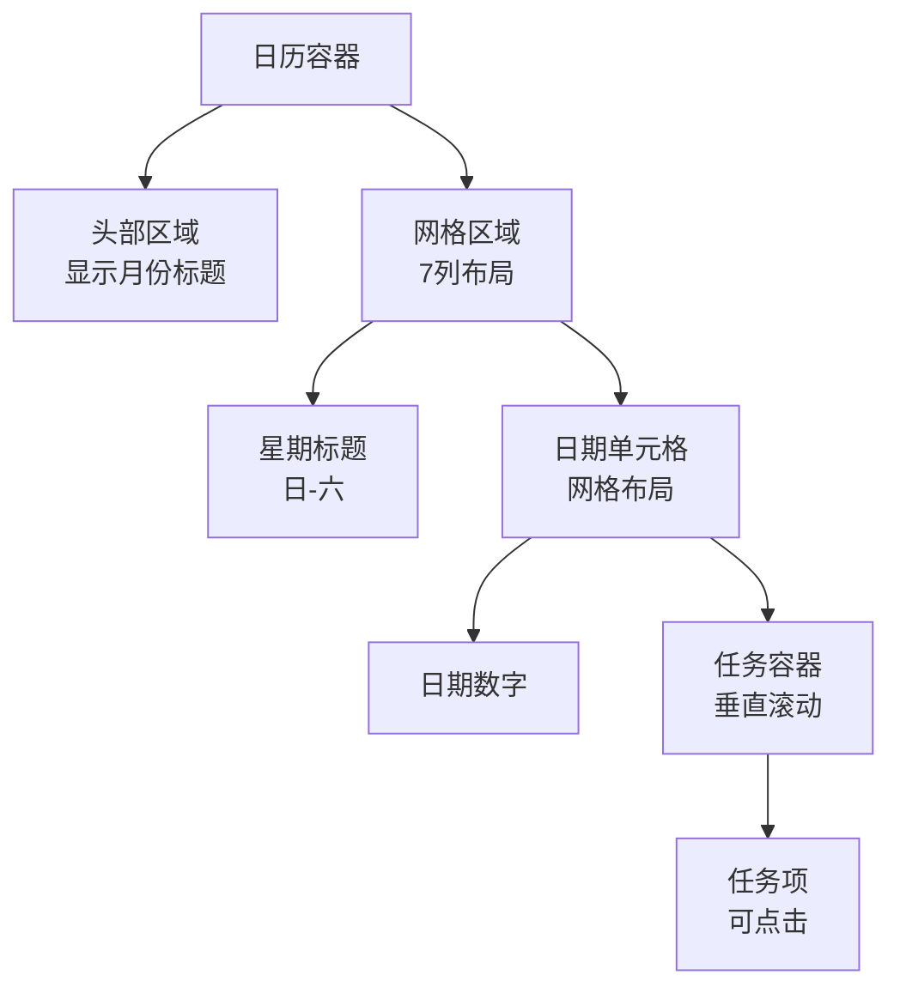
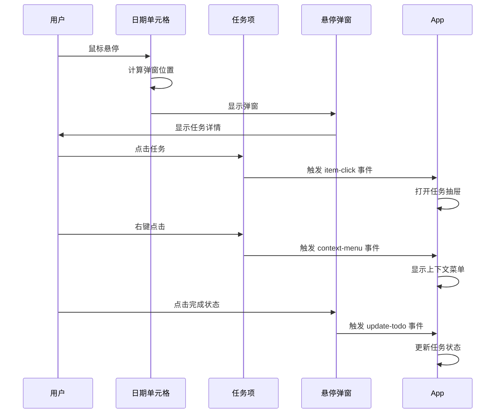
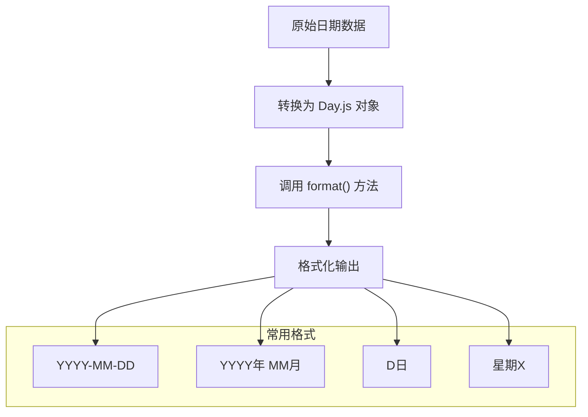
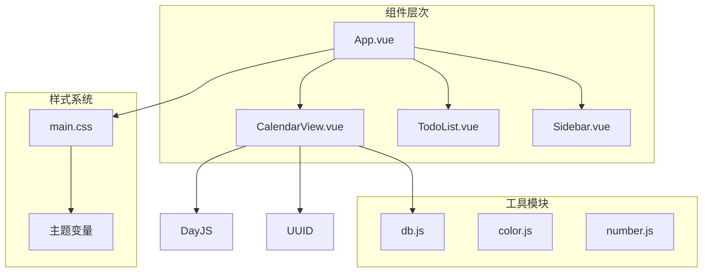

# CalendarView 日历组件

<cite>
**本文档引用的文件**
- [CalendarView.vue](file://src/components/CalendarView.vue)
- [DateTimePicker.vue](file://src/components/DateTimePicker.vue)
- [App.vue](file://src/App.vue)
- [db.js](file://src/utils/db.js)
- [main.js](file://src/main.js)
- [main.css](file://src/main.css)
- [package.json](file://package.json)
</cite>

## 目录
1. [简介](#简介)
2. [项目结构](#项目结构)
3. [核心组件](#核心组件)
4. [架构概览](#架构概览)
5. [详细组件分析](#详细组件分析)
6. [依赖关系分析](#依赖关系分析)
7. [性能考虑](#性能考虑)
8. [故障排除指南](#故障排除指南)
9. [结论](#结论)
10. [附录](#附录)

## 简介

CalendarView 是一个基于 Vue 3 和 Day.js 的现代化日历组件，专为 Just-Todo 待办事项应用设计。该组件提供了直观的日历视图，支持任务事件渲染、月份切换、响应式布局和丰富的交互体验。

该组件集成了以下核心功能：
- 基于 Day.js 的日期处理和格式化
- 任务事件在日历网格中的可视化展示
- 悬停弹窗显示任务详情和快速操作
- 响应式网格布局适配不同屏幕尺寸
- 主题系统支持明暗模式切换
- 国际化支持（简体中文）

## 项目结构

Just-Todo 采用模块化的 Vue 3 单页应用架构，CalendarView 作为核心组件之一集成在主应用中。



**图表来源**
- [App.vue:2332-2338](file://src/App.vue#L2332-L2338)
- [CalendarView.vue:1-417](file://src/components/CalendarView.vue#L1-L417)
- [main.js:1-6](file://src/main.js#L1-L6)

**章节来源**
- [package.json:1-24](file://package.json#L1-L24)
- [main.js:1-6](file://src/main.js#L1-L6)

## 核心组件

CalendarView 组件的核心特性包括：

### 数据结构设计
- **任务数据模型**: 支持优先级（high/medium/low/normal）、完成状态、截止日期等属性
- **日期处理**: 使用 Day.js 进行日期计算、格式化和本地化
- **状态管理**: 响应式状态管理，支持实时更新和视图同步

### 视觉设计系统
- **颜色体系**: 基于 CSS 变量的主题系统，支持明暗模式自动切换
- **网格布局**: 基于 CSS Grid 的响应式日历网格
- **动画效果**: Vue Transition Group 实现的任务项过渡动画

### 交互模式
- **悬停交互**: 任务项悬停显示详细信息和快速操作
- **滚动优化**: 自定义滚轮事件处理，避免跳过任务项
- **边界检测**: 弹窗位置智能调整，确保在可视区域内显示

**章节来源**
- [CalendarView.vue:5-16](file://src/components/CalendarView.vue#L5-L16)
- [CalendarView.vue:178-416](file://src/components/CalendarView.vue#L178-L416)

## 架构概览

CalendarView 在整个应用架构中扮演着关键角色，作为视图层的重要组成部分。



**图表来源**
- [CalendarView.vue:120-175](file://src/components/CalendarView.vue#L120-L175)
- [App.vue:2332-2338](file://src/App.vue#L2332-L2338)

### 组件通信机制

CalendarView 通过 Vue 的事件系统与父组件进行通信：



**图表来源**
- [CalendarView.vue:1-116](file://src/components/CalendarView.vue#L1-L116)
- [App.vue:2332-2338](file://src/App.vue#L2332-L2338)
- [DateTimePicker.vue:1-148](file://src/components/DateTimePicker.vue#L1-L148)

**章节来源**
- [CalendarView.vue:12-16](file://src/components/CalendarView.vue#L12-L16)
- [App.vue:2332-2338](file://src/App.vue#L2332-L2338)

## 详细组件分析

### 日期选择器集成

CalendarView 与 DateTimePicker 组件深度集成，提供统一的日期选择体验。

#### 日期计算算法
组件使用 Day.js 进行精确的日期计算：



**图表来源**
- [CalendarView.vue:22-36](file://src/components/CalendarView.vue#L22-L36)

#### 月份切换逻辑
支持平滑的月份导航：

- **上一月**: `currentMonth.value = currentMonth.value.subtract(1, 'month')`
- **下一月**: `currentMonth.value = currentMonth.value.add(1, 'month')`
- **回到今天**: `currentMonth.value = dayjs()`

**章节来源**
- [CalendarView.vue:45-55](file://src/components/CalendarView.vue#L45-L55)

### 任务事件渲染

#### 任务数据绑定
组件通过 props 接收任务列表，并使用计算属性进行高效的数据处理：



**图表来源**
- [CalendarView.vue:38-43](file://src/components/CalendarView.vue#L38-L43)
- [CalendarView.vue:144-156](file://src/components/CalendarView.vue#L144-L156)

#### 任务优先级系统
支持四种优先级级别的可视化表示：

| 优先级 | CSS 类 | 颜色 | 用途 |
|--------|--------|------|------|
| high | `.high` | 红色 (#ef4444) | 最高优先级 |
| medium | `.medium` | 橙色 (#f59e0b) | 中等优先级 |
| low | `.low` | 绿色 (#22c55e) | 低优先级 |
| normal | `.normal` | 蓝色 (#3b82f6) | 默认优先级 |

**章节来源**
- [CalendarView.vue:310-320](file://src/components/CalendarView.vue#L310-L320)

### 响应式布局适配

#### 网格布局设计
使用 CSS Grid 实现灵活的响应式布局：



**图表来源**
- [CalendarView.vue:127-160](file://src/components/CalendarView.vue#L127-L160)
- [CalendarView.vue:235-336](file://src/components/CalendarView.vue#L235-L336)

#### 响应式特性
- **移动端适配**: 使用 `minmax(0, 1fr)` 确保在小屏幕上合理分配空间
- **滚动优化**: 自定义滚轮事件处理，避免跳过任务项
- **边界检测**: 弹窗位置智能调整，确保在可视区域内显示

**章节来源**
- [CalendarView.vue:237-241](file://src/components/CalendarView.vue#L237-L241)
- [CalendarView.vue:110-115](file://src/components/CalendarView.vue#L110-L115)

### 事件绑定机制

#### 用户交互处理
组件实现了多层次的事件绑定：



**图表来源**
- [CalendarView.vue:149-153](file://src/components/CalendarView.vue#L149-L153)
- [CalendarView.vue:169-173](file://src/components/CalendarView.vue#L169-L173)

#### 事件生命周期
- **mouseenter**: 显示悬停弹窗，启动定时器
- **mouseleave**: 启动隐藏延迟（200ms）
- **click**: 触发任务详情或完成状态切换
- **contextmenu**: 显示上下文菜单

**章节来源**
- [CalendarView.vue:70-108](file://src/components/CalendarView.vue#L70-L108)

### 日期格式化处理

#### 格式化策略
组件使用 Day.js 进行统一的日期格式化：



**图表来源**
- [CalendarView.vue:122](file://src/components/CalendarView.vue#L122)

#### 本地化支持
- **语言设置**: 使用 `dayjs.locale('zh-cn')` 设置简体中文
- **插件扩展**: 集成 `isSameOrBefore` 和 `isSameOrAfter` 插件
- **文化适应**: 星期标题使用中文字符（日-六）

**章节来源**
- [App.vue:17-21](file://src/App.vue#L17-L21)

### 国际化支持

#### 多语言环境
虽然当前主要支持简体中文，但组件具备良好的国际化基础：

- **文本本地化**: 星期标题、按钮文本均为中文
- **日期格式**: 支持多种日期格式化需求
- **文化适配**: 数字显示使用等宽字体，适合多语言环境

#### 扩展建议
未来可以添加：
- 多语言切换机制
- RTL（从右到左）语言支持
- 不同地区的日期格式偏好

**章节来源**
- [CalendarView.vue:128-129](file://src/components/CalendarView.vue#L128-L129)

## 依赖关系分析

### 外部依赖

```mermaid
graph LR
subgraph "核心依赖"
Vue[Vue 3.5.13]
DayJS[Day.js 1.11.19]
UUID[UUID 13.0.0]
end
subgraph "UI 库"
RemixIcon[Remix Icon 4.8.0]
Confetti[Canvas Confetti 1.9.4]
end
subgraph "工具库"
HTML2Canvas[HTML2Canvas 1.4.1]
JS PDF[jspdf 2.5.2]
Vuedraggable[VueDraggable 4.1.0]
end
CalendarView --> Vue
CalendarView --> DayJS
CalendarView --> UUID
CalendarView --> RemixIcon
CalendarView --> Confetti
CalendarView --> HTML2Canvas
CalendarView --> JS PDF
CalendarView --> Vuedraggable
```

**图表来源**
- [package.json:7-16](file://package.json#L7-L16)

### 内部依赖关系



**图表来源**
- [App.vue:1-14](file://src/App.vue#L1-L14)
- [CalendarView.vue:2-3](file://src/components/CalendarView.vue#L2-L3)

**章节来源**
- [package.json:1-24](file://package.json#L1-L24)

## 性能考虑

### 渲染优化

#### 虚拟滚动
对于大量任务的情况，可以考虑实现虚拟滚动：

```javascript
// 当前实现：直接渲染所有任务
<div class="day-todos" @wheel.stop.prevent="handleWheel">

// 建议的虚拟滚动实现
<virtual-list :items="visibleTodos" :item-height="20" :visible-count="10">
  <template #default="{ item }">
    <div class="todo-thumb" :key="item.id">
      {{ item.content }}
    </div>
  </template>
</virtual-list>
```

#### 计算属性缓存
使用 Vue 3 的 `computed` 确保数据处理的高效性：

- **days 计算属性**: 缓存日历网格数据
- **getTodosForDate 函数**: 基于过滤的计算结果

### 内存管理

#### 定时器清理
组件正确管理定时器资源：

```javascript
let hideTimer = null;

const startHide = () => {
  hideTimer = setTimeout(() => {
    hoverState.value.visible = false;
  }, 200);
};

const cancelHide = () => {
  if (hideTimer) clearTimeout(hideTimer);
};
```

#### 事件监听器
确保组件卸载时清理事件监听器，避免内存泄漏。

**章节来源**
- [CalendarView.vue:20](file://src/components/CalendarView.vue#L20)
- [CalendarView.vue:100-108](file://src/components/CalendarView.vue#L100-L108)

### 性能优化建议

1. **懒加载**: 对于大型任务集合，考虑分页加载
2. **防抖处理**: 对频繁触发的操作添加防抖
3. **虚拟化**: 实现虚拟滚动以提升大数据集性能
4. **缓存策略**: 缓存 Day.js 对象和格式化结果

## 故障排除指南

### 常见问题及解决方案

#### 日期显示异常
**症状**: 日期显示不正确或格式错误
**原因**: Day.js 实例化问题或格式化参数错误
**解决方法**:
1. 检查 Day.js 版本兼容性
2. 验证日期字符串格式
3. 确认时区设置正确

#### 任务项渲染问题
**症状**: 任务项不显示或显示异常
**原因**: 任务数据结构不匹配或过滤条件错误
**解决方法**:
1. 验证 `todos` prop 数据结构
2. 检查 `dueDate` 字段格式
3. 确认任务对象包含必要字段

#### 悬停弹窗位置错误
**症状**: 弹窗显示在屏幕外或遮挡内容
**原因**: 边界检测逻辑或定位计算错误
**解决方法**:
1. 检查窗口尺寸获取
2. 验证弹窗尺寸计算
3. 确认 CSS 定位属性

#### 性能问题
**症状**: 大量任务时界面卡顿
**原因**: 直接渲染所有任务项
**解决方法**:
1. 实现虚拟滚动
2. 添加数据分页
3. 优化 DOM 结构

**章节来源**
- [CalendarView.vue:70-98](file://src/components/CalendarView.vue#L70-L98)
- [CalendarView.vue:110-115](file://src/components/CalendarView.vue#L110-L115)

### 调试技巧

#### 开发者工具使用
1. **Vue DevTools**: 检查组件状态和 props
2. **浏览器控制台**: 查看 Day.js 相关错误
3. **网络面板**: 监控数据加载情况

#### 日志记录
在关键函数中添加适当的日志：
- 日期计算过程
- 任务过滤逻辑
- 事件处理流程

## 结论

CalendarView 日历组件是一个功能完整、设计精良的 Vue 3 组件，具有以下突出特点：

### 技术优势
- **现代化架构**: 基于 Vue 3 Composition API 和 Day.js
- **响应式设计**: 完美适配各种屏幕尺寸
- **主题系统**: 支持明暗模式自动切换
- **用户体验**: 流畅的交互和动画效果

### 功能完整性
- **日期处理**: 精确的日期计算和格式化
- **任务管理**: 完整的任务事件渲染和交互
- **导航控制**: 直观的月份切换和快速定位
- **上下文菜单**: 丰富的任务操作选项

### 扩展潜力
组件设计具有良好扩展性，可以轻松添加：
- 更多的日期格式选项
- 多语言支持
- 高级筛选功能
- 集成第三方日历服务

该组件为 Just-Todo 应用提供了强大的日历视图功能，是整体应用架构中的重要组成部分。

## 附录

### 组件配置选项

| 属性名 | 类型 | 必需 | 默认值 | 描述 |
|--------|------|------|--------|------|
| todos | Array | 是 | [] | 任务列表数据 |
| size | String | 否 | 'md' | 组件尺寸 (sm/xs/md) |
| showTime | Boolean | 否 | false | 是否显示时间选择 |
| minDate | String/Number/Date | 否 | '' | 最小可选日期 |
| showClear | Boolean | 否 | true | 是否显示清除按钮 |

### API 接口说明

#### 事件
- **item-click**: 任务项点击事件
- **update-todo**: 任务状态更新事件
- **context-menu**: 上下文菜单事件

#### 方法
- **prevMonth()**: 切换到上个月
- **nextMonth()**: 切换到下个月
- **goToday()**: 跳转到今天
- **toggleComplete(todo, event)**: 切换任务完成状态

### 样式定制指南

#### 主题变量
- `--primary-color`: 主色调
- `--bg-color`: 背景色
- `--text-color`: 文本色
- `--border-color`: 边框色

#### 响应式断点
- 小屏: `< 768px`
- 中屏: `768px - 1024px`
- 大屏: `> 1024px`

### 性能优化建议

1. **虚拟滚动**: 对于超过 100 个任务的场景
2. **懒加载**: 延迟加载非当前月份的数据
3. **缓存策略**: 缓存 Day.js 对象和格式化结果
4. **事件节流**: 对频繁触发的事件添加节流