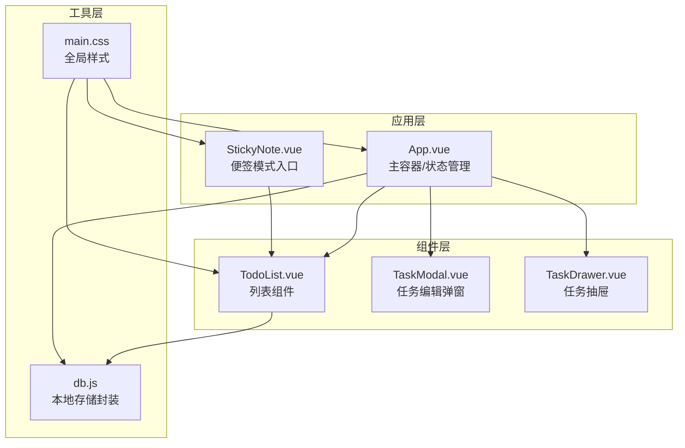
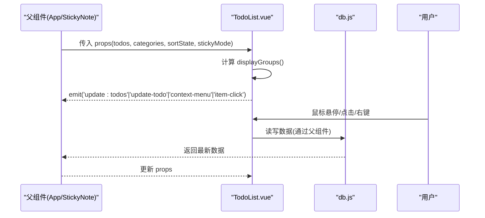
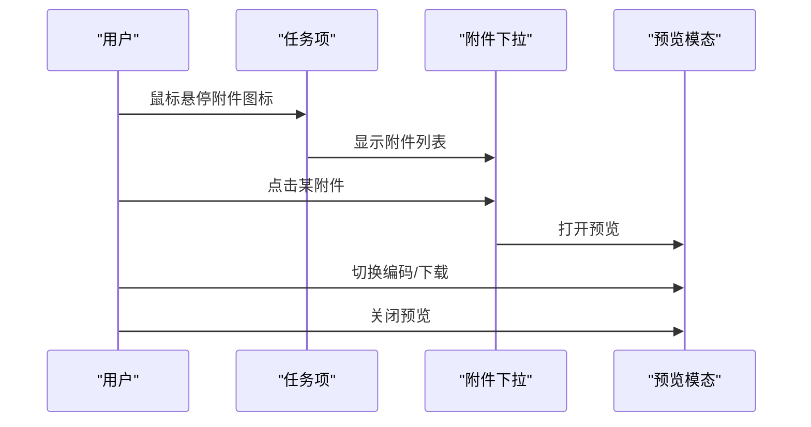
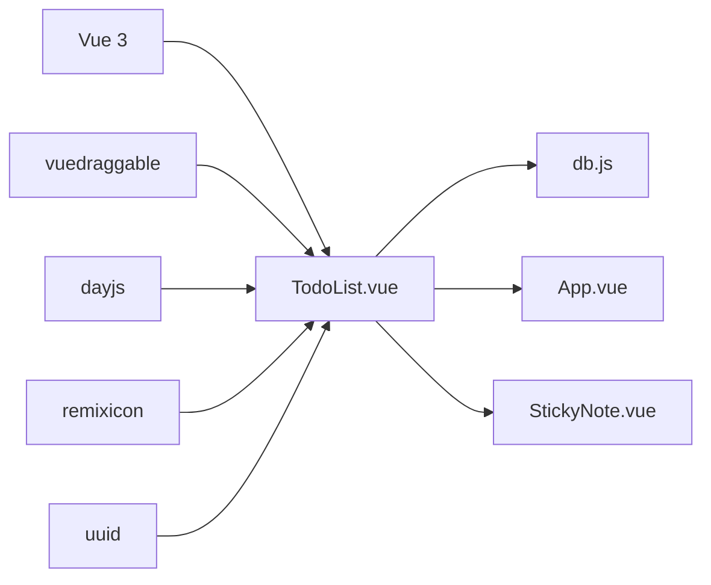

# TodoList 列表组件

<cite>
**本文档引用的文件**
- [TodoList.vue](file://src/components/TodoList.vue)
- [StickyNote.vue](file://src/components/StickyNote.vue)
- [App.vue](file://src/App.vue)
- [db.js](file://src/utils/db.js)
- [main.css](file://src/main.css)
- [main.js](file://src/main.js)
- [package.json](file://package.json)
</cite>

## 目录
1. [简介](#简介)
2. [项目结构](#项目结构)
3. [核心组件](#核心组件)
4. [架构总览](#架构总览)
5. [详细组件分析](#详细组件分析)
6. [依赖关系分析](#依赖关系分析)
7. [性能考虑](#性能考虑)
8. [故障排除指南](#故障排除指南)
9. [结论](#结论)
10. [附录](#附录)

## 简介
本文件为 TodoList 列表组件的详细技术文档，覆盖以下关键能力：
- 任务分组逻辑：按日期、优先级、分类进行分组；在便签模式下按“今日”“紧急”“分类”分组
- 拖拽排序：基于 vuedraggable 的拖拽排序，仅在特定场景启用
- 附件预览系统：支持图片与文本附件的预览、编码切换、下载
- 子任务管理：悬停显示子任务面板，点击切换子任务完成状态
- 右键菜单处理：统一通过事件发射器触发上下文菜单
- 滚动优化机制：根据内容高度动态启用/禁用滚动，避免误触滚动穿透
- 视图模式：普通列表模式与便签模式（stickyMode）的差异化渲染
- 性能优化：分组计算缓存、可见性检测、动画过渡优化

## 项目结构
该项目采用 Vue 3 单页应用结构，TodoList 组件位于 src/components 目录，配合 App.vue 主容器、StickyNote 便签模式入口、db 数据持久化工具等模块协同工作。

图表来源
- [App.vue:1-120](file://src/App.vue#L1-L120)
- [StickyNote.vue:1-60](file://src/components/StickyNote.vue#L1-L60)
- [TodoList.vue:1-40](file://src/components/TodoList.vue#L1-L40)
- [db.js:102-157](file://src/utils/db.js#L102-L157)
- [main.css:1-170](file://src/main.css#L1-L170)

章节来源
- [main.js:1-6](file://src/main.js#L1-L6)
- [package.json:1-24](file://package.json#L1-L24)

## 核心组件
- TodoList.vue：负责任务列表渲染、分组、交互、附件预览、子任务管理、滚动控制、便签模式适配
- StickyNote.vue：便签模式容器，注入 stickyMode 并传递给 TodoList
- App.vue：应用主容器，负责数据加载、分类管理、任务增删改、通知调度、视图切换
- db.js：本地存储封装，提供 categories、todos、settings 的 CRUD 能力

章节来源
- [TodoList.vue:9-28](file://src/components/TodoList.vue#L9-L28)
- [StickyNote.vue:5-23](file://src/components/StickyNote.vue#L5-L23)
- [App.vue:23-47](file://src/App.vue#L23-L47)
- [db.js:102-157](file://src/utils/db.js#L102-L157)

## 架构总览
TodoList 作为展示型组件，接收来自父组件（App 或 StickyNote）的 props，并通过事件发射器与父组件通信。其内部通过计算属性对任务进行分组，结合响应式状态控制展开/折叠、滚动、附件预览等行为。

图表来源
- [TodoList.vue:30-37](file://src/components/TodoList.vue#L30-L37)
- [TodoList.vue:300-495](file://src/components/TodoList.vue#L300-L495)
- [App.vue:640-790](file://src/App.vue#L640-L790)
- [db.js:102-157](file://src/utils/db.js#L102-L157)

## 详细组件分析

### Props 接口与事件发射器
- Props
  - todos: Array，必填，任务数组
  - categoryId: String，当前分类标识
  - showInput: Boolean，是否显示输入框（用于父组件控制）
  - categories: Array，默认空数组，分类列表
  - sortState: Object，默认 { field: 'default', order: 'asc' }，排序状态
  - stickyMode: Boolean，默认 false，是否启用便签模式
- Emits
  - update:todos：列表重排或过滤后更新父组件
  - open-add-task：请求打开新增任务界面
  - update-todo：请求更新单个任务
  - context-menu：请求显示右键菜单
  - item-click：点击任务项

章节来源
- [TodoList.vue:9-28](file://src/components/TodoList.vue#L9-L28)
- [TodoList.vue:30-37](file://src/components/TodoList.vue#L30-L37)

### 计算属性与响应式状态
- displayGroups：根据 stickyMode、categoryId、sortState 动态生成分组
- collapsedGroups：记录每个分组的展开/折叠状态
- todosList：todos 的 v-model 包装，双向绑定
- isCustomSort：判断是否启用自定义排序
- containerStyle：便签模式下注入 CSS 变量以调整间距
- scrollEnabled：根据容器高度与内容高度差动态启用滚动
- previewVisible、previewAttachment、previewText、previewEncoding：预览模态状态与参数

章节来源
- [TodoList.vue:176-179](file://src/components/TodoList.vue#L176-L179)
- [TodoList.vue:181-184](file://src/components/TodoList.vue#L181-L184)
- [TodoList.vue:497-504](file://src/components/TodoList.vue#L497-L504)
- [TodoList.vue:555-567](file://src/components/TodoList.vue#L555-L567)
- [TodoList.vue:81-92](file://src/components/TodoList.vue#L81-L92)

### 任务分组逻辑
- 便签模式（stickyMode=true 且 categoryId='all'）
  - 今日待办：当日到期且未完成的任务
  - 紧急待办：高/中优先级且未完成的任务
  - 分类分组：遍历所有分类，确保即使为空也显示，便于快速新建任务
- 优先级分组（categoryId='urgent'）
  - 高/中/低/无优先级四档分组
- 日期分组（categoryId='plan'）
  - 今日/明天/其他日期/已过期，按 dueDate 排序
- 其他分类分组（categoryId='all'/'today'/'completed'）
  - 按 categoryId 过滤并分组
- 自定义分类（My List）
  - 将未完成任务作为“待办”，已完成任务作为“已完成”，默认折叠已完成

章节来源
- [TodoList.vue:309-380](file://src/components/TodoList.vue#L309-L380)
- [TodoList.vue:381-401](file://src/components/TodoList.vue#L381-L401)
- [TodoList.vue:403-431](file://src/components/TodoList.vue#L403-L431)
- [TodoList.vue:432-462](file://src/components/TodoList.vue#L432-L462)
- [TodoList.vue:463-492](file://src/components/TodoList.vue#L463-L492)

### 拖拽排序功能
- 使用 vuedraggable 在“自定义分类”的“待办”分组中启用拖拽
- 当存在自定义排序或非简单分组时，禁用拖拽以保证稳定性
- 拖拽结束时通过 emit('update:todos', props.todos) 同步回父组件

章节来源
- [TodoList.vue:765-782](file://src/components/TodoList.vue#L765-L782)
- [TodoList.vue:789-868](file://src/components/TodoList.vue#L789-L868)
- [TodoList.vue:871-958](file://src/components/TodoList.vue#L871-L958)

### 附件预览系统
- 附件图标悬浮显示下拉菜单，包含附件名称与类型图标
- 支持图片与文本附件预览
- 文本附件可切换编码（UTF-8、GBK、GB18030、ISO-8859-1）
- 提供下载按钮，将 dataUrl 转换为 Blob 下载
- 预览遮罩层阻止滚动穿透

图表来源
- [TodoList.vue:45-70](file://src/components/TodoList.vue#L45-L70)
- [TodoList.vue:124-174](file://src/components/TodoList.vue#L124-L174)
- [TodoList.vue:975-1013](file://src/components/TodoList.vue#L975-L1013)

章节来源
- [TodoList.vue:72-78](file://src/components/TodoList.vue#L72-L78)
- [TodoList.vue:110-122](file://src/components/TodoList.vue#L110-L122)
- [TodoList.vue:145-153](file://src/components/TodoList.vue#L145-L153)
- [TodoList.vue:161-174](file://src/components/TodoList.vue#L161-L174)

### 子任务管理
- 悬停显示子任务面板或描述面板
- 点击子任务切换完成状态，触发 update-todo
- 子任务面板支持动画展开/收起，悬停时强制展开

章节来源
- [TodoList.vue:637-672](file://src/components/TodoList.vue#L637-L672)
- [TodoList.vue:674-682](file://src/components/TodoList.vue#L674-L682)
- [TodoList.vue:684-729](file://src/components/TodoList.vue#L684-L729)
- [TodoList.vue:836-865](file://src/components/TodoList.vue#L836-L865)
- [TodoList.vue:927-956](file://src/components/TodoList.vue#L927-L956)

### 右键菜单处理
- onContextMenu：阻止默认菜单，发射 context-menu 事件，携带事件对象与任务项
- 父组件（App/StickyNote）负责监听并显示菜单

章节来源
- [TodoList.vue:632-635](file://src/components/TodoList.vue#L632-L635)

### 滚动优化机制
- updateScrollState：根据容器高度与内容高度差决定是否启用滚动
- onWheel：在预览模态关闭时，拦截滚轮事件，避免滚动穿透到父容器
- stickyMode 下额外绑定 wheel 事件，防止误触滚动

章节来源
- [TodoList.vue:555-578](file://src/components/TodoList.vue#L555-L578)
- [TodoList.vue:603-624](file://src/components/TodoList.vue#L603-L624)

### 视图模式差异（普通模式 vs 便签模式）
- 便签模式（stickyMode=true）
  - 注入 containerStyle，调整分组间距
  - 分组标题左侧显示时间轴点，区分“今日”“紧急”
  - 分类分组支持“新建待办”按钮
  - 禁用外层滚动，避免误触
- 普通模式
  - 默认启用滚动，支持 FAB 新建按钮

章节来源
- [TodoList.vue:498-504](file://src/components/TodoList.vue#L498-L504)
- [TodoList.vue:743-760](file://src/components/TodoList.vue#L743-L760)
- [TodoList.vue:971-973](file://src/components/TodoList.vue#L971-L973)
- [StickyNote.vue:757-768](file://src/components/StickyNote.vue#L757-L768)

### 分组展开/折叠逻辑
- toggleGroup：切换分组 collapsedGroups
- checkAndInitUrgent/checkAndInitSticky：首次进入相应视图时初始化默认展开/折叠
- updateAxisBounds：根据可见头部与项目计算时间轴位置

章节来源
- [TodoList.vue:205-209](file://src/components/TodoList.vue#L205-L209)
- [TodoList.vue:514-537](file://src/components/TodoList.vue#L514-L537)
- [TodoList.vue:185-203](file://src/components/TodoList.vue#L185-L203)

### 数据模型与持久化
- db.js 提供 categories、todos、settings 的读写接口
- App.vue 调用 db.getCategories()/getTodos()/getSettings() 初始化数据
- 任务更新通过 updateTodo 归一化字段并保存

章节来源
- [db.js:102-157](file://src/utils/db.js#L102-L157)
- [App.vue:489-535](file://src/App.vue#L489-L535)
- [App.vue:653-790](file://src/App.vue#L653-L790)

## 依赖关系分析
- 外部依赖
  - vue：响应式与组件系统
  - vuedraggable：拖拽排序
  - dayjs：日期处理
  - remixicon：图标库
  - uuid：ID 生成
  - canvas-confetti、html2canvas、jspdf：附加功能（与 TodoList 无直接耦合）
- 内部依赖
  - TodoList 依赖 App/StickyNote 传递的 props 与事件
  - TodoList 通过 db.js 间接访问本地存储

图表来源
- [package.json:7-16](file://package.json#L7-L16)
- [TodoList.vue:2-6](file://src/components/TodoList.vue#L2-L6)
- [db.js:1-1](file://src/utils/db.js#L1-L1)

章节来源
- [package.json:1-24](file://package.json#L1-L24)

## 性能考虑
- 分组计算缓存
  - displayGroups 基于 props.todos、categoryId、sortState、stickyMode 计算，避免重复计算
  - watch(displayGroups, ...) 与 watch(() => props.todos.length, ...) 触发边界更新
- 可见性检测
  - updateAxisBounds 仅在可见元素存在时计算时间轴尺寸
  - updateScrollState 根据容器与内容高度差动态启用滚动
- 动画过渡优化
  - 使用 Transition 控制子任务面板展开/收起，避免强制布局抖动
- DOM 事件节流
  - 附件预览延迟隐藏使用 setTimeout 清理，避免频繁切换导致闪烁

章节来源
- [TodoList.vue:505-508](file://src/components/TodoList.vue#L505-L508)
- [TodoList.vue:185-203](file://src/components/TodoList.vue#L185-L203)
- [TodoList.vue:555-567](file://src/components/TodoList.vue#L555-L567)
- [TodoList.vue:62-70](file://src/components/TodoList.vue#L62-L70)

## 故障排除指南
- 附件无法预览
  - 检查附件类型与 dataUrl 是否正确
  - 文本附件需选择合适的编码
- 拖拽无效
  - 若启用自定义排序或非简单分组，拖拽会被禁用
- 滚动穿透
  - 预览模态开启时会阻止滚轮事件传播
- 便签模式滚动异常
  - stickyMode 下禁用外层滚动，确保只在列表内滚动

章节来源
- [TodoList.vue:124-174](file://src/components/TodoList.vue#L124-L174)
- [TodoList.vue:765-782](file://src/components/TodoList.vue#L765-L782)
- [TodoList.vue:570-578](file://src/components/TodoList.vue#L570-L578)

## 结论
TodoList 组件通过清晰的分层设计与响应式状态管理，实现了灵活的任务分组、稳定的拖拽排序、完善的附件预览与子任务交互、以及针对便签模式的滚动优化。其与 App/StickyNote 的事件驱动通信模式，使得组件职责明确、扩展性强。

## 附录

### 使用示例（API 参数说明）
- 在普通模式中使用
  - 传入 todos、categories、sortState
  - 监听 update:todos、update-todo、context-menu、item-click
- 在便签模式中使用
  - 设置 stickyMode=true，categoryId='all'
  - 传入 visibleTodos（由父组件过滤已完成任务）

章节来源
- [StickyNote.vue:757-768](file://src/components/StickyNote.vue#L757-L768)
- [TodoList.vue:9-28](file://src/components/TodoList.vue#L9-L28)

### 样式变量与主题
- 全局样式变量定义于 main.css，支持浅色/深色主题与手动切换
- 便签模式通过 CSS 变量注入背景、轴线、卡片等样式

章节来源
- [main.css:1-170](file://src/main.css#L1-L170)
- [StickyNote.vue:613](file://src/components/StickyNote.vue#L613)