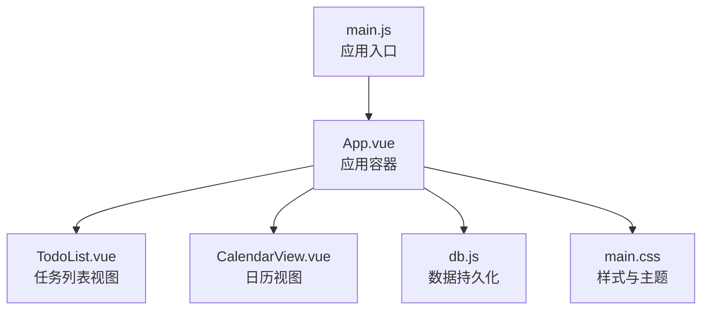
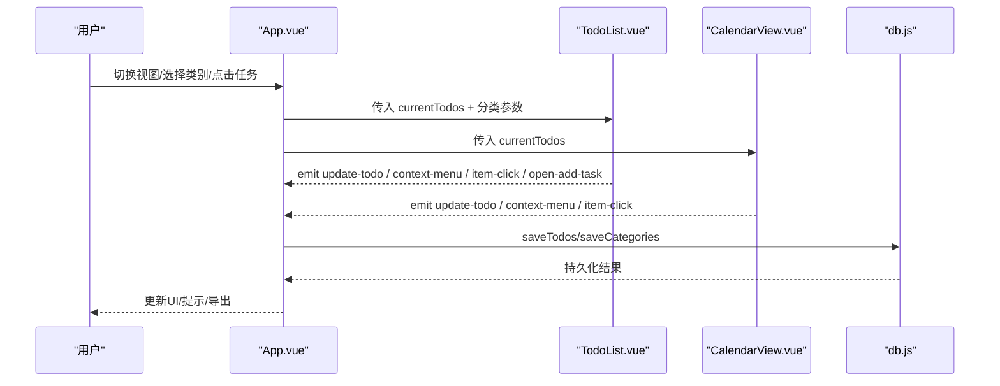
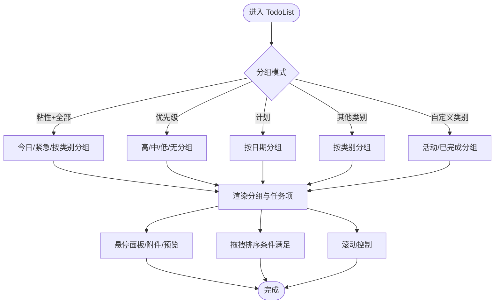
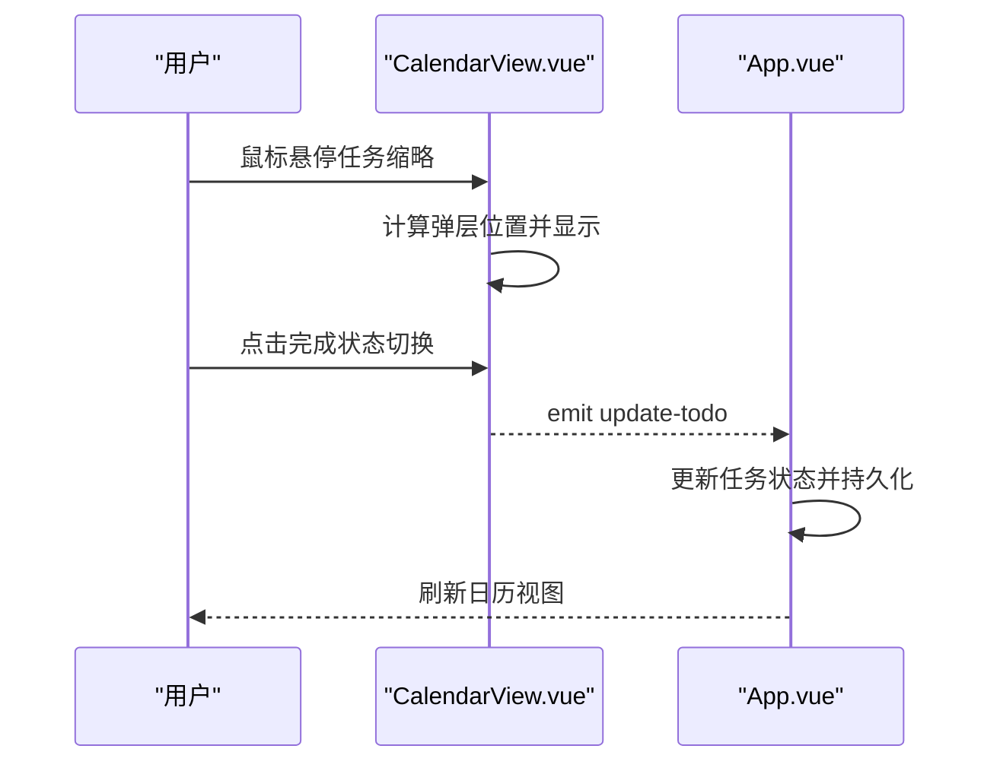
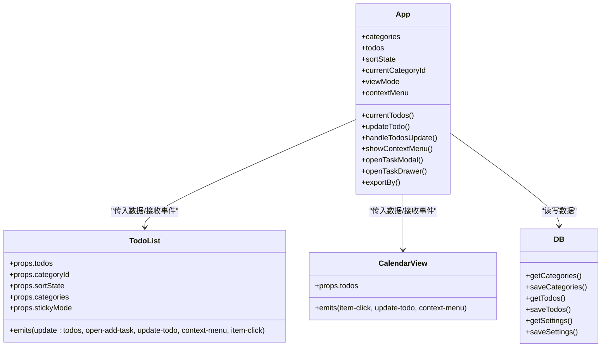
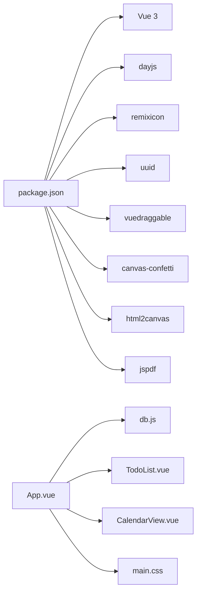

# 任务展示组件

<cite>
**本文引用的文件**
- [src/components/TodoList.vue](file://src/components/TodoList.vue)
- [src/components/CalendarView.vue](file://src/components/CalendarView.vue)
- [src/App.vue](file://src/App.vue)
- [src/utils/db.js](file://src/utils/db.js)
- [src/main.js](file://src/main.js)
- [src/main.css](file://src/main.css)
- [package.json](file://package.json)
</cite>

## 目录
1. [简介](#简介)
2. [项目结构](#项目结构)
3. [核心组件](#核心组件)
4. [架构总览](#架构总览)
5. [详细组件分析](#详细组件分析)
6. [依赖关系分析](#依赖关系分析)
7. [性能考量](#性能考量)
8. [故障排查指南](#故障排查指南)
9. [结论](#结论)
10. [附录](#附录)

## 简介
本文件面向“任务展示组件”群组，系统性梳理 TodoList 列表组件与 CalendarView 日历组件的功能实现、状态管理、数据绑定、事件处理与性能优化策略，并给出使用示例、API 接口说明与扩展指南。同时分析两种视图模式（列表/日历）在数据映射与用户体验上的差异与协同。

## 项目结构
- 前端框架：Vue 3（Composition API）
- 视图层：TodoList（列表）、CalendarView（日历）
- 应用容器：App.vue（状态、路由、视图切换、上下文菜单、导出等）
- 数据持久化：db.js（本地存储/utools 数据库适配）
- 主入口：main.js（应用挂载）
- 样式：main.css（主题变量、暗黑/明亮主题）

图表来源
- [src/main.js:1-6](file://src/main.js#L1-L6)
- [src/App.vue:2220-2340](file://src/App.vue#L2220-L2340)
- [src/components/TodoList.vue:1-120](file://src/components/TodoList.vue#L1-L120)
- [src/components/CalendarView.vue:1-60](file://src/components/CalendarView.vue#L1-L60)
- [src/utils/db.js:102-157](file://src/utils/db.js#L102-L157)
- [src/main.css:1-170](file://src/main.css#L1-L170)

章节来源
- [src/main.js:1-6](file://src/main.js#L1-L6)
- [src/App.vue:2220-2340](file://src/App.vue#L2220-L2340)
- [src/main.css:1-170](file://src/main.css#L1-L170)

## 核心组件
- TodoList 列表组件：负责任务渲染、分组、排序、拖拽、附件/预览、子任务/描述悬停面板、滚动与粘性模式等。
- CalendarView 日历组件：负责月份网格、日期选择、任务事件展示、悬停弹层、滚动优化与视图切换。
- App.vue：统一状态管理（类别、排序、视图模式、上下文菜单、通知、导出等），作为父容器协调两个视图。

章节来源
- [src/components/TodoList.vue:1-120](file://src/components/TodoList.vue#L1-L120)
- [src/components/CalendarView.vue:1-60](file://src/components/CalendarView.vue#L1-L60)
- [src/App.vue:23-60](file://src/App.vue#L23-L60)

## 架构总览
- 视图切换：通过 App.vue 的 viewMode 在列表与日历之间切换。
- 数据流：App.vue 计算 currentTodos，按类别与排序规则过滤/排序后传入子组件；子组件通过 emit 与父组件交互更新数据。
- 状态管理：App.vue 维护 categories、todos、sortState、contextMenu、viewMode 等全局状态。
- 事件链路：子组件触发 update-todo、context-menu、item-click、open-add-task 等事件，由 App.vue 处理并持久化。

图表来源
- [src/App.vue:2319-2339](file://src/App.vue#L2319-L2339)
- [src/components/TodoList.vue:30-37](file://src/components/TodoList.vue#L30-L37)
- [src/components/CalendarView.vue:12-16](file://src/components/CalendarView.vue#L12-L16)
- [src/utils/db.js:102-157](file://src/utils/db.js#L102-L157)

## 详细组件分析

### TodoList 列表组件
- 渲染与分组
  - 支持多种分组模式：
    - 粘性模式（stickyMode）+ 全部（all）：今日待办、紧急待办、按类别分组。
    - 优先级（urgent）：高/中/低/无。
    - 计划（plan）：按日期分组（含“无日期”、“已过期”等）。
    - 其他类别：按类别分组。
    - 自定义类别（My List）：活动/已完成分组。
  - 分组时会根据 props.categories 顺序进行排序，确保用户自定义顺序一致。
- 过滤与排序
  - App.vue 提供统一过滤逻辑（按类别过滤），并在需要时执行自定义排序（createdAt/dueDate/priority/default）。
  - TodoList 内部也保留了对“自定义排序”的识别与相应行为（如禁用拖拽以保证稳定性）。
- 交互与悬停面板
  - 子任务/描述悬停面板：鼠标进入显示子任务或描述面板，支持直接点击切换子任务完成状态。
  - 附件下拉：悬停附件图标显示可预览/下载的附件列表。
  - 预览模态：支持文本/图片预览与编码切换、下载。
- 拖拽与滚动
  - 使用 vuedraggable 实现拖拽排序，仅在“活动”且非自定义排序时启用，避免复杂分组场景下的同步问题。
  - 滚动优化：根据容器高度与内容差值动态启用/禁用滚动，粘性模式下提供滚轮穿透控制。
- 粘性模式
  - 特定分组（今日/紧急）默认展开/折叠策略，配合时间轴轴线与分隔线提升视觉连贯性。

图表来源
- [src/components/TodoList.vue:299-495](file://src/components/TodoList.vue#L299-L495)
- [src/components/TodoList.vue:589-731](file://src/components/TodoList.vue#L589-L731)
- [src/components/TodoList.vue:733-1015](file://src/components/TodoList.vue#L733-L1015)

章节来源
- [src/components/TodoList.vue:1-1816](file://src/components/TodoList.vue#L1-L1816)

### CalendarView 日历组件
- 月份网格与日期选择
  - 基于 dayjs 计算当月起止与周起始，生成完整网格。
  - 日期单元格区分“当前月/非当前月/今日”，点击跳转至对应日期。
- 任务事件展示
  - 每个日期单元格列出当日任务缩略，支持点击打开抽屉详情。
  - 任务缩略按优先级着色，完成状态带遮罩与斜体。
- 悬停弹层
  - 鼠标悬停任务缩略显示弹层，包含优先级点、标题与完成状态切换按钮。
  - 弹层位置自动避障（右/左/上/下边界检测），确保可见性。
- 视图切换与滚动
  - 顶部导航支持上一月/下一月/回到今天。
  - 日常任务列表采用轻量滚动（deltaY 缩放），避免快速跳页。

图表来源
- [src/components/CalendarView.vue:70-116](file://src/components/CalendarView.vue#L70-L116)
- [src/components/CalendarView.vue:118-176](file://src/components/CalendarView.vue#L118-L176)
- [src/App.vue:653-790](file://src/App.vue#L653-L790)

章节来源
- [src/components/CalendarView.vue:1-417](file://src/components/CalendarView.vue#L1-L417)

### App.vue 状态与数据流
- 全局状态
  - categories/todos/sortState/currentCategoryId/viewMode/contextMenu 等。
- 过滤与排序
  - currentTodos 基于类别与排序字段计算，支持默认排序与自定义排序。
- 事件处理
  - update-todo：统一更新任务并持久化，支持完成/撤销完成的历史记录与重复任务递归。
  - context-menu：统一上下文菜单，支持复制、移动、设置截止日期、优先级、重复规则等。
  - item-click/open-add-task：打开抽屉/模态，新增任务。
- 导出与通知
  - 支持 PNG/PDF/Markdown 导出，通知渠道（桌面/邮件/Bark/Webhook）配置与触发。
- 数据持久化
  - db.js 封装本地存储/utools 数据库访问，提供 categories/todos/settings 的读写与备份/恢复。

图表来源
- [src/App.vue:23-60](file://src/App.vue#L23-L60)
- [src/App.vue:350-415](file://src/App.vue#L350-L415)
- [src/App.vue:616-790](file://src/App.vue#L616-L790)
- [src/components/TodoList.vue:9-28](file://src/components/TodoList.vue#L9-L28)
- [src/components/CalendarView.vue:5-16](file://src/components/CalendarView.vue#L5-L16)
- [src/utils/db.js:102-157](file://src/utils/db.js#L102-L157)

章节来源
- [src/App.vue:1-3300](file://src/App.vue#L1-L3300)
- [src/utils/db.js:1-157](file://src/utils/db.js#L1-L157)

## 依赖关系分析
- Vue 生态：Vue 3、vuedraggable、dayjs、remixicon、uuid、canvas-confetti、html2canvas、jspdf。
- 本地存储：db.js 抽象 uTools 与浏览器环境，提供 categories/todos/settings 的 CRUD。
- 样式：main.css 定义主题变量与暗黑/明亮主题切换。

图表来源
- [package.json:7-22](file://package.json#L7-L22)
- [src/App.vue:1-30](file://src/App.vue#L1-L30)
- [src/utils/db.js:1-50](file://src/utils/db.js#L1-L50)
- [src/main.css:1-30](file://src/main.css#L1-L30)

章节来源
- [package.json:1-24](file://package.json#L1-L24)
- [src/App.vue:1-30](file://src/App.vue#L1-L30)

## 性能考量
- 列表渲染
  - TodoList 对分组与滚动状态进行响应式监听与节流（resize/wheel 事件），避免频繁重排。
  - 拖拽排序仅在必要条件下启用，减少复杂分组场景下的同步成本。
- 日历渲染
  - CalendarView 使用 TransitionGroup 与轻量滚动（deltaY 缩放）提升滚动体验。
  - 弹层位置计算仅在 hover 时触发，避免不必要的 DOM 计算。
- 数据持久化
  - db.js 在浏览器环境模拟 _rev 更新，减少冲突；utools 环境直接调用原生数据库接口。
- 主题与样式
  - main.css 使用 CSS 变量与媒体查询，减少重绘与闪烁。

章节来源
- [src/components/TodoList.vue:505-624](file://src/components/TodoList.vue#L505-L624)
- [src/components/CalendarView.vue:110-116](file://src/components/CalendarView.vue#L110-L116)
- [src/utils/db.js:30-43](file://src/utils/db.js#L30-L43)
- [src/main.css:1-170](file://src/main.css#L1-L170)

## 故障排查指南
- 任务状态更新无效
  - 检查 App.vue 的 updateTodo 是否被正确调用与持久化；确认历史记录与重复任务逻辑未被跳过。
- 拖拽排序异常
  - 确认当前分组模式与 sortState，仅在“活动”且非自定义排序时启用拖拽。
- 日历弹层遮挡
  - 检查 hoverState 的位置计算与窗口边界，确保弹层在可视区域内。
- 导出失败
  - 检查导出流程中的权限与文件句柄，确认浏览器/utools 环境支持相应 API。
- 通知未触发
  - 检查通知设置与缓存，确认触发时间与缓存 TTL 合理。

章节来源
- [src/App.vue:653-790](file://src/App.vue#L653-L790)
- [src/components/TodoList.vue:764-782](file://src/components/TodoList.vue#L764-L782)
- [src/components/CalendarView.vue:70-116](file://src/components/CalendarView.vue#L70-L116)
- [src/App.vue:940-1015](file://src/App.vue#L940-L1015)

## 结论
TodoList 与 CalendarView 通过 App.vue 的统一状态与数据流实现紧密协作：列表强调任务细节与操作效率，日历强调时间维度与可视化概览。两者在数据映射上保持一致（currentTodos），在交互上互补（悬停/抽屉/上下文菜单）。通过合理的分组、排序、滚动与主题机制，整体用户体验清晰、高效且可扩展。

## 附录

### 使用示例
- 切换视图
  - 在 App.vue 顶部切换“列表/日历”视图。
- 选择类别
  - 通过侧边栏选择“全部/今日/计划/紧急/已完成/自定义类别”。
- 新建任务
  - 在列表视图点击浮动按钮或在分组头部点击“新建待办”。
- 打开任务详情
  - 列表项点击或日历任务缩略点击打开抽屉详情。
- 设置截止日期/优先级/重复规则
  - 右键任务打开上下文菜单进行设置。

章节来源
- [src/App.vue:2294-2340](file://src/App.vue#L2294-L2340)
- [src/components/TodoList.vue:584-593](file://src/components/TodoList.vue#L584-L593)
- [src/components/CalendarView.vue:149-155](file://src/components/CalendarView.vue#L149-L155)

### API 接口说明
- TodoList
  - Props
    - todos: Array（必填）
    - categoryId: String
    - showInput: Boolean
    - categories: Array
    - sortState: Object
    - stickyMode: Boolean
  - Emits
    - update:todos
    - open-add-task
    - update-todo
    - context-menu
    - item-click
- CalendarView
  - Props
    - todos: Array（必填）
  - Emits
    - item-click
    - update-todo
    - context-menu

章节来源
- [src/components/TodoList.vue:9-37](file://src/components/TodoList.vue#L9-L37)
- [src/components/CalendarView.vue:5-16](file://src/components/CalendarView.vue#L5-L16)

### 扩展指南
- 新增分组/排序
  - 在 TodoList 的 displayGroups 中添加新的分组逻辑，结合 App.vue 的 sortState 控制排序。
- 新增视图
  - 参考 App.vue 的 viewMode 与模板切换，在 App.vue 中新增视图组件并接入数据流。
- 通知与导出
  - 在 App.vue 的通知与导出逻辑基础上扩展新渠道或格式。
- 主题与样式
  - 在 main.css 中新增/调整 CSS 变量，或在 App.vue 中动态切换主题类名。

章节来源
- [src/components/TodoList.vue:299-495](file://src/components/TodoList.vue#L299-L495)
- [src/App.vue:325-348](file://src/App.vue#L325-L348)
- [src/App.vue:1017-1178](file://src/App.vue#L1017-L1178)
- [src/App.vue:2153-2216](file://src/App.vue#L2153-L2216)
- [src/main.css:1-170](file://src/main.css#L1-L170)