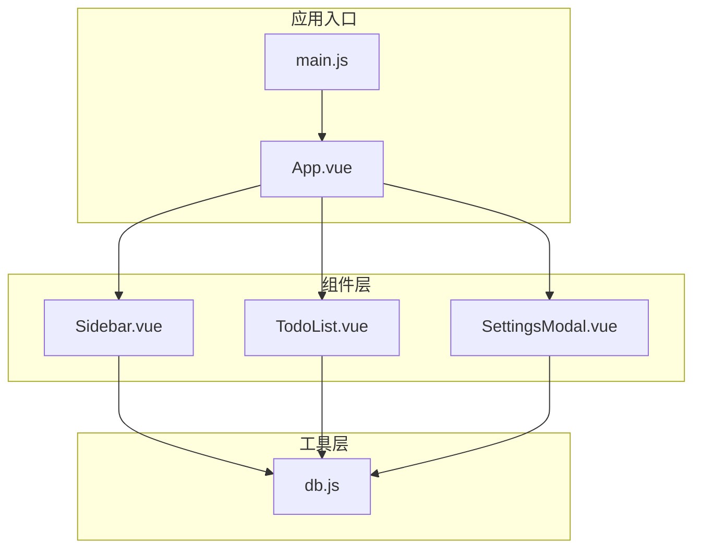
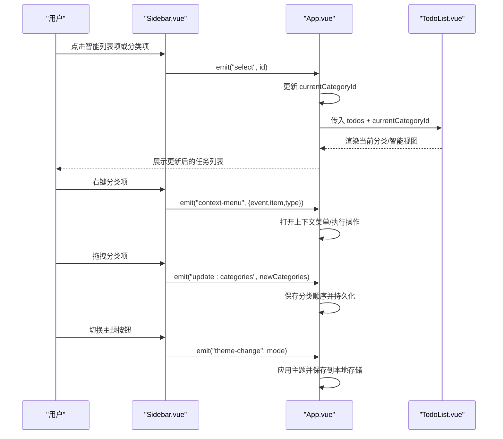
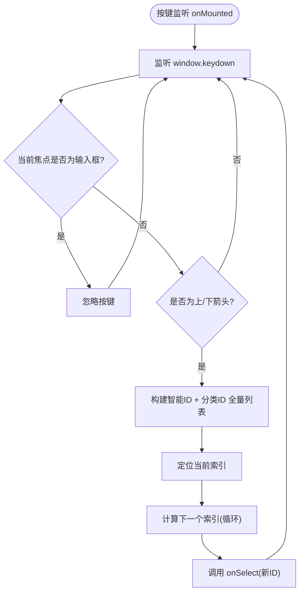
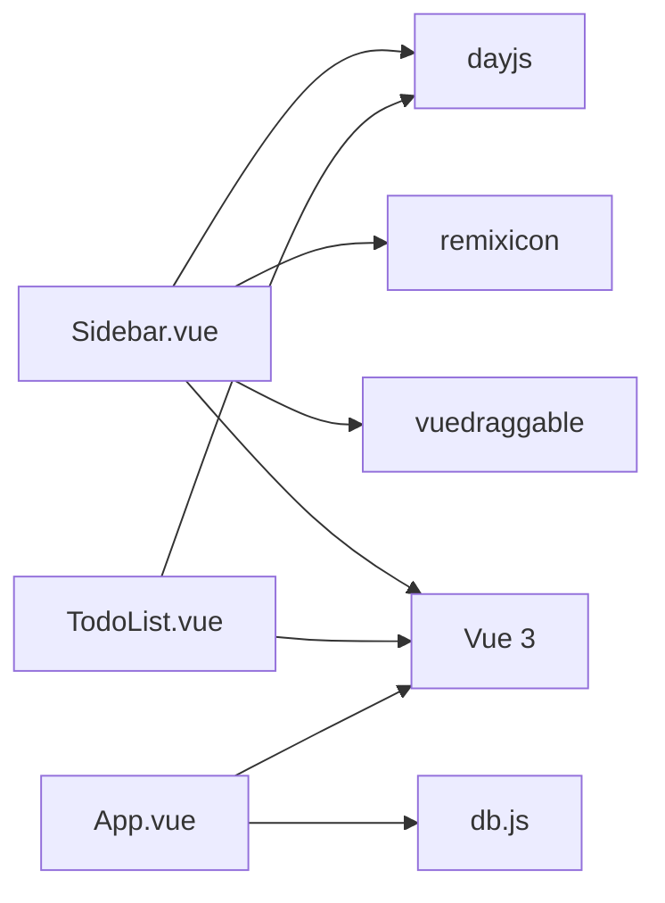
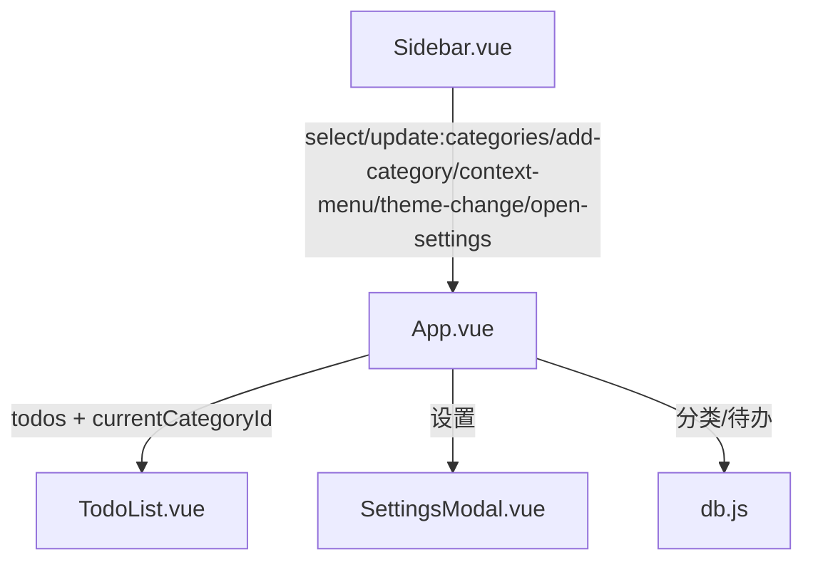

# 导航组件

<cite>
**本文引用的文件**
- [Sidebar.vue](file://src/components/Sidebar.vue)
- [App.vue](file://src/App.vue)
- [TodoList.vue](file://src/components/TodoList.vue)
- [SettingsModal.vue](file://src/components/SettingsModal.vue)
- [db.js](file://src/utils/db.js)
- [main.js](file://src/main.js)
- [package.json](file://package.json)
</cite>

## 目录
1. [简介](#简介)
2. [项目结构](#项目结构)
3. [核心组件](#核心组件)
4. [架构总览](#架构总览)
5. [详细组件分析](#详细组件分析)
6. [依赖关系分析](#依赖关系分析)
7. [性能考虑](#性能考虑)
8. [故障排查指南](#故障排查指南)
9. [结论](#结论)
10. [附录](#附录)

## 简介
本文件面向 Sidebar 导航组件，系统化阐述其设计与实现，覆盖以下方面：
- 智能列表区域（今日待办、计划、全部、优先级、已完成）
- 分类列表区域（可拖拽排序、右键上下文菜单）
- 键盘导航支持（方向键在智能列表与分类间循环切换）
- 主题切换机制（浅色、深色、系统跟随）
- 上下文菜单处理流程
- 组件 Props 接口、Emits 事件、计算属性与响应式状态
- 使用示例、事件处理模式与性能优化建议
- 与应用其他模块的数据流与集成方式

## 项目结构
Sidebar 位于组件层，作为左侧导航面板，与应用主视图、任务列表、设置弹窗等模块协同工作。其主要依赖第三方库 vuedraggable 实现拖拽排序，Remix Icon 提供图标资源。

图表来源
- [main.js:1-6](file://src/main.js#L1-L6)
- [App.vue:1-120](file://src/App.vue#L1-L120)
- [Sidebar.vue:1-502](file://src/components/Sidebar.vue#L1-L502)
- [TodoList.vue:1-120](file://src/components/TodoList.vue#L1-L120)
- [SettingsModal.vue:1-120](file://src/components/SettingsModal.vue#L1-L120)
- [db.js:1-157](file://src/utils/db.js#L1-L157)

章节来源
- [main.js:1-6](file://src/main.js#L1-L6)
- [package.json:1-24](file://package.json#L1-L24)

## 核心组件
Sidebar 是一个基于 Vue 3 Composition API 的单文件组件，负责：
- 渲染智能列表区域与分类列表区域
- 处理分类项拖拽排序
- 处理键盘导航与主题切换
- 触发上下文菜单事件
- 向父组件传递选择、新增分类、主题变更、打开设置等事件

章节来源
- [Sidebar.vue:1-109](file://src/components/Sidebar.vue#L1-L109)

## 架构总览
Sidebar 通过 props 接收外部状态（分类列表、当前选中分类 ID、待办列表、主题模式），通过 emits 将交互事件回传给父组件 App.vue。App.vue 负责：
- 维护全局状态（分类、待办、当前分类、主题）
- 计算当前显示的待办列表
- 处理分类增删改、主题切换、上下文菜单、设置弹窗等

图表来源
- [Sidebar.vue:25-108](file://src/components/Sidebar.vue#L25-L108)
- [App.vue:23-60](file://src/App.vue#L23-L60)
- [TodoList.vue:9-37](file://src/components/TodoList.vue#L9-L37)

## 详细组件分析

### Props 接口与 Emits 事件
- Props
  - categories: Array，必填，分类数组
  - currentCategoryId: String，必填，当前选中的分类 ID
  - todos: Array，默认空数组，用于智能计数
  - themeMode: String，默认 'system'，主题模式
- Emits
  - select: 选择某分类或智能视图时触发
  - update:categories: 分类列表被拖拽排序后触发
  - add-category: 新建分类按钮触发
  - context-menu: 右键菜单触发
  - theme-change: 主题切换触发
  - open-settings: 打开设置触发

章节来源
- [Sidebar.vue:6-25](file://src/components/Sidebar.vue#L6-L25)

### 响应式状态与计算属性
- dragging: Boolean，拖拽开始/结束时控制
- categoriesList: computed，双向绑定分类列表，便于 v-model 与拖拽
- themeIndex: computed，根据 themeMode 计算滑块位置
- sliderLeft: computed，主题切换滑块 left 值
- getSmartCount: 根据 todos 计算各类智能视图的计数

章节来源
- [Sidebar.vue:27-72](file://src/components/Sidebar.vue#L27-L72)
- [Sidebar.vue:47-63](file://src/components/Sidebar.vue#L47-L63)

### 智能列表区域
- 包含五个智能视图：今日待办、计划、全部、优先级、已完成
- 支持点击切换，激活态样式由 currentCategoryId 决定
- 计数器通过 getSmartCount 动态展示数量

章节来源
- [Sidebar.vue:111-159](file://src/components/Sidebar.vue#L111-L159)
- [Sidebar.vue:47-63](file://src/components/Sidebar.vue#L47-L63)

### 分类列表区域
- 使用 vuedraggable 实现拖拽排序
- 支持右键上下文菜单，传递 item、type、event
- 支持添加分类按钮
- 默认分类徽章与计数展示

章节来源
- [Sidebar.vue:170-196](file://src/components/Sidebar.vue#L170-L196)
- [Sidebar.vue:38-45](file://src/components/Sidebar.vue#L38-L45)

### 键盘导航支持
- 在窗口级监听 keydown 事件
- 当输入框未聚焦时，方向键在智能列表与分类列表之间循环切换
- 通过 onSelect 触发选择事件

图表来源
- [Sidebar.vue:74-108](file://src/components/Sidebar.vue#L74-L108)

章节来源
- [Sidebar.vue:74-108](file://src/components/Sidebar.vue#L74-L108)

### 主题切换机制
- 三种模式：light、dark、system
- 通过 themeMode 控制滑块位置与实际主题应用
- setTheme 通过 emit("theme-change", mode) 通知父组件

章节来源
- [Sidebar.vue:69-72](file://src/components/Sidebar.vue#L69-L72)
- [App.vue:268-291](file://src/App.vue#L268-L291)

### 上下文菜单处理
- 右键分类项时阻止默认菜单，emit("context-menu", { event, type: 'category', item })
- App.vue 中统一处理上下文菜单的显示与操作

章节来源
- [Sidebar.vue:38-41](file://src/components/Sidebar.vue#L38-L41)
- [App.vue:480-481](file://src/App.vue#L480-L481)

### 与 TodoList 的数据流
- App.vue 基于 currentCategoryId 与 todos 计算当前显示列表
- TodoList 接收 todos 与 categoryId，渲染对应分组与排序
- Sidebar 仅负责选择与分类排序，不直接修改 todos

章节来源
- [App.vue:350-415](file://src/App.vue#L350-L415)
- [TodoList.vue:9-37](file://src/components/TodoList.vue#L9-L37)

### 与设置弹窗的集成
- Sidebar 触发 open-settings，App.vue 打开 SettingsModal
- SettingsModal 通过 emits 保存设置并回传数据

章节来源
- [Sidebar.vue:71-72](file://src/components/Sidebar.vue#L71-L72)
- [SettingsModal.vue:368-376](file://src/components/SettingsModal.vue#L368-L376)

### 与数据库的集成
- App.vue 通过 db.js 读写分类与待办数据
- Sidebar 不直接访问数据库，通过 props 与 emits 与 App.vue 协作

章节来源
- [db.js:102-156](file://src/utils/db.js#L102-L156)
- [App.vue:489-545](file://src/App.vue#L489-L545)

## 依赖关系分析
- 第三方依赖
  - vuedraggable：实现分类列表拖拽排序
  - dayjs：日期比较与格式化
  - remixicon：图标资源
- 组件间耦合
  - Sidebar 与 App.vue 强耦合（通过 props/emit 传递状态与事件）
  - TodoList 与 App.vue 强耦合（接收 todos 与 categoryId）
  - SettingsModal 与 App.vue 强耦合（接收/保存设置）

图表来源
- [package.json:7-16](file://package.json#L7-L16)
- [Sidebar.vue:1-5](file://src/components/Sidebar.vue#L1-L5)
- [TodoList.vue:1-7](file://src/components/TodoList.vue#L1-L7)
- [App.vue:1-21](file://src/App.vue#L1-L21)
- [db.js:1-20](file://src/utils/db.js#L1-L20)

章节来源
- [package.json:1-24](file://package.json#L1-L24)

## 性能考虑
- 智能计数 getSmartCount 对 todos 进行多次过滤，建议：
  - 在 App.vue 缓存智能计数结果，避免重复计算
  - 对大列表采用分页或虚拟滚动
- 键盘导航监听在 mounted/onUnmounted 中注册/移除，避免内存泄漏
- 分类拖拽排序使用 v-model 与 computed，确保响应式更新最小化
- 主题切换通过 CSS 类切换，避免频繁重排

[本节为通用性能建议，无需特定文件引用]

## 故障排查指南
- 拖拽无效
  - 检查 vuedraggable 是否正确安装与引入
  - 确认 categoriesList 的 v-model 绑定与 update:categories 事件处理
- 键盘导航不生效
  - 确认未在输入框内触发
  - 检查 window.keydown 监听是否在 mounted 注册
- 主题切换异常
  - 检查 themeMode 的值与 setTheme 的调用
  - 确认根节点 CSS 类切换逻辑
- 上下文菜单未显示
  - 确认 App.vue 中 document.click 关闭菜单的逻辑
  - 检查 emit("context-menu") 的参数结构

章节来源
- [Sidebar.vue:170-196](file://src/components/Sidebar.vue#L170-L196)
- [Sidebar.vue:74-108](file://src/components/Sidebar.vue#L74-L108)
- [App.vue:268-291](file://src/App.vue#L268-L291)
- [App.vue:480-481](file://src/App.vue#L480-L481)

## 结论
Sidebar 导航组件通过清晰的 props/emit 设计，将选择、排序、主题、上下文菜单等交互能力与 App.vue 解耦，配合 TodoList 的分组与排序逻辑，形成完整的导航与内容展示体系。建议在大数据场景下进一步优化智能计数与渲染性能，并保持事件流与状态管理的一致性。

[本节为总结性内容，无需特定文件引用]

## 附录

### 使用示例与事件处理模式
- 在父组件中：
  - 传入 categories、currentCategoryId、todos、themeMode
  - 监听 select、update:categories、add-category、context-menu、theme-change、open-settings
  - 在 context-menu 中根据 type 与 item 执行不同操作
  - 在 update:categories 中保存分类顺序并持久化

章节来源
- [Sidebar.vue:6-25](file://src/components/Sidebar.vue#L6-L25)
- [Sidebar.vue:34-45](file://src/components/Sidebar.vue#L34-L45)
- [Sidebar.vue:38-41](file://src/components/Sidebar.vue#L38-L41)
- [Sidebar.vue:69-72](file://src/components/Sidebar.vue#L69-L72)
- [Sidebar.vue:198-216](file://src/components/Sidebar.vue#L198-L216)

### 数据流向图（简化）

图表来源
- [Sidebar.vue:25-45](file://src/components/Sidebar.vue#L25-L45)
- [App.vue:350-415](file://src/App.vue#L350-L415)
- [SettingsModal.vue:368-376](file://src/components/SettingsModal.vue#L368-L376)
- [db.js:102-156](file://src/utils/db.js#L102-L156)