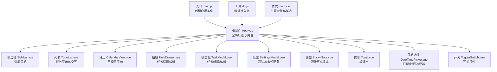
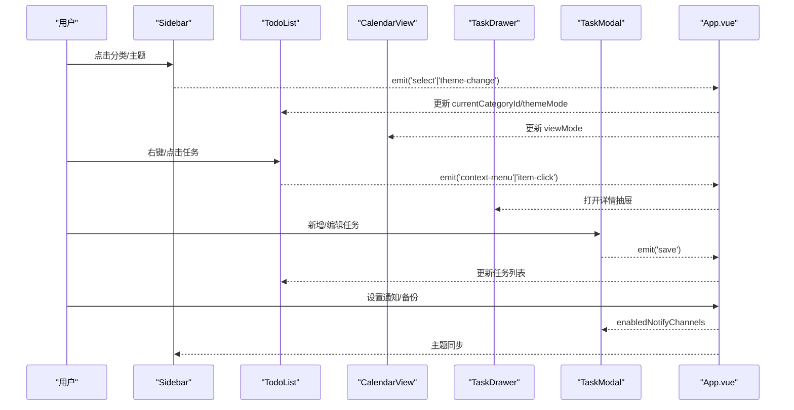
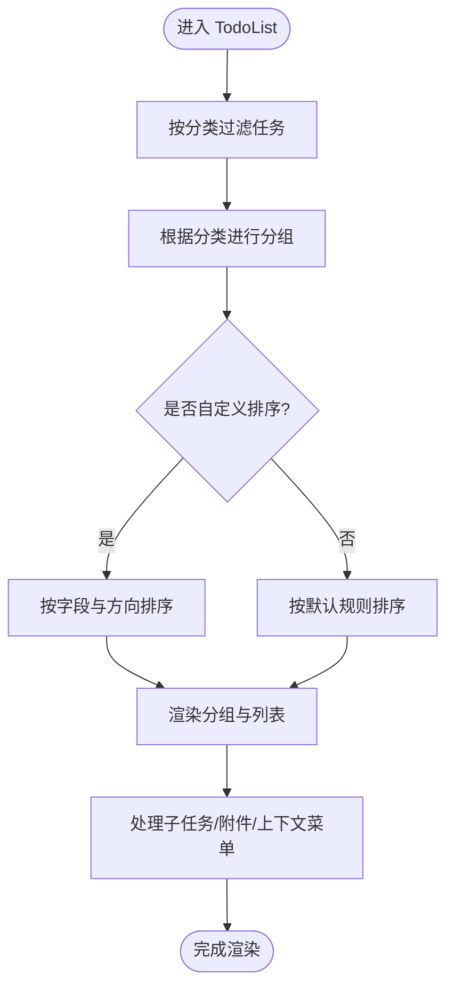
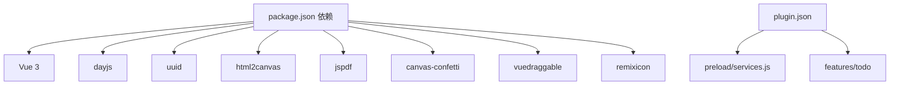

# 组件系统

<cite>
**本文档引用的文件**
- [src/App.vue](file://src/App.vue)
- [src/main.js](file://src/main.js)
- [src/main.css](file://src/main.css)
- [src/components/TodoList.vue](file://src/components/TodoList.vue)
- [src/components/StickyNote.vue](file://src/components/StickyNote.vue)
- [src/components/Sidebar.vue](file://src/components/Sidebar.vue)
- [src/components/TaskModal.vue](file://src/components/TaskModal.vue)
- [src/components/TaskDrawer.vue](file://src/components/TaskDrawer.vue)
- [src/components/SettingsModal.vue](file://src/components/SettingsModal.vue)
- [src/components/CalendarView.vue](file://src/components/CalendarView.vue)
- [src/components/DateTimePicker.vue](file://src/components/DateTimePicker.vue)
- [src/components/Toast.vue](file://src/components/Toast.vue)
- [src/components/ToggleSwitch.vue](file://src/components/ToggleSwitch.vue)
- [src/utils/db.js](file://src/utils/db.js)
- [src/utils/color.js](file://src/utils/color.js)
- [package.json](file://package.json)
- [plugin.json](file://plugin.json)
</cite>

## 目录
1. [项目概述](#项目概述)
2. [项目结构](#项目结构)
3. [核心组件](#核心组件)
4. [架构总览](#架构总览)
5. [详细组件分析](#详细组件分析)
6. [依赖关系分析](#依赖关系分析)
7. [性能考量](#性能考量)
8. [故障排查指南](#故障排查指南)
9. [结论](#结论)
10. [附录](#附录)

## 项目概述
Just-Todo 是一个基于 Vue 3 的跨平台待办事项应用，支持桌面便签模式、分类管理、重复任务、通知与备份等能力。项目通过统一的状态管理与组件化设计，实现清晰的数据流与良好的用户体验。

## 项目结构
项目采用典型的 Vue 单页应用结构，核心入口在 App.vue，所有业务组件集中在 src/components 下，工具函数位于 src/utils，样式集中于 src/main.css。

图表来源
- [src/main.js:1-6](file://src/main.js#L1-L6)
- [src/App.vue:1-120](file://src/App.vue#L1-L120)
- [src/main.css:1-170](file://src/main.css#L1-L170)

章节来源
- [src/main.js:1-6](file://src/main.js#L1-L6)
- [src/main.css:1-170](file://src/main.css#L1-L170)
- [package.json:1-24](file://package.json#L1-L24)
- [plugin.json:1-21](file://plugin.json#L1-L21)

## 核心组件
本节概述 8 个核心组件的设计理念、职责与交互模式：

- TodoList：任务列表渲染与分组、子任务与附件预览、拖拽排序、上下文菜单、键盘导航。
- Sidebar：智能分类与自定义分类导航、主题切换、快捷键导航。
- CalendarView：月视图展示、悬停弹层、滚动优化、右键菜单。
- TaskDrawer：任务详情抽屉、历史时间轴、子任务与附件管理、完成状态切换。
- TaskModal：任务新增/编辑表单、重复规则、通知渠道、文件上传与预览。
- SettingsModal：通知通道配置（桌面/邮件/Bark/Webhook）、本地/HTTP/WebDAV 备份。
- StickyNote：悬浮便签模式、置顶窗口、主题与透明度、颜色方案。
- DateTimePicker：日期/时间选择器、尺寸适配、禁用策略、确认回调。
- Toast：轻提示组件、成功/错误类型、淡入淡出动画。
- ToggleSwitch：开关控件、禁用态、无障碍属性。

章节来源
- [src/components/TodoList.vue:1-120](file://src/components/TodoList.vue#L1-L120)
- [src/components/Sidebar.vue:1-120](file://src/components/Sidebar.vue#L1-L120)
- [src/components/CalendarView.vue:1-120](file://src/components/CalendarView.vue#L1-L120)
- [src/components/TaskDrawer.vue:1-120](file://src/components/TaskDrawer.vue#L1-L120)
- [src/components/TaskModal.vue:1-120](file://src/components/TaskModal.vue#L1-L120)
- [src/components/SettingsModal.vue:1-120](file://src/components/SettingsModal.vue#L1-L120)
- [src/components/StickyNote.vue:1-120](file://src/components/StickyNote.vue#L1-L120)
- [src/components/DateTimePicker.vue:1-120](file://src/components/DateTimePicker.vue#L1-L120)
- [src/components/Toast.vue:1-63](file://src/components/Toast.vue#L1-L63)
- [src/components/ToggleSwitch.vue:1-84](file://src/components/ToggleSwitch.vue#L1-L84)

## 架构总览
应用采用“根组件集中状态 + 子组件单向数据流”的架构。App.vue 负责全局状态（分类、任务、视图模式、通知设置、便签设置等），通过 props 向子组件传递数据，通过事件向上游回传变更。

图表来源
- [src/App.vue:350-520](file://src/App.vue#L350-L520)
- [src/components/Sidebar.vue:25-120](file://src/components/Sidebar.vue#L25-L120)
- [src/components/TodoList.vue:30-120](file://src/components/TodoList.vue#L30-L120)
- [src/components/CalendarView.vue:12-60](file://src/components/CalendarView.vue#L12-L60)
- [src/components/TaskDrawer.vue:41-120](file://src/components/TaskDrawer.vue#L41-L120)
- [src/components/TaskModal.vue:41-120](file://src/components/TaskModal.vue#L41-L120)

## 详细组件分析

### TodoList 组件分析
- 设计理念：以“分组 + 排序”为核心，支持多种视图模式下的灵活展示；强调可访问性与性能。
- 关键特性：
  - 分组逻辑：根据当前分类自动分组（今日/计划/优先级/自定义分类）。
  - 排序策略：支持自定义排序字段与方向，同时保留原顺序作为“手动排序”。
  - 交互增强：子任务悬停面板、描述悬停、附件预览与下载、拖拽排序（仅在特定场景启用）。
  - 性能优化：分组后计算时间轴、滚动状态检测、防抖隐藏等。
- 属性接口与事件：
  - Props：todos、categoryId、showInput、categories、sortState、stickyMode
  - Emits：update:todos、open-add-task、update-todo、context-menu、item-click
- 生命周期与性能：
  - onMounted/onUnmounted 注册/注销事件监听，避免内存泄漏。
  - 使用 nextTick 与计算属性减少重排与重绘。

图表来源
- [src/components/TodoList.vue:176-495](file://src/components/TodoList.vue#L176-L495)

章节来源
- [src/components/TodoList.vue:1-800](file://src/components/TodoList.vue#L1-L800)

### Sidebar 组件分析
- 设计理念：简洁高效的导航与设置入口，支持键盘导航与拖拽重排。
- 关键特性：
  - 智能分类：今日/计划/全部/优先级/已完成快速入口。
  - 自定义分类：支持拖拽排序、右键菜单、添加分类。
  - 主题控制：三态主题切换（浅色/深色/系统）。
  - 键盘导航：上下箭头在所有条目间循环跳转。
- 属性接口与事件：
  - Props：categories、currentCategoryId、todos、themeMode
  - Emits：select、update:categories、add-category、context-menu、theme-change、open-settings

章节来源
- [src/components/Sidebar.vue:1-502](file://src/components/Sidebar.vue#L1-L502)

### CalendarView 组件分析
- 设计理念：月视图直观展示任务分布，配合悬停弹层提升交互效率。
- 关键特性：
  - 月视图生成：前后月份天数补全、今日高亮。
  - 悬停弹层：显示任务标题与完成状态，自动避屏。
  - 滚动优化：降低滚轮速度，避免跳页。
- 属性接口与事件：
  - Props：todos
  - Emits：item-click、update-todo、context-menu

章节来源
- [src/components/CalendarView.vue:1-417](file://src/components/CalendarView.vue#L1-L417)

### TaskDrawer 组件分析
- 设计理念：任务详情的沉浸式编辑体验，提供完整的历史记录与操作反馈。
- 关键特性：
  - 历史时间轴：创建/完成/重置/更新/延迟等事件记录。
  - 完成状态切换：即时更新并记录历史。
  - 表单校验：内容必填、提醒渠道必选、重复规则联动。
- 属性接口与事件：
  - Props：visible、categories、initialData、defaultCategoryId、enabledNotifyChannels
  - Emits：update:visible、save、toast、open-settings

章节来源
- [src/components/TaskDrawer.vue:1-800](file://src/components/TaskDrawer.vue#L1-L800)

### TaskModal 组件分析
- 设计理念：浮动表单承载复杂任务编辑，提供丰富的提醒与重复规则配置。
- 关键特性：
  - 浮动选择器：日期/提醒时间选择器定位与避障。
  - 重复规则：每日/每周/每月/每年，联动截止时间与提醒时间。
  - 通知渠道：桌面/邮件/Bark/Webhook，动态启用与校验。
  - 附件管理：文件选择、预览、下载、编码切换。
- 属性接口与事件：
  - Props：visible、categories、initialData、defaultCategoryId、enabledNotifyChannels
  - Emits：update:visible、save、toast、open-settings

章节来源
- [src/components/TaskModal.vue:1-800](file://src/components/TaskModal.vue#L1-L800)

### SettingsModal 组件分析
- 设计理念：集中化的设置中心，覆盖通知与备份两大领域。
- 关键特性：
  - 通知管理：桌面/邮件/Bark/Webhook 参数配置与测试。
  - 数据管理：本地备份导出、HTTP/URL 恢复、WebDAV 连接与文件列表。
- 属性接口与事件：
  - Props：visible、initialSettings、initialBackupSettings
  - Emits：update:visible、save、save-backup、data-restored、test-desktop、test-email、test-bark、test-webhook

章节来源
- [src/components/SettingsModal.vue:1-800](file://src/components/SettingsModal.vue#L1-L800)

### StickyNote 组件分析
- 设计理念：悬浮便签模式，支持置顶窗口、主题与透明度、颜色方案。
- 关键特性：
  - 窗口置顶：通过 Electron/utools API 实现置顶与重建窗口。
  - 主题同步：跟随系统或手动切换，实时同步到子组件。
  - 颜色方案：预设与自定义颜色，持久化存储。
- 属性接口与事件：
  - Props：todos、categories
  - Emits：update:todos、open-add-task、update-todo、context-menu、item-click、close

章节来源
- [src/components/StickyNote.vue:1-800](file://src/components/StickyNote.vue#L1-L800)

### DateTimePicker 组件分析
- 设计理念：通用日期/时间选择器，支持多尺寸与禁用策略。
- 关键特性：
  - 日历网格：上月/当月/下月天数拼接、今日高亮、禁用判断。
  - 时间选择：可选时分输入，确认输出标准格式。
  - 尺寸适配：sm/xs 两种尺寸，响应式布局。
- 属性接口与事件：
  - Props：modelValue、size、showTime、minDate、showClear
  - Emits：update:modelValue、close、confirm

章节来源
- [src/components/DateTimePicker.vue:1-458](file://src/components/DateTimePicker.vue#L1-L458)

### Toast 组件分析
- 设计理念：轻量提示，自动消失，支持成功/错误两类。
- 关键特性：
  - 动画过渡：淡入淡出，居中显示。
  - 类型区分：图标与颜色区分成功/错误。
- 属性接口：
  - Props：visible、message、type

章节来源
- [src/components/Toast.vue:1-63](file://src/components/Toast.vue#L1-L63)

### ToggleSwitch 组件分析
- 设计理念：语义明确的开关控件，支持禁用态与无障碍属性。
- 关键特性：
  - 状态切换：active/disabled 两态，knob 平滑移动。
  - 事件触发：update:modelValue 与 change。
- 属性接口与事件：
  - Props：modelValue、disabled
  - Emits：update:modelValue、change

章节来源
- [src/components/ToggleSwitch.vue:1-84](file://src/components/ToggleSwitch.vue#L1-L84)

## 依赖关系分析
- 运行时依赖：Vue 3、dayjs、uuid、html2canvas、jspdf、canvas-confetti、vuedraggable、remixicon。
- 开发依赖：@vitejs/plugin-vue、less、utools-api-types、vite。
- 插件配置：plugin.json 定义主入口、预加载脚本与功能指令。

图表来源
- [package.json:1-24](file://package.json#L1-L24)
- [plugin.json:1-21](file://plugin.json#L1-L21)

章节来源
- [package.json:1-24](file://package.json#L1-L24)
- [plugin.json:1-21](file://plugin.json#L1-L21)

## 性能考量
- 渲染优化
  - TodoList：分组后计算时间轴与滚动状态，避免不必要的重排。
  - CalendarView：滚轮减速，减少跳页感；TransitionGroup 优化列表项进出。
- 数据持久化
  - db.js 抽象了 utools 与浏览器环境差异，提供统一的 get/save 接口。
- 异步加载
  - App.vue 中对 html2canvas/jsPDF 采用按需异步导入，减少首屏体积。
- 事件监听
  - 组件在 onMounted/onUnmounted 中注册/清理事件，防止内存泄漏。

章节来源
- [src/components/TodoList.vue:505-624](file://src/components/TodoList.vue#L505-L624)
- [src/components/CalendarView.vue:110-116](file://src/components/CalendarView.vue#L110-L116)
- [src/App.vue:104-115](file://src/App.vue#L104-L115)
- [src/utils/db.js:1-157](file://src/utils/db.js#L1-L157)

## 故障排查指南
- 数据加载失败
  - 现象：控制台报错，utools 显示通知。
  - 处理：检查 db.js 初始化与权限，确认 categories/todos/settings 是否存在。
- 通知未触发
  - 现象：提醒时间到达但无提示。
  - 处理：核对 SettingsModal 中通知通道配置与 enabledNotifyChannels；测试各通道。
- 便签置顶失效
  - 现象：切换置顶后窗口回到普通层级。
  - 处理：检查 Electron/utools API 权限与 setAlwaysOnTop 调用链路。
- 重复任务未生效
  - 现象：完成任务后未创建新任务。
  - 处理：确认 repeatRule 配置与 handleRecurrence 触发条件。

章节来源
- [src/App.vue:489-535](file://src/App.vue#L489-L535)
- [src/components/SettingsModal.vue:372-407](file://src/components/SettingsModal.vue#L372-L407)
- [src/components/StickyNote.vue:228-266](file://src/components/StickyNote.vue#L228-L266)
- [src/App.vue:792-800](file://src/App.vue#L792-L800)

## 结论
Just-Todo 通过清晰的组件边界与统一的状态管理，实现了从任务列表到便签模式的完整待办体验。组件间通过 props 与事件进行松耦合通信，结合工具函数与主题系统，提供了良好的可维护性与扩展性。

## 附录
- 最佳实践
  - 使用 computed 与 watch 控制副作用，避免直接修改 props。
  - 在组件销毁时清理定时器与事件监听。
  - 对大列表使用虚拟滚动或分页，减少渲染压力。
- 扩展建议
  - 引入状态管理库（如 Pinia）以支持更复杂的跨组件状态共享。
  - 将常用 UI 组件抽象为可复用的原子组件，提升一致性。
  - 增加单元测试与集成测试，保障核心流程稳定性。