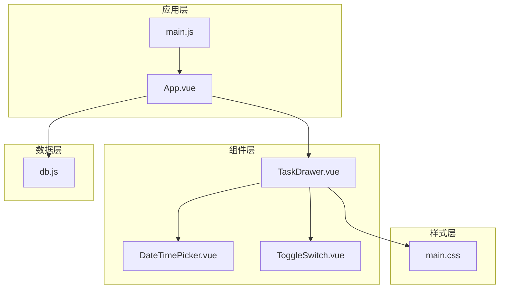
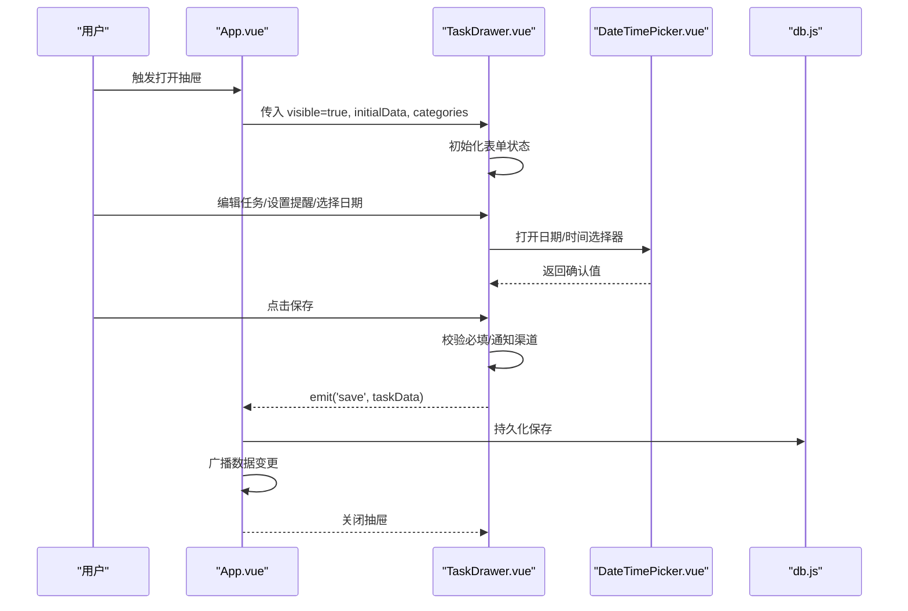
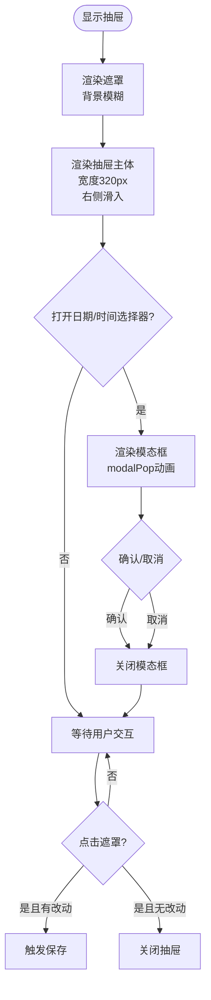
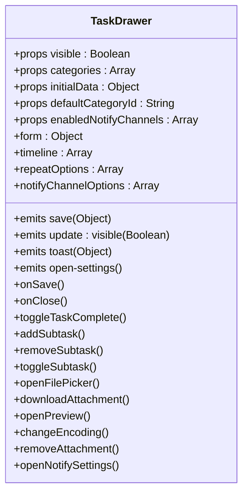
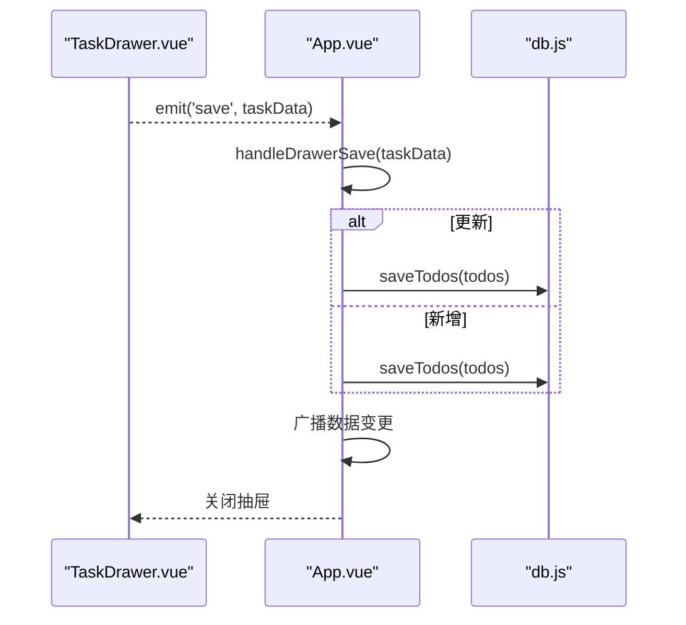
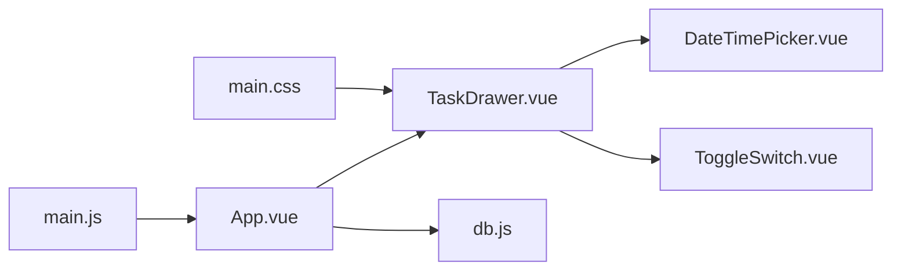

# 任务抽屉

<cite>
**本文引用的文件列表**
- [TaskDrawer.vue](file://src/components/TaskDrawer.vue)
- [App.vue](file://src/App.vue)
- [main.js](file://src/main.js)
- [db.js](file://src/utils/db.js)
- [main.css](file://src/main.css)
- [DateTimePicker.vue](file://src/components/DateTimePicker.vue)
- [ToggleSwitch.vue](file://src/components/ToggleSwitch.vue)
</cite>

## 目录
1. [简介](#简介)
2. [项目结构](#项目结构)
3. [核心组件](#核心组件)
4. [架构总览](#架构总览)
5. [详细组件分析](#详细组件分析)
6. [依赖关系分析](#依赖关系分析)
7. [性能考量](#性能考量)
8. [故障排查指南](#故障排查指南)
9. [结论](#结论)
10. [附录](#附录)

## 简介
本文件为 TaskDrawer 任务抽屉组件的深度技术文档。该组件采用侧边弹出式交互设计，提供任务的只读浏览与编辑能力，支持子任务、附件、重复规则、提醒与通知渠道等高级特性，并通过与主应用的状态联动实现数据同步与事件传递。文档将从设计理念、实现原理、数据流、交互机制、响应式适配到可配置参数与样式定制进行全面阐述，帮助开发者快速理解与扩展该组件。

## 项目结构
TaskDrawer 所属模块位于 src/components 目录下，配合 App.vue 主应用容器、数据库工具 db.js、主题样式 main.css 以及辅助组件 DateTimePicker 和 ToggleSwitch 共同构成完整的任务抽屉生态。

图表来源
- [TaskDrawer.vue:1-2416](file://src/components/TaskDrawer.vue#L1-L2416)
- [App.vue:1-3300](file://src/App.vue#L1-L3300)
- [main.js:1-6](file://src/main.js#L1-L6)
- [db.js:1-157](file://src/utils/db.js#L1-L157)
- [main.css:1-170](file://src/main.css#L1-L170)
- [DateTimePicker.vue:1-458](file://src/components/DateTimePicker.vue#L1-L458)
- [ToggleSwitch.vue:1-84](file://src/components/ToggleSwitch.vue#L1-L84)

章节来源
- [TaskDrawer.vue:1-2416](file://src/components/TaskDrawer.vue#L1-L2416)
- [App.vue:1-3300](file://src/App.vue#L1-L3300)
- [main.js:1-6](file://src/main.js#L1-L6)
- [db.js:1-157](file://src/utils/db.js#L1-L157)
- [main.css:1-170](file://src/main.css#L1-L170)
- [DateTimePicker.vue:1-458](file://src/components/DateTimePicker.vue#L1-L458)
- [ToggleSwitch.vue:1-84](file://src/components/ToggleSwitch.vue#L1-L84)

## 核心组件
- TaskDrawer：侧边抽屉，负责任务的输入、展示、校验与保存；内置子任务、附件、重复规则、提醒与通知渠道等编辑功能。
- App：应用入口与状态容器，负责任务数据的增删改查、抽屉可见性控制、全局广播与本地存储同步。
- db：统一的数据访问层，封装了本地存储（浏览器 localStorage 或 utools db）与备份恢复。
- DateTimePicker：日期/时间选择器，被抽屉用于设置截止日期与提醒时间。
- ToggleSwitch：开关组件，用于“是否启用提醒”等布尔型字段的切换。

章节来源
- [TaskDrawer.vue:1-2416](file://src/components/TaskDrawer.vue#L1-L2416)
- [App.vue:1-3300](file://src/App.vue#L1-L3300)
- [db.js:1-157](file://src/utils/db.js#L1-L157)
- [DateTimePicker.vue:1-458](file://src/components/DateTimePicker.vue#L1-L458)
- [ToggleSwitch.vue:1-84](file://src/components/ToggleSwitch.vue#L1-L84)

## 架构总览
TaskDrawer 作为独立的抽屉组件，通过 props 接收初始数据与类别列表，内部维护表单状态；通过 emits 向父组件传递保存、关闭、吐司提示与打开设置等事件。App 负责：
- 维护 categories、todos、当前分类、视图模式等全局状态
- 控制 taskDrawer 可见性与初始数据
- 处理保存事件，调用 db 持久化并广播数据变更
- 与外部环境（utools/electron）交互，实现窗口管理与通知

图表来源
- [App.vue:579-594](file://src/App.vue#L579-L594)
- [TaskDrawer.vue:743-761](file://src/components/TaskDrawer.vue#L743-L761)
- [DateTimePicker.vue:122-135](file://src/components/DateTimePicker.vue#L122-L135)
- [db.js:102-133](file://src/utils/db.js#L102-L133)

章节来源
- [App.vue:579-594](file://src/App.vue#L579-L594)
- [TaskDrawer.vue:743-761](file://src/components/TaskDrawer.vue#L743-L761)
- [DateTimePicker.vue:122-135](file://src/components/DateTimePicker.vue#L122-L135)
- [db.js:102-133](file://src/utils/db.js#L102-L133)

## 详细组件分析

### 设计理念与交互模型
- 侧边弹出式：抽屉从右侧滑入，遮罩背景模糊，强调层级与焦点转移。
- 只读/编辑双态：根据是否存在 initialData.id 决定标题与时间轴展示；编辑态支持全量字段修改。
- 原子化交互：每个字段使用独立的下拉面板或开关，避免信息过载；通过动画过渡提升反馈。
- 数据驱动：所有状态均来自 props 与内部 ref/computed，保证可追踪与可测试。

章节来源
- [TaskDrawer.vue:849-1284](file://src/components/TaskDrawer.vue#L849-L1284)

### 抽屉的打开/关闭动画与定位
- 动画：抽屉主体使用 slideIn 进场动画，模态日期/时间选择器使用 modalPop 放大进入；预览模态使用 fadeIn/zoomIn。
- 定位：抽屉固定在右侧，宽度 320px，高度 100%，阴影与背景色营造立体感。
- 事件：点击遮罩触发保存或关闭；点击空白区域关闭下拉面板；点击外部关闭日期/时间选择器。

图表来源
- [TaskDrawer.vue:1310-1356](file://src/components/TaskDrawer.vue#L1310-L1356)
- [TaskDrawer.vue:1910-1932](file://src/components/TaskDrawer.vue#L1910-L1932)
- [TaskDrawer.vue:2224-2370](file://src/components/TaskDrawer.vue#L2224-L2370)

章节来源
- [TaskDrawer.vue:1310-1356](file://src/components/TaskDrawer.vue#L1310-L1356)
- [TaskDrawer.vue:1910-1932](file://src/components/TaskDrawer.vue#L1910-L1932)
- [TaskDrawer.vue:2224-2370](file://src/components/TaskDrawer.vue#L2224-L2370)

### 任务数据展示与编辑模式
- 表单字段：内容、描述、清单、优先级、截止日期/时间、重复规则、提醒开关、通知渠道、子任务、附件。
- 只读模式：当存在 initialData.id 时，展示任务时间轴（创建/完成/重置/推迟/更新）。
- 编辑模式：支持全量字段修改；自动计算重复规则下的下次执行日期；支持子任务增删与完成切换；支持附件上传、下载、预览与编码切换。

图表来源
- [TaskDrawer.vue:21-39](file://src/components/TaskDrawer.vue#L21-L39)
- [TaskDrawer.vue:41-41](file://src/components/TaskDrawer.vue#L41-L41)
- [TaskDrawer.vue:43-57](file://src/components/TaskDrawer.vue#L43-L57)
- [TaskDrawer.vue:310-334](file://src/components/TaskDrawer.vue#L310-L334)
- [TaskDrawer.vue:262-308](file://src/components/TaskDrawer.vue#L262-L308)
- [TaskDrawer.vue:441-476](file://src/components/TaskDrawer.vue#L441-L476)

章节来源
- [TaskDrawer.vue:21-39](file://src/components/TaskDrawer.vue#L21-L39)
- [TaskDrawer.vue:41-41](file://src/components/TaskDrawer.vue#L41-L41)
- [TaskDrawer.vue:43-57](file://src/components/TaskDrawer.vue#L43-L57)
- [TaskDrawer.vue:310-334](file://src/components/TaskDrawer.vue#L310-L334)
- [TaskDrawer.vue:262-308](file://src/components/TaskDrawer.vue#L262-L308)
- [TaskDrawer.vue:441-476](file://src/components/TaskDrawer.vue#L441-L476)

### 抽屉与主界面的交互机制
- 事件链路：TaskDrawer 通过 emit('save') 将任务数据回传给 App；App 在 handleDrawerSave 中统一处理新增/更新逻辑，随后持久化并广播数据变更。
- 状态管理：App 维护 taskDrawer.visible 与 initialData，控制抽屉的显示与初始数据注入；同时维护 todos/categories/notificationSettings 等全局状态。
- 数据同步：App 通过 db.saveTodos/saveCategories/saveSettings 持久化；通过 localStorage/BroadcastChannel 广播数据变更，实现跨标签页/窗口同步。

图表来源
- [App.vue:586-594](file://src/App.vue#L586-L594)
- [db.js:129-133](file://src/utils/db.js#L129-L133)

章节来源
- [App.vue:586-594](file://src/App.vue#L586-L594)
- [db.js:129-133](file://src/utils/db.js#L129-L133)

### 响应式设计与适配策略
- 宽度与布局：抽屉宽度固定 320px，内容区自适应滚动；在小屏设备上对日期/提醒行进行换行与最小宽度约束，保证可读性。
- 字体与间距：整体采用紧凑排版，减少垂直空间占用；在移动端通过媒体查询优化列宽与网格布局。
- 交互细节：下拉面板与遮罩层级明确，避免点击穿透；日期/时间选择器居中显示，动画自然。

章节来源
- [TaskDrawer.vue:1858-1868](file://src/components/TaskDrawer.vue#L1858-L1868)
- [TaskDrawer.vue:1844-1856](file://src/components/TaskDrawer.vue#L1844-L1856)

### 可配置参数、样式定制与扩展点
- 可配置参数（props）
  - visible: Boolean — 控制抽屉显隐
  - categories: Array — 清单列表
  - initialData: Object — 初始任务数据（含 id 即视为编辑态）
  - defaultCategoryId: String — 默认清单 ID
  - enabledNotifyChannels: Array — 启用的通知渠道白名单
- 事件（emits）
  - update:visible(Boolean) — 关闭抽屉
  - save(Object) — 保存任务
  - toast(Object) — 显示提示
  - open-settings() — 打开通知设置
- 样式变量
  - 使用 CSS 变量（如 --bg-color、--text-color、--primary-color）实现主题切换与深浅色适配
  - 抽屉内组件复用全局变量，保证视觉一致性
- 扩展点
  - 自定义通知渠道：通过 enabledNotifyChannels 限制可用渠道
  - 自定义默认清单：通过 defaultCategoryId 设置
  - 自定义重复规则：支持每日/每周/每月/每年，自动计算下次执行日期
  - 子任务与附件：支持动态增删、完成切换、文本/图片预览与下载

章节来源
- [TaskDrawer.vue:21-39](file://src/components/TaskDrawer.vue#L21-L39)
- [TaskDrawer.vue:41-41](file://src/components/TaskDrawer.vue#L41-L41)
- [main.css:1-29](file://src/main.css#L1-L29)
- [main.css:95-136](file://src/main.css#L95-L136)
- [main.css:138-169](file://src/main.css#L138-L169)

## 依赖关系分析
- 组件依赖
  - TaskDrawer 依赖 DateTimePicker 与 ToggleSwitch 实现日期/时间选择与开关切换
  - App 作为容器，依赖 TaskDrawer、TodoList、Sidebar 等组件
- 外部依赖
  - dayjs：日期/时间解析与格式化
  - remixicon：图标字体
  - uuid：生成唯一 ID
  - localStorage/BroadcastChannel：跨标签页同步
  - utools（可选）：桌面插件环境下的数据库与窗口管理

图表来源
- [TaskDrawer.vue:5-6](file://src/components/TaskDrawer.vue#L5-L6)
- [App.vue:3-11](file://src/App.vue#L3-L11)
- [main.js:1-6](file://src/main.js#L1-L6)
- [main.css:1-170](file://src/main.css#L1-L170)

章节来源
- [TaskDrawer.vue:5-6](file://src/components/TaskDrawer.vue#L5-L6)
- [App.vue:3-11](file://src/App.vue#L3-L11)
- [main.js:1-6](file://src/main.js#L1-L6)
- [main.css:1-170](file://src/main.css#L1-L170)

## 性能考量
- 渲染优化
  - 抽屉内容区使用滚动容器，避免整页重绘
  - 下拉面板与遮罩层级分离，减少点击事件冒泡成本
- 计算优化
  - 重复规则计算仅在规则变化或日期变化时触发
  - 时间轴按时间倒序渲染，避免额外排序
- 数据持久化
  - 保存前进行必要字段校验，减少无效写入
  - 通过广播与本地存储同步，降低频繁 IO

[本节为通用指导，无需特定文件来源]

## 故障排查指南
- 抽屉无法关闭
  - 检查 visible 是否正确绑定；确认遮罩点击回调是否触发保存或关闭
- 保存失败
  - 确认必填字段（如任务内容）非空；检查通知渠道是否启用但未选择
- 重复规则异常
  - 检查 repeatRule 与 repeatWeekDays/repeatMonthDays 的合法性；确认 dueDate 是否存在
- 预览失败
  - 检查附件 MIME 类型与编码；尝试切换编码选项
- 同步问题
  - 确认 BroadcastChannel/localStorage 广播是否正常；检查 App 层广播与监听逻辑

章节来源
- [TaskDrawer.vue:743-761](file://src/components/TaskDrawer.vue#L743-L761)
- [TaskDrawer.vue:175-207](file://src/components/TaskDrawer.vue#L175-L207)
- [App.vue:123-131](file://src/App.vue#L123-L131)

## 结论
TaskDrawer 以清晰的职责划分与数据驱动的方式实现了任务抽屉的核心能力：侧边弹出、只读/编辑双态、复杂字段管理与跨组件事件传递。其响应式布局与主题变量使组件在多环境下保持一致体验；通过 App 的统一状态管理与 db 的持久化封装，实现了稳定可靠的数据流。建议在扩展时遵循现有事件与状态模式，确保一致性与可维护性。

[本节为总结性内容，无需特定文件来源]

## 附录
- 术语
  - 重复规则：daily/weekly/monthly/yearly
  - 通知渠道：desktop/email/bark/webhook
  - 时间轴：记录任务生命周期关键事件
- 最佳实践
  - 保持 initialData 结构与 App 保存逻辑一致
  - 合理使用 enabledNotifyChannels 限制可用渠道
  - 对重复规则与提醒时间进行联动校验

[本节为补充说明，无需特定文件来源]