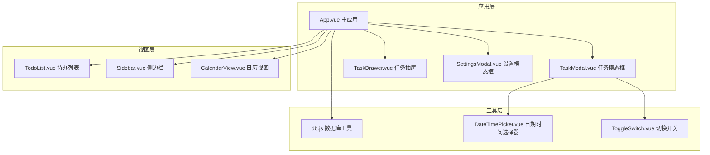
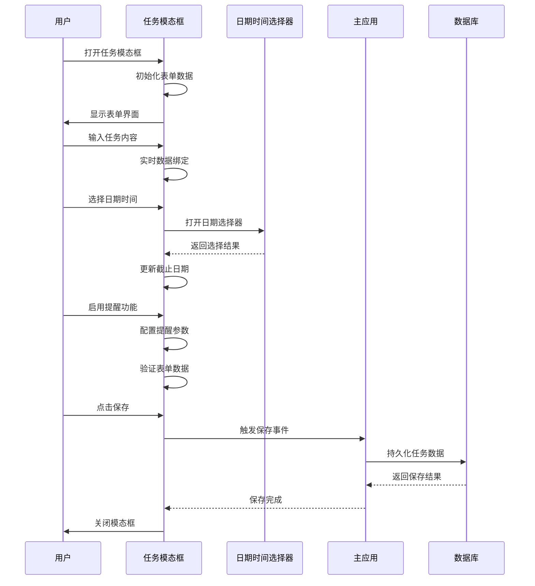
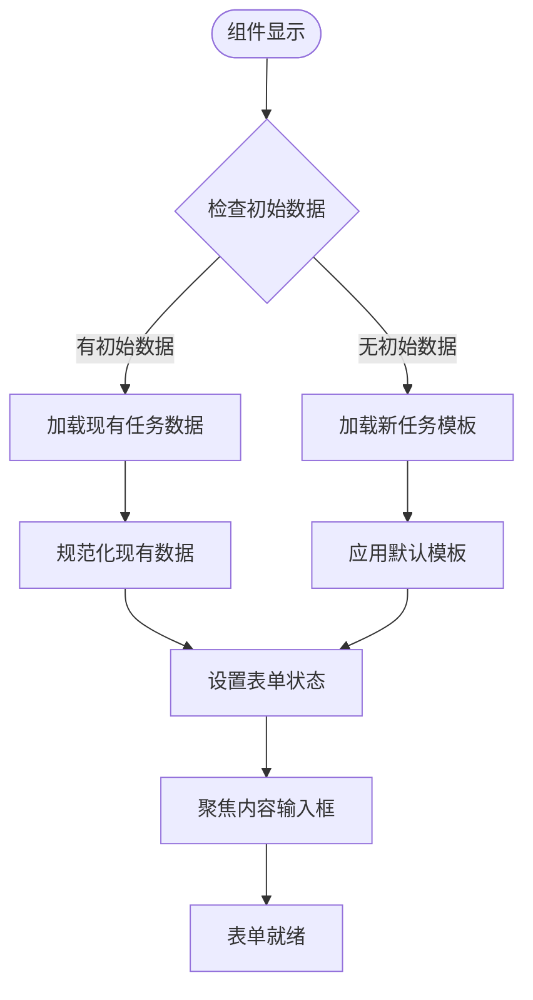
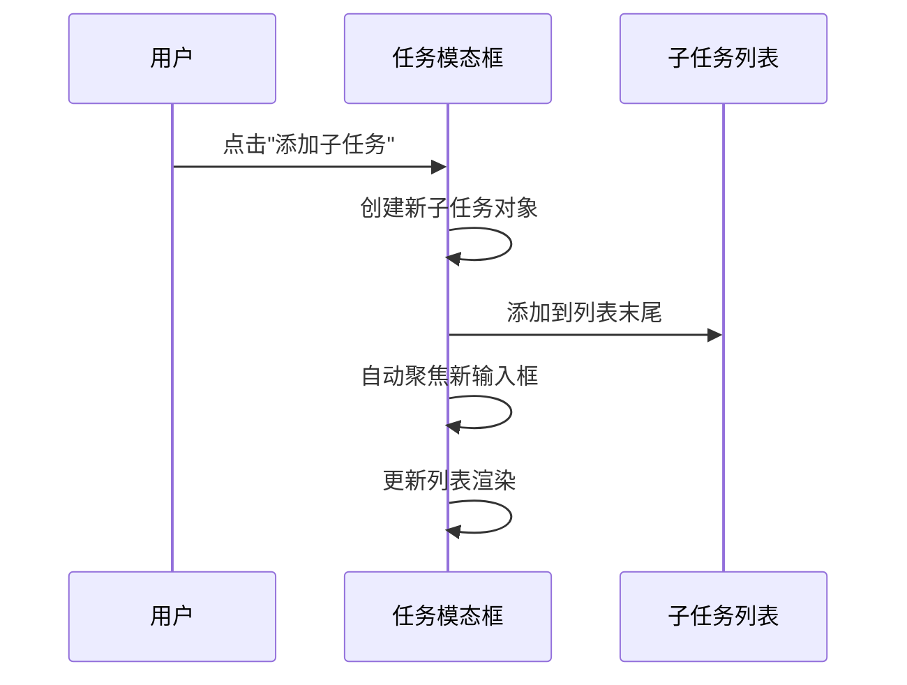
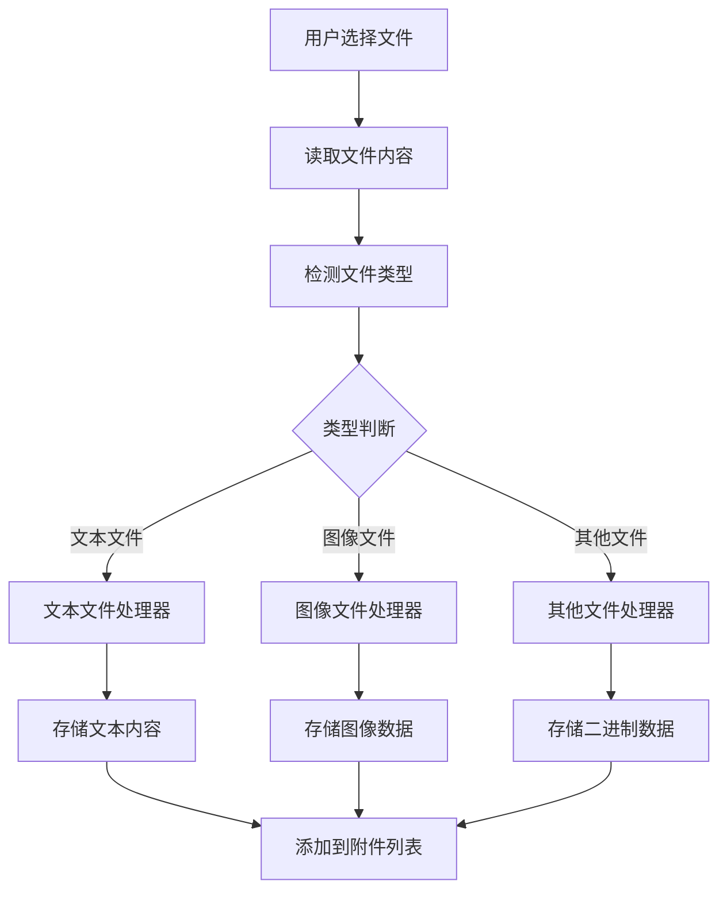
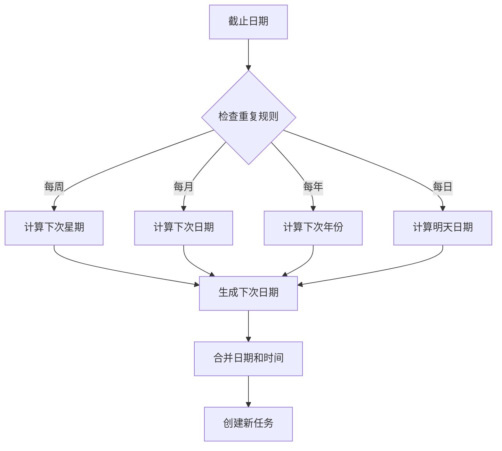
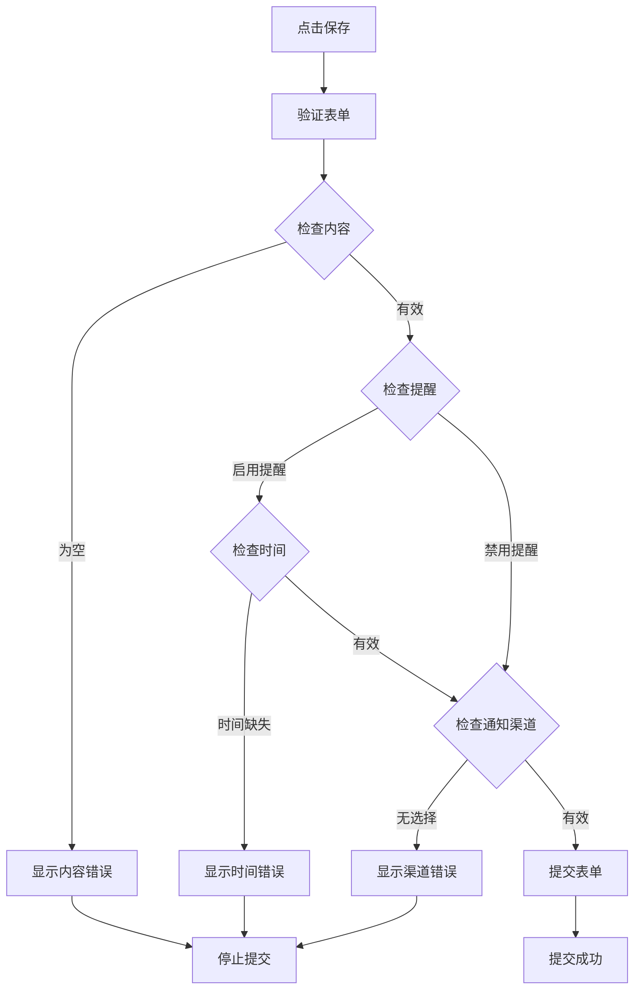
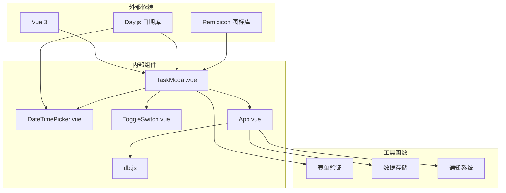

# 任务模态对话框

<cite>
**本文档引用的文件**
- [TaskModal.vue](file://src/components/TaskModal.vue)
- [DateTimePicker.vue](file://src/components/DateTimePicker.vue)
- [ToggleSwitch.vue](file://src/components/ToggleSwitch.vue)
- [db.js](file://src/utils/db.js)
- [App.vue](file://src/App.vue)
</cite>

## 目录
1. [简介](#简介)
2. [项目结构](#项目结构)
3. [核心组件](#核心组件)
4. [架构概览](#架构概览)
5. [详细组件分析](#详细组件分析)
6. [依赖关系分析](#依赖关系分析)
7. [性能考虑](#性能考虑)
8. [故障排除指南](#故障排除指南)
9. [结论](#结论)

## 简介

任务模态对话框是 Just-Todo 应用中的核心交互组件，负责提供完整的任务创建和编辑体验。该组件实现了复杂的表单生命周期管理、数据绑定和状态同步机制，支持任务属性配置、子任务管理、附件上传系统以及重复任务规则的智能处理。

本组件采用 Vue 3 Composition API 构建，集成了现代化的响应式设计模式，提供了直观的用户界面和流畅的交互体验。通过精心设计的状态管理和事件驱动架构，确保了数据的一致性和用户体验的连贯性。

## 项目结构

Just-Todo 项目采用模块化架构设计，任务模态对话框作为独立的可复用组件，与应用的其他核心功能紧密集成。

**图表来源**
- [App.vue:1-50](file://src/App.vue#L1-L50)
- [TaskModal.vue:1-50](file://src/components/TaskModal.vue#L1-L50)

**章节来源**
- [App.vue:1-100](file://src/App.vue#L1-L100)
- [TaskModal.vue:1-50](file://src/components/TaskModal.vue#L1-L50)

## 核心组件

任务模态对话框包含以下核心功能模块：

### 表单数据模型
组件维护一个完整的任务数据结构，支持所有必要的字段：
- 基础信息：内容、描述、清单分类、优先级
- 时间管理：截止日期、提醒时间、重复规则
- 附加功能：子任务、附件、通知渠道
- 状态跟踪：完成状态、历史记录

### 生命周期管理
组件实现了完整的生命周期管理，包括初始化、更新、销毁等阶段的状态处理。

### 交互控制
提供丰富的用户交互能力，包括下拉菜单、日期选择、开关切换、文件上传等。

**章节来源**
- [TaskModal.vue:183-197](file://src/components/TaskModal.vue#L183-L197)
- [TaskModal.vue:482-521](file://src/components/TaskModal.vue#L482-L521)

## 架构概览

任务模态对话框采用分层架构设计，确保关注点分离和代码的可维护性。

**图表来源**
- [TaskModal.vue:801-822](file://src/components/TaskModal.vue#L801-L822)
- [App.vue:596-604](file://src/App.vue#L596-L604)

**章节来源**
- [TaskModal.vue:801-822](file://src/components/TaskModal.vue#L801-L822)
- [App.vue:596-604](file://src/App.vue#L596-L604)

## 详细组件分析

### 表单生命周期管理

任务模态对话框实现了完整的表单生命周期管理，确保数据在不同状态间的正确转换。

#### 初始化流程
当组件可见性变为 true 时，系统会根据传入的初始数据进行表单初始化：

**图表来源**
- [TaskModal.vue:482-521](file://src/components/TaskModal.vue#L482-L521)

#### 数据绑定机制
组件使用 Vue 3 的响应式系统实现双向数据绑定，支持实时的数据同步和验证反馈。

**章节来源**
- [TaskModal.vue:482-521](file://src/components/TaskModal.vue#L482-L521)
- [TaskModal.vue:801-822](file://src/components/TaskModal.vue#L801-L822)

### 任务属性配置

任务模态对话框提供了全面的任务属性配置选项，满足不同用户的使用需求。

#### 内容输入与描述编辑
- 支持多行文本输入，自动调整高度适应内容
- 实时验证确保内容完整性
- 描述区域支持富文本编辑

#### 分类选择系统
- 动态加载可用的清单分类
- 支持分类的增删改查操作
- 默认分类自动应用逻辑

#### 优先级设置
提供三级优先级设置：
- 高优先级：红色标识
- 中优先级：橙色标识  
- 低优先级：蓝色标识

**章节来源**
- [TaskModal.vue:349-411](file://src/components/TaskModal.vue#L349-L411)

### 子任务管理系统

子任务管理是任务模态对话框的重要功能之一，提供了灵活的任务分解能力。

#### 动态添加子任务

**图表来源**
- [TaskModal.vue:201-217](file://src/components/TaskModal.vue#L201-L217)

#### 删除和状态切换
- 支持单个子任务删除
- 点击复选框切换完成状态
- 完成状态下的样式变化

**章节来源**
- [TaskModal.vue:219-225](file://src/components/TaskModal.vue#L219-L225)
- [TaskModal.vue:858-892](file://src/components/TaskModal.vue#L858-L892)

### 附件上传系统

附件上传系统提供了完整的文件管理功能，支持多种文件类型的处理。

#### 文件读取与类型检测

**图表来源**
- [TaskModal.vue:236-266](file://src/components/TaskModal.vue#L236-L266)

#### 预览和下载功能
- 文本文件支持在线预览
- 图像文件提供缩略图预览
- 支持文件下载功能

**章节来源**
- [TaskModal.vue:236-347](file://src/components/TaskModal.vue#L236-L347)
- [TaskModal.vue:291-327](file://src/components/TaskModal.vue#L291-L327)

### 重复任务规则系统

重复任务规则系统实现了复杂的自动重置机制，支持多种重复模式。

#### 重复规则类型
- **每日重复**：每天固定时间提醒
- **每周重复**：指定星期几重复
- **每月重复**：指定日期重复
- **每年重复**：指定月份和日期重复

#### 智能日期计算

**图表来源**
- [TaskModal.vue:655-767](file://src/components/TaskModal.vue#L655-L767)

**章节来源**
- [TaskModal.vue:355-401](file://src/components/TaskModal.vue#L355-L401)
- [TaskModal.vue:655-767](file://src/components/TaskModal.vue#L655-L767)

### 表单验证策略

任务模态对话框实现了多层次的表单验证策略，确保数据的完整性和一致性。

#### 实时验证反馈
- 内容字段必填验证
- 提醒时间完整性检查
- 通知渠道选择验证

#### 错误处理机制

**图表来源**
- [TaskModal.vue:801-822](file://src/components/TaskModal.vue#L801-L822)

**章节来源**
- [TaskModal.vue:611-614](file://src/components/TaskModal.vue#L611-L614)
- [TaskModal.vue:801-822](file://src/components/TaskModal.vue#L801-L822)

## 依赖关系分析

任务模态对话框与其他组件存在紧密的依赖关系，形成了完整的功能生态系统。

**图表来源**
- [TaskModal.vue:1-10](file://src/components/TaskModal.vue#L1-L10)
- [App.vue:1-20](file://src/App.vue#L1-L20)

**章节来源**
- [TaskModal.vue:1-10](file://src/components/TaskModal.vue#L1-L10)
- [App.vue:1-20](file://src/App.vue#L1-L20)

## 性能考虑

任务模态对话框在设计时充分考虑了性能优化，采用了多种策略提升用户体验。

### 渲染优化
- 使用虚拟滚动处理大量子任务
- 懒加载日期选择器组件
- 条件渲染减少不必要的 DOM 元素

### 内存管理
- 及时清理事件监听器
- 合理的组件卸载处理
- 避免内存泄漏的设计模式

### 网络优化
- 本地文件处理避免网络请求
- 缓存常用数据减少重复计算
- 异步操作优化用户体验

## 故障排除指南

### 常见问题及解决方案

#### 表单数据丢失
**问题**：关闭模态框后数据丢失
**原因**：未正确处理组件销毁
**解决**：确保在组件卸载时正确清理状态

#### 日期选择异常
**问题**：日期选择器无法正常显示
**原因**：定位计算错误或样式冲突
**解决**：检查浮动定位逻辑和 CSS 样式

#### 附件上传失败
**问题**：文件上传过程中出现错误
**原因**：文件类型检测失败或读取异常
**解决**：验证文件读取逻辑和类型检测算法

#### 重复任务未正确创建
**问题**：完成任务后未生成新的重复任务
**原因**：重复规则计算错误
**解决**：检查日期计算逻辑和边界条件处理

**章节来源**
- [TaskModal.vue:179-181](file://src/components/TaskModal.vue#L179-L181)
- [TaskModal.vue:824-830](file://src/components/TaskModal.vue#L824-L830)

## 结论

任务模态对话框作为 Just-Todo 应用的核心组件，展现了现代前端开发的最佳实践。通过精心设计的架构、完善的生命周期管理和丰富的功能特性，为用户提供了优秀的任务管理体验。

该组件的主要优势包括：

1. **完整的功能覆盖**：从基础的表单输入到高级的重复规则管理
2. **优秀的用户体验**：直观的界面设计和流畅的交互反馈
3. **强大的扩展性**：模块化的架构便于功能扩展和维护
4. **可靠的稳定性**：完善的错误处理和性能优化

未来可以考虑的功能改进方向：
- 增加任务模板功能
- 支持更复杂的重复规则
- 优化移动端用户体验
- 增强数据导入导出功能