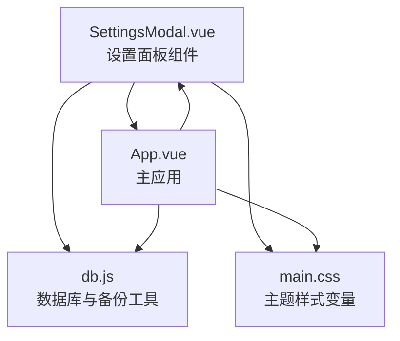
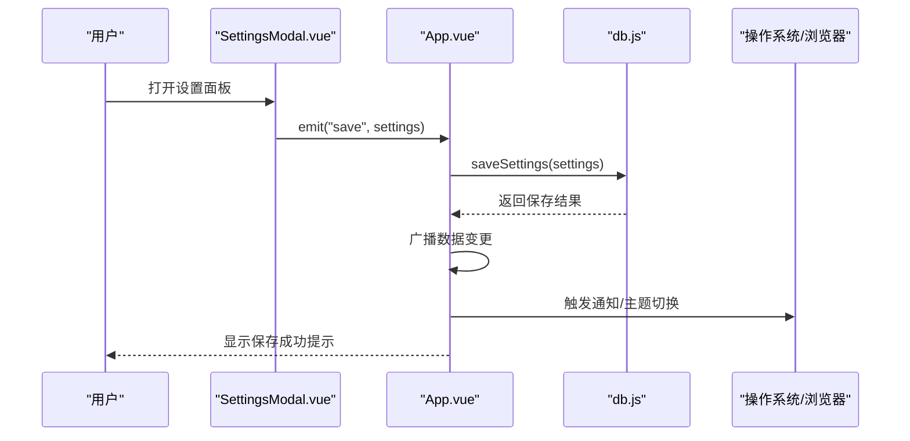
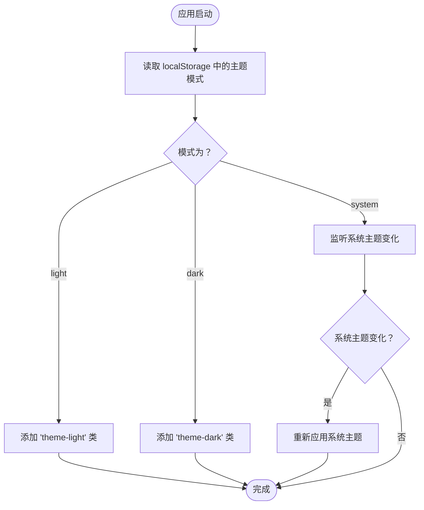
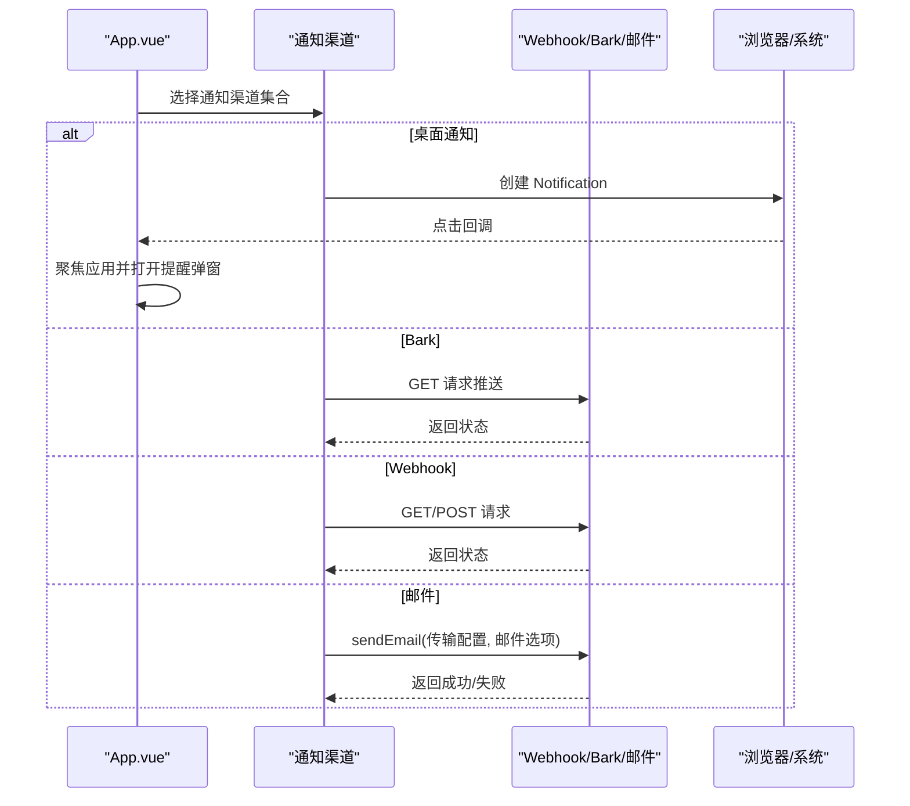
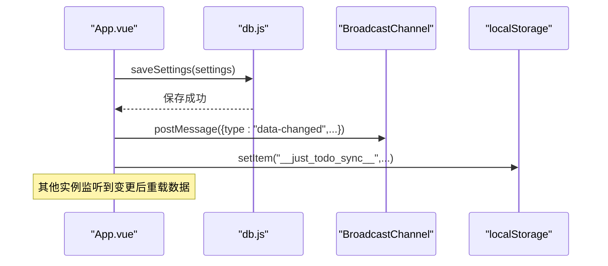
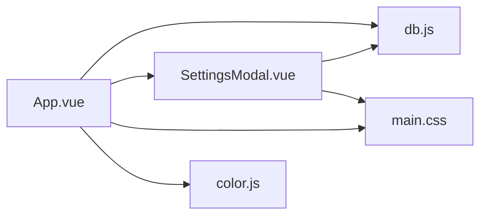

# 设置模态面板

<cite>
**本文档引用的文件**
- [SettingsModal.vue](file://src/components/SettingsModal.vue)
- [db.js](file://src/utils/db.js)
- [App.vue](file://src/App.vue)
- [main.css](file://src/main.css)
- [color.js](file://src/utils/color.js)
- [main.js](file://src/main.js)
</cite>

## 目录
1. [简介](#简介)
2. [项目结构](#项目结构)
3. [核心组件](#核心组件)
4. [架构总览](#架构总览)
5. [详细组件分析](#详细组件分析)
6. [依赖关系分析](#依赖关系分析)
7. [性能考量](#性能考量)
8. [故障排除指南](#故障排除指南)
9. [结论](#结论)
10. [附录](#附录)

## 简介
本文件面向 SettingsModal 设置面板，系统性阐述应用设置的层次结构与分类管理，覆盖主题配置、通知设置、系统选项与用户偏好，并深入解析主题切换机制（浅色、深色与系统主题自动适配）、通知渠道配置流程（桌面通知、邮件、Bark、Webhook）以及数据备份与恢复机制。同时提供设置面板的可扩展性设计建议、设置验证与默认值处理策略，以及错误恢复机制说明，帮助开发者在不破坏现有功能的前提下进行扩展与维护。

## 项目结构
SettingsModal 作为独立的 Vue 组件，位于 src/components 目录下，配合 src/utils/db.js 实现设置数据的持久化与备份恢复，通过 src/main.css 定义主题变量与样式体系，最终在 src/App.vue 中被主应用调用并参与全局通知逻辑。

图表来源
- [SettingsModal.vue:1-1140](file://src/components/SettingsModal.vue#L1-L1140)
- [db.js:1-157](file://src/utils/db.js#L1-L157)
- [App.vue:1-3300](file://src/App.vue#L1-L3300)
- [main.css:1-170](file://src/main.css#L1-L170)

章节来源
- [SettingsModal.vue:1-1140](file://src/components/SettingsModal.vue#L1-L1140)
- [db.js:1-157](file://src/utils/db.js#L1-L157)
- [App.vue:1-3300](file://src/App.vue#L1-L3300)
- [main.css:1-170](file://src/main.css#L1-L170)

## 核心组件
- SettingsModal.vue：提供设置面板界面，包含“通知管理”和“数据管理”两个标签页，支持桌面通知、邮件、Bark、Webhook 的配置与测试，支持本地与 WebDAV 备份导出与恢复。
- db.js：封装本地存储与备份/恢复逻辑，负责设置文档的读写、备份载荷生成与恢复应用。
- App.vue：应用主入口，负责加载设置、执行通知分发、主题切换与跨设备同步广播。
- main.css：定义主题变量与浅色/深色媒体查询，支持手动主题类与系统主题监听。
- color.js：颜色工具函数，为颜色相关设置提供校验与转换能力。

章节来源
- [SettingsModal.vue:287-410](file://src/components/SettingsModal.vue#L287-L410)
- [db.js:45-157](file://src/utils/db.js#L45-L157)
- [App.vue:268-326](file://src/App.vue#L268-L326)
- [main.css:1-170](file://src/main.css#L1-L170)
- [color.js:1-27](file://src/utils/color.js#L1-L27)

## 架构总览
设置面板采用“组件-工具-应用”的分层架构：
- 组件层：SettingsModal 负责 UI 交互、表单绑定与事件发射。
- 工具层：db.js 封装设置读写、备份载荷生成与恢复应用。
- 应用层：App.vue 负责加载设置、触发通知、主题切换与跨设备同步。

图表来源
- [SettingsModal.vue:372-376](file://src/components/SettingsModal.vue#L372-L376)
- [App.vue:1181-1188](file://src/App.vue#L1181-L1188)
- [db.js:144-148](file://src/utils/db.js#L144-L148)

## 详细组件分析

### 设置面板层次结构与分类管理
- 通知管理标签页
  - 桌面通知：启用/禁用开关与测试按钮。
  - 邮件通知：SMTP 主机、端口、SSL、发件人、授权码、收件人等配置，支持测试邮件发送。
  - Bark 通知：服务端 URL、通知级别、铃声、角标等配置，支持测试消息推送。
  - Webhook 通知：URL、请求方式、内容类型、请求头、自定义请求体，支持测试请求。
- 数据管理标签页
  - 本地备份：导出备份文件至本地或浏览器下载。
  - WebDAV 备份：配置服务器地址、目录、凭据；支持导出、刷新目录、选择备份并恢复。

章节来源
- [SettingsModal.vue:30-275](file://src/components/SettingsModal.vue#L30-L275)
- [SettingsModal.vue:198-275](file://src/components/SettingsModal.vue#L198-L275)

### 主题切换机制
- 支持三种模式：浅色(light)、深色(dark)、系统(system)。
- 本地持久化：通过 localStorage 存储当前主题模式。
- 运行时应用：根据模式动态为根元素添加 theme-light 或 theme-dark 类，或跟随系统。
- 媒体查询监听：当系统主题变化且当前模式为“系统”时，自动应用系统主题。
- 样式变量：通过 CSS 变量统一控制背景、文本、边框、阴影等，确保主题切换一致。

图表来源
- [App.vue:288-291](file://src/App.vue#L288-L291)
- [App.vue:294-298](file://src/App.vue#L294-L298)
- [main.css:138-170](file://src/main.css#L138-L170)

章节来源
- [App.vue:268-326](file://src/App.vue#L268-L326)
- [main.css:1-170](file://src/main.css#L1-L170)

### 通知渠道配置与集成流程
- 桌面通知：优先使用浏览器 Notification API，若失败则回退到 uTools 原生通知；支持点击跳转至提醒弹窗。
- 邮件通知：通过 window.services.sendEmail 发送，使用 SMTP 配置；失败时显示错误提示。
- Bark 通知：拼接服务端 URL 与查询参数（level/sound/badge），发起 GET 请求。
- Webhook 通知：支持 GET/POST，POST 支持 JSON/Form Data 两种 Content-Type；支持自定义请求头与自定义请求体合并。

图表来源
- [App.vue:1017-1178](file://src/App.vue#L1017-L1178)
- [App.vue:1204-1300](file://src/App.vue#L1204-L1300)

章节来源
- [App.vue:1017-1178](file://src/App.vue#L1017-L1178)
- [App.vue:1204-1300](file://src/App.vue#L1204-L1300)

### 系统设置的持久化与跨设备同步
- 持久化存储：设置文档保存在本地数据库中，键为 settings，值为对象，包含 notification 与 backup 两部分。
- 跨设备同步：通过 BroadcastChannel 与 localStorage 变更事件实现多窗口/多实例同步；主应用在设置保存后广播“data-changed”，其他实例监听后触发数据重载。
- 备份与恢复：备份载荷包含 categories、todos、settings 与主题模式；恢复时写入对应集合并更新主题模式。

图表来源
- [App.vue:1181-1196](file://src/App.vue#L1181-L1196)
- [App.vue:455-486](file://src/App.vue#L455-L486)
- [db.js:144-148](file://src/utils/db.js#L144-L148)

章节来源
- [App.vue:455-486](file://src/App.vue#L455-L486)
- [App.vue:1181-1196](file://src/App.vue#L1181-L1196)
- [db.js:45-100](file://src/utils/db.js#L45-L100)

### 设置面板的可扩展性设计
- 新增设置项步骤
  - 在 SettingsModal.vue 的 defaultSettings 中添加字段与默认值。
  - 在模板中新增表单项，使用 v-model 绑定。
  - 如需测试功能，新增 emit('test-xxx') 并在 App.vue 中实现对应的 testXxx 方法。
  - 在 App.vue 的 handleSaveSettings 中合并新字段到 settings.notification。
- 修改现有设置
  - 若需调整字段类型或默认值，优先在 defaultSettings 中更新，保持 hydrateFromProps 的兼容性。
  - 对于复杂表单（如 Webhook 请求头列表），通过辅助方法 addHeader/removeHeader 管理动态列表。
- 备份与恢复扩展
  - 在 db.js 的 createBackupPayload/applyBackupPayload 中增加/迁移字段，确保版本兼容与默认值注入。

章节来源
- [SettingsModal.vue:308-343](file://src/components/SettingsModal.vue#L308-L343)
- [SettingsModal.vue:383-390](file://src/components/SettingsModal.vue#L383-L390)
- [App.vue:1181-1196](file://src/App.vue#L1181-L1196)
- [db.js:47-100](file://src/utils/db.js#L47-L100)

### 设置验证、默认值与错误恢复
- 默认值处理
  - SettingsModal 初始化时以 defaultSettings 为基础，结合 props.initialSettings 合并，保证字段完整性。
  - Webhook 的 headers 数组缺失时自动补全为空数组。
- 验证规则
  - 邮件配置有效性通过 isEmailValid 计算属性校验关键字段是否齐全。
  - WebDAV 凭据完整性通过 isWebdavReady 计算属性校验。
- 错误恢复
  - 通知发送失败时记录日志并回退到 uTools 原生通知或弹窗提示。
  - 备份/恢复异常通过 notify 弹窗提示具体错误信息。
  - 数据库操作异常在 db.js 中捕获并抛出，由上层处理。

章节来源
- [SettingsModal.vue:308-343](file://src/components/SettingsModal.vue#L308-L343)
- [SettingsModal.vue:378-407](file://src/components/SettingsModal.vue#L378-L407)
- [App.vue:1048-1066](file://src/App.vue#L1048-L1066)
- [db.js:30-43](file://src/utils/db.js#L30-L43)

## 依赖关系分析
- SettingsModal 依赖 db.js 的备份载荷生成与恢复应用能力。
- App.vue 依赖 SettingsModal 的事件发射（save/save-backup/test-*）与 db.js 的设置读写。
- main.css 为 App.vue 与 SettingsModal 提供主题变量与样式基础。
- color.js 为颜色相关设置提供校验与转换工具。

图表来源
- [SettingsModal.vue:287-290](file://src/components/SettingsModal.vue#L287-L290)
- [App.vue:12-14](file://src/App.vue#L12-L14)
- [main.css:1-170](file://src/main.css#L1-L170)
- [color.js:1-27](file://src/utils/color.js#L1-L27)

章节来源
- [SettingsModal.vue:287-290](file://src/components/SettingsModal.vue#L287-L290)
- [App.vue:12-14](file://src/App.vue#L12-L14)
- [main.css:1-170](file://src/main.css#L1-L170)
- [color.js:1-27](file://src/utils/color.js#L1-L27)

## 性能考量
- 表单双向绑定：使用 reactive 与 v-model，避免不必要的深度监听；watch 仅在可见状态变化时初始化 hydrate。
- 通知调度：定时器每分钟检查一次到期任务，避免频繁轮询；缓存已通知任务 ID，减少重复推送。
- 备份导出：本地导出与 WebDAV 导出均采用异步请求，导出过程中禁用按钮防止重复操作。
- 样式变量：通过 CSS 变量统一主题，减少运行时样式计算成本。

[本节为通用指导，无需特定文件来源]

## 故障排除指南
- 桌面通知无响应
  - 检查浏览器通知权限是否允许；若 API 失败，回退到 uTools 原生通知。
  - 参考路径：[App.vue:1034-1066](file://src/App.vue#L1034-L1066)
- 邮件发送失败
  - 校验 SMTP 配置（主机、端口、SSL、授权码、收件人）；查看服务返回的错误信息。
  - 参考路径：[App.vue:1151-1178](file://src/App.vue#L1151-L1178)
- Bark 推送失败
  - 确认服务端 URL 正确且以斜杠结尾；检查 level/sound/badge 参数。
  - 参考路径：[App.vue:1069-1082](file://src/App.vue#L1069-L1082)
- Webhook 请求失败
  - 检查 URL、方法、内容类型与请求头；确认自定义请求体 JSON 格式正确。
  - 参考路径：[App.vue:1085-1143](file://src/App.vue#L1085-L1143)
- 备份/恢复异常
  - 本地导出失败：检查浏览器下载权限或文件写入权限；WebDAV 失败：检查服务器地址、目录与凭据。
  - 参考路径：[SettingsModal.vue:469-519](file://src/components/SettingsModal.vue#L469-L519)，[SettingsModal.vue:608-644](file://src/components/SettingsModal.vue#L608-L644)

章节来源
- [App.vue:1034-1178](file://src/App.vue#L1034-L1178)
- [SettingsModal.vue:469-519](file://src/components/SettingsModal.vue#L469-L519)
- [SettingsModal.vue:608-644](file://src/components/SettingsModal.vue#L608-L644)

## 结论
SettingsModal 设置面板以清晰的层次结构与完善的工具链支撑了主题、通知与备份等核心功能。其可扩展的设计便于后续新增设置项与增强通知渠道；通过本地持久化与跨设备同步机制保障用户体验一致性；完善的验证与错误恢复策略提升了系统的健壮性。建议在扩展新功能时遵循现有模式，确保设置项的默认值、验证与备份恢复流程的一致性。

[本节为总结性内容，无需特定文件来源]

## 附录
- 设置项默认值参考
  - 桌面通知：enabled=true
  - 邮件通知：enabled=false，host=smtp.qq.com，port=465，secure=true，user/pass/to 为空
  - Bark 通知：enabled=false，serverUrl 为空，level=active，sound=minuet，badge=1
  - Webhook 通知：enabled=false，url 为空，method=POST，contentType=application/json，headers=[]，customBody=""
- 备份载荷字段
  - 包含 categories、todos、settings 与 themeMode；版本号与导出时间戳用于兼容性与审计。

章节来源
- [SettingsModal.vue:308-313](file://src/components/SettingsModal.vue#L308-L313)
- [db.js:47-70](file://src/utils/db.js#L47-L70)