# 输入模态组件

<cite>
**本文档引用的文件**
- [TaskModal.vue](file://src/components/TaskModal.vue)
- [TaskDrawer.vue](file://src/components/TaskDrawer.vue)
- [SettingsModal.vue](file://src/components/SettingsModal.vue)
- [DateTimePicker.vue](file://src/components/DateTimePicker.vue)
- [ToggleSwitch.vue](file://src/components/ToggleSwitch.vue)
- [db.js](file://src/utils/db.js)
- [App.vue](file://src/App.vue)
</cite>

## 目录
1. [简介](#简介)
2. [项目结构](#项目结构)
3. [核心组件](#核心组件)
4. [架构概览](#架构概览)
5. [详细组件分析](#详细组件分析)
6. [依赖关系分析](#依赖关系分析)
7. [性能考虑](#性能考虑)
8. [故障排除指南](#故障排除指南)
9. [结论](#结论)

## 简介

本文档深入分析了 Just-Todo 应用中的输入和配置模态组件，包括任务创建/编辑对话框（TaskModal）、任务抽屉（TaskDrawer）和设置面板（SettingsModal）。这些组件构成了应用的核心交互界面，提供了完整的任务管理功能，包括表单处理、验证逻辑、附件上传、通知配置和数据同步机制。

## 项目结构

项目采用基于功能的模块化组织方式，所有组件都位于 `src/components/` 目录下，每个组件都是独立的功能模块，通过 Vue 3 Composition API 实现现代化的开发体验。

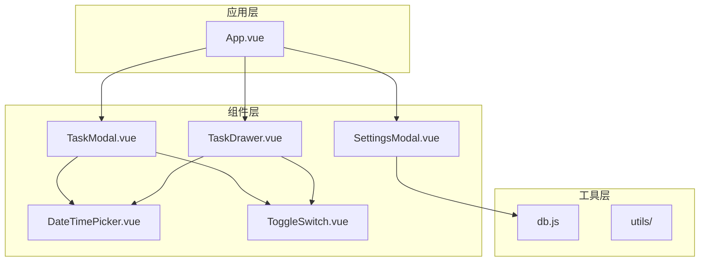

**图表来源**
- [TaskModal.vue:1-50](file://src/components/TaskModal.vue#L1-L50)
- [TaskDrawer.vue:1-50](file://src/components/TaskDrawer.vue#L1-L50)
- [SettingsModal.vue:1-50](file://src/components/SettingsModal.vue#L1-L50)
- [db.js:1-50](file://src/utils/db.js#L1-L50)

**章节来源**
- [TaskModal.vue:1-50](file://src/components/TaskModal.vue#L1-L50)
- [TaskDrawer.vue:1-50](file://src/components/TaskDrawer.vue#L1-L50)
- [SettingsModal.vue:1-50](file://src/components/SettingsModal.vue#L1-L50)

## 核心组件

### 任务模态组件（TaskModal）

TaskModal 是一个功能完整的任务创建和编辑对话框，支持复杂的表单处理和验证逻辑。

**主要特性：**
- 响应式表单设计，支持实时验证
- 附件上传和预览功能
- 重复任务规则配置
- 提醒系统集成
- 自动位置计算和滚动同步

### 任务抽屉组件（TaskDrawer）

TaskDrawer 提供了侧边弹出式的任务编辑体验，特别适合移动端和触摸设备。

**主要特性：**
- 浮动抽屉布局
- 实时数据同步
- 完整的任务历史记录
- 编辑器自动调整高度

### 设置面板组件（SettingsModal）

SettingsModal 提供了全面的系统配置管理，包括通知设置、数据备份和主题配置。

**主要特性：**
- 多标签页界面设计
- 通知渠道配置
- 数据备份和恢复
- 主题模式切换

**章节来源**
- [TaskModal.vue:183-521](file://src/components/TaskModal.vue#L183-L521)
- [TaskDrawer.vue:43-395](file://src/components/TaskDrawer.vue#L43-L395)
- [SettingsModal.vue:287-376](file://src/components/SettingsModal.vue#L287-L376)

## 架构概览

三个模态组件通过统一的应用状态管理进行协调，形成了完整的任务管理系统。

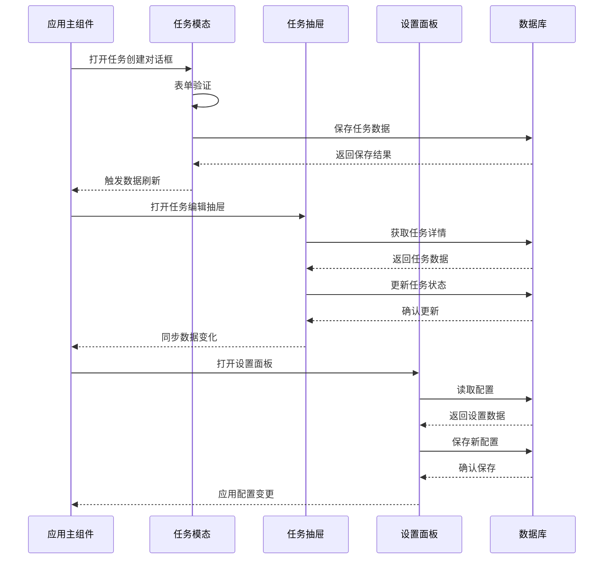

**图表来源**
- [App.vue:572-614](file://src/App.vue#L572-L614)
- [TaskModal.vue:801-822](file://src/components/TaskModal.vue#L801-L822)
- [TaskDrawer.vue:743-761](file://src/components/TaskDrawer.vue#L743-L761)
- [SettingsModal.vue:372-376](file://src/components/SettingsModal.vue#L372-L376)

## 详细组件分析

### TaskModal 组件深度分析

TaskModal 是整个应用中最复杂的组件，实现了完整的任务管理功能。

#### 表单处理架构

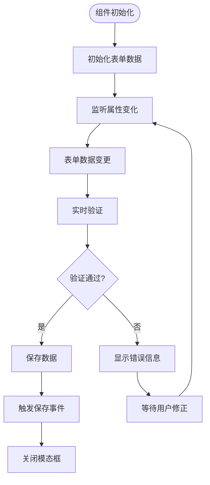

**图表来源**
- [TaskModal.vue:801-822](file://src/components/TaskModal.vue#L801-L822)
- [TaskModal.vue:611-613](file://src/components/TaskModal.vue#L611-L613)

#### 附件上传系统

TaskModal 实现了完整的附件处理系统，支持多种文件类型和预览功能。

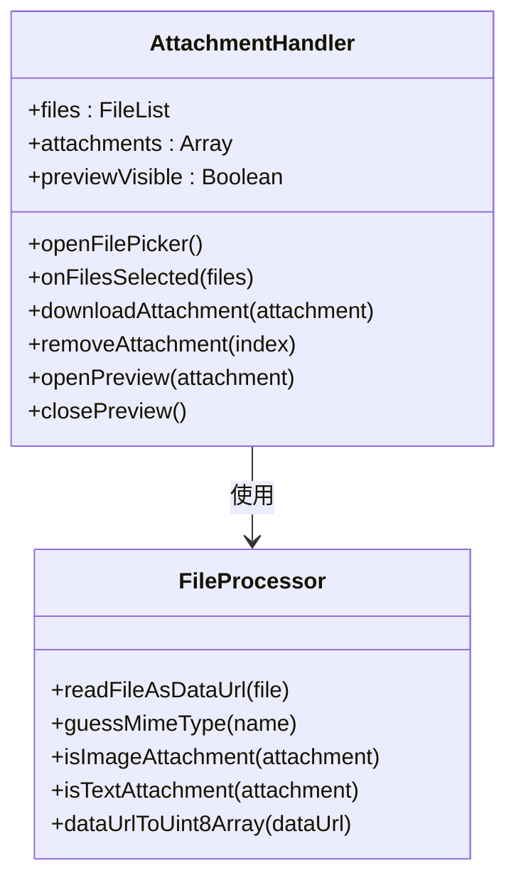

**图表来源**
- [TaskModal.vue:227-347](file://src/components/TaskModal.vue#L227-L347)
- [TaskModal.vue:236-289](file://src/components/TaskModal.vue#L236-L289)

#### 通知系统集成

TaskModal 集成了多通道通知系统，支持桌面、邮件、Bark 和 Webhook 通知。

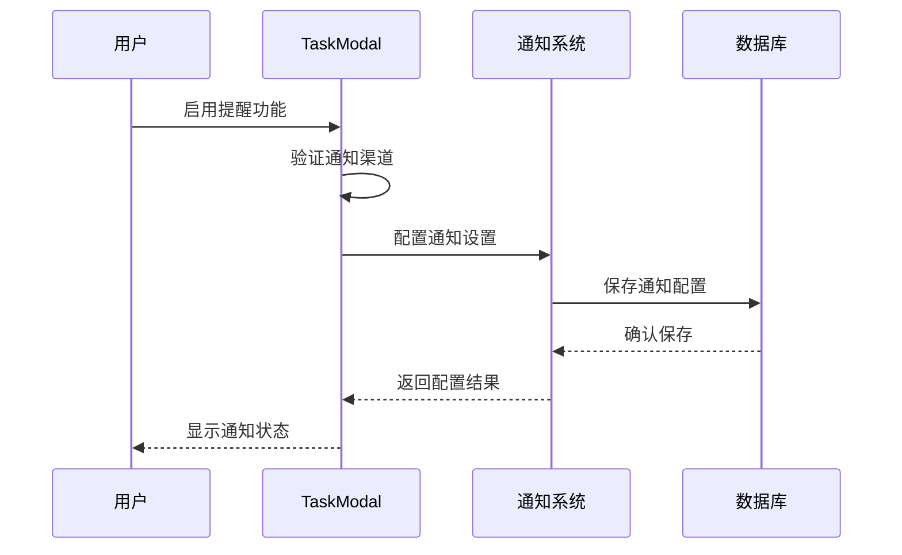

**图表来源**
- [TaskModal.vue:418-453](file://src/components/TaskModal.vue#L418-L453)
- [TaskModal.vue:455-487](file://src/components/TaskModal.vue#L455-L487)

**章节来源**
- [TaskModal.vue:1-831](file://src/components/TaskModal.vue#L1-L831)

### TaskDrawer 组件深度分析

TaskDrawer 提供了独特的抽屉式交互体验，特别适合移动设备使用。

#### 抽屉交互机制

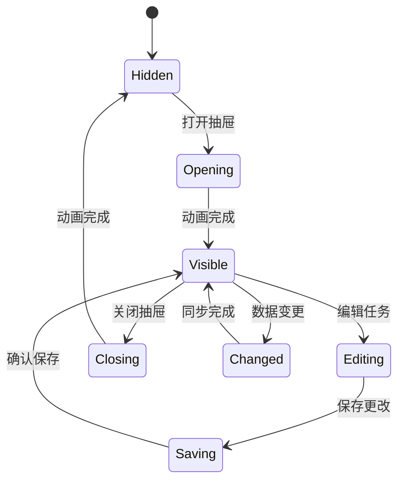

**图表来源**
- [TaskDrawer.vue:763-766](file://src/components/TaskDrawer.vue#L763-L766)
- [TaskDrawer.vue:768-800](file://src/components/TaskDrawer.vue#L768-L800)

#### 实时数据同步

TaskDrawer 实现了双向数据同步机制，确保抽屉中的数据与主列表保持一致。

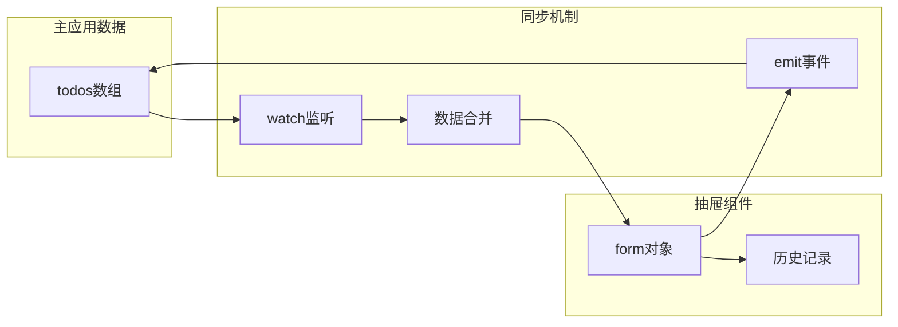

**图表来源**
- [TaskDrawer.vue:234-243](file://src/components/TaskDrawer.vue#L234-L243)
- [TaskDrawer.vue:586-594](file://src/components/TaskDrawer.vue#L586-L594)

**章节来源**
- [TaskDrawer.vue:1-800](file://src/components/TaskDrawer.vue#L1-L800)

### SettingsModal 组件深度分析

SettingsModal 提供了全面的系统配置管理功能，是应用的控制中心。

#### 设置面板架构

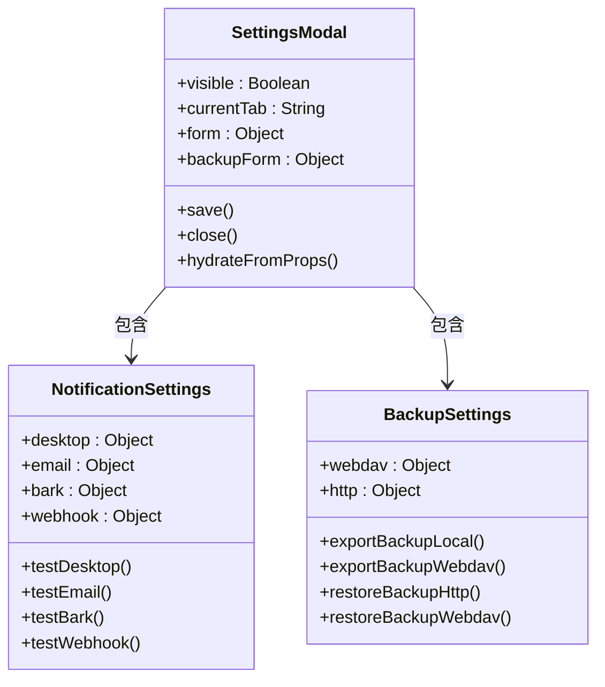

**图表来源**
- [SettingsModal.vue:287-376](file://src/components/SettingsModal.vue#L287-L376)
- [SettingsModal.vue:308-322](file://src/components/SettingsModal.vue#L308-L322)

#### 备份恢复系统

SettingsModal 实现了完整的数据备份和恢复功能，支持本地文件和 WebDAV 两种存储方式。

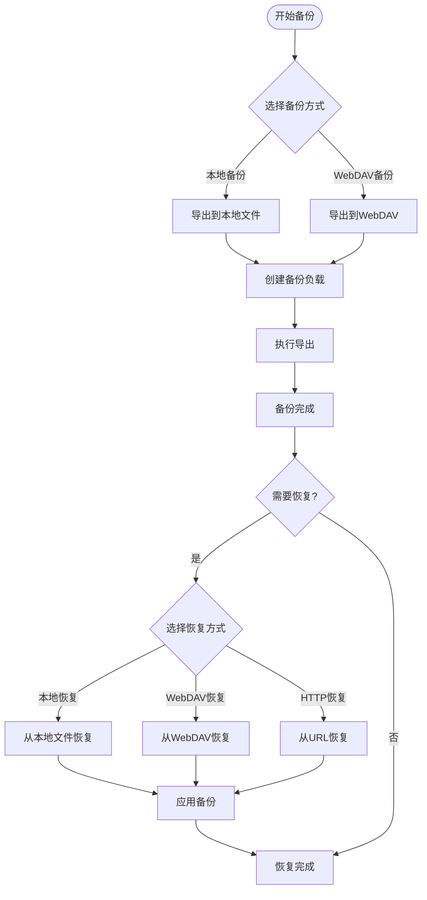

**图表来源**
- [SettingsModal.vue:469-500](file://src/components/SettingsModal.vue#L469-L500)
- [SettingsModal.vue:502-519](file://src/components/SettingsModal.vue#L502-L519)
- [SettingsModal.vue:585-644](file://src/components/SettingsModal.vue#L585-L644)

**章节来源**
- [SettingsModal.vue:1-1140](file://src/components/SettingsModal.vue#L1-L1140)

## 依赖关系分析

### 组件间依赖关系

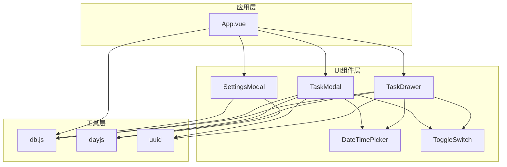

**图表来源**
- [App.vue:1-30](file://src/App.vue#L1-L30)
- [TaskModal.vue:1-10](file://src/components/TaskModal.vue#L1-L10)
- [TaskDrawer.vue:1-10](file://src/components/TaskDrawer.vue#L1-L10)
- [SettingsModal.vue:1-10](file://src/components/SettingsModal.vue#L1-L10)

### 数据流管理

应用实现了完整的数据流管理机制，确保各个组件之间的数据一致性。

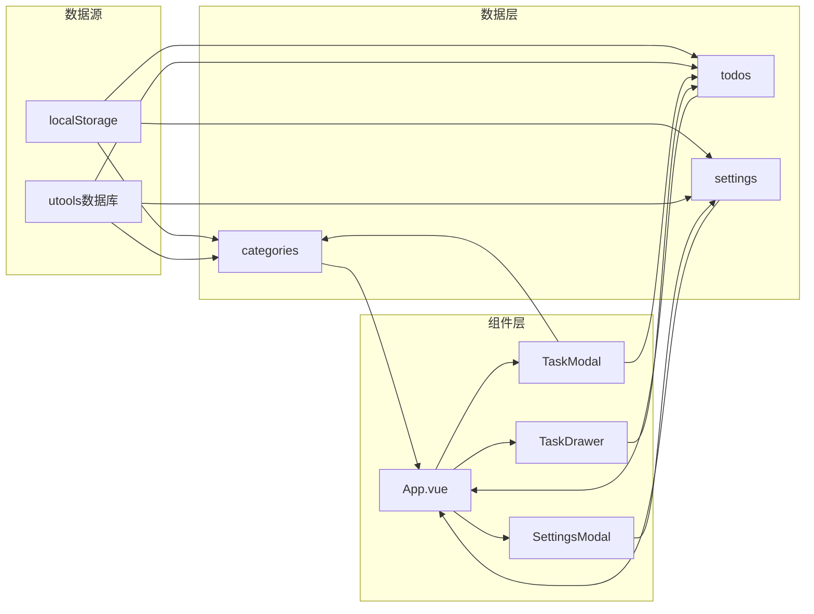

**图表来源**
- [db.js:1-157](file://src/utils/db.js#L1-L157)
- [App.vue:489-535](file://src/App.vue#L489-L535)

**章节来源**
- [db.js:1-157](file://src/utils/db.js#L1-L157)
- [App.vue:489-535](file://src/App.vue#L489-L535)

## 性能考虑

### 内存管理优化

三个模态组件都实现了适当的内存管理策略：

1. **事件监听器清理**：在组件卸载时自动清理事件监听器
2. **文件处理器优化**：使用 FileReader API 进行异步文件处理
3. **DOM 操作最小化**：通过 Vue 的响应式系统减少直接 DOM 操作

### 渲染性能优化

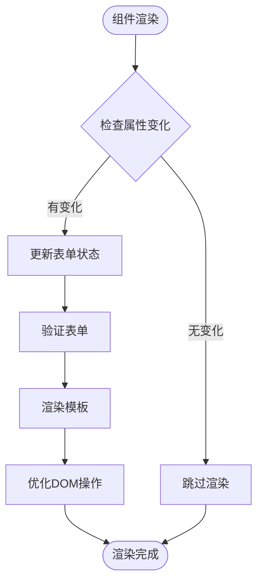

**图表来源**
- [TaskModal.vue:138-177](file://src/components/TaskModal.vue#L138-L177)
- [TaskDrawer.vue:358-395](file://src/components/TaskDrawer.vue#L358-L395)

### 存储优化策略

应用采用了混合存储策略来平衡性能和可靠性：

1. **浏览器环境**：使用 localStorage 作为主要存储
2. **uTools 环境**：使用内置数据库 API
3. **数据迁移**：提供向后兼容的数据迁移机制

**章节来源**
- [TaskModal.vue:179-181](file://src/components/TaskModal.vue#L179-L181)
- [TaskDrawer.vue:433-435](file://src/components/TaskDrawer.vue#L433-L435)
- [db.js:1-43](file://src/utils/db.js#L1-L43)

## 故障排除指南

### 常见问题诊断

#### 附件上传问题

**症状**：附件无法上传或预览失败

**可能原因**：
1. 文件大小超出限制
2. 文件类型不受支持
3. 浏览器兼容性问题

**解决方案**：
1. 检查文件大小限制
2. 验证文件类型支持
3. 测试不同浏览器兼容性

#### 通知配置问题

**症状**：通知无法正常发送

**可能原因**：
1. 浏览器权限设置
2. 通知渠道配置错误
3. 网络连接问题

**解决方案**：
1. 检查浏览器通知权限
2. 验证通知渠道配置
3. 测试网络连接稳定性

#### 数据同步问题

**症状**：组件间数据不同步

**可能原因**：
1. 事件监听器未正确绑定
2. 数据更新时机不当
3. 组件销毁时机问题

**解决方案**：
1. 检查事件监听器绑定
2. 调整数据更新时机
3. 确保组件正确销毁

**章节来源**
- [TaskModal.vue:236-347](file://src/components/TaskModal.vue#L236-L347)
- [SettingsModal.vue:392-395](file://src/components/SettingsModal.vue#L392-L395)
- [App.vue:123-131](file://src/App.vue#L123-L131)

## 结论

Just-Todo 应用的输入和配置模态组件展现了现代前端开发的最佳实践。通过精心设计的组件架构、完善的表单处理机制、灵活的通知系统和可靠的备份恢复功能，这些组件为用户提供了流畅、高效的任务管理体验。

### 设计亮点

1. **模块化设计**：每个组件职责明确，便于维护和扩展
2. **响应式架构**：充分利用 Vue 3 的响应式系统
3. **用户体验优化**：注重交互细节和反馈机制
4. **数据一致性**：通过事件驱动确保数据同步
5. **可扩展性**：为未来功能扩展预留接口

### 技术优势

- **类型安全**：通过 TypeScript 和严格的类型检查
- **性能优化**：合理的渲染策略和内存管理
- **跨平台兼容**：同时支持浏览器和 uTools 环境
- **国际化支持**：内置中文本地化支持
- **无障碍访问**：遵循无障碍设计原则

这些组件不仅满足了当前的功能需求，更为未来的功能扩展和技术演进奠定了坚实的基础。