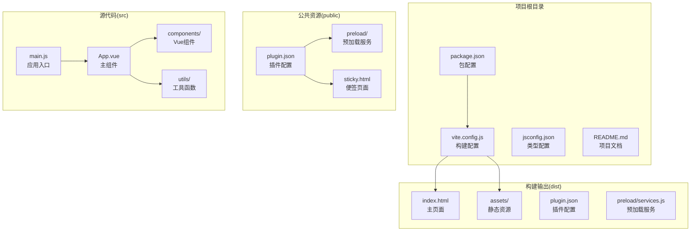
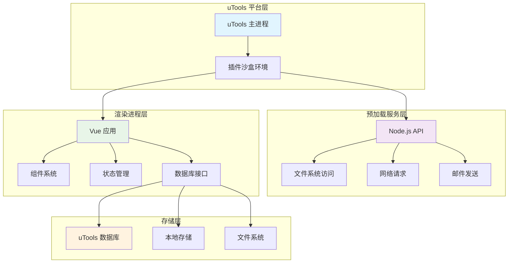
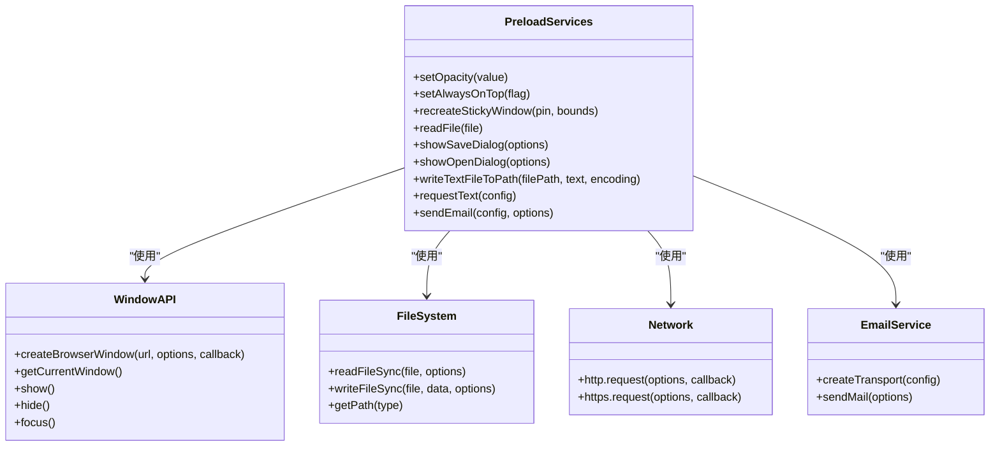
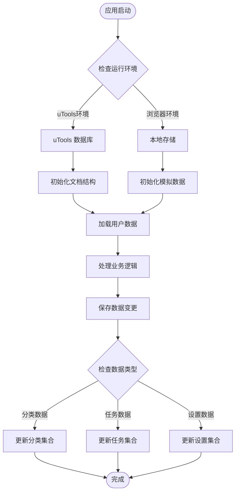
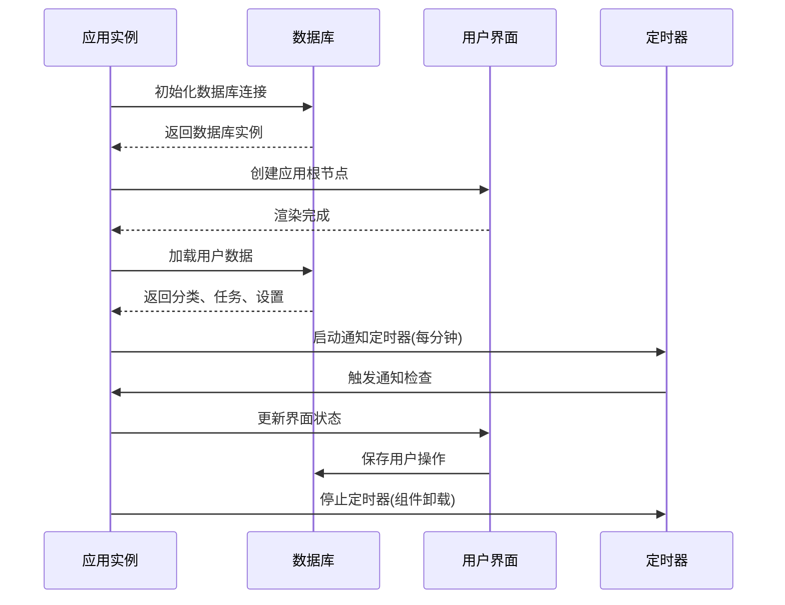

# 部署指南

<cite>
**本文档引用的文件**
- [package.json](file://package.json)
- [vite.config.js](file://vite.config.js)
- [plugin.json](file://plugin.json)
- [public/plugin.json](file://public/plugin.json)
- [public/preload/services.js](file://public/preload/services.js)
- [public/sticky.html](file://public/sticky.html)
- [index.html](file://index.html)
- [src/main.js](file://src/main.js)
- [src/App.vue](file://src/App.vue)
- [src/utils/db.js](file://src/utils/db.js)
- [jsconfig.json](file://jsconfig.json)
- [README.md](file://README.md)
</cite>

## 目录
1. [简介](#简介)
2. [项目结构](#项目结构)
3. [核心组件](#核心组件)
4. [架构概览](#架构概览)
5. [详细组件分析](#详细组件分析)
6. [依赖分析](#依赖分析)
7. [性能考虑](#性能考虑)
8. [故障排除指南](#故障排除指南)
9. [结论](#结论)
10. [附录](#附录)

## 简介

Just-Todo 是一个基于 uTools 平台的轻量级待办事项插件。该项目采用现代前端技术栈，使用 Vue 3 + Vite 构建，提供了完整的任务管理功能，包括分类清单、重复任务、视图切换、数据导出等特性。

本部署指南将详细介绍项目的生产环境构建配置、资源优化策略、uTools 插件发布流程、版本管理和分发机制，以及跨平台部署要求和兼容性测试方法。

## 项目结构

项目采用标准的 Vue 3 + Vite 项目结构，主要分为以下几部分：



**图表来源**
- [package.json:1-24](file://package.json#L1-L24)
- [vite.config.js:1-28](file://vite.config.js#L1-L28)
- [public/plugin.json:1-21](file://public/plugin.json#L1-L21)

**章节来源**
- [README.md:63-77](file://README.md#L63-L77)
- [package.json:1-24](file://package.json#L1-L24)

## 核心组件

### 构建系统配置

项目使用 Vite 作为构建工具，配置了专门的生产环境优化策略：

- **模块化打包**: 通过 Rollup 的 manualChunks 功能实现代码分割
- **动态导入**: 关键依赖采用异步加载策略
- **资源基路径**: 设置相对路径基址确保插件部署兼容性

### 插件配置系统

uTools 插件通过 JSON 配置文件定义核心参数：

- **入口文件**: 指定主应用入口和开发环境地址
- **预加载服务**: 提供 Node.js 能力给渲染进程
- **功能定义**: 声明插件的功能码和命令触发词

**章节来源**
- [vite.config.js:5-27](file://vite.config.js#L5-L27)
- [plugin.json:1-21](file://plugin.json#L1-L21)
- [public/plugin.json:1-21](file://public/plugin.json#L1-L21)

## 架构概览

项目采用前后端分离的架构设计，结合 uTools 平台的特殊运行环境：



**图表来源**
- [public/preload/services.js:51-357](file://public/preload/services.js#L51-L357)
- [src/utils/db.js:1-157](file://src/utils/db.js#L1-L157)

## 详细组件分析

### 预加载服务系统

预加载服务是 uTools 插件的核心组件，提供了从 Node.js 环境到渲染进程的桥接：



**图表来源**
- [public/preload/services.js:59-357](file://public/preload/services.js#L59-L357)

#### 核心功能模块

1. **窗口管理**: 支持透明窗口、置顶显示、便签功能
2. **文件系统**: 提供文件读写、对话框集成
3. **网络通信**: 封装 HTTP/HTTPS 请求
4. **邮件服务**: 基于 nodemailer 的邮件发送功能

**章节来源**
- [public/preload/services.js:1-358](file://public/preload/services.js#L1-L358)

### 数据持久化系统

应用采用多层数据存储策略，确保在不同环境下的兼容性：



**图表来源**
- [src/utils/db.js:21-43](file://src/utils/db.js#L21-L43)

#### 数据存储策略

1. **uTools 环境**: 使用 window.utools.db API 进行数据存储
2. **开发环境**: 使用 localStorage 模拟数据库行为
3. **数据迁移**: 自动处理字段兼容性和默认值

**章节来源**
- [src/utils/db.js:102-157](file://src/utils/db.js#L102-L157)

### 应用生命周期管理

Vue 应用采用现代化的状态管理模式和生命周期钩子：



**图表来源**
- [src/App.vue:482-486](file://src/App.vue#L482-L486)

**章节来源**
- [src/App.vue:294-322](file://src/App.vue#L294-L322)

## 依赖分析

项目依赖关系呈现清晰的层次结构：

```mermaid
graph TB
subgraph "运行时依赖"
A[Vue 3<br/>核心框架]
B[Day.js<br/>时间处理]
C[html2canvas<br/>截图功能]
D[jspdf<br/>PDF生成]
E[uuid<br/>唯一标识]
F[vuedraggable<br/>拖拽功能]
G[canvas-confetti<br/>特效动画]
H[remixicon<br/>图标库]
end
subgraph "开发依赖"
I[@vitejs/plugin-vue<br/>Vue插件]
J[Vite<br/>构建工具]
K[Less<br/>CSS预处理器]
L[utools-api-types<br/>类型定义]
end
subgraph "应用层"
M[main.js<br/>应用入口]
N[App.vue<br/>主组件]
O[components/<br/>组件库]
P[utils/<br/>工具函数]
end
A --> M
M --> N
N --> O
N --> P
O --> A
P --> B
P --> C
P --> D
P --> E
P --> F
P --> G
P --> H
I --> J
K --> J
L --> J
```

**图表来源**
- [package.json:7-22](file://package.json#L7-L22)

### 性能优化策略

项目实现了多项性能优化措施：

1. **代码分割**: 通过 manualChunks 实现按功能模块的代码分割
2. **懒加载**: 关键依赖采用动态 import 实现按需加载
3. **缓存策略**: 对大型库进行缓存复用
4. **构建优化**: 生产环境启用压缩和 Tree Shaking

**章节来源**
- [vite.config.js:14-24](file://vite.config.js#L14-L24)

## 性能考虑

### 构建性能优化

项目在构建阶段采用了多项优化策略：

- **模块化打包**: 将第三方库按功能分组，避免单一大文件
- **动态导入**: 关键功能模块采用异步加载，减少首屏加载时间
- **资源压缩**: 生产环境自动启用代码压缩和资源优化

### 运行时性能优化

应用层面的性能优化包括：

- **虚拟滚动**: 大列表数据的虚拟化处理
- **事件节流**: 高频事件的防抖处理
- **内存管理**: 及时清理定时器和事件监听器

## 故障排除指南

### 常见部署问题

1. **插件无法加载**
   - 检查 plugin.json 配置是否正确
   - 确认预加载服务文件路径有效
   - 验证入口文件是否存在

2. **功能异常**
   - 检查 Node.js API 权限配置
   - 验证文件系统访问权限
   - 确认网络请求超时设置

3. **数据丢失**
   - 检查 uTools 数据库连接
   - 验证本地存储权限
   - 确认数据备份机制

**章节来源**
- [public/preload/services.js:342-356](file://public/preload/services.js#L342-L356)

### 调试工具

项目提供了多种调试和监控手段：

- **控制台日志**: 详细的错误信息输出
- **状态监控**: 实时查看应用状态变化
- **性能分析**: 构建产物的体积分析

## 结论

Just-Todo 项目展现了现代前端插件开发的最佳实践。通过合理的架构设计、完善的性能优化和严格的部署流程，该项目能够在 uTools 平台上提供稳定可靠的服务。

建议在生产环境中重点关注以下方面：
- 构建产物的完整性验证
- 不同平台的兼容性测试
- 用户数据的安全保护
- 错误日志的收集和分析

## 附录

### 发布检查清单

- [ ] 所有依赖项已正确安装
- [ ] 构建配置已针对生产环境优化
- [ ] 插件配置文件完整无误
- [ ] 预加载服务功能正常
- [ ] 数据库连接测试通过
- [ ] 跨平台兼容性验证
- [ ] 性能基准测试完成
- [ ] 用户验收测试通过

### 版本管理策略

项目采用语义化版本控制，遵循以下规则：
- 主版本号：重大功能变更或破坏性修改
- 次版本号：新增功能但保持向后兼容
- 修订号：bug 修复和小功能调整

### CI/CD 流程建议

建议实施以下持续集成流程：
1. 代码提交触发构建
2. 自动化测试执行
3. 代码质量检查
4. 构建产物生成
5. 自动化部署
6. 监控告警配置