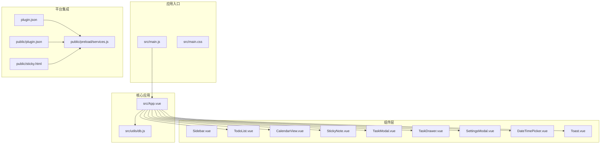
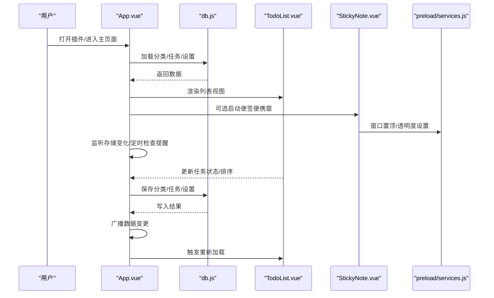
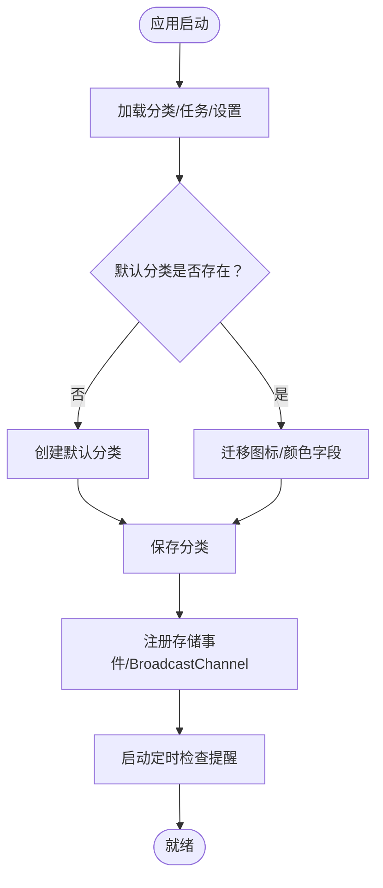
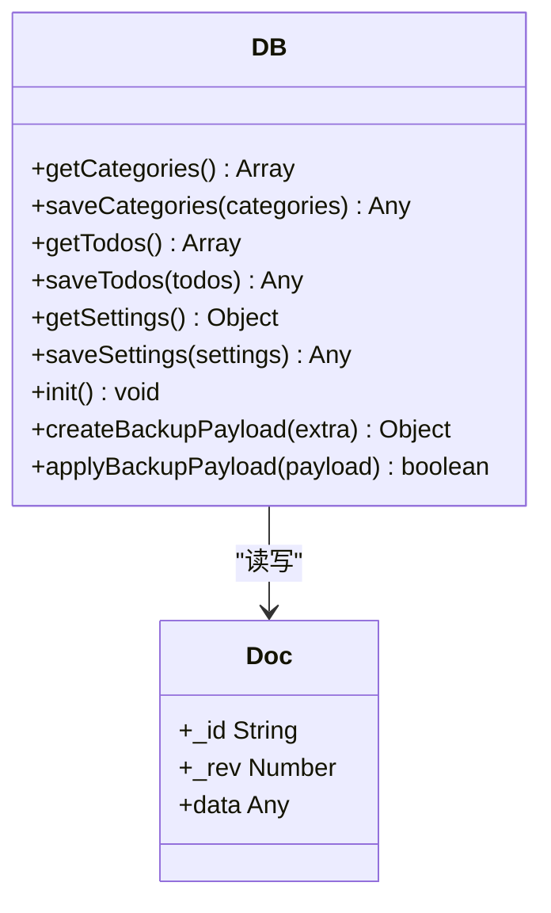
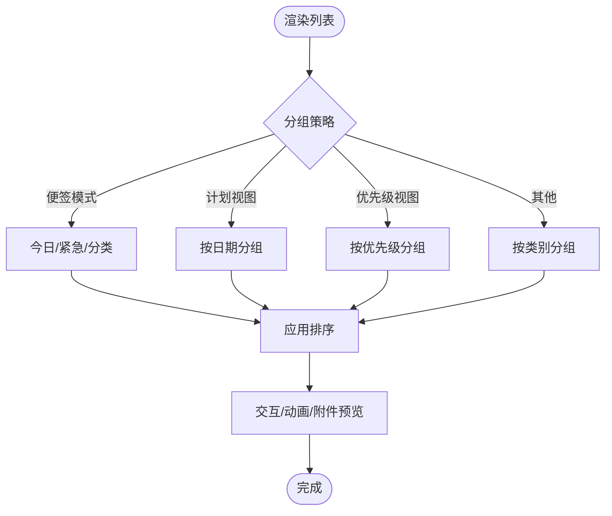
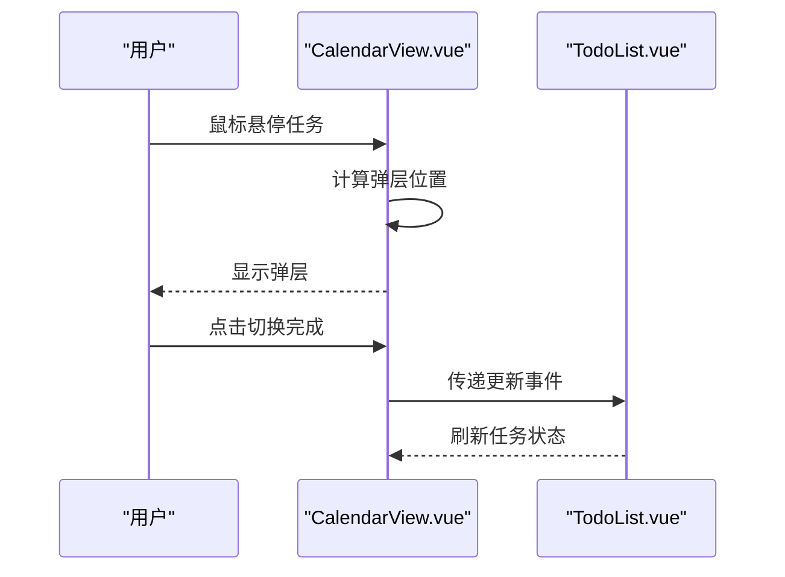
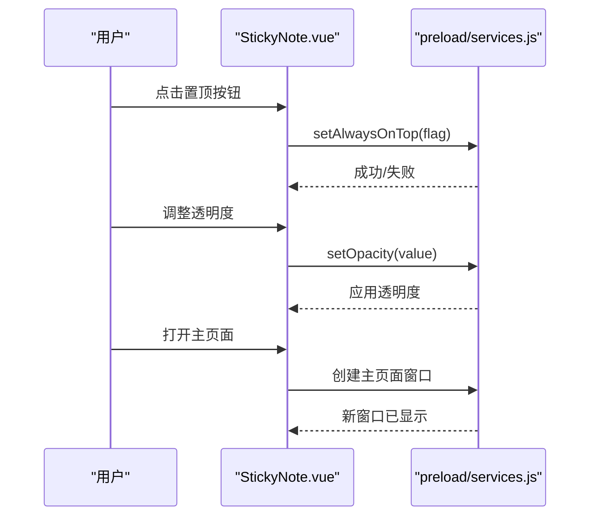
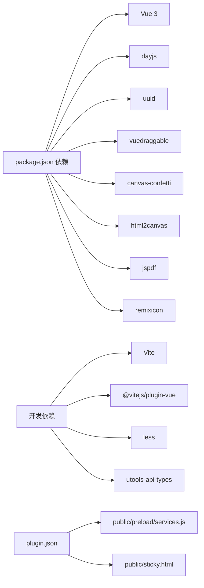

# 项目概述

<cite>
**本文引用的文件列表**
- [package.json](file://package.json)
- [plugin.json](file://plugin.json)
- [public/plugin.json](file://public/plugin.json)
- [src/main.js](file://src/main.js)
- [src/App.vue](file://src/App.vue)
- [src/main.css](file://src/main.css)
- [src/utils/db.js](file://src/utils/db.js)
- [src/components/StickyNote.vue](file://src/components/StickyNote.vue)
- [src/components/TodoList.vue](file://src/components/TodoList.vue)
- [src/components/CalendarView.vue](file://src/components/CalendarView.vue)
- [src/components/TaskModal.vue](file://src/components/TaskModal.vue)
- [public/sticky.html](file://public/sticky.html)
- [public/preload/services.js](file://public/preload/services.js)
</cite>

## 目录
1. [简介](#简介)
2. [项目结构](#项目结构)
3. [核心组件](#核心组件)
4. [架构总览](#架构总览)
5. [详细组件分析](#详细组件分析)
6. [依赖关系分析](#依赖关系分析)
7. [性能考量](#性能考量)
8. [故障排查指南](#故障排查指南)
9. [结论](#结论)

## 简介
Just-Todo 是一个基于 Vue 3 的桌面待办事项管理应用，专为 utools 插件平台设计与发布。它以“便签模式”为核心特色，提供轻量、可置顶、可透明化的悬浮便签界面；同时支持列表与日历双视图、任务分组与排序、提醒与重复规则、附件与子任务、主题与本地化等能力，并通过本地数据库持久化与跨窗口同步机制保障数据一致性与离线可用性。项目旨在为用户提供高效、直观、可定制的桌面任务管理体验，满足日常办公与生活场景下的待办事项管理需求。

## 项目结构
项目采用典型的前端单页应用（SPA）结构，结合 utools 插件的主页面与便签页面两种运行形态：
- 应用入口与样式：入口脚本负责挂载根组件，全局样式定义主题变量与通用 UI 规范。
- 核心应用：根组件负责状态管理、数据加载、视图切换、通知与提醒、主题与同步等。
- 数据层：封装统一的数据访问接口，兼容浏览器开发环境与 utools 环境。
- 组件层：包含列表视图、日历视图、便签便携窗、任务模态框、侧边栏、设置弹窗等。
- 平台集成：通过插件配置与预加载服务实现窗口控制、文件对话框、网络请求、邮件发送等系统级能力。

图表来源
- [src/main.js:1-6](file://src/main.js#L1-L6)
- [src/App.vue:1-120](file://src/App.vue#L1-L120)
- [src/utils/db.js:1-157](file://src/utils/db.js#L1-L157)
- [plugin.json:1-21](file://plugin.json#L1-L21)
- [public/plugin.json:1-21](file://public/plugin.json#L1-L21)
- [public/sticky.html:1-21](file://public/sticky.html#L1-L21)
- [public/preload/services.js:1-358](file://public/preload/services.js#L1-L358)

章节来源
- [src/main.js:1-6](file://src/main.js#L1-L6)
- [src/main.css:1-170](file://src/main.css#L1-L170)
- [src/App.vue:1-120](file://src/App.vue#L1-L120)
- [plugin.json:1-21](file://plugin.json#L1-L21)
- [public/plugin.json:1-21](file://public/plugin.json#L1-L21)
- [public/sticky.html:1-21](file://public/sticky.html#L1-L21)
- [public/preload/services.js:1-358](file://public/preload/services.js#L1-L358)

## 核心组件
- 应用根组件（App.vue）
  - 负责应用状态（主题、视图模式、分类与任务集合、上下文菜单、日期选择器、任务抽屉、设置弹窗等）、生命周期事件（加载数据、监听存储变化、定时检查提醒）、广播同步与本地缓存。
  - 提供分类与任务的增删改查、排序与过滤、提醒与重复逻辑、通知渠道配置、导出导入备份等。
- 数据访问层（db.js）
  - 封装统一的文档读写接口，兼容浏览器开发与 utools 环境；提供初始化、备份与恢复、设置读写等能力。
- 列表视图（TodoList.vue）
  - 支持多种分组策略（按类别、按日期、按优先级、按完成状态），提供拖拽重排、悬停面板、子任务与附件预览、滚动优化等交互。
- 日历视图（CalendarView.vue）
  - 月历网格展示，支持悬停弹层快速切换完成状态，提供上月/下月/回到今天导航。
- 便签便携窗（StickyNote.vue）
  - 可置顶、可透明、可跟随系统主题的悬浮便签，支持主题切换、透明度调节、颜色选择、窗口重建与主页面跳转。
- 任务模态框（TaskModal.vue）
  - 任务编辑与新增的弹窗，支持日期时间选择、提醒开关、重复规则、子任务与附件管理、通知渠道配置等。
- 其他组件
  - 侧边栏、设置弹窗、日期时间选择器、抽屉式详情、全局提示等。

章节来源
- [src/App.vue:1-535](file://src/App.vue#L1-L535)
- [src/utils/db.js:1-157](file://src/utils/db.js#L1-L157)
- [src/components/TodoList.vue:1-800](file://src/components/TodoList.vue#L1-L800)
- [src/components/CalendarView.vue:1-417](file://src/components/CalendarView.vue#L1-L417)
- [src/components/StickyNote.vue:1-610](file://src/components/StickyNote.vue#L1-L610)
- [src/components/TaskModal.vue:1-200](file://src/components/TaskModal.vue#L1-L200)

## 架构总览
应用采用“根组件集中状态 + 组件分治”的架构模式：
- 根组件集中管理应用状态与业务流程，组件通过 props 与事件进行通信。
- 数据访问层抽象了底层存储差异，确保在不同运行环境下的一致行为。
- 平台集成通过预加载服务桥接渲染进程与系统能力，实现窗口控制、文件对话框、网络请求与邮件发送等功能。
- 同步机制通过 BroadcastChannel 与 localStorage 实现跨窗口与跨标签页的数据变更通知与自动刷新。

图表来源
- [src/App.vue:455-486](file://src/App.vue#L455-L486)
- [src/utils/db.js:102-156](file://src/utils/db.js#L102-L156)
- [src/components/TodoList.vue:603-624](file://src/components/TodoList.vue#L603-L624)
- [src/components/StickyNote.vue:228-266](file://src/components/StickyNote.vue#L228-L266)
- [public/preload/services.js:59-132](file://public/preload/services.js#L59-L132)

## 详细组件分析

### 应用根组件（App.vue）
- 状态与生命周期
  - 主题模式（系统/浅色/深色）与媒体查询联动；窗口置顶状态；通知与提醒定时器；通知缓存与去重。
  - 生命周期内注册存储事件监听、BroadcastChannel、插件进入回调、数据加载与定时检查。
- 视图与导航
  - 支持列表与日历双视图；根据当前分类动态调整默认排序与分组策略。
- 数据与同步
  - 通过 db.js 访问分类、任务与设置；提供保存与广播机制；处理重复任务与历史记录。
- 通知与提醒
  - 支持桌面、邮件、Bark、Webhook 等通知通道；基于触发时间与缓存避免重复提醒。
- 备份与恢复
  - 提供备份数据结构与恢复流程，确保主题与数据一致性。

图表来源
- [src/App.vue:489-535](file://src/App.vue#L489-L535)
- [src/App.vue:455-486](file://src/App.vue#L455-L486)

章节来源
- [src/App.vue:1-535](file://src/App.vue#L1-L535)

### 数据访问层（db.js）
- 抽象文档模型
  - 统一的 getDoc/putDoc 接口，兼容浏览器开发与 utools 环境；提供 categories/todos/settings 的读写与初始化。
- 备份与恢复
  - 备份包结构包含应用标识、版本、导出时间、主题模式与数据体；恢复时校验格式并写回。
- 初始化与容错
  - 若文档缺失则自动创建默认文档；写入异常抛出错误；读取失败返回模拟数据用于开发。

图表来源
- [src/utils/db.js:102-156](file://src/utils/db.js#L102-L156)

章节来源
- [src/utils/db.js:1-157](file://src/utils/db.js#L1-L157)

### 列表视图（TodoList.vue）
- 分组与排序
  - 支持按类别、日期、优先级、完成状态分组；在便签模式下对今日与紧急任务进行特殊分组。
- 交互与动画
  - 悬停面板显示子任务与描述；过渡动画控制展开/收起；滚动优化与滚轮穿透处理。
- 附件与预览
  - 支持图片/文本/PDF 等类型识别；提供预览与下载；编码切换与字节解码。
- 拖拽与重排
  - 在特定分组与排序条件下启用拖拽重排，保证与主列表同步。

图表来源
- [src/components/TodoList.vue:300-495](file://src/components/TodoList.vue#L300-L495)

章节来源
- [src/components/TodoList.vue:1-800](file://src/components/TodoList.vue#L1-L800)

### 日历视图（CalendarView.vue）
- 月历网格
  - 周起始与月末填充；今日高亮；非当月日期弱化。
- 悬停弹层
  - 鼠标悬停显示任务摘要；边界检测与位置自适应；滚轮减速避免跳页。
- 完成切换
  - 弹层内直接切换完成状态，即时更新 UI 与父组件。

图表来源
- [src/components/CalendarView.vue:70-115](file://src/components/CalendarView.vue#L70-L115)
- [src/components/TodoList.vue:626-630](file://src/components/TodoList.vue#L626-L630)

章节来源
- [src/components/CalendarView.vue:1-417](file://src/components/CalendarView.vue#L1-L417)

### 便签便携窗（StickyNote.vue）
- 窗口控制
  - 通过预加载服务设置窗口置顶与透明度；支持从便签切换到主页面或重建便签窗口。
- 主题与外观
  - 支持跟随系统主题、浅色/深色手动切换；颜色选择与自定义色板；透明度滑块。
- 交互与设置
  - 菜单弹层、主题切换、颜色选择、置顶开关、透明度调节、打开主页面等。

图表来源
- [src/components/StickyNote.vue:228-266](file://src/components/StickyNote.vue#L228-L266)
- [public/preload/services.js:59-132](file://public/preload/services.js#L59-L132)

章节来源
- [src/components/StickyNote.vue:1-610](file://src/components/StickyNote.vue#L1-L610)
- [public/preload/services.js:1-358](file://public/preload/services.js#L1-L358)

### 任务模态框（TaskModal.vue）
- 表单与布局
  - 自动高度调整、浮动选择器定位、滚动居中、下拉菜单与键盘交互。
- 功能特性
  - 日期时间选择、提醒开关、重复规则（日/周/月/年）、子任务与附件管理、通知渠道配置。
- 位置计算
  - 浮动选择器根据触发元素与视口边界动态定位，支持滚动与窗口大小变化。

章节来源
- [src/components/TaskModal.vue:1-200](file://src/components/TaskModal.vue#L1-L200)

## 依赖关系分析
- 运行时依赖
  - Vue 3：响应式与组件系统；dayjs：日期与国际化；uuid：唯一 ID；vuedraggable：拖拽；canvas-confetti：完成动画；html2canvas/jspdf：截图与 PDF 导出；remixicon：图标。
- 开发依赖
  - Vite：构建工具；Vue 插件：热更新与模板编译；Less：样式预处理；utools-api-types：平台 API 类型声明。
- 平台集成
  - 插件配置定义主页面、预加载脚本、开发环境地址与功能命令；预加载服务提供窗口控制、文件对话框、网络请求与邮件发送等能力。

图表来源
- [package.json:7-22](file://package.json#L7-L22)
- [plugin.json:1-21](file://plugin.json#L1-L21)
- [public/preload/services.js:1-358](file://public/preload/services.js#L1-L358)
- [public/sticky.html:1-21](file://public/sticky.html#L1-L21)

章节来源
- [package.json:1-24](file://package.json#L1-L24)
- [plugin.json:1-21](file://plugin.json#L1-L21)
- [public/plugin.json:1-21](file://public/plugin.json#L1-L21)

## 性能考量
- 渲染优化
  - 列表视图使用过渡动画与条件渲染减少重绘；日历视图采用虚拟滚动与边界检测避免过度渲染。
- 数据访问
  - 本地存储与 BroadcastChannel 双通道同步，降低频繁读写成本；通知缓存与去重避免重复提醒。
- 资源懒加载
  - html2canvas 与 jspdf 按需引入，减少首屏体积。
- 主题与样式
  - CSS 变量与媒体查询实现主题切换，避免重复样式计算。

## 故障排查指南
- 数据加载失败
  - 根组件在加载数据时捕获异常并通过平台通知提示；检查 db.js 初始化与写入权限。
- 同步不生效
  - 确认 BroadcastChannel 是否可用；检查 localStorage 键值与消息格式；验证源实例 ID 过滤逻辑。
- 便签窗口无法置顶
  - 检查预加载服务的 setAlwaysOnTop 调用链与窗口句柄；确认平台权限与窗口层级设置。
- 通知未触发
  - 校验通知通道配置与触发时间；检查通知缓存键与去重逻辑；确认定时器是否正常运行。
- 附件预览失败
  - 检查 MIME 类型与数据 URL 编码；确认解码字符集与字节转换；验证 Blob 下载链接。

章节来源
- [src/App.vue:526-534](file://src/App.vue#L526-L534)
- [src/App.vue:132-141](file://src/App.vue#L132-L141)
- [public/preload/services.js:69-132](file://public/preload/services.js#L69-L132)
- [src/components/TodoList.vue:124-174](file://src/components/TodoList.vue#L124-L174)

## 结论
Just-Todo 以 utools 插件为载体，结合 Vue 3 的响应式与组件化优势，构建了一个功能完备、交互流畅的桌面待办管理应用。其核心价值在于：
- 便签模式提供轻量化、可置顶、可透明的悬浮便签，适合快速记录与查看。
- 多视图与智能分组提升任务组织效率，满足不同场景下的管理需求。
- 本地数据持久化与跨窗口同步保障数据一致性与离线可用性。
- 丰富的通知与提醒机制、附件与子任务支持，满足复杂任务管理。
- 平台集成能力与主题适配，确保在不同操作系统与环境下稳定运行。

该设计既满足了开发者对模块化与可维护性的要求，也为最终用户提供了直观、高效的使用体验。